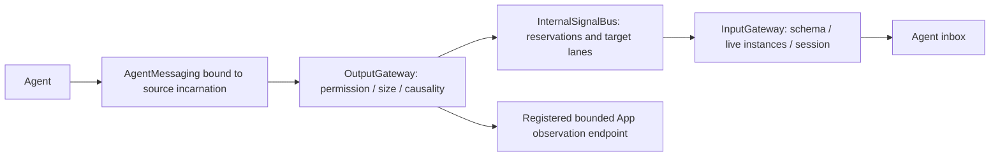
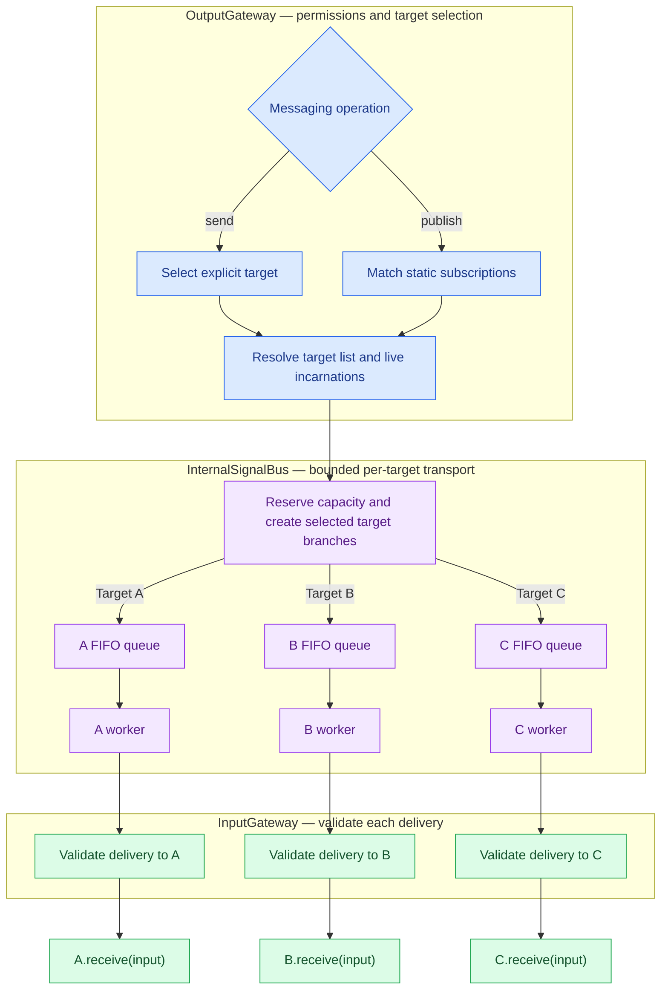

# Bus — bounded event communication

Purpose: share perception observations among independent Agents through both gateways. AgentCore owns contracts and transport state, never concrete Agents, models, UI or devices.

✅ Implemented: AgentMessaging bound ports, JSON v4 CommunicationPolicy, discrete events and latest-state delivery, per-recipient receipts, deadlines, identity/session fencing and bounded transport diagnostics.
❌ Request/reply, persistence, retries, dynamic subscriptions, remote transport, generic AgentContext supervision and robot channel takeover remain unimplemented. Historical request/reply designs are not executable behavior.

## Interfaces and flow

`AgentInput` is the single input envelope. PerceptionObservation is a typed payload (speech final/partial/phase or pose), not a third model output protocol. Actions and Tools retain the existing output stream; events use the bound port without XML parsing. Calling publish waits for inbox admission receipts, not execution. No ordering across Action and event paths is implied.

The App loads all four Agent JSON v4 resources into an immutable policy. Each declaration has inputs (contract/version/kind), subscriptions (contract/source/topic), publications (contract names), and sends (contract/target). Unknown keys, old versions, unknown sources/targets, incompatible input contracts and duplicate declarations fail validation. Sources/topics are exact names; there is no reflection or wildcard permission.

Direct sends do not require subscription but still require outbound permission and receiver input support. A configured but unavailable target produces a rejection. Zero recipients is an explicit error unless the OutputGateway has a registered App observer for that contract. The observer is the UI/status endpoint for speech.partial, speech.final and speech.phase; it does not create an implicit Agent subscription. It runs through OutputGateway validation and does not invoke model or device code.

## Target selection and per-Agent delivery

This diagram expands the internal Agent-to-Agent path. OutputGateway selects recipients before Bus admission: `send` selects one explicit target; `publish` matches static contract/source/topic subscriptions. Both then use the same transport and the same queue for each target.

A/B/C illustrate possible targets, not unconditional broadcast: a direct send creates one branch, and a publication creates branches only for its selected subscribers. Capacity reservation can reject the whole operation before any branch is enqueued. Workers progress independently after admission, subject to shared transport limits and explicit latest-state replacement rules.

The three validation boxes are calls to the same InputGateway instance, not separate gateways or queues. Each checks identity, session, contract, payload and deadline; it does not rematch subscriptions. Both routes reach the same Agent `receive` entry, which admits work into the Agent-owned inbox. Bus lanes are separate from those inboxes and from Action Channels. External inputs and ToolResult returns enter InputGateway directly and are outside this diagram.

For the corresponding direct path without Bus queues, see [external input admission and delivery](../../Gateway/Input/README.md#external-input-admission-and-delivery). The [communication framework](../../README.md#communication-framework) compares both paths.

## Admission and bounded scheduling

1. OutputGateway validates sender identity/session, contract/payload, outgoing policy and causal hop count. It issues an input ID/sequence and binds source incarnation; callers cannot select another source through that port. Child admission deadlines cannot outlive the parent.
2. Freeze recipients; unavailable registered endpoints become rejected branches. Atomically reserve transport count/bytes for live recipients.
3. Each target has a FIFO lane and one worker; different targets progress independently. A bounded delivery task races each admission against its monotonic deadline and joins cooperative cancellation.
4. InputGateway checks both live incarnations, session, payload and deadline; receiver `receive` only admits bounded work, never waits for model processing.
5. Receipt branches settle once. Complete operations release retained payloads. No automatic retry occurs.

| Resource | Limit / overflow |
| --- | --- |
| Registered Agents / active target workers | 64; reject |
| Topics / subscriptions per Agent / recipients | 64 / 16 / 16; reject configuration or operation |
| Open sessions | 256; reject, release on close |
| Live operations | 128 total, 16 per source; reject |
| Delivery branches | 256 total, 32 per target including active; reject whole new reservation |
| Payload | 16 KiB normally; pose 256 KiB; schema validation before transport |
| Retained branch payloads | 8 MiB, conservatively charged per recipient; reject |
| Discrete terminal records | At most 1024 including reserved live operations, 60-second retention; reject rather than evict |
| State sequence channels | 256 total, 32 per target; release on session closure |
| Causal hops / lifetime | 8; discrete default 10 s, hard max 60 s; pose 1 s, partial 2 s |

Latest-state key is `(target, source, source incarnation, session, contract)`. A new state replaces one queued predecessor in that lane, settles the predecessor as `superseded`, and increments replacement count. The active delivery is not replaced. State dedup uses the highest sequence in the channel, not a terminal record per frame. Reordered states fail. Discrete duplicates in the retention window are rejected; the implementation does not replay old receipts or promise exactly-once execution.

A full shared lane rejects even state replacement if its branch reservation cannot be made. Actions, tools, speech finals and phase transitions are never subjected to latest-state replacement. Only partial transcripts and pose observations are coalescible. App speech observers are awaited and retain only current UI state; there is no separate unbounded observer queue.

## Lifecycle and diagnostics

Stop invalidates source/destination identity before joining the Agent. Session closure first closes bus admission, settles queued branches and cancels/joins only active deliveries from that session; it does not wait for another session's active work. Shutdown cancels and joins all workers. Delivery endpoints must cooperate with cancellation; an endpoint ignoring cancellation can delay cleanup. This is not a hard-real-time transport.

Receipts describe admission only. Agent inboxes recheck expiry before processing. Expiry does not interrupt an already-started Assistant reply. Speech cleanup closes and joins perception first, then cancels Assistant and related Actions; camera cleanup remains independent. Completed physical effects cannot be rolled back.

Snapshot counters report operations, branches, retained bytes, state channels, discrete records and active sessions, plus replacement/expiry counters. No media or transcript payload is logged by transport. Tests cover high-rate states, latest replacement, directed permissions, stale ports, explicit partial failure, deadlines, slow receiver isolation and independent session closure.

Future ReflexAgent may consume observations, but it needs separate sampling guarantees, control arbitration and device-side protection. No signal implicitly transfers channel ownership or implements a robot safety function.
