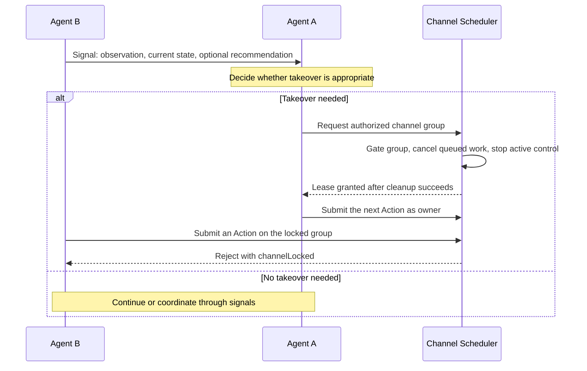
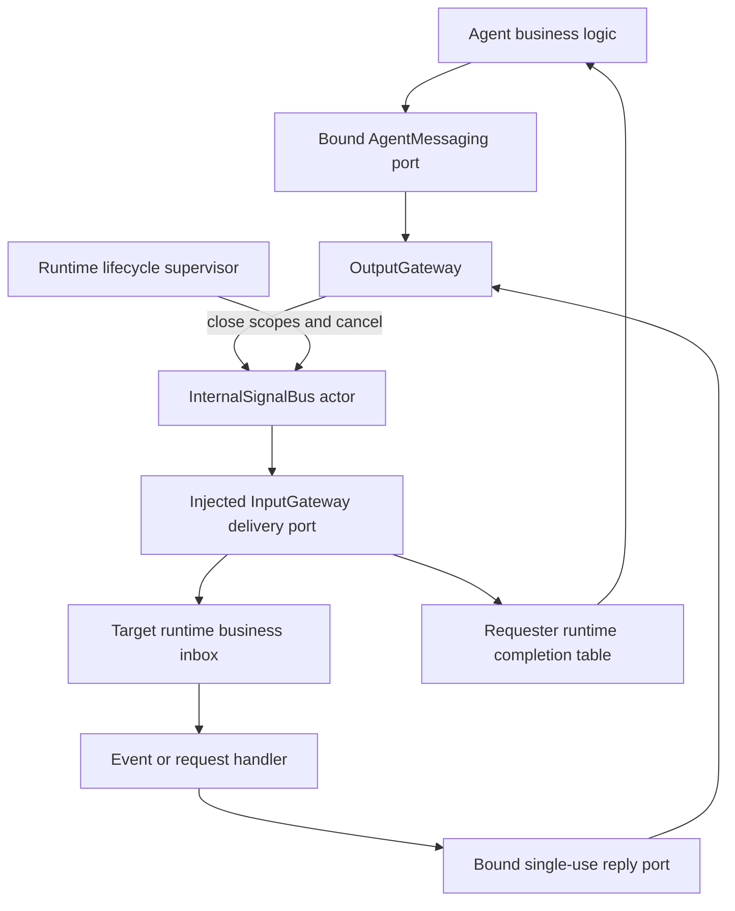
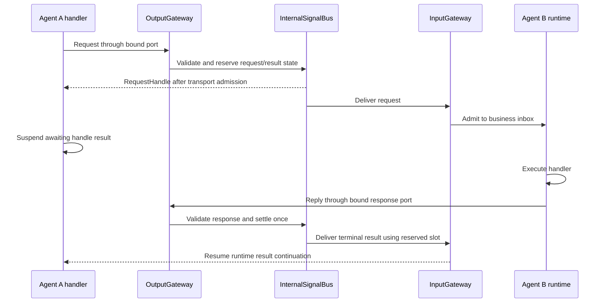
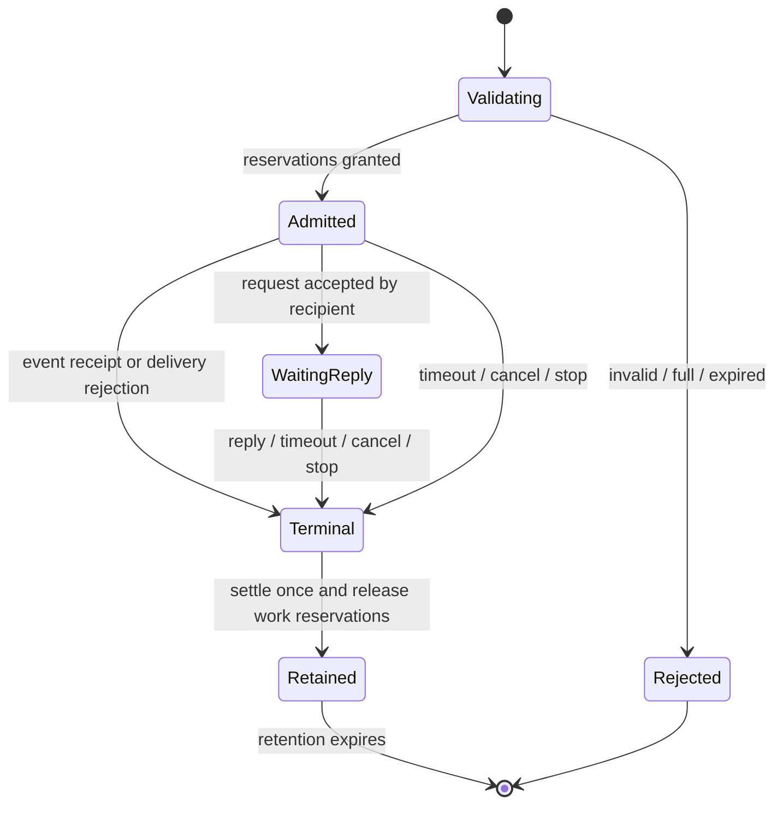

# Bus — Internal Agent Communication

Purpose: define process-local communication between independent Agents. Design goals: typed messages, explicit authorization, bounded producer/consumer flow, safe request correlation and cancellation, and no dependency from AgentCore to Gateway, ModelKit, UI or concrete Agents.

- ✅ Architecture, contracts, algorithms and acceptance criteria are documented here and in [technical design section 32](../../README.md#32-internal-agent-communication).
- ❌ All APIs and transport components described below are planned; this directory contains no implementation.
- ❌ Remote/durable messaging, exactly-once effects, automatic retries, dynamic subscriptions, priorities and streaming replies are outside the initial scope.

## Signals and Control Takeover

A signal shares information; it does not transfer channel ownership. Agent B reports a situation, Agent A decides whether to take control, and the runtime validates and executes that decision.

Arrows summarize logical communication: signals travel through OutputGateway → InternalSignalBus → InputGateway; lock requests and ActionCalls enter through OutputGateway, and control outcomes return through InputGateway. If takeover fails, A receives an explicit failure and must not act as owner.

| Participant | Responsibility |
| --- | --- |
| Agent B | Report observations and current state; optionally recommend intervention or request help |
| Agent A | Interpret the signal in context and decide whether to request takeover |
| Runtime | Check authority, resolve ownership conflicts, cancel old work and grant or reject the lease |

- B may request help, but cannot decide on A's behalf or grant A a lock.
- Receiving a signal does not require A to acquire a lock. Requesting a lock does not guarantee authorization or success.
- While A decides, B may continue working. If B cannot reliably continue, it may pause its own behavior and report that state.
- After takeover, B may still receive input; its conflicting ActionCalls fail explicitly. Notifications can reduce unnecessary production.
- Device emergencies use deterministic safety rules or hardware stop mechanisms; they do not wait for another Agent's model judgment.
- ✅ This interaction and its responsibilities are specified. ❌ Signal transport and lock enforcement remain unimplemented.

See [Channel Lock Design](../../Gateway/Output/Scheduling/README.md#channel-lock-design) for acquisition, cancellation and release. A successful lock stops old control; the owner separately chooses its next Action, such as `hold`.

## Inter-Agent Communication Design

### 1. Responsibilities and module boundaries

| Owner | Planned responsibility |
| --- | --- |
| AgentCore/Bus | Sendable internal message/receipt/error contracts, port protocols, InternalSignalBus actor, bounded transport state, request tracking and deduplication |
| AgentCore/Runtime and AgentContext | Bind ports to a trusted Agent incarnation and execution scope; own business inbox admission, request result endpoints, child work and lifecycle cleanup |
| AgentCore/Capability | Validate versioned communication declarations and immutable policy snapshots without importing concrete Agents |
| Agents/<Agent> | Declare allowed communications in JSON and implement event/request handlers; decide whether model inference is useful |
| Gateway/Output | Validate the bound sender and outbound policy; dispatch typed internal signals through the bus; no XML/alias parsing |
| Gateway/Input and Routing | Resolve recipient snapshots and check inbound policy, schema and live incarnation; deliver business work or settle runtime outcomes |
| App composition | Connect protocol implementations, register Agent incarnations/policy and supervise the bus independently of a particular page |
| Actions / ActionRuntime and Tools / ToolRuntime | Retain their respective execution protocols; communication is not another Action or Tool |

AgentCore defines a narrow delivery interface implemented by InputGateway and an outbound interface implemented by OutputGateway. The App injects them. InternalSignalBus never imports Gateway or fetches concrete Agents. Delivery endpoints expose bounded admission, completion and cancellation operations, not an unrestricted Agent reference.

Planned files in this directory are InternalSignal.swift (envelopes and payload contracts), AgentMessaging.swift (ports and handles), CommunicationPolicy.swift (validated policy), CommunicationError.swift, and InternalSignalBus.swift. Split request tracking into a separate file only if implementation size warrants it. Do not add unused stubs. Tests belong under root Tests; SwiftPM must exclude this README from the AgentCore target.

### 2. Relationship to Agent and model output

FunctionToken describes mixed natural text/XML; ActionCall is a resolved Action invocation; ToolCall is a resolved native tool invocation. InternalSignal is a separate runtime communication contract. It does not pass through FunctionTokenParser, ChannelScheduler or ToolExecutor. ModelKit and the two model generation protocols do not change.

Agent business code receives a bound AgentMessaging port through AgentContext. Its typed send/publish/request/reply operations all call OutputGateway. This is an explicit runtime output path rather than a third model-generated AgentOutput case. Existing ActionCall/ToolCall/control envelopes continue on their current output stream; free-form control strings are not communication messages. There is no ordering guarantee between the two paths unless business logic awaits the appropriate execution or delivery barrier before sending.

Model text must never be decoded directly into a trusted transport envelope. If model-assisted planning selects a request, Agent logic validates it against a typed domain operation and its communication policy. Receivers treat payload text as data, never as privileged system instructions or executable markup. An Agent's messaging port cannot impersonate another Agent or widen its declared permissions.

### 3. Envelope and payload contracts

These are proposed contracts, not existing Swift APIs:

| Field | Semantics |
| --- | --- |
| messageID | Runtime-issued UUID for this immutable envelope; replaying the same envelope does not allocate a new ID |
| kind | event, request, response, or runtime-generated terminal failure; cancellation is scoped control state |
| source | Trusted AgentID plus incarnationID from the bound port; runtime failures have an explicit runtime source |
| destination | Explicit AgentID/incarnation for requests/responses; one Agent or a validated topic for events |
| sessionID / scopeID | Correlation and lifetime scope issued by the runtime; unrelated scopes cannot be cancelled through this port |
| rootID / parentID | Causal chain identity; child requests/events inherit it from the active execution context |
| requestID | For responses, the original request's messageID; callers cannot choose another request to settle |
| contract | Stable domain name plus schema version, such as vision.personDetected v1 or vision.describeScene v1 |
| payload | Schema-validated JSON value, encoded at most 16 KiB, nesting at most 8; finite numeric values only |
| deadline | A ContinuousClock instant for this process, inherited/clamped by the scope; not a wall-clock string supplied by a model |
| hopCount / ancestry | Runtime-maintained chain budget and visited request-handler Agent incarnations |

Transport metadata is bounded to 2 KiB: contract/topic names at most 128 UTF-8 bytes, fixed UUID fields and at most eight ancestry entries. No arbitrary metadata dictionaries, closures, actors, native model objects or inline audio/image/video are allowed. Large media references require a separately designed lifetime/permission contract and are not accepted initially.

The initial request API has one final success payload or a typed failure with bounded code/message, not partial progress. Domain request declarations pair input and success-result schemas; failure payloads use the framework error contract. String payloads do not imply parameter casting. Schema validation belongs at both outbound and inbound boundaries.

### 4. Declaration and authorization

A future JSON schema version adds a communication section alongside actions/tools/channels/textActions. It declares: accepted events, handled request operations, allowed destinations for outgoing requests/events, publishable topics, static subscriptions, schema versions and local limits. Current JSON v3 rejects unknown fields and stays unchanged until this feature is implemented; the new version requires coordinated loader/config/tests migration.

App composition validates a closed registry of exact Agent IDs, contract/schema names and topic subscribers. Unknown references and incompatible request/result schemas fail startup; there is no wildcard permission or fallback registry. An empty communication declaration grants no send/receive permission.

OutputGateway checks source capability and scope. InputGateway checks target acceptance and schema. Topic routing intersects authorized subscribers with live registered endpoints, while retaining unavailable configured subscribers as explicit failed deliveries in the receipt. Replies require a single-use response capability bound to requestID, caller, callee, schema, scope and deadline. They are authorized by the request, not by arbitrary publish permission. Requests cannot delegate their reply capability to another Agent.

### 5. Event routing and admission algorithm

Events target one Agent or one statically configured topic; requests always target one Agent. One topic expansion has at most 16 recipients. SignalRouter deduplicates IDs and freezes the recipient/policy snapshot before bus admission. A later policy/lifecycle change does not silently substitute another receiver. Topic configurations exceeding 16 subscribers fail startup validation.

1. OutputGateway validates the bound sender, scope, payload size/schema and outbound permission against immutable in-memory policy. The outbound port bounds concurrent admission attempts to 16 per source; excess calls fail before creating routing tasks.
2. Obtain the bounded recipient snapshot through the injected routing port. A topic with no receivers returns noRecipients explicitly; it is not silent success.
3. The bus actor checks deadline, hop budget, duplicate identity and all global/sender capacity limits. Reserve delivery entries and bytes for the entire fan-out before returning an accepted operation handle. If reservation fails, reject without partial bus admission.
4. Append delivery references to target lanes. One worker per destination awaits InputGateway admission; different destinations can progress concurrently. These workers do not await business execution.
5. InputGateway atomically validates the incarnation/scope and accepts into the target runtime inbox, or rejects with an explicit reason. Inbox full fails immediately; no task waits for a future slot.
6. Settle each delivery once. An event receipt lists each receiver's accepted/rejected result. Accepted means business inbox admission, not handler completion. Once all branches settle, complete the receipt and release transit reservations.

Bus reservation is atomic only within the bus actor. Multi-target inbox admission is best-effort: some targets may accept while another rejects. Receipt failure never rolls back accepted work. No retries or automatic publication on subscriber recovery occur. Resubmission with a new ID is new work and may repeat side effects.

Delivery FIFO is guaranteed per source-incarnation/destination lane at inbox admission, following the order that sends reach the bus. Concurrent callers have no pre-existing order. Cross-sender fairness uses round-robin selection among active source lanes for a destination; a full destination is rejected rather than holding its lane indefinitely. There is no global ordering, and handler completion may differ from admission order under future handler concurrency. The initial business runtime consumes one input at a time.

### 6. Request/reply algorithm and deadlock prevention

A request first reserves a pending-request entry and a bounded result slot in the requester's runtime. It returns a RequestHandle after bus admission; `await result()` is a separate, single-consumer operation. The handle may be awaited once or cancelled. Dropping it requests cancellation; deadline/scope cleanup remains the authoritative bound if the caller forgets to release it.

Replies and transport failures enter InputGateway's runtime completion endpoint, not the Agent business inbox. They only validate and settle a reserved slot; they never run model inference or arbitrary business handlers on that path. A paused Agent can receive completion for an already active request. Its awaiting handler resumes under ordinary runtime lifecycle/cancellation rules. A stopped Agent's endpoint cancels/consumes outstanding results without restarting it.

This avoids a reply waiting behind the handler that is awaiting it. It does not alone prevent nested business-request cycles: the runtime rejects a nested request targeting any Agent incarnation already in its causal request ancestry, including self-request. A→B→C is allowed within the hop budget; C→A and B→B are rejected as cycleDetected. If an unrelated root requires a currently busy Agent, it may wait in the bounded business inbox until its deadline; liveness is bounded by timeout, not guaranteed progress.

A callee handler must produce exactly one terminal success or domain failure through its response capability. If it returns without replying, the runtime synthesizes missingReply. If it throws, the runtime sends a sanitized handlerFailed result; it does not leak private logs or stack data. Attempts to reply twice receive alreadyCompleted. A response is accepted only from the bound callee incarnation, before the effective deadline and while the request is pending. Unknown, stale or late replies are rejected, recorded and released, never treated as a new event.

### 7. Capacity and overflow policy

Initial implementation defaults below are design limits, not existing runtime settings. All admission paths reserve before spawning worker tasks. Lower per-Agent limits may be configured; raising hard caps requires a reviewed contract change.

| Resource | Bound | Full behavior |
| --- | --- | --- |
| Registered Agent incarnations | 64 | Reject registration |
| Topics / subscriptions per Agent | 64 topics / 16 subscriptions | Fail policy validation |
| Recipients per event | 16 | Reject before any bus reservation |
| Live event/request operations | 128 globally, 16 per source | Reject new operation |
| Queued/in-admission delivery branches | 256 globally, 32 per destination | Reject whole new bus operation |
| Business inbox | 32 waiting inputs per Agent, excluding one active handler; shared with other input kinds | Reject that recipient delivery |
| Pending requests and reserved results | 128 globally, 8 per requester | Reject request before delivery |
| Message payload / metadata | 16 KiB / 2 KiB | Reject before admission |
| Retained transport payload budget | 8 MiB across queued branches, request/result slots and receipt data | Reject before allocation; charge fan-out conservatively per branch |
| Terminal deduplication records | 1024 across live plus reserved terminal records | Reject new operation if a terminal record cannot be reserved |
| Active communication execution scopes | 256 globally, including running event/request handlers and their suspended parents | Reject recipient work before admission |
| Causal depth | 8 hops | Reject hopLimitExceeded |
| Lifetime | Default 10 s, hard maximum 60 s; child deadline no later than parent | Reject expired admission; cancel on expiry |

Result slots count against both pending-request and byte budgets even while empty. They hold at most one terminal response, using the same payload limit. An unconsumed completed handle retains its slot only until its effective deadline, then releases payload while preserving a compact outcome marker for that handle; the registry removes it. Awaiting an unconsumed result after its payload retention expires returns resultUnavailable; it does not rewrite the request's recorded terminal outcome. Long-lived handles cannot retain bus payload memory indefinitely. Receipts are bounded by 16 receivers and the same operation deadline.

Terminal deduplication records retain IDs and compact admission/terminal status, not response bodies, for 60 s after terminalization. Each live operation reserves its eventual record, so completion cannot overflow the table. Expired records are pruned before admission; unexpired records are never evicted to admit more work. Active records cannot be evicted. Deduplication stores a bounded fingerprint of the immutable envelope; the same ID with different routing or payload is rejected as messageConflict. Replaying a duplicate returns known admission/terminal status, not a promise to replay a consumed result payload. This is deduplication within a documented process/window, not exactly-once execution.

At most 64 target delivery workers exist. They use round-robin source lanes and a bounded number of in-flight delivery attempts already counted in the branch limit. A single bus deadline coordinator owns bounded timer state (at most one timer entry per live operation/result retention, maximum 256) and sleeps until the nearest expiry. Target runtimes separately enforce accepted execution-scope deadlines, with at most 256 scope timer records globally, even after an event receipt has completed. No task-per-retry, unbounded stream, unbounded detached callback accumulation or wait-for-capacity queue is allowed.

Cancellation/stop are idempotent flags on existing operation/scope records, not normal messages requiring another inbox slot. Terminal replies consume pre-reserved result slots and do not compete for ordinary event capacity. InputGateway completion/cancellation endpoints must perform bounded runtime bookkeeping and be independently serviceable while a business handler is suspended.

### 8. State transitions, failure and delivery guarantees

Each request has exactly one observable terminal state within this process. A bus-serialized transition checks effective deadline and pending status before committing; duplicate terminal transitions lose. At/after deadline, timeout wins even if the timer task runs late. Cancellation and response races use the first valid committed transition before deadline. No state transition across an await is assumed atomic: reservation tokens and incarnation/scope checks are revalidated after every external admission callback.

InputGateway target runtime owns the definitive per-delivery inbox-admission record keyed by messageID plus destination incarnation. Its admission operation checks the bus permit/deadline and updates inbox/dedup state together without suspending. The bus propagates the same permit on any repeated callback; it does not invent a second delivery. The target deduplication/admission table is bounded to 64 live-plus-retained records per incarnation and 1024 across all targets, with 60 s terminal retention; it reserves records before accepting an input and rejects rather than evicting unexpired entries. Lifecycle close invalidates admission permits before cleanup. Acceptance racing cancellation may mean work was already admitted: cancellation removes waiting work or cooperatively stops active work, without claiming it never ran.

There is no automatic resend after ambiguous failure. A request reports deliveryUnknown when admission cannot be established; callers must not infer that side effects did not occur. On process crash all in-memory state is lost; no delivery or reply survives restart and nothing is replayed. Runtime-owned work must use cancellation-aware effects; physical actions still require their own independent safety guarantees.

Typed failures include unauthorized, unsupportedContract, invalidPayload, unknownTarget, unavailableTarget, noRecipients, capacityExceeded, expired, cancelled, scopeClosed, staleIncarnation, cycleDetected, hopLimitExceeded, deliveryUnknown, handlerFailed, missingReply alreadyCompleted, messageConflict and resultUnavailable. Fan-out receipts carry failures per target. Error codes must not be converted into ordinary conversation text unless the Agent's business handler chooses to do so.

### 9. Lifecycle, causality and cancellation

AgentManager assigns a fresh incarnationID when creating/registering a new runtime instance; pause/resume preserves that identity. Stop first closes outbound ports and inbound admission, then settles/cancels outstanding operations and joins target handlers and their Action work. Only after cleanup may a replacement incarnation receive traffic. Messages to an old incarnation are rejected, never retargeted implicitly.

Pausing halts dequeue of new business inputs; it may still admit bounded queued events/requests, subject to deadline and policy. Active handlers and reply/timeout/cancel bookkeeping continue. Stop is terminal. Each message scope is owned by the runtime; a sender can cancel only its own operation or authorized descendant scope, not an arbitrary Agent/session.

Nested requests and derived events inherit a causal root, increment hops and clamp their deadline. A runtime handler receives a bound child scope; generated work cannot silently reset ancestry or start a new root to bypass loop limits. Only authorized top-level runtime inputs create independent roots. Event loops are bounded by hop/deadline even though events do not await replies.

Request cancellation propagates to descendant requests and removes queued target input or cancels its active handler. That handler's execution context links to its own Agent/input Action barrier, so cancellation targets its Actions without cancelling unrelated inputs sharing the conversation. Session closure cancels all owned scopes; this is broader than cancellation of one request. A callee's reply capability becomes invalid when the request ends. Already executed Actions are not rolled back.

Bus shutdown closes admission, invalidates ports, settles handles, cancels delivery workers and joins them, then releases tables. A handler ignoring cooperative cancellation can delay shutdown; the supervisor reports this explicitly rather than releasing physical-resource reservations while effects still run. The bus is not an iOS background-execution guarantee.

### 10. Observability and acceptance

Diagnostics record IDs, Agent incarnations, contract/version, target, queue depth, payload byte count, admission/processing latency and terminal error code. Payload text/media is excluded from default logs. Record partial fan-out, rejection counts, timeouts, late replies and dedup hits. Expose bounded counters/snapshots instead of an unbounded audit stream.

Required tests before enabling a second communicating Agent:

- Direct event/request delivery, schema/permission rejection, exact source/incarnation binding and two Agents without implementation dependencies.
- Per-lane FIFO, cross-target progress and round-robin source selection; no assumed global completion order.
- All count/byte limits, atomic bus fan-out reservation and partial inbox rejection; no silently lost accepted branch.
- Request result delivery while the requester handler awaits, its inbox is full or its runtime is paused.
- Missing/double/wrong-sender replies, self/cyclic nested requests, child deadline clamping and bounded event loops.
- Deadline/reply/cancel races using an injected monotonic clock; exactly one terminal outcome and no leaked slots/timers.
- Stop/session closure during admission/handling, stale-incarnation rejection, cooperative Action cancellation and unrelated-input isolation.
- Duplicate envelope/delivery admission within retention, admission failure when retention capacity is full, expiry behavior and absence of automatic replay after restart.
- Abandoned/completed handles and receipts release large payloads by deadline; shutdown joins worker work and reports non-cooperative handlers honestly.

### 11. Implementation stages

1. Define contracts, immutable policies, byte/count budgets and an injected clock; add deterministic test endpoints and schema-version tests.
2. Implement bounded bus event delivery through injected Gateway ports with receipts, deduplication and lifecycle admission tokens.
3. Add request tracking, reserved result endpoints, reply capabilities, deadlines, cycle checks and cancellation propagation.
4. Integrate supervised AgentContext/runtime ports and the coordinated JSON schema version. Connect two minimal real business handlers through App composition only when required by a product feature.
5. Complete stress/lifecycle tests and update every affected module README before enabling production communication.

No stage may introduce an AgentCore dependency on Gateway or executable placeholder handlers. Preserve the distinction between documented design ✅ and implemented transport ❌ until executable behavior and its tests are delivered.

✅ Event migration stage 1: JSON v4 communication declarations, typed perception inputs, static subscription/direct delivery, bounded event transport and incarnation fencing. ❌ Production perception agents and shared App composition follow in subsequent stages.
