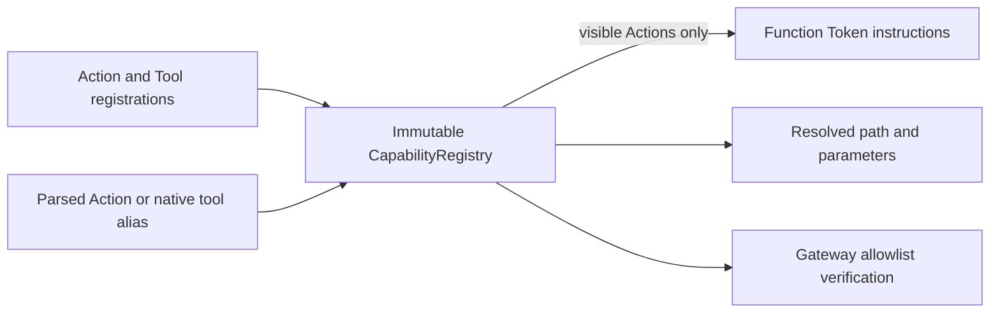
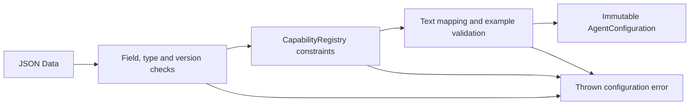

# Capability — Agent-local Registrations

Purpose: resolve model-facing aliases into explicit execution paths. Each Agent owns an independent immutable registry; Actions and Tools share one alias namespace, with no duplicate names or injected executable handlers.

- ✅ ActionRegistration: alias, ActionPath, default channel and required/optional string parameters.
- ✅ ToolRegistration: alias, explicit toolPath and string-argument contract.
- ✅ CapabilityRegistry: registration validation, parameter-name validation, effective-channel resolution and resolved-call allowlist checks.
- ✅ CapabilityContextBuilder: instructions generated from visible Action metadata, without handler or reflection paths.
- ✅ At most 128 capabilities and 16 available channels per Agent; at most 32 parameters per call and 4096 UTF-8 bytes per value.
- ❌ Full JSON Schema, numeric range validation, platform permissions, dynamic registration versions and resource budgets. Actual adapters remain responsible for platform permission checks.

Default channels are registration metadata. When natural text maps to multiple Actions, each uses its own default unless an explicit scope overrides it. Alias resolution remains inside the Agent. ActionPath identifies the actual module/function rather than its model-facing alias.

## Versioned configuration algorithm

AgentConfiguration accepts bounded Foundation Data, not Bundle or application dependencies. JSON v3 input is limited to 64 KiB. It rejects missing/unknown fields, invalid types/versions, duplicate arrays, required/optional overlap and invalid text mappings. Resource discovery belongs to Agents/AgentConfigurations. Tests use this same validation path; production Agents must not add hardcoded registration fallbacks.

The loader parses XML/text Action examples using FunctionTokenParser, then resolves them against the registry. This validates syntax and call structure, not execution-time value constraints. See the canonical [Function Token definition](../Generation/README.md#terminology) and [Agent configuration standard](../../Agents/README.md).

✅ JSON v3 uses doc for usage guidance, XML strings for Action examples, native JSON strings for Tool examples, and hidden with a default of false. Only visible Action declarations/docs/examples enter system context. Hidden registrations and automatic text mappings remain functional.

✅ Tools remain registered and resolvable independently; their aliases, parameter guidance, docs and examples never enter CapabilityContextBuilder output, regardless of hidden.

❌ Provider-native tool schema transport remains unimplemented.

Update this README when changing files, validation or configuration semantics. ✅ means implemented; ❌ means outstanding. The target architecture is MobileHarness/README.md.

✅ resolveAction returns ActionCall; resolved-call validation checks its ActionPath, effective channel and parameter names against the Agent registry.
