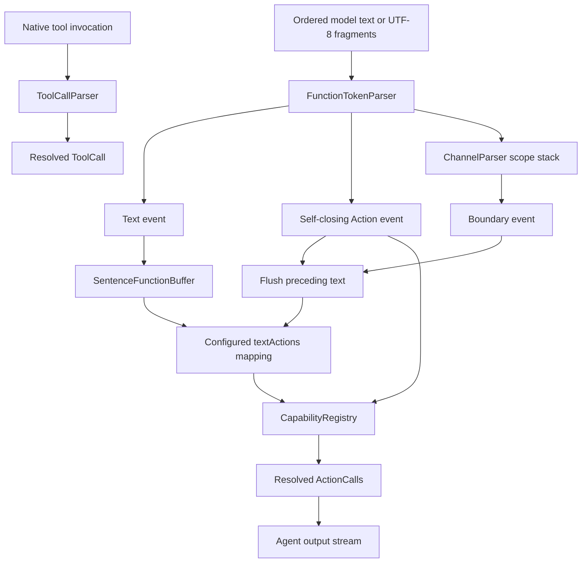

# Generation — Function Token and Tool Call Protocols

Purpose: share incremental Agent-output parsing across Agents without depending on model SDKs, UI or executable Actions. Raw model text, XML and unresolved aliases stay inside the Agent boundary. This README is the canonical definition of the Function Token protocol and its parser terminology.

## Terminology

| Term | Definition |
| --- | --- |
| Function Token protocol | A mixed stream of natural text characters and restricted XML syntax. Text is a first-class part of the protocol, not content outside it. A document root is not required. |
| FunctionToken | An internal parsed event: `.text`, `.action` or `.boundary`. It is not a model tokenizer token, a network fragment or necessarily one character. |
| FunctionTokenParser | Incrementally decodes UTF-8 and parses text, self-closing Action tags and paired Channel tags. It neither binds capabilities nor executes Actions. |
| Action | A registered executable behavior, such as `Speech.speak` or `UI.express`. Its implementation owns parameter/value validation and behavior. |
| ActionCall | One resolved Action invocation: ActionPath, string parameters and effective channel. It is distinct from raw FunctionToken events and model-native ToolCall invocations. |
| ToolCall | A separate native tool invocation resolved by ToolCallParser. It does not pass through XML parsing or Channel action queues. |

A model tokenizer may split one XML tag across many model tokens. Conversely, one received text fragment may contain several protocol events. Parsing handles arbitrary UTF-8 byte boundaries; `.text` event boundaries can depend on fragment delivery. SentenceFunctionBuffer subsequently forms text chunks for Action mapping. Do not assume one character, one model token, one parsed event and one Action call correspond one-to-one.

## Syntax and meaning

The protocol has three forms:

1. **Natural text**, such as `Hello.`: parsed as text and later mapped through the Agent's configured textActions. Assistant maps each accepted text chunk to say and print.
2. **Self-closing XML Action tags**, such as `<express emotion="happy"/>`: parsed as an alias plus string attributes. AgentGenerator resolves the alias to a registered ActionPath.
3. **Paired XML Channel tags**, such as `<channel.main>...</channel.main>`: control the channel scope for enclosed text and Actions. They emit boundary events but are not executable Actions.

```xml
Hello.
<channel.main>
  <express emotion="happy"/>
  Good news!
  <channel.Display><express emotion="thinking"/></channel.Display>
  Back in main.
</channel.main>
Back to each Action's default channel.
```

All Action tags must be self-closing; `<say>Hello</say>` is invalid. Channel tags accept neither attributes nor self-closing syntax. Closing an inner channel restores its parent; closing the outermost channel restores a nil scope, which capability resolution replaces with each Action's default channel. `main` has no special global-blocking meaning in the current scheduler.

An Action is emitted as soon as its complete tag arrives, without waiting for channel closure. Action and channel boundaries first flush preceding text, preventing sentences from crossing scopes. Explicit speech calls do not automatically duplicate into display calls; only natural text uses textActions mapping. Hidden Actions remain registered but are omitted from model-facing instructions.

Literal `<` and `&` in text must be escaped as `&lt;` and `&amp;`. Attribute values must be quoted; single and double quotes, five predefined XML entities and valid numeric XML character references are supported. Escaped markup stays text and is not parsed a second time. Tool results and demonstration text use `escapeText` before entering this protocol. Comments, DOCTYPE, CDATA, processing instructions and non-self-closing Actions are rejected. This is a restricted XML syntax, not a general XML document parser.

## Algorithm and data flow

Each generation owns one parser, one bounded channel stack and one sentence buffer. The Agent supplies fragments in order and synchronously consumes returned calls; there is no async mailbox in this module.

1. Incrementally decode UTF-8 and retain only incomplete byte/entity/tag state and pending text.
2. Parse completed tags; update ChannelParser scopes and emit text, Action or boundary events in order.
3. AgentGenerator accumulates text in SentenceFunctionBuffer. At sentence or protocol boundaries, flush text and resolve the configured text-action aliases.
4. Resolve explicit Action aliases and parameters through CapabilityRegistry. Return ordered ActionCalls to the Agent for its bounded output stream.
5. On normal termination, call `finish` to flush valid remaining text and reject incomplete syntax. On cancellation, discard state instead of flushing partial output.



For `<express emotion="happy"/> Hello.`, Assistant produces an expression call to `UI.express`, then text calls to `Speech.speak` and `UI.print`. Outside a channel scope those calls use their respective defaults. This illustrates why text is a Function Token even when it contains no XML.

## Bounds, completion and failure

| State or operation | Current bound |
| --- | --- |
| Input per generation | 65,536 UTF-8 bytes |
| One XML tag | 4096 UTF-8 bytes |
| Tags per generation | 1024 |
| Nested channels | 8 |
| Attributes per tag | 32 |
| Sentence text buffer | 2000 UTF-8 bytes |
| Resolved calls per generation | 120, within the Agent's 128-envelope output buffer |
| Complete native tool argument JSON | 4096 UTF-8 bytes; string values only |

Errors and limits terminate that parser/generator instance; it cannot be reused. Finish rejects incomplete UTF-8, entities, tags and unclosed channels. Unknown entities, mismatched closing tags, duplicate attributes, invalid UTF-8, unknown capabilities and invalid parameters fail explicitly.

Failure cannot roll back Actions already emitted and executed. If one append throws, its local result is not returned; the Agent reports failure and Gateway cancels remaining work for that input. Invalid streams may have different already-executed prefixes under different fragmentation. There is no automatic retry or persistent replay.

## Implementation status

- ✅ FunctionTokenParser.swift: incremental mixed text/XML protocol parser.
- ✅ FunctionToken.swift: text, Action and scope-boundary events plus generation errors.
- ✅ ChannelParser.swift: bounded nesting and scope restoration.
- ✅ AgentGenerator.swift: alias binding, effective channels and configured text mappings.
- ✅ SentenceFunctionBuffer.swift: progressive multilingual sentence segmentation, including punctuation, quotes, decimals and abbreviations.
- ✅ ToolCallParser.swift: complete native tool arguments and registered capability resolution.
- ❌ Incremental native tool-argument assembly and full JSON Schema. ChatEvent currently exposes text/completion only; the existing /status tool route remains separate.

Update this README when changing syntax, names, bounds, ordering or completion/cancellation behavior.

✅ AgentGenerator now supports an empty textActions list for Action-only Agents such as Photographer. Explicit self-closing calls and Channel scopes still use the shared parser; non-whitespace natural text without a mapping fails explicitly rather than being discarded. Assistant still requires nonempty text mappings at its own configuration boundary.
