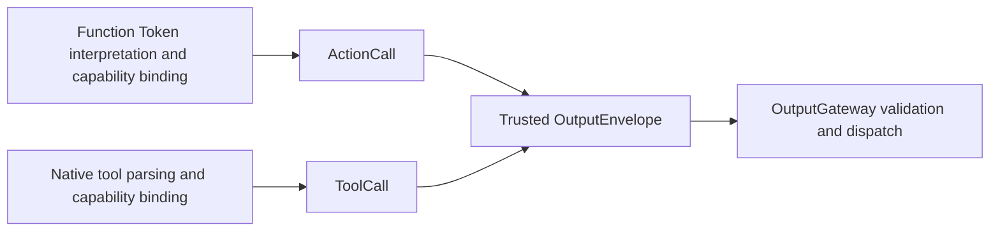

# Output — Resolved Calls and Runtime Notifications

Purpose: define executable values at the Agent boundary. ActionCall and ToolCall are resolved invocation types; raw text and unresolved FunctionToken events remain inside the Agent. The Function Token protocol produces ActionCalls, while the native tool protocol produces ToolCalls.

- ✅ `ActionCall`: ActionPath, effective channel and string parameters. Handlers receive an explicit module/function path, not a model alias.
- ✅ `ToolCall`: call UUID, toolPath and parameters; ToolResult preserves callID.
- ✅ `OutputEnvelope`: trusted source, inputID and sessionID association. The model cannot supply source identity.
- ✅ `AgentOutput.actionCall` and `.toolCall` carry these respective values; `OutputKind.actionCall` and `.toolCall` classify them.
- ✅ `.control` carries runtime completion/error notifications and supports cancellation/playback barriers. It is not a model generation protocol.
- ❌ Separate typed runtime events, ActionResult/Signal feedback, public ActionCall invocation IDs, priorities and deadlines.

ActionCall is a value type correlated with input through OutputEnvelope. ChannelScheduler allocates an internal UUID per admitted job; cross-process idempotent replay is not provided. ToolResult is shared by input/output contracts without introducing a dependency on ToolRuntime.

See [Generation](../Generation/README.md) for protocol definitions. Keep names, fields, implemented ✅ and outstanding ❌ behavior synchronized with code.
