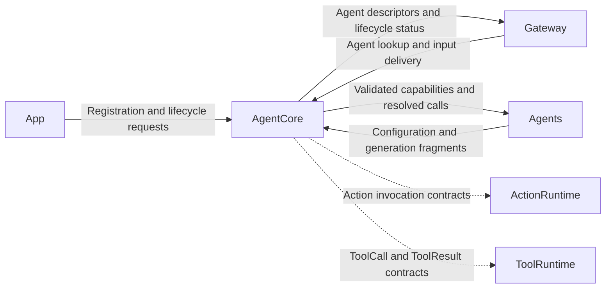

# AgentCore — Shared Agent Contracts and Infrastructure

AgentCore provides reusable Agent identity, lifecycle, capability registration, output interpretation, and input/output contracts. Architecture sections 6–24 and 32 describe its target responsibilities. Concrete business policies belong to Agents.

## Boundaries

AgentCore depends only on the standard library and Foundation. It must not depend on UI, concrete Agents, Actions, Gateway, ModelKit, or device adapters. Parsers are shared infrastructure; each generation owns its own mutable parsing state.

## Direct relationships

AgentCore is a foundation rather than a separate processing hop. These edges show the contracts and services its direct consumers use; they are not reverse compile-time dependencies.

## Implementation status

- ✅ Root contracts: `Agent`, `AgentDescriptor`, `AgentInput`, `AgentID`, input kinds, and shared errors.
- ✅ [Runtime](Runtime/README.md): AgentManager, bounded AgentRegistry, AgentLifecycle, and AgentStatus.
- ✅ [Capability](Capability/README.md): versioned configuration validation, local aliases, ActionPath, parameter rules, default Channels, and model-facing capability context.
- ✅ [Generation](Generation/README.md): streaming FunctionTokenParser, ChannelParser, text-to-action mapping, sentence buffering, and complete native ToolCall parsing.
- ✅ [Output](Output/README.md): ActionCall, ToolCall, ToolResult, AgentOutput, and trusted OutputEnvelope association.
- ✅ [Bus communication design](Bus/README.md#inter-agent-communication-design): typed internal signals, Gateway ports, bounded transport, request/reply and lifecycle semantics; documentation only.
- ❌ Generic AgentRuntime worker/mailbox container, AgentContext, StateStore, and InternalSignalBus. Assistant currently owns its bounded state and worker.
- ❌ Unified Signal inputs and incremental native tool-call argument assembly.

`AgentInput` and `ToolResult` remain shared contracts here to prevent circular dependencies. Root Package.swift compiles these sources directly; there is no duplicate Contracts/Protocol source tree. Runtime notifications remain separate in meaning from the two model output protocols.

## Maintenance

Keep this README synchronized with changes to responsibilities, files, interfaces, and implementation status. ✅ means implemented; ❌ means planned or incomplete. Do not create unused placeholder modules. The [technical architecture](../README.md) defines the target; the [layout audit](../../docs/Repository-Structure.md) records implementation exceptions.

✅ ImageInput adds bounded upright RGB8 media transport (640 pixels per side), capture sequence/time and sensor rotation, independent of ModelKit/PlatformKit. PoseOverlay defines compact UI Action data and inverse sensor-coordinate mapping.

✅ ImageInput now supports either bounded RGB or a 64×64 gray sample plus opaque Sendable ImageAttachment. AgentCore still imports neither ModelKit nor CoreVideo; App supplies the attachment resolver. Native inputs are bounded to 4 MP / 4096 per side.

✅ Event migration stage 1: JSON v4 communication declarations, typed perception inputs, static subscription/direct delivery, bounded event transport and incarnation fencing. ❌ Production perception agents and shared App composition follow in subsequent stages.
