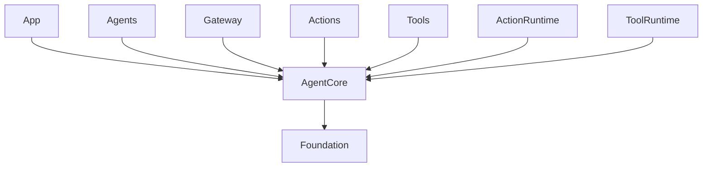
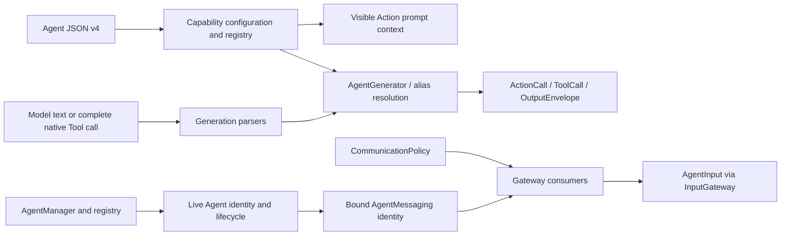

# AgentCore — Shared Agent Contracts

Defines Agent identity, input/output, lifecycle, configuration, parsing and communication contracts. The goal is reusable infrastructure without business policy. It depends on Foundation and the Swift standard library, never UI, concrete Agents, model engines or device adapters.

## Directory structure

```text
AgentCore/
├── Agent.swift, AgentDescriptor.swift, AgentID.swift  # Agent interface and identity
├── AgentInput.swift, ImageInput.swift, InputKind.swift # Input and media transport
├── HarnessError.swift                               # Shared errors
├── Runtime/                                         # Registry, manager and lifecycle
├── Capability/                                      # JSON v4 validation and local permissions
├── Generation/                                      # Shared parsers and text-to-Action mapping
├── Output/                                          # Resolved calls, results and trusted context
├── Communication/                                   # Typed inputs, messaging contracts and policy
└── README.md                                        # Module boundary and status
```

## Upstream and downstream

Arrows mean compile-time dependency on shared contracts; AgentCore does not import its consumers.



## Internal structure and data flow



AgentInput separates payload from source, session, turn and timing metadata. ToolResult stays here to avoid a circular runtime dependency. Agents own parser instances and resolve aliases before output leaves them. Native Tool calls are separate from text/XML Function Tokens.

Runtime tracks Agents; it is not a generic mailbox worker. Business Agents own their inboxes and state. Gateways bound active direct calls without lanes or workers. Deadlines are freshness checks before receive; caller cancellation propagates through structured calls. Agent-owned buffers decide state replacement, ordering and accepted-work cleanup. Receipts confirm admission only.

Detailed bounds and algorithms belong to [Runtime](Runtime/README.md), [Capability](Capability/README.md), [Generation](Generation/README.md), [Output](Output/README.md) and [Communication](Communication/README.md).

## Feature status

- ✅ Agent contracts, bounded registration, lifecycle and source/session identity.
- ✅ JSON v4 permissions, Action prompt context, shared parsing and resolved output.
- ✅ Typed events, static communication policy, deadlines and bounded event delivery.
- ❌ Generic AgentRuntime, AgentContext, StateStore and request/reply endpoints.
- ❌ Incremental native Tool argument assembly and durable event delivery.

## Issue record

| Status | Issue / next step |
| --- | --- |
| Open | Request/reply needs a bounded completion path that cannot block behind its requester. |
| Open | Non-cooperative receivers can delay cancellation; transport is not a real-time safety system. |


✅ Communication now includes generic AgentMessage with bounded synthesis requests and cancellation IDs; it contains no PCM cache, model or playback implementation. ❌ Persistent message delivery remains unsupported.


✅ GenerationEvent preserves resolved Actions and typed wait boundaries. The shared lexical stack handles combined Channel/wait nesting; SchedulingDirective crosses the trusted output boundary without introducing runtime, UI or model dependencies. ❌ Execution policy remains in Gateway, not AgentCore.
