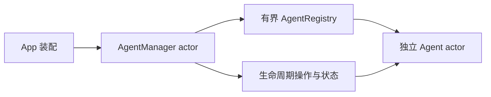

# Runtime · Agent 注册与生命周期

用途：管理独立 Agent 实例。设计目标：通用基础层不引用具体 Agent，业务状态与运行状态分离。

- ✅ AgentManager actor：注册、查找、描述符列表、start/pause/resume/stop/stopAll。
- ✅ AgentRegistry：Manager 隔离下的值类型目录，拒绝重复 ID，最多 64 个 Agent，满时明确 queueFull。
- ✅ AgentLifecycle/AgentStatus：registered/running/paused/stopped/failed 与排队/处理数。
- ❌ factory、restart、健康监督、通用 AgentRuntime、独立 StateStore 和恢复；仍由具体 Agent 持有 worker/mailbox。

stop 仍是现有 Agent 的终态，恢复需新实例；pause 只阻止领取下一输入，进行中的生成允许完成。

维护：修改本目录代码、文件或子目录时同步 README；✅ 已实现，❌ 未实现。设计以 MobileHarness/README.md 为目标，历史决策见 ADR 0018。

✅ 生命周期枚举与文件名统一为 AgentLifecycle / AgentLifecycle.swift。
