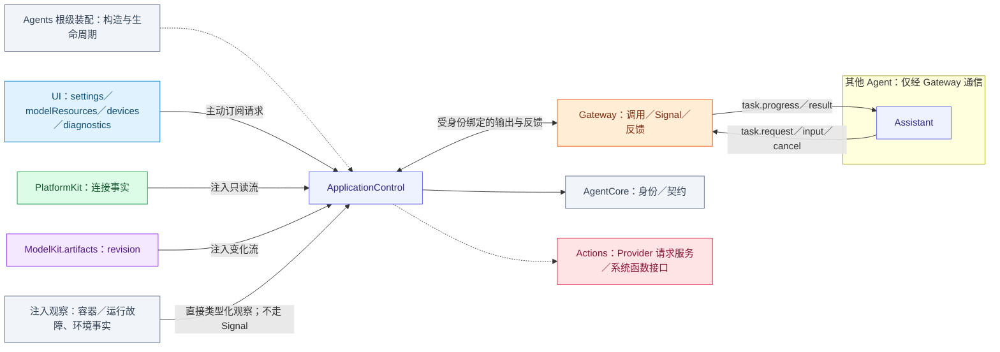
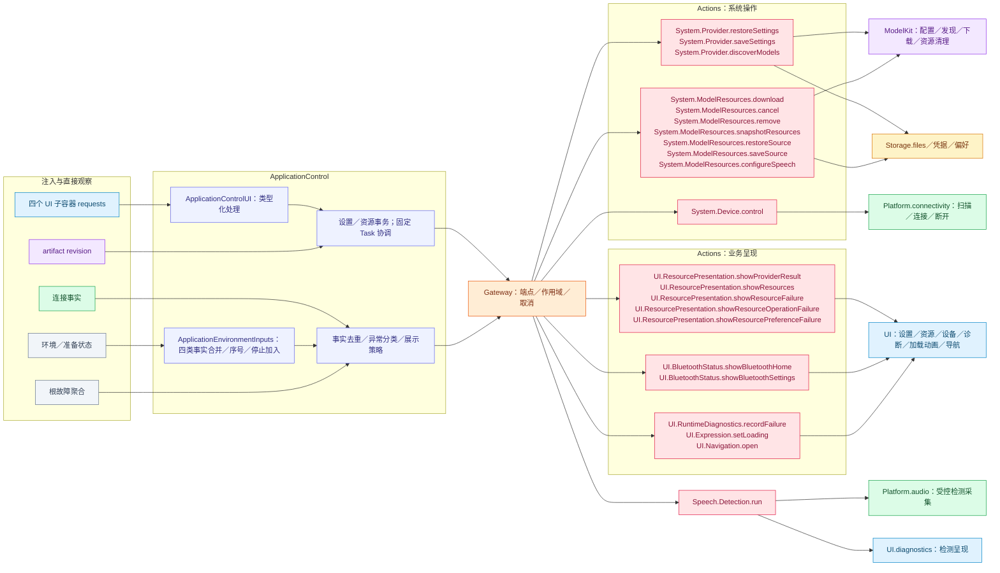

# ApplicationControl — 设置、资源、设备与故障策略

## 角色容器

[ApplicationControlContainer.swift](ApplicationControlContainer.swift) 是 AgentContainer 的稳定子能力。持有角色执行会话、设置／资源／设备工作流、环境事实 worker 和观察生命周期。停止先加入环境 worker，再清理角色；Provider 事务和原生执行仍归 Actions。

生命周期由[模块根](../README.md#agent-container)统一编排；子容器能力不授予执行权。

## 职责与注入能力

本角色执行确定性政策与事务关联，不运行 Chat。构造注入 `UISettingsContainer`、`UIModelResourcesContainer`、`UIDeviceSettingsContainer`、`UIDiagnosticsContainer`，主动订阅各自类型化请求。另注入连接事实流、ModelKit artifact revision 观察回调、Provider 私有请求／结果能力、观察失败回调及私有 Context。

连接事实类型来自 PlatformKit，资源变更源来自 ModelKit.artifacts；角色只观察事实，不直接下载资源或控制蓝牙。Provider 凭据保存在私有请求能力中，不进入 Signal 或模型上下文。Storage 设置文件和凭据写入由 Actions 服务拥有。

## 文件与职责

| 文件 | 职责 |
| --- | --- |
| [ApplicationControlAgent.swift](ApplicationControlAgent.swift) | 确定性系统控制角色的准入、事务关联与真实结果处理 |
| [ApplicationControlExecutionSession.swift](ApplicationControlExecutionSession.swift) | 注册、身份绑定输出消费及根停止加入 |
| [ApplicationControlFunctions.swift](ApplicationControlFunctions.swift) | 角色内部函数地址、必需参数与固定权限集合 |
| [ApplicationControlInputs.swift](ApplicationControlInputs.swift) | 本地环境／交互值，以及本角色固定任务的载荷解释 |
| [ApplicationControlPolicy.swift](ApplicationControlPolicy.swift) | 资源结果、故障文案和蓝牙事实的纯分类策略 |
| [ApplicationControlProcessing.swift](ApplicationControlProcessing.swift) | 角色 Context、输入预处理与决策上下文构造 |
| [ApplicationControlUI.swift](ApplicationControlUI.swift) | settings/resources/devices/diagnostics 的角色订阅和类型化处理 |
| [ApplicationEnvironmentInputs.swift](ApplicationEnvironmentInputs.swift) | 单 worker、每环境类别一个最新候选的有界接纳 |
| [ModelResourceInputs.swift](ModelResourceInputs.swift) | 资源意图、观察和原始业务失败值 |
| [ModelResourcesClient.swift](../../Actions/System/ModelResources/ModelResourcesClient.swift) | 经角色请求提交资源操作，合并恢复及保存准入 |
| [ProviderInputs.swift](ProviderInputs.swift) | 会话私有 Provider 设置／发现意图 |
| [ProviderSettingsClient.swift](../../Actions/System/Provider/ProviderSettingsClient.swift) | 经注入操作提交 Provider 请求，缓存已确认配置、合并恢复并适配安全失败结果 |
| [ResourceObservationSession.swift](ResourceObservationSession.swift) | 资源 revision 的单次订阅及前台代际切换 |

## 外部关系（一层）

角色间消息经 Gateway 递送；基础能力通过构造注入，输入订阅由角色持有。角色、Skill 与 Task 授权归 Agents；Actions 来源的协作接口由 App 以中立窄端口绑定，Agents 不导入 Actions、CallRuntime 或 ExecutionRuntime。

## 内部结构与执行链

## 请求、订阅与事务

`ApplicationControlUI.swift` 拥有订阅启动／关闭和类型化 settings/resource/device/diagnostic 方法；普通请求与停止扫描、断开、遗忘等控制入口独立，控制单槽满载明确拒绝。输出通过身份绑定消费器执行，回执等待实际终态。UI 局部草稿、焦点、滚动和路径交互保留在 UI。

角色拥有连接事实及 `ResourceObservationSession` 生命周期。资源变化唤醒库存重读，读取／下载／取消／删除通过固定 Actions，不轮询、不编码发布外部 Signal、不重放变更。库存及环境按 session/revision/category 去重；同版本同内容无操作，同版本冲突拒绝，旧版本不得重新打开 loading。

ResourceObservationSession 的 changed 为无参数失效通知；ModelKit revision 仅用于唤醒库存重读。角色构造 ModelResourceObservation.changed，保留 model.resources 来源并递增 observationSequence。订阅 epoch 隔离前台代际，pause/resume 重建订阅后仍从角色最后接纳序号递增。

偏好设置的失败呈现本身失败时，UI 回执保留执行错误及呈现原因；不按消息中的选择错误码降为单一选择提示。成功提交的失败提示与真实业务失败分别保留。

Provider restore/save/discover 与资源偏好事务由 Actions 执行；偏好先持久化再配置语音绑定，后续失败保留真实已发生效果，不伪造回滚。`ProviderSettingsClient.swift`／`ModelResourcesClient.swift` 提供页面所需窄协议适配与读取合并，实际业务输入由 UI 子容器消费，执行由相应 Actions 服务拥有。

## 故障与业务呈现

容器／运行失败是直接被动观察值，允许 running/paused 下记录，校验来源、会话和执行关联；不登记为 Gateway 外部输入。ApplicationControl 合并证据后调用 `UI.RuntimeDiagnostics.recordFailure`。最多 128 个事件键及 128 个未完成内部呈现调用；保留至多 128 条呈现失败详情，不递归上报呈现失败。首次、无 callID、发生时间在当前 −5…15 秒内的事件可提示；历史、重复及调用关联事件只保留证据。

连接条件通过 `UI.BluetoothStatus.showBluetoothHome/showBluetoothSettings` 展示；模型准备通过 `UI.Expression.setLoading` 按 revision 更新。实际 UI 写入和动画由 Actions 提交，角色不改基础状态字段。App 在角色尚不可用时保留启动失败兜底。

## 状态、生命周期与接口

输出 256，短接纳等待 32，最近证据／批次 4096；UI 每源普通未终态 64、控制单槽。停止关闭接纳、取消并加入观察／事务／输出；旧 revision、消费者 token 与会话拒绝迟到结果。Context 原子提交失败保留旧值并传播，不重放设备操作。

实际函数见 [System](../../Actions/System/README.md)、[UI](../../Actions/UI/README.md)、[Speech](../../Actions/Speech/README.md)，通信见 [Agent.json](../../Resources/Agents/ApplicationControl/Agent.json)。

本角色通过 [固定任务准入](../Support/Communication/README.md#固定任务准入) 接收 Assistant 委派。ApplicationControlTaskInput 解释 app.interaction、资源意图和 Provider 意图，拒绝远程构造资源 retire；Provider 的敏感草稿只保存在会话私有请求服务中。

ApplicationControlFunctions 只声明代码拥有的内部调用权限；ApplicationControlPolicy 只分类事实与结果，不持有 UI、设备或模型。ProviderSettingsClient 和 ModelResourcesClient 是 Actions 拥有的 UI 请求客户端；实际配置事务、模型绑定和下载由 Actions 执行，纯表单草稿由基础 UI 拥有。

## 多 Provider 管理

沿用私有设置事务传递至多 32 个 URL 唯一的 provider；当前配置与其余配置一起保存。UI 在加载模型上方提供单选、编辑、删除和末行添加，删除当前项关闭云端并要求重新选择。保存提交后生效，Key 保持钥匙串存储，旧单配置恢复为首项。

Provider 名称和稳定 ID 通过私有配置链路保存，当前持久文档必须显式包含这些字段。新增/编辑采用独立 modal 草稿（name/url/key），默认生成未占用的 Provider N 名称；取消不修改选择和凭据，确认校验 URL 唯一性与名称。列表名称为主、URL 单行省略为辅，保留三字段粘贴和 Key 脱敏。

ProviderSettingsClient 的连接失败提示允许 HTTP/HTTPS；配置仍通过私有请求链路传递，网络与主机能力策略由 [Provider Actions](../../Actions/System/Provider/README.md) 和 [Config](../../../Config/README.md) 拥有。

## Execution ownership and lifecycle

ProviderSettingsClient, ModelResourcesClient and UI interaction workflows belong to Actions. This role receives UI-owned facade interfaces and neutral staging/maintenance ports, owns Action and communication authorization, and submits calls through injected Gateway facilities. It does not construct business registries or native services.

## Application summary State

applicationState retains the role's internal admitted observation ledger, including scene, modelPreparation and sequences. The container's complete State puts modelPreparation in Business and scene/sequence metadata in Runtime. Assistant's agents.applicationcontrol source selects modelPreparation only. Unobserved fields remain unknown; running/paused reads never start a cold role. Internal applicationState remains independent of Assistant's selection.

BasicSkill selects the source for every actual model request. Navigation is read directly through ui.navigation; it has no duplicate role environment report. Device/capability observations remain private policy inputs, and actual results remain in the bounded correlated result inbox and feedback/history. Raw observation strings, result IDs and lastDeviceResult are not model State. Specific status/resource/history Actions retain their own detail contracts, without a generic environment query or reverse business callback.

## Passive container state

stateSnapshot projects local installation/closure, Agent lifecycle/queue counters and initialized committed task/Skill fields without message content. residentContext() reads the repository’s last committed memory only; context fields are unknown before initialization. Agent start owns initialization/restoration and its failures. The root catalog binds independent readers without sampling roles or maintaining another mutable role-state registry.

WindowState.requests is a typed UI source consumed with maximum concurrency4 plus the existing one-slot control source. Code-owned permissions enumerate the six UI.Window tools; the handler supplies only windowID and uses the identity-bound Gateway consumer. It does not operate camera devices or choose photo disposition. Shutdown closes and joins the same root subscriptions.

系统灵动岛仅通过App白名单导航入口返回现有页面，设备控制使用Camera窗口原有请求源；本角色不持有灵动岛专用交互队列或导航回执集合。

设置桥接完整传递Writer独立思考布尔选择，保存/还原继续经既有Gateway私有请求ID，不新增模型可见写配置Action。

## 自有连接岛

连接输入经角色自己的分类/接纳后调用UI.Island内部工具。状态变化先显示high优先级临时提示，角色持有一个可替换、可取消加入的3秒到期任务；到期连接状态降为background，断开撤下。展示不读取UI.bluetoothStatus，也不委托Assistant；窗口/诊断/设置的既有调用职责不变。presentationFailure在角色和容器runtime公开，停止在身份退休前加入最终end和计时器清理。
