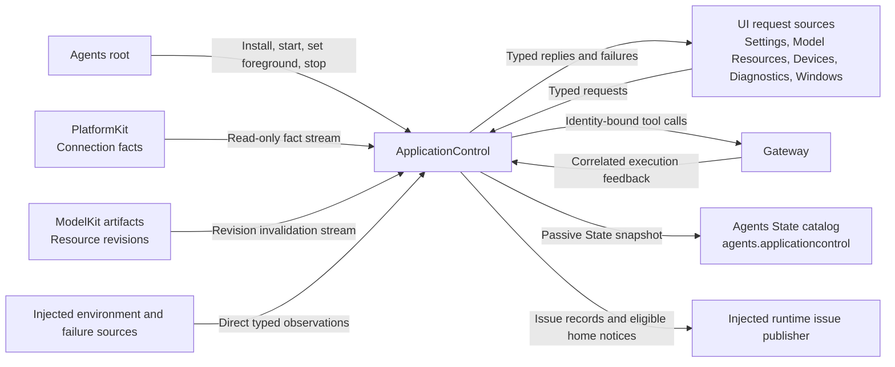
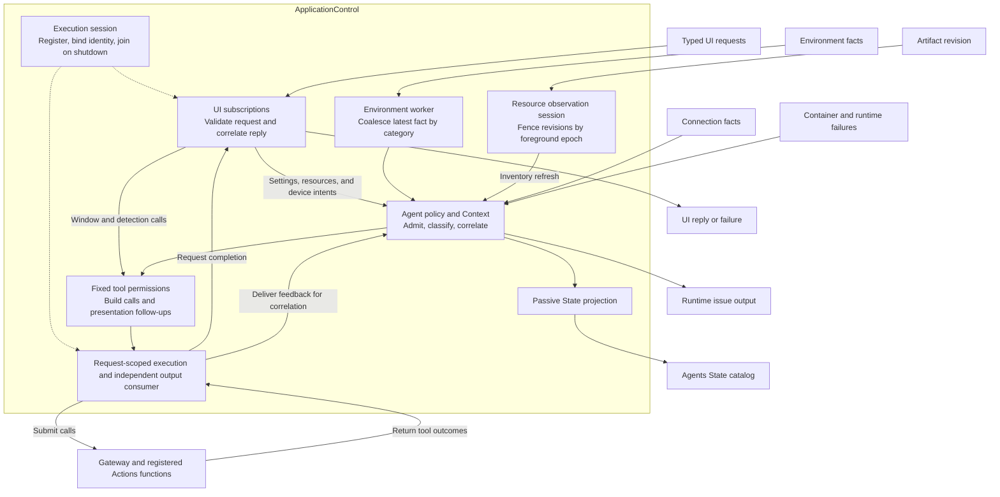

# ApplicationControl

ApplicationControl is a deterministic Agent for application settings, model resources, device administration, window commands, and diagnostic presentation. Its [role descriptor](../../Resources/Agents/ApplicationControl/Agent.json) classifies it as a perception Agent. It applies policy and correlates requests with execution results. Actions owns configuration transactions, device operations, and presentation writes. UI owns local interaction state such as drafts, focus, scrolling, and navigation gestures.

[AgentContainer](../README.md#lifetime-inputs-and-failures) owns the role's lifetime. ApplicationControl subscribes to UI requests and observes typed facts through injected interfaces. Its decision path runs in code and makes no Chat requests.

## Upstream and downstream interfaces

Gateway is the role's execution boundary for registered Actions functions, including Provider, ModelResources, Device, Speech Detection, and UI presentation and window functions. App binds the neutral staging and maintenance ports at composition time. Agents owns role authorization, and the role uses fixed tool permissions declared in code.

Assistant's `application-control` Skill calls registered Actions through Assistant's own Gateway scope. ApplicationControl's descriptor declares fixed-task inputs and permission to send `agent.task.response` to Assistant. Its handler validates and decodes authorized fixed-task envelopes, tracks them by scope, handles cancellation, and reports the outcome. The [Assistant descriptor](../../Resources/Agents/Assistant/Agent.json) grants outgoing task requests to Writer only. The interaction between Assistant and this role in normal operation is a passive State read through the Agents catalog. See [fixed-task admission](../Support/Communication/README.md#固定任务准入) for the shared envelope contract.

## Internal execution flow

| Component | Responsibility |
| --- | --- |
| [ApplicationControlContainer.swift](ApplicationControlContainer.swift) | Owns the installed session and environment worker, forwards foreground changes, and projects passive State. |
| [ApplicationControlExecutionSession.swift](ApplicationControlExecutionSession.swift) | Registers the role, binds the Gateway consumer, drains independent output, and joins shutdown. |
| [ApplicationControlUI.swift](ApplicationControlUI.swift) | Owns typed UI subscriptions and request-scoped execution, including cancellation and reply creation. |
| [ApplicationControlAgent.swift](ApplicationControlAgent.swift), [ApplicationControlProcessing.swift](ApplicationControlProcessing.swift) | Admit inputs, maintain Context, correlate pending calls, and advance requests from actual outcomes. |
| [ApplicationControlFunctions.swift](ApplicationControlFunctions.swift), [ApplicationControlPolicy.swift](ApplicationControlPolicy.swift) | Own fixed invocation permissions and pure classification of device facts and failures. |
| [ApplicationEnvironmentInputs.swift](ApplicationEnvironmentInputs.swift), [ResourceObservationSession.swift](ResourceObservationSession.swift) | Coalesce environment facts and manage the foreground-scoped revision subscription. |
| [ApplicationControlInputs.swift](ApplicationControlInputs.swift), [ModelResourceInputs.swift](ModelResourceInputs.swift), [ProviderInputs.swift](ProviderInputs.swift) | Define typed local intents, observations, and the business payloads accepted through fixed-task envelopes. |

## Request and completion contracts

- **Settings and Provider.** The role coordinates restore, save, and model discovery using private request IDs. Provider drafts, including credentials, stay in the session's private request service. Store, restore, and discovery belong to [Provider Actions and its request client](../../Actions/System/Provider/README.md). Save and restore advance on structured completion, and the registered request port supplies form values. Discovery returns its result as a business value. Writer's independent reasoning selection and Decision's local mode, provider ID, and model selection travel through the same typed configuration path.
- **Model resources.** The role coordinates inventory reads, downloads, cancellation, removal, and source or speech preferences. A ModelKit artifact revision invalidates the inventory and triggers a fresh snapshot through [ModelResources Actions and its request client](../../Actions/System/ModelResources/README.md). The observation session fences stale subscription epochs and continues the role's observation sequence across foreground changes. Preference changes persist before speech binding, so a later binding error preserves the effects already committed.
- **Devices and windows.** The role maps typed device commands to `System.Device.control` and maps window commands to six registered `UI.Window` tools. It resolves the current window reference before dispatch and passes it as `windowID`. The window request returns after its tool outcome is available. Camera capture and media ownership stay with their existing owners. See [System Actions](../../Actions/System/README.md) and [UI Actions](../../Actions/UI/README.md).
- **Diagnostics.** The diagnostics subscription starts and stops the controlled `Speech.Detection.run` workflow. [Speech Actions](../../Actions/Speech/README.md) owns detection execution and presentation.

For settings, resources, and devices, request-scoped execution correlates tool outcomes and presentation follow-ups before returning a reply. Provider failures preserve their structured code when available. If failure presentation also fails, the reply preserves the original failure and the presentation error. Provider and resource request clients adapt these replies for UI and coalesce restoration requests.

## Observations and presentation

- **Environment.** One worker keeps at most one pending observation per category (scene, devices, capabilities, and model preparation). The latest pending observation replaces the previous one for its category. The role records revisions and rejects stale or conflicting observations. Model preparation drives the revision-bound loading expression.
- **Bluetooth.** Connection facts drive home and settings status and the role's own connection Island through UI tools. On a state change, the Island briefly uses high priority. After three seconds, a connected or connecting state drops to background priority, and a disconnected state is removed. New changes cancel and join the previous timer. The role exposes presentation failures through Runtime State.
- **Runtime issues.** The role directly accepts typed container and runtime failure observations while running or paused. An injected publisher writes [Runtime Issues](../../UI/Components/RuntimeLog/README.md) and eligible home notices. The role retains up to 128 event keys. A first occurrence without a call ID can raise a notice when its age is between −5 and 15 seconds. Call-associated, repeated, and older events are retained as diagnostic evidence without a new notice.

## State and lifecycle

The container exposes `agents.applicationcontrol` through the Agents State catalog. The Business projection includes model preparation and task phases from committed Context when available. The Runtime projection includes scene, sequence metadata, installation and closure, role phase, queue counters, and presentation failure. A passive read leaves an uninitialized role cold and yields unknown fields where there is no observation or committed Context. Assistant's BasicSkill selects only `modelPreparation` from this source for model requests. Navigation comes from `ui.navigation`. Device and capability observations remain local policy inputs.

UI request sources have bounded admission and dedicated control slots for supported stop or cancellation commands. Window handling allows four concurrent ordinary operations and one close control slot. The role bounds short admission waits and tracked fixed tasks at 32 each. It caps the output buffer at 256 and retained input evidence at 4,096 records. Requests beyond capacity fail explicitly. Session IDs, request IDs, and revisions fence late outcomes. A failed Context commit preserves the preceding committed State and propagates the error.

The execution session owns registration and the identity-bound consumer. Leaving the foreground stops speech detection, pauses resource observation, and pauses the running Agent. Returning to the foreground restores resource observation and resumes the paused Agent. Root shutdown closes admission, joins the environment worker, and cancels and joins subscriptions and other owned work. The session completes the connection Island cleanup before retiring the Gateway identity.
