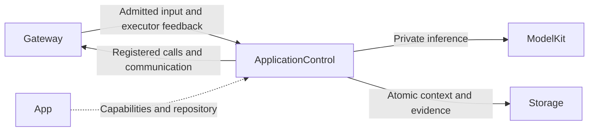
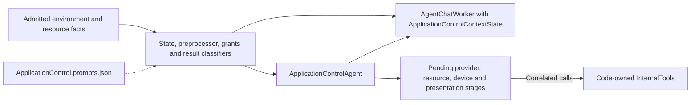

# ApplicationControl — Application Configuration and Device Decisions

## Summary

Owns provider, model-resource, navigation, Bluetooth and fixed device transaction policy plus environment context.

## Ownership and boundaries

App injects native primitives and retains immediate safety/lifecycle fences. Photographer owns camera policy; Memory owns history. Model declarations expose seven business Tools plus scheduled Actions; code grants fixed transaction calls separately.

## External relationships and data flow

Runtime arrows show data or capability calls; dashed arrows show injection.

## Fixed transactions and reasoning

ApplicationControlAgent.swift owns staged calls and independent Chat relay; ApplicationControlProcessing.swift owns schema, preprocessing, internal grants and pure result classification. Natural tasks use a per-decision configured binding pinned across continuation. Typed user-source subscriptions run deterministic transactions without creating delegation tasks.

Pending calls and environment categories are each bounded to 32. A 32-waiter AgentAdmissionGate serializes short state commits; inference/native work never holds it. Provider/preference/presentation stages retain their own call limits and exact failure codes. Environment/resource facts have no completion receipt and do not trigger implicit binding retries.

Paused state accepts environment facts and correlated feedback; fresh business requests require running. Validated business admission failure emits correlated agent.error; authentication failures emit no effects. Late manual device results enter bounded 128-result history separately from command acceptance. Resource error presentation cannot recursively diagnose itself or replay operations.

The model uses openPage as a scheduled Action; code-owned fixed navigation remains InternalTool. One model address is not exposed through both protocols. The eleven Robot Actions are shared implementations registered under this role for Settings command tests.

## Internal components

The following graph shows source composition and local data selection. Cross-role delivery and effect execution use Gateway.

## Context, bounds and failure

The role owns its schema/repository, preprocessing, immutable request builder and task outcomes. Evidence commits before dependent output; storage failure ends dependent processing. Legacy business contexts without Chat fields may import once; partial/null/unsupported fields fail. Restart interrupts unfinished work and does not replay native effects. Media is referenced by authorized IDs.

Shared model admission, request/call budgets, protocol consumers and overflow are defined in [Chat](../Support/Chat/README.md#bounds-and-overflow). Role communication retains 16 pending outputs with four runtime deliveries. Task views retain 256 identities with at most 32 live; terminal records may be retired, live tasks may not. Excess work rejects explicitly.

Pause cancels/joins model work; resume admits future work without replay. Stop joins worker/relay. App registration and output consumption outlive UI pages and microphone capture. Each reply's actual executor owns its results and speech; display focus does not change execution authority.

## Prompt resources

[ApplicationControl.prompts.json](ApplicationControl.prompts.json) owns application-control role/style and task/history/execution message templates. Protocol grammar is included through the shared Function Token guide; no role-specific prompt prose remains in shared Worker code.

## Function and communication registration

Model exposure comes from [ApplicationControl.agent.json](ApplicationControl.agent.json); code-owned internal permissions are separate. Empty Channel groups declare Channels without exposing a function.

### Model functions

| Protocol / Channel | Model name | Canonical function | Parameters and constraints | Behavior |
| --- | --- | --- | --- | --- |
| Action / Display | `openPage` | `UI.Navigation.open` | `destination` required: string; home, settings, language, recognition, synthesis, vision, bluetooth or history. | On a conversational request, open the requested application page through authorized UI presentation. Touch navigation is local and does not call this Agent. |
| Action / Robot | `shakeBase` | `NexArm.Motion.shakeBase` | `cycles` required: integer; Integer 1 through 3 only.; `speed` optional: integer; Native motor speed, 1–1400; default1400.; `acceleration` optional: integer; Native acceleration register value, 1–254; default30. | Perform the requested finite gesture using motors1–5, starting and ending at their home; never command or wait for the gripper. Accept optional native speed1–1400 and acceleration1–254. Stable arrival advances immediately. Stable off-target positions, send errors and missing feedback end only affected atomic steps and are collected in the final report; subsequent composition steps and Channel actions continue. Unavailable-device steps fail without blind writes, queries or replay. Explicit cancellation stops remaining work. Use only on user request with a connected arm and clear space. |
| Action / Robot | `waveWrist` | `NexArm.Gesture.waveWrist` | `count` required: integer; Integer 1 through 3. No default.; `speed` optional: integer; Native motor speed, 1–1400; default1400.; `acceleration` optional: integer; Native acceleration register value, 1–254; default30. | Perform the requested finite gesture using motors1–5, starting and ending at their home; never command or wait for the gripper. Accept optional native speed1–1400 and acceleration1–254. Stable arrival advances immediately. Stable off-target positions, send errors and missing feedback end only affected atomic steps and are collected in the final report; subsequent composition steps and Channel actions continue. Unavailable-device steps fail without blind writes, queries or replay. Explicit cancellation stops remaining work. Use only on user request with a connected arm and clear space. |
| Action / Robot | `tiltWrist` | `NexArm.Gesture.tiltWrist` | `direction` required: string; Exactly left or right.; `speed` optional: integer; Native motor speed, 1–1400; default1400.; `acceleration` optional: integer; Native acceleration register value, 1–254; default30. | Perform the requested finite gesture using motors1–5, starting and ending at their home; never command or wait for the gripper. Accept optional native speed1–1400 and acceleration1–254. Stable arrival advances immediately. Stable off-target positions, send errors and missing feedback end only affected atomic steps and are collected in the final report; subsequent composition steps and Channel actions continue. Unavailable-device steps fail without blind writes, queries or replay. Explicit cancellation stops remaining work. Use only on user request with a connected arm and clear space. |
| Action / Robot | `lookAround` | `NexArm.Gesture.lookAround` | `cycles` required: integer; Integer 1 through 3. No default.; `speed` optional: integer; Native motor speed, 1–1400; default1400.; `acceleration` optional: integer; Native acceleration register value, 1–254; default30. | Perform the requested finite gesture using motors1–5, starting and ending at their home; never command or wait for the gripper. Accept optional native speed1–1400 and acceleration1–254. Stable arrival advances immediately. Stable off-target positions, send errors and missing feedback end only affected atomic steps and are collected in the final report; subsequent composition steps and Channel actions continue. Unavailable-device steps fail without blind writes, queries or replay. Explicit cancellation stops remaining work. Use only on user request with a connected arm and clear space. |
| Action / Robot | `celebrate` | `NexArm.Gesture.celebrate` | `cycles` required: integer; Integer 1 through 3. No default.; `speed` optional: integer; Native motor speed, 1–1400; default1400.; `acceleration` optional: integer; Native acceleration register value, 1–254; default30. | Perform the requested finite gesture using motors1–5, starting and ending at their home; never command or wait for the gripper. Accept optional native speed1–1400 and acceleration1–254. Stable arrival advances immediately. Stable off-target positions, send errors and missing feedback end only affected atomic steps and are collected in the final report; subsequent composition steps and Channel actions continue. Unavailable-device steps fail without blind writes, queries or replay. Explicit cancellation stops remaining work. Use only on user request with a connected arm and clear space. |
| Action / Robot | `dance` | `NexArm.Gesture.dance` | `cycles` required: integer; Integer 1 through 3. No default.; `speed` optional: integer; Native motor speed, 1–1400; default1400.; `acceleration` optional: integer; Native acceleration register value, 1–254; default30. | Perform the requested finite gesture using motors1–5, starting and ending at their home; never command or wait for the gripper. Accept optional native speed1–1400 and acceleration1–254. Stable arrival advances immediately. Stable off-target positions, send errors and missing feedback end only affected atomic steps and are collected in the final report; subsequent composition steps and Channel actions continue. Unavailable-device steps fail without blind writes, queries or replay. Explicit cancellation stops remaining work. Use only on user request with a connected arm and clear space. |
| Action / Robot | `nodHead` | `NexArm.Gesture.nodHead` | `cycles` required: integer; Integer 1 through 3 only; no default.; `speed` optional: integer; Native motor speed, 1–1400; default1400.; `acceleration` optional: integer; Native acceleration register value, 1–254; default30. | Compose home, sweeps and return using only motor4. Leave all other motors untouched. Accept optional native speed1–1400 and acceleration1–254. Stable arrival advances immediately. Stable off-target positions, send errors and missing feedback end only affected atomic steps and are collected in the final report; subsequent composition steps and Channel actions continue. Unavailable-device steps fail without blind writes, queries or replay. Explicit cancellation stops remaining work. Use only on user request with a connected arm and clear space. |
| Action / Robot | `shakeHead` | `NexArm.Gesture.shakeHead` | `cycles` required: integer; Integer 1 through 3 only; no default.; `speed` optional: integer; Native motor speed, 1–1400; default1400.; `acceleration` optional: integer; Native acceleration register value, 1–254; default30. | Compose home, sweeps and return using only motor5. Leave all other motors untouched. Accept optional native speed1–1400 and acceleration1–254. Stable arrival advances immediately. Stable off-target positions, send errors and missing feedback end only affected atomic steps and are collected in the final report; subsequent composition steps and Channel actions continue. Unavailable-device steps fail without blind writes, queries or replay. Explicit cancellation stops remaining work. Use only on user request with a connected arm and clear space. |
| Action / Robot | `resetArm` | `NexArm.Motion.reset` | `speed` optional: integer; Native motor speed, 1–1400; default1400.; `acceleration` optional: integer; Native acceleration register value, 1–254; default30. | Reset motors1–5 only; do not command or wait for the gripper. Accept optional native speed1–1400 and acceleration1–254. Stable arrival advances immediately. Stable off-target positions, send errors and missing feedback end only affected atomic steps and are collected in the final report; subsequent composition steps and Channel actions continue. Unavailable-device steps fail without blind writes, queries or replay. Explicit cancellation stops remaining work. Use only on user request with a connected arm and clear space. |
| Action / Robot | `moveMotor` | `NexArm.Motion.moveMotor` | `motor` required: integer; Motor ID1–6. Reset requires a configured home; current arm homes cover1–5.; `target` required: integer; Native encoder target, restricted to configured motor limits.; `speed` optional: integer; Native speed1–1400, default1400.; `acceleration` optional: integer; Native acceleration1–254, default30. | Move only the explicitly selected motor to its native encoder target. Accept optional native speed1–1400 and acceleration1–254. Stable arrival advances immediately. Stable off-target positions, send errors and missing feedback end only affected atomic steps and are collected in the final report; subsequent composition steps and Channel actions continue. Unavailable-device steps fail without blind writes, queries or replay. Explicit cancellation stops remaining work. Use only on user request with a connected arm and clear space. |
| Action / Robot | `resetMotor` | `NexArm.Motion.resetMotor` | `motor` required: integer; Motor ID1–6. Reset requires a configured home; current arm homes cover1–5.; `speed` optional: integer; Native speed1–1400, default1400.; `acceleration` optional: integer; Native acceleration1–254, default30. | Reset only the selected motor to its configured home; motor6 requires an explicitly configured home. Accept optional native speed1–1400 and acceleration1–254. Stable arrival advances immediately. Stable off-target positions, send errors and missing feedback end only affected atomic steps and are collected in the final report; subsequent composition steps and Channel actions continue. Unavailable-device steps fail without blind writes, queries or replay. Explicit cancellation stops remaining work. Use only on user request with a connected arm and clear space. |
| Tool / — | `ModelResources.snapshot` | `System.ModelResources.snapshotResources` | — | Read current shared model resource inventory, installed groups and progress. Does not download, remove or switch a model. |
| Tool / — | `Provider.readSettings` | `System.Provider.readSettings` | — | Read confirmed cloud-enabled status and selected cloud model. Contains no URL/key. Does not probe provider availability or change configuration. |
| Tool / — | `Bluetooth.readStatus` | `System.Device.readStatus` | — | Read current Bluetooth power/connection and discovered device IDs. Does not scan or move a robot. |
| Tool / — | `Bluetooth.control` | `System.Device.control` | `operation` required: string;  enum=scan,stopScan,connect,reconnect,disconnect,forget,refresh; `id` optional: string;  | Submit an explicit Bluetooth connection/discovery command. Accepted is not connected or physically completed. Read status to confirm actual state. |
| Tool / — | `App.readEnvironment` | `System.Device.readEnvironment` | — | Read latest sequenced scene, navigation and device capability facts admitted by the root Agent. Facts are observations, not proof of physical completion. |
| Tool / — | `ModelResources.download` | `System.ModelResources.download` | `id` required: string; ; `endpoint` required: string; ; `allowsCellular` required: string;  enum=true,false | Admit a model download using an explicit source. Admission does not mean installed; read the shared inventory for progress. |
| Tool / — | `ModelResources.cancel` | `System.ModelResources.cancel` | `id` required: string;  | Cancel and join an admitted model transfer. Failure is returned without replay. |
| Action / Communication | `send` | `Agent.Communication.send` | target, kind, content; taskID/artifactID as applicable; authorized pairs: `assistant/progress`, `assistant/result` | Directed admission receipt; task outcome is separate. |

### Internal fixed functions

| Protocol | Canonical function | Channel | Parameters | Registration source |
| --- | --- | --- | --- | --- |
| InternalAction | `UI.Caption.beginReplyTurn` | Display | — | [AgentChatWorker.swift](../Support/Chat/AgentChatWorker.swift) |
| InternalAction | `Speech.Playback.speak` | Speech | `audioID` | [AgentChatWorker.swift](../Support/Chat/AgentChatWorker.swift) |
| InternalAction | `UI.Caption.print` | Display | `text` | [AgentChatWorker.swift](../Support/Chat/AgentChatWorker.swift) |
| InternalTool | `System.Device.control` | — | `operation`, `id?`, `value?`, `action?`, `fence?` | [ApplicationControlProcessing.swift](ApplicationControlProcessing.swift) |
| InternalTool | `UI.Navigation.open` | — | `destination` | [ApplicationControlProcessing.swift](ApplicationControlProcessing.swift) |
| InternalTool | `System.ModelResources.download` | — | `id`, `endpoint`, `allowsCellular` | [ApplicationControlProcessing.swift](ApplicationControlProcessing.swift) |
| InternalTool | `System.ModelResources.cancel` | — | `id` | [ApplicationControlProcessing.swift](ApplicationControlProcessing.swift) |
| InternalTool | `System.ModelResources.remove` | — | `id` | [ApplicationControlProcessing.swift](ApplicationControlProcessing.swift) |
| InternalTool | `System.Provider.restoreSettings` | — | `requestID` | [ApplicationControlProcessing.swift](ApplicationControlProcessing.swift) |
| InternalTool | `System.Provider.saveSettings` | — | `requestID` | [ApplicationControlProcessing.swift](ApplicationControlProcessing.swift) |
| InternalTool | `UI.ResourcePresentation.showProviderResult` | — | `requestID`, `failureCode?` | [ApplicationControlProcessing.swift](ApplicationControlProcessing.swift) |
| InternalTool | `System.Provider.discoverModels` | — | `requestID` | [ApplicationControlProcessing.swift](ApplicationControlProcessing.swift) |
| InternalTool | `System.ModelResources.snapshotResources` | — | — | [ApplicationControlProcessing.swift](ApplicationControlProcessing.swift) |
| InternalTool | `UI.ResourcePresentation.showResources` | — | `generation` | [ApplicationControlProcessing.swift](ApplicationControlProcessing.swift) |
| InternalTool | `UI.ResourcePresentation.showResourceFailure` | — | `generation`, `message` | [ApplicationControlProcessing.swift](ApplicationControlProcessing.swift) |
| InternalTool | `UI.ResourcePresentation.showResourceOperationFailure` | — | `message` | [ApplicationControlProcessing.swift](ApplicationControlProcessing.swift) |
| InternalTool | `UI.ResourcePresentation.showResourcePreferenceFailure` | — | `reason`, `message` | [ApplicationControlProcessing.swift](ApplicationControlProcessing.swift) |
| InternalTool | `System.ModelResources.restoreSource` | — | — | [ApplicationControlProcessing.swift](ApplicationControlProcessing.swift) |
| InternalTool | `System.ModelResources.saveSource` | — | `endpoint`, `allowsCellular`, `recognition`, `synthesis` | [ApplicationControlProcessing.swift](ApplicationControlProcessing.swift) |
| InternalTool | `System.ModelResources.configureSpeech` | — | `recognition`, `synthesis` | [ApplicationControlProcessing.swift](ApplicationControlProcessing.swift) |

### Declared input schemas

| Contract | Version | Kind |
| --- | --- | --- |
| `action.result` | 1 | `actionResult` |
| `app.environment` | 1 | `observation` |
| `app.interaction` | 1 | `observation` |
| `provider.settings` | 1 | `observation` |
| `provider.discovery` | 1 | `observation` |
| `model.resource.hostFailure` | 1 | `observation` |
| `model.resource.state` | 1 | `observation` |
| `model.resource.intent` | 1 | `observation` |
| `tool.result` | 1 | `toolResult` |
| `task.request` | 1 | `observation` |
| `task.input` | 1 | `observation` |
| `task.progress` | 1 | `observation` |
| `task.result` | 1 | `observation` |
| `task.cancel` | 1 | `observation` |
| `generation.round.result` | 1 | `roundResult` |
| `communication.receipt` | 1 | `communicationReceipt` |
| `user.text` | 1 | `text` |

Directed input schemas and static subscriptions are distinct; admission also validates the runtime sender and scope.

### Input subscriptions and communication grants

Publication is one-way and has no recipient acknowledgment. Directed send returns admission; explicit task results report completion.

| Input contract | Source | Topic |
| --- | --- | --- |
| `model.resource.intent` | `runtime` | `model.resource.intent` |
| `model.resource.state` | `model.resources` | `model.resource.state` |
| `model.resource.hostFailure` | `app.resources` | `model.resource.hostFailure` |
| `app.environment` | `app.environment` | `app.environment` |
| `app.interaction` | `user` | `app.interaction` |
| `model.resource.intent` | `user` | `model.resource.intent` |
| `provider.settings` | `user` | `provider.settings` |
| `provider.discovery` | `user` | `provider.discovery` |

| Output | Contract | Destination |
| --- | --- | --- |
| publish | `interaction.replyActivity` | Exact static subscribers |
| send | `task.progress` | `assistant` |
| send | `task.result` | `assistant` |
| send | `speech.synthesize` | `speechSynthesis` |
| send | `speech.cancel` | `speechSynthesis` |

## Related design

[Parent design](../README.md)
