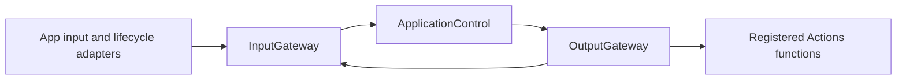
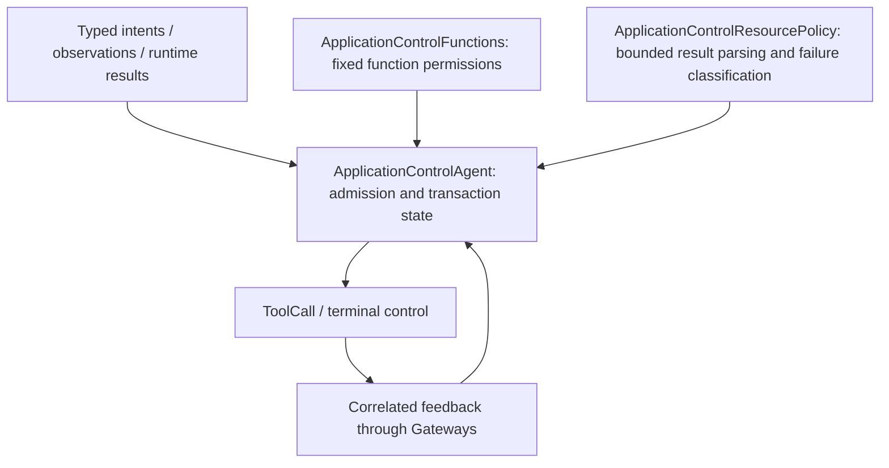

# ApplicationControl — Application Operations and Configuration

ApplicationControl interprets explicit application-operation Signals and their results: model resources, Provider configuration, device connection/manual control, navigation and environment facts. It is a deterministic business service; conversation reasoning belongs to Assistant, photography to Photographer and memory organization to Memory.

## Upstream and downstream

The App owns registration, private Provider request storage, native endpoints and joined transport tasks. The Agent imports AgentCore and Foundation; it does not import Gateway, Actions, UI or native SDK implementations. Model-originated operations currently share registered functions where explicitly granted; generic Assistant-to-ApplicationControl delegation is not yet implemented.

## Internal design

| File | Ownership |
| --- | --- |
| ApplicationControlAgent.swift | Lifecycle, trusted source/session checks, transaction exclusion, request/result correlation and next-effect selection |
| ApplicationControl.agent.json | v6 inputs and canonical identity; no model-callable catalog or communication send/publish grants |
| ApplicationControlFunctions.swift | Fixed internal function grants grouped by resource, Provider, device and navigation domains |
| ApplicationControlResourcePolicy.swift | Pure preference-result decoding, exact failure-code classification and UTF-8-bounded error projection |

## Signal and completion contracts

Inputs: `model.resource.intent/1`, sequenced `model.resource.state/1`, root-linked `model.resource.hostFailure/1`, opaque `provider.discovery/1` and `provider.settings/1`, device/navigation `app.interaction/1`, finite-category sequenced `app.environment/1`, correlated `tool.result/1`, and trusted runtime-owned `action.result/1`. Domain contracts and private credential handling retain their existing schemas; identity is `applicationControl`.

Output: permitted returning ToolCalls through OutputGateway, followed by `application.control.finished` / `application.control.failed` protocol notifications. These controls cannot perform business effects. No publish or send. Returning results must match pending call, owning session and runtime source; result-driven presentation is attempted once without replaying effects.

## State, lifecycle and failures

One root session owns the actor. Maximum32 pending calls and64 buffered outputs reject excess work explicitly; host transport admits32 requests and joins each retained worker before the next call. Preference/Provider configuration exclusion spans persistence, binding and terminal presentation. Ordinary operation failure completes only its request and preserves producer and presentation causes. Host infrastructure diagnostics have one slot and no recursive retry. Output overflow fails the actor and closes the stream; host shutdown joins workers and removes registration.

Device terminal reports use the existing128-result inbox; finite-category environment facts reject stale sequences and serialize at most65536 bytes. Native background fences and physical motion safety execute immediately in native owners before facts enter the Agent. Accepted device calls mean submission, not arrival; arrival tolerance, timeouts and independent native failure reports remain unchanged.

❌ Broader semantic delegation, new app features and physical/live-model acceptance remain separate work. See [overall design](../../README.md), [Communication](../Communication/README.md) and [host transport](../../App/Workflows/Settings/README.md).

## Validation

✅ Full repository checks, unsigned iOS device clean build and seven-config verification passed;212 Mermaid diagrams parse. ❌ Simulator CoreAI dependency, native UI/live-model and physical acceptance remain outstanding. See [validation evidence](../../../docs/Validation-History.md#2026-10-08--applicationcontrol-service-organization-adr0182).
