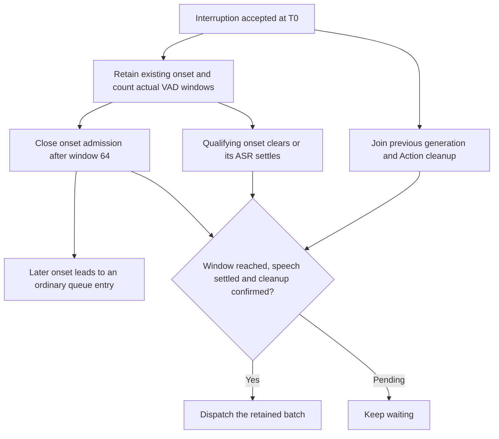

# Assistant input

Assistant owns input admission, batch text, quiet wake and interruption policy. Prompt resources are under [Resources/Agents/Assistant/Input](../../Resources/Agents/Assistant/Input).

The localized input protocol shows the reply interruption marker from Assistant's prompt resources. It describes retained history text as fragments of successful Actions and Action Results as the source of returned values and execution errors.

| File | Responsibility |
| --- | --- |
| [AssistantChatInput.swift](AssistantChatInput.swift) | Authenticated speech and control intake, input admission, keyword policy, queue drain and reply-turn start. |
| [AssistantInputBatch.swift](AssistantInputBatch.swift) | Trusted source timeline, batch text, source-line markers and input prompt access. |
| [AssistantInputDecision.swift](AssistantInputDecision.swift) | Settings-selected Decision provider, bounded inference and interruption queue. |
| [AssistantInterrupt.swift](AssistantInterrupt.swift) | Application and runtime interruption target, Signal and result. |
| [ListeningControl.swift](ListeningControl.swift) and [ListeningCoordinator.swift](ListeningCoordinator.swift) | Private conversation gate, quiet episodes, judgment scheduling and release. |
| [QuietExitJudge.swift](QuietExitJudge.swift) | Builds the quiet wake question from the latest utterance and optional wake agreement. |

## Decision scheduling and cleanup

The interruption prompt renders the frozen reply and latest user input into a localized sentence, followed by a question about whether the user intends to interrupt. Replies without generated text use an empty string. ModelKit binds the sentence and question to the provider's boolean readout. Quiet wake uses its own templates with the same Settings-selected provider.

AssistantDecisionQueue retains at most 32 unsettled jobs, including the current job. Overflow rejects classification while the ordinary input stays queued. New admission cancels the current classification and replaces the waiting candidate. Assistant checks the reply identity and interruption barrier before submitting a job and again before the job starts inference. An accepted interruption retires the active classification for that reply. Superseded jobs keep request evidence and ordinary input admission. If inference completed before its result became obsolete, the log retains the boolean and reports that the interrupt was skipped. Session close removes matching work, and pause and stop join the queue.

AssistantInputDecision owns at most one inference worker and one waiting attempt per local or cloud lane. A replacement waits for complete ModelKit cleanup within its deadline. Attempt IDs fence cancellation, timeout and late results. Model switching and root shutdown join the retained worker.

## Speech activity and listening Signals

SpeechPerception publishes three facts through Gateway within the interaction session. Their contracts are defined in [Support/Communication](../../Support/Communication/README.md).

| Contract | Assistant handling |
| --- | --- |
| `perception.speech.activity.v1` | Track capture generation, onset candidate, confirmed utterance and progress through the VAD windows. |
| `user.input.speech.v1` | Subscribe to final ASR results. Nonempty text enters ordinary admission or quiet wake. Empty and failed results settle the utterance. |
| `perception.speech.keyword.v1` | Check keyword label, capture generation, utterance and arrival relative to the current reply. |

`energyChanged` carries the capture and utterance identity and is processed independently of onset or progress messages. The worker retains the current speech energy even while no reply is active. A matching low-energy update, capture stop or capture replacement releases the energy state. ASR final settles input admission independently of playback energy. The interruption window uses the capture time in received VAD snapshots.

The Assistant retains up to 128 terminal utterance receipts. Final ASR enters normal admission immediately. A keyword from that utterance can still win against the same active reply while a Decision is pending. A settled utterance stays settled when the keyword arrives. If the keyword is accepted first, the utterance stays open until final ASR settles. Its text enters the queue once and skips the interruption Decision.

### Post-interruption wait

An idle ASR final joins the ordinary queue and can dispatch as soon as the queue is ready. Only an accepted interruption opens the post-interruption buffer. The buffer waits for at least 64 complete 512-sample VAD windows from interruption admission. It retains candidates and confirmed utterances active at admission and accepts new candidates through window 64 inclusive. A qualifying candidate can confirm after window 64. Its utterance stays pending through ASR terminal admission, including empty and failed results. Cleanup can continue in parallel with both steps.

For each onset, the VAD and ASR Signals carry the oldest capture time of its preceding 64 complete windows when available. Assistant compares that time with T0 to classify the onset even when the ASR final arrives on its channel first. The first released batch keeps late speech separate from retained input. A capture replacement clears observation state and restarts counting. Stalled capture and unconfirmed cleanup preserve queued inputs and surface a diagnostic.

### `listening` and `quiet`

The Assistant owns a Boolean conversation gate, `state.listening`, with default `true`. Legacy `full` and `half` restore as `true`. Legacy `quiet` restores as `false` with its saved wake agreement. PlatformKit and SpeechPerception own the physical duplex policy.

While the gate is false, the selected Decision handles nonempty ASR finals. The default prompt considers an invitation to speak. An explicit condition uses a JSON request with the condition and latest sentence. The exact phrase following `literal:` becomes a requirement in that request. A newer utterance or changed condition retires the previous judgment. A current positive result writes `true`, clears the condition and admits the same input once. Negative results and failures preserve quiet. Three consecutive failures are reported once. Judgment evidence goes to [listening_dialogs](../../../Storage/Database/ListeningDialogs/README.md).

A host write entering quiet joins interruption cleanup. A model write settles in its originating round and retires the audio handles owned by that input. Microphone recovery preserves the gate.

## 流式关键词快停

Assistant 从 [InterruptionKeywords.json](../../Resources/Agents/Assistant/Input/InterruptionKeywords.json) 加载允许打断的标签集合。有效命中必须属于当前语音会话，起声时间也须落在当前回复开始之后。关键词和模型共用同一个打断接纳屏障。清理完成或失败后，Assistant 将关键词、模型身份、起声到检测完成的总耗时、ModelKit 累计推理耗时和打断结果投影到 Decision 日志。来自 ApplicationControl 的 `agent.interruption.v1` 也走统一打断接纳入口。

[AssistantSignalSelection.swift](AssistantSignalSelection.swift) classifies signals and selects the decision batch. [AssistantFeedbackAdmission.swift](AssistantFeedbackAdmission.swift) verifies feedback origin, session and turn.
