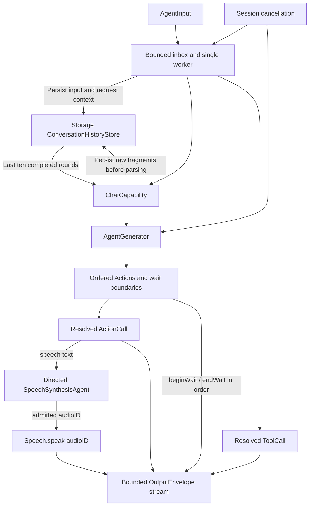
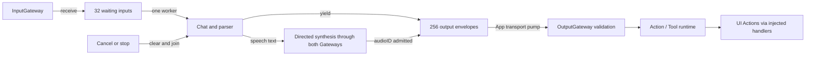
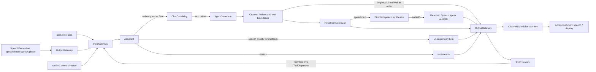
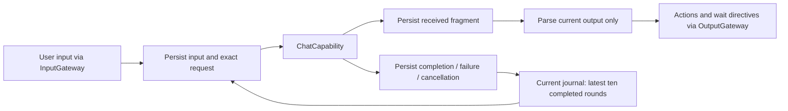

# Assistant — Stateful Conversation Agent

Purpose: send user input to ChatCapability, maintain bounded history and interpret generated output inside the Agent. Its local registry controls available capabilities; Gateway receives resolved calls.

- ✅ AssistantAgent actor: 32 waiting inputs, 256 output envelopes and one generation worker; overflow fails explicitly.
- ✅ Assistant.agent.json v5 exposes express under Display and declares the empty Speech group. Code owns reply initialization, speech synthesis/audioID playback and caption permissions.
- ✅ Each turn owns AgentGenerator state. Natural text uses Assistant.mapText; explicit XML resolves only JSON Actions. Channel scopes override defaults without moving wait boundaries.
- ✅ CapabilityContextBuilder includes JSON Action aliases/docs/parameters/examples only. Speech behavior is an English Agent-owned instruction; internal methods and native Tools never enter system context.
- ✅ express accepts clear, smile, happy, laugh, thinking, surprised, sad, love, angry, scared and playful. It controls UI presentation only.
- ✅ /status resolves runtimeInfo. Tool results and event descriptions are escaped before text interpretation.
- ✅ Limits: 4 KiB user text, provider-default output token budget, 30 s generation deadline and at most 120 ActionCalls. Current-conversation context is loaded from the shared journal: the last ten completed user/assistant rounds, preserving exact model text. Failed/cancelled turns remain visible but are excluded from future model context.
- ✅ Cancellation bypasses full/paused inbox admission, joins the worker and discards incomplete parsing state.
- ❌ Native model tool deltas, durable inbox/runtime checkpoints, restart and long-running background execution. ToolCallParser exists, but ChatCapability produces text/completion events.

Speech and captions use different default channels and can run concurrently. Consecutive wait groups serialize stages; each wait retains ordinary Channel scheduling internally. Runtime notifications are not model-authored.

## Configuration and initialization

Follow the [Agent standard](../README.md). AgentConfigurations validates JSON v5 id=assistant. Assistant adds its fixed internal permissions to the immutable descriptor; these are not configuration fallbacks. Invalid configuration throws before registration. Hot reload is unsupported.

ChatCapability is a required dependency; tests inject FixedTextChat from IntegrationTests. Configuration/request validation does not guarantee real-model protocol compliance. Update this README with changes and retain ✅/❌ status distinctions.

## Queue and asynchronous processing contract

`AssistantAgent` owns its FIFO inbox and generation worker inside an actor. InputGateway produces `AgentInput`; `drain()` consumes it. The default inbox holds 32 waiting inputs, excluding the active input. Admission rejects excess work with `queueFull`; it does not suspend until space appears. Text input is limited to 4096 UTF-8 bytes. A single generation worker preserves input processing order; actor reentrancy does not permit a second worker.

1. `receive` checks lifecycle and payload, appends an input, and starts draining when running.
2. Pausing stops admission-to-execution transitions, but does not cancel an already running generation. Resume drains queued inputs.
3. Generation consumes Chat events, parses them and emits resolved output envelopes. The output stream buffers 256 envelopes with `bufferingOldest`; the consumer is App's VoiceSessionCoordinator. Failed yields mark the Agent failed, clear the inbox, cancel generation and close the stream. This plain AsyncStream does not transmit a thrown error; the coordinator checks final Agent status.
4. `assistant.cancel` bypasses the inbox, even when full or paused, removes the selected session's waiting inputs and awaits cancellation of its active worker. Stop clears waiting inputs and joins the worker before closing outputs; durable history is retained.

Successful outputs already consumed are not rolled back. There is no automatic retry, durable inbox or priority scheduling. FIFO uses Array append/removeFirst; removal shifts remaining entries, with cost bounded by the configured capacity.

✅ The algorithm above describes the current implementation.

Maintenance: update this contract when changing producers, consumers, limits, ordering, cancellation or completion semantics.

✅ New image payloads remain unsupported by Assistant and are rejected by its descriptor; VisionPerception owns camera input.

✅ JSON v5 subscribes to speech.final and user.text; final transcript uses the same conversation path as text. Inputs expire before dequeue, never during a started reply. Partial transcripts cannot enter Assistant.

✅ JSON v5 also subscribes to speech.phase. Speech onset emits UI.beginReplyTurn once per turn on Display, followed by agent.finished to release Action tracking; it does not invoke Chat or resume capture. Other phases cause no Assistant behavior. App must not infer these UI operations from the Signal. Ordinary transcription still follows the existing chat path.

✅ Runtime turn context is inherited from the triggering input. Repeated VAD onset notifications within one utterance do not repeat beginReplyTurn. Final processing also ensures that begin Action exists if onset was missed. Every output has a monotonically increasing source sequence; text/expression survive normal reply completion until the next turn.

## 输入、订阅与输出契约

以 [Assistant.agent.json](Assistant.agent.json) 和 [AssistantAgent.swift](AssistantAgent.swift) 为准，以下是当前实现。公共信封见 [Agents 输入输出约定](../README.md#输入输出文档约定)。所有输入均经过 InputGateway；声明支持某种输入不等于订阅了该主题。

| 接收方式 | contract / version / kind | source / topic | 数据与处理 |
| --- | --- | --- | --- |
| 静态订阅 | `user.text / 1 / text` | `user / user.text` | `.text(String)`，最多 4096 UTF-8 字节；普通文本进入 Chat，精确等于 `/status` 时调用 runtimeInfo。当前 App 没有文本输入框，这是已支持的协议入口。 |
| 静态订阅 | `speech.final / 1 / observation` | `speechPerception / speech.final` | `.observation(.transcript(text, final: true))`，非空、最多 4096 UTF-8 字节；与文本走同一处理路径。 |
| 静态订阅 | `speech.phase / 1 / observation` | `speechPerception / speech.phase` | `.observation(.speechPhase(phase))`；仅 `speaking` 触发本轮 beginReplyTurn，其他阶段不产生业务输出，也不调用 Chat。 |
| 运行时定向输入，无静态订阅 | `runtime.event / 1 / event` | 默认 source 为 `runtime`，直接指定目标 `assistant` | `.event("assistant.cancel")` 绕过普通队列，清理指定 session 的等待输入/历史并取消其活动生成；其他事件按转义文本输出 `事件：…`，不调用 Chat。 |
| Tool 定向回流，无静态订阅 | `tool.result / 1 / toolResult` | ToolDispatcher 经 InputGateway 回送原 Agent/session，默认 source 为 `runtime` | `.toolResult(ToolResult(callID: UUID, value: String, isError: Bool))`；当前按 value 输出转义文本，不依据 isError 分支或继续调用 Chat。 |

事件入口 Gateway 限制 16 KiB；即时输出（事件前缀加正文或 ToolResult.value）另外限制 2000 UTF-8 字节，超限输出 assistant.error。不接收 raw audio、image、speech.partial 或 vision.pose。

| 输出类别 | 调用路径 / Channel | 数据、触发与接收者 |
| --- | --- | --- |
| Action | `Speech.speak / Speech` | `parameters["text"]: String`，非空、最多 2000 UTF-8 字节；自然语言分句映射后先定向提交 SpeechSynthesisAgent，成功接纳后转换成代码内部的 `Speech.speak(audioID)`。 |
| Action | `Speech.speak / Speech`（隐藏） | `parameters["audioID"]: UUID 字符串`；沿用原 say 的 Channel。仅在 `speech.synthesize` 被接纳后输出；SpeechPlayback 用该 ID 等待并消费 PCM，接纳不保证当时已有音频。 |
| Action | `UI.print / Display` | 同样的 text 参数，追加回复字幕；与 say 来自同一段自然文本。 |
| Action | `express → UI.express / Display` | `parameters["emotion"]` 为 `clear / smile / happy / laugh / thinking / surprised / sad / love / angry / scared / playful`，设置或清除表情。 |
| Action | `UI.beginReplyTurn / Display` | 无参数；有 ConversationTurn 时在首次 speaking 或最终文本处理前确保本轮只发一次，原子清除上一轮回复和表情。 |
| 有返回值 Tool | `runtimeInfo`，无 Channel | `arguments: [:]`；由 `/status` 确定性触发，结果经过 tool.result 回流。目前不是模型原生 Tool streaming。 |
| control | `assistant.finished` | 正常生成或即时文本输出结束；由 App 经输出处理等待相关 Actions 完成，再协调恢复聆听。不能把“生成结束”等同于“语音已播放完”。 |
| control | `agent.finished` | speaking 阶段的展示 Action 完成屏障，释放该输入的 Action 跟踪。 |
| control | `assistant.error: …` | 生成、解析、即时输出等失败；输出流溢出会直接进入 failed 并关闭流，不能保证再塞入错误消息。 |

Action Channel 是默认值，生成中的显式 Channel 可覆盖；JSON 不再额外声明 `main`；跨轨同步使用 wait。参数始终为 `[String: String]`。所有调用封装为 `OutputEnvelope`，由 App 消费后送 OutputGateway；Assistant/SpeechPerception 为输出赋递增序号，并保留触发输入的 `inputID / sessionID / turn`。

### Publish / send 数据标准

`communication.publications = []`：Assistant 不广播共享观测。`communication.sends` 只允许以下两种定向消息，目标均为 `speechSynthesis`，均通过 `AgentMessaging.send(message, parent: input, to:)` 经 OutputGateway → InputGateway。发送端身份由绑定端口确定为 `assistant`；parent 是触发该段回复的输入，保留 session/turn/因果链。send 的回执只确认接纳，不等待模型合成或播放。

| contract / version / kind | typed payload 与字段标准 | 时机与失败语义 |
| --- | --- | --- |
| `speech.synthesize / 1 / observation` | `.speechSynthesis(SpeechSynthesisInput(audioID: UUID, text: String, locale: String))`；audioID 为每段新建的唯一句柄；text 为 Agent 分好的非空语义段，最多 2000 UTF-8 字节；locale 当前默认 `auto`，协议允许 `auto / zh-CN / en-US`。完整编码受 16 KiB 消息上限约束。 | 自然文本完成分段后立即提交；必须在回执中确认目标已接纳且无拒绝，才输出同一 audioID 的内部 Speech.speak(audioID) Action。合成与后续 Action 调度并行。 |
| `speech.cancel / 1 / observation` | `.cancelSpeech(audioID: UUID)`；只带待取消的音频句柄，不携带文本或 PCM。 | 提交已接纳但 播放 Action 无法成功入队等清理场景发送；SpeechSynthesis 按发送方、session、父输入所有权校验，不能取消别的请求。当前清理发送失败被忽略，原始入队错误继续上抛。 |

❌ 图像理解、partial 驱动回答及模型原生 Tool 增量仍未实现。

✅ express emits semantic eye emotions; Assistant.agent.json remains the production capability declaration. No emoji conversion is performed. clear smoothly returns to neutral. Three added values are angry/scared/playful; JSON schema is v5, with an additive parameter-domain extension.

✅ Conversation replies follow the user language (Mandarin/English speech), with short spoken sentences and no Markdown/emoji. Agent-owned text handling preserves mixed Mandarin/English; the synthesis provider validates text. Prompt wording does not guarantee compliance.

✅ Speech segments are sent to speechSynthesis with a runtime UUID. After admission, Assistant creates Speech.speak(audioID) on the original Channel through its internal permission. speech.synthesize / speech.cancel remain declared communication sends. No internal playback alias or TTS model dependency belongs in JSON.

✅ AssistantAgent.systemPrompt is shared by production and evaluation. Conversation history retains the actual prompt and raw model text. Its non-executing preview uses the same Assistant.mapText callback; no historical Action is replayed.

✅ Assistant emits `.scheduling(.beginWait/.endWait)` in the same ordered output stream as resolved Actions. Speech synthesis admission and audioID substitution preserve each event's position; directives do not count as Actions. Output holds 256 events; generation remains bounded to 120 Actions and 32 wait groups. The shared prompt explains default lanes, parallelism, local nested joins, lexical validity and actual completion; the appended JSON registry remains the only model-callable list. ❌ Tool calls and speech synthesis prefetch are not members of Action wait groups.

✅ The shared English systemPrompt takes the capability registry; Assistant supplies Speech as its fixed audio Channel. Callable Action details are grouped by Channel. Internal method metadata and subtitle mechanics are omitted. ❌ Live-model comprehension and device acceptance remain unverified.

## Durable conversation records and context

✅ App injects a process-wide ConversationHistoryStore. The explicit default in-memory store is for isolated tests; production creates a protected local document. Assistant persists original user input and the exact system + ten-round + current-user request before inference, then persists each received text fragment before its bounded parser. Successful generation saves completion/finish reason; parser/provider/limit failure and cancellation save the received prefix and error. Persistence errors propagate, without resetting history or silently dropping received data. Store bounds can reject new work before inference.

Logical conversation identity survives voice-session changes, stop/start and App restart. Only Start New archives the current conversation and resets context. History messages are model context only, never re-parsed for execution. No old audioID or Action is replayed. Model/provider context budgets still apply: an oversized ten-round request fails explicitly, rather than silently dropping rounds or altering stored originals.

✅ ConversationTitleGenerator generates titles from bounded excerpts as non-executable metadata. Its request is separate from Assistant conversation context and carries no Action instruction list. ❌ Storing raw responses does not guarantee that GPT-4.1 follows wait instructions or that Actions completed successfully; generation and execution status are distinct.

✅ Chat output-token budgets are optional and default to nil. Assistant/cloud requests omit max_tokens so the provider chooses its default; local Qwen uses remaining room in its existing 4096-token context. History shows 模型默认 for omitted values and preserves older explicit budgets. The separate 2000-byte whole-reply cap is removed; parser, queue, timeout and per-segment bounds remain. Explicit title/warmup budgets are unchanged. ❌ Live-provider/device acceptance remains separate.
