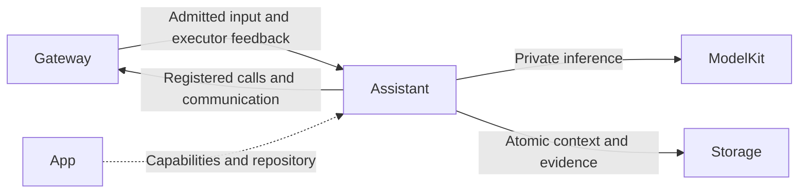
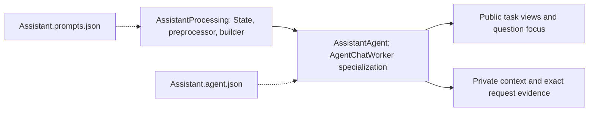

# Assistant — Default User Entry and Delegation

## Summary

Owns user interaction, basic reply/expression/Robot Actions and public specialist coordination.

## Ownership and boundaries

Camera/history/settings UI data commands go directly to their owners. Assistant includes role-owned delegation summaries and public task reports, not child private histories. It has no listening grant and no model Tools.

## External relationships and data flow

Runtime arrows show data or capability calls; dashed arrows show injection.

## Decision and task policy

AssistantAgent.swift defines a type alias specializing AgentChatWorker with AssistantContextState; AssistantProcessing.swift owns preprocessing, task views and Action-only context projection. The model emits registered XML Actions, including send and readEnvironment. `/status` is ordinary user text. Historical native pairs remain stored but are projected as inert evidence in new Assistant requests.

Robot commands use Assistant's eleven registered NexArm Actions directly. Photography, history and application tasks use authorized send; the parent emits no redundant spoken delegation acknowledgment. Specialist owns questions and outcome replies.

One foreground question and FIFO pending questions select task-directed user answers. Speech-onset bindings retain 32 entries with deadlines; TaskInput validates task/session/question/artifact. Public prompts retain live tasks and eight terminal excerpts. Parent evidence commits before Memory receives parentCommitted. Completed/cancelled tasks release focus.

interaction.replyActivity reports admitted reply inputs and delegated holds. Waiting-user releases its hold after runtime.replyFinished; explicit task terminal reports release the rest. These facts do not grant microphone control.

## Internal components

The following graph shows source composition and local data selection. Cross-role delivery and effect execution use Gateway.

## Context, bounds and failure

The role owns its schema/repository, preprocessing, immutable request builder and task outcomes. Evidence commits before dependent output; storage failure ends dependent processing. Legacy business contexts without Chat fields may import once; partial/null/unsupported fields fail. Restart interrupts unfinished work and does not replay native effects. Media is referenced by authorized IDs.

Shared model admission, request/call budgets, protocol consumers and overflow are defined in [Chat](../Support/Chat/README.md#bounds-and-overflow). Role communication retains 16 pending outputs with four runtime deliveries. Task views retain 256 identities with at most 32 live; terminal records may be retired, live tasks may not. Excess work rejects explicitly.

Pause cancels/joins model work; resume admits future work without replay. Stop joins worker/relay. App registration and output consumption outlive UI pages and microphone capture. Each reply's actual executor owns its results and speech; display focus does not change execution authority.

## Prompt resources

[Assistant.prompts.json](Assistant.prompts.json) owns role identity, concise spoken style, delegation guidance, concurrent speech/action policy and speak-then-act/act-then-speak examples. Its system template incorporates the shared Function Token guide. Active-task, public task reports, execution feedback and inert history projections are role-owned templates rendered by shared Chat code.

## Function and communication registration

Model exposure comes from [Assistant.agent.json](Assistant.agent.json); code-owned internal permissions are separate. Empty Channel groups declare Channels without exposing a function.

### Model functions

| Protocol / Channel | Model name | Canonical function | Parameters and constraints | Behavior |
| --- | --- | --- | --- | --- |
| Action / Display | `express` | `UI.Expression.express` | `emotion` required: string; Exactly one of: smile, happy, laugh, thinking, surprised, sad, love, angry, scared, playful. clear is invalid; use setExpression for persistent state or clearing. | Perform one eye expression, awaiting its transition and return to the current base expression. Each call is a fresh performance. Does not change captions or speech. |
| Action / Display | `setExpression` | `UI.Expression.setExpression` | `emotion` required: string; Exactly one of: clear, smile, happy, laugh, thinking, surprised, sad, love, angry, scared, playful. clear resets the base to neutral. | Set the persistent base eye expression until replaced, cleared or reset on new user speech. Completes on state acceptance, not animation completion. Repeating the same emotion is idempotent. |
| Action / Robot | `shakeBase` | `NexArm.Motion.shakeBase` | `cycles` required: integer; Integer 1 through 3 only.; `speed` optional: integer; Native motor speed, 1–1400; default1400.; `acceleration` optional: integer; Native acceleration register value, 1–254; default30. | Perform the requested finite gesture using motors1–5, starting and ending at their home; never command or wait for the gripper. Accept optional native speed1–1400 and acceleration1–254. Stable arrival advances immediately. Stable off-target positions, send errors and missing feedback end only affected atomic steps and are collected in the final report; subsequent composition steps and Channel actions continue. Unavailable-device steps fail without blind writes, queries or replay. Explicit cancellation stops remaining work. Use only on user request with a connected arm and clear space. |
| Action / Robot | `waveWrist` | `NexArm.Gesture.waveWrist` | `count` required: integer; Integer 1 through 3. No default.; `speed` optional: integer; Native motor speed, 1–1400; default1400.; `acceleration` optional: integer; Native acceleration register value, 1–254; default30. | Perform the requested finite gesture using motors1–5, starting and ending at their home; never command or wait for the gripper. Accept optional native speed1–1400 and acceleration1–254. Stable arrival advances immediately. Stable off-target positions, send errors and missing feedback end only affected atomic steps and are collected in the final report; subsequent composition steps and Channel actions continue. Unavailable-device steps fail without blind writes, queries or replay. Explicit cancellation stops remaining work. Use only on user request with a connected arm and clear space. |
| Action / Robot | `tiltWrist` | `NexArm.Gesture.tiltWrist` | `direction` required: string; Exactly left or right.; `speed` optional: integer; Native motor speed, 1–1400; default1400.; `acceleration` optional: integer; Native acceleration register value, 1–254; default30. | Perform the requested finite gesture using motors1–5, starting and ending at their home; never command or wait for the gripper. Accept optional native speed1–1400 and acceleration1–254. Stable arrival advances immediately. Stable off-target positions, send errors and missing feedback end only affected atomic steps and are collected in the final report; subsequent composition steps and Channel actions continue. Unavailable-device steps fail without blind writes, queries or replay. Explicit cancellation stops remaining work. Use only on user request with a connected arm and clear space. |
| Action / Robot | `lookAround` | `NexArm.Gesture.lookAround` | `cycles` required: integer; Integer 1 through 3. No default.; `speed` optional: integer; Native motor speed, 1–1400; default1400.; `acceleration` optional: integer; Native acceleration register value, 1–254; default30. | Perform the requested finite gesture using motors1–5, starting and ending at their home; never command or wait for the gripper. Accept optional native speed1–1400 and acceleration1–254. Stable arrival advances immediately. Stable off-target positions, send errors and missing feedback end only affected atomic steps and are collected in the final report; subsequent composition steps and Channel actions continue. Unavailable-device steps fail without blind writes, queries or replay. Explicit cancellation stops remaining work. Use only on user request with a connected arm and clear space. |
| Action / Robot | `celebrate` | `NexArm.Gesture.celebrate` | `cycles` required: integer; Integer 1 through 3. No default.; `speed` optional: integer; Native motor speed, 1–1400; default1400.; `acceleration` optional: integer; Native acceleration register value, 1–254; default30. | Perform the requested finite gesture using motors1–5, starting and ending at their home; never command or wait for the gripper. Accept optional native speed1–1400 and acceleration1–254. Stable arrival advances immediately. Stable off-target positions, send errors and missing feedback end only affected atomic steps and are collected in the final report; subsequent composition steps and Channel actions continue. Unavailable-device steps fail without blind writes, queries or replay. Explicit cancellation stops remaining work. Use only on user request with a connected arm and clear space. |
| Action / Robot | `dance` | `NexArm.Gesture.dance` | `cycles` required: integer; Integer 1 through 3. No default.; `speed` optional: integer; Native motor speed, 1–1400; default1400.; `acceleration` optional: integer; Native acceleration register value, 1–254; default30. | Perform the requested finite gesture using motors1–5, starting and ending at their home; never command or wait for the gripper. Accept optional native speed1–1400 and acceleration1–254. Stable arrival advances immediately. Stable off-target positions, send errors and missing feedback end only affected atomic steps and are collected in the final report; subsequent composition steps and Channel actions continue. Unavailable-device steps fail without blind writes, queries or replay. Explicit cancellation stops remaining work. Use only on user request with a connected arm and clear space. |
| Action / Robot | `nodHead` | `NexArm.Gesture.nodHead` | `cycles` required: integer; Integer 1 through 3 only; no default.; `speed` optional: integer; Native motor speed, 1–1400; default1400.; `acceleration` optional: integer; Native acceleration register value, 1–254; default30. | Compose home, sweeps and return using only motor4. Leave all other motors untouched. Accept optional native speed1–1400 and acceleration1–254. Stable arrival advances immediately. Stable off-target positions, send errors and missing feedback end only affected atomic steps and are collected in the final report; subsequent composition steps and Channel actions continue. Unavailable-device steps fail without blind writes, queries or replay. Explicit cancellation stops remaining work. Use only on user request with a connected arm and clear space. |
| Action / Robot | `shakeHead` | `NexArm.Gesture.shakeHead` | `cycles` required: integer; Integer 1 through 3 only; no default.; `speed` optional: integer; Native motor speed, 1–1400; default1400.; `acceleration` optional: integer; Native acceleration register value, 1–254; default30. | Compose home, sweeps and return using only motor5. Leave all other motors untouched. Accept optional native speed1–1400 and acceleration1–254. Stable arrival advances immediately. Stable off-target positions, send errors and missing feedback end only affected atomic steps and are collected in the final report; subsequent composition steps and Channel actions continue. Unavailable-device steps fail without blind writes, queries or replay. Explicit cancellation stops remaining work. Use only on user request with a connected arm and clear space. |
| Action / Robot | `resetArm` | `NexArm.Motion.reset` | `speed` optional: integer; Native motor speed, 1–1400; default1400.; `acceleration` optional: integer; Native acceleration register value, 1–254; default30. | Reset motors1–5 only; do not command or wait for the gripper. Accept optional native speed1–1400 and acceleration1–254. Stable arrival advances immediately. Stable off-target positions, send errors and missing feedback end only affected atomic steps and are collected in the final report; subsequent composition steps and Channel actions continue. Unavailable-device steps fail without blind writes, queries or replay. Explicit cancellation stops remaining work. Use only on user request with a connected arm and clear space. |
| Action / Robot | `moveMotor` | `NexArm.Motion.moveMotor` | `motor` required: integer; Motor ID1–6. Reset requires a configured home; current arm homes cover1–5.; `target` required: integer; Native encoder target, restricted to configured motor limits.; `speed` optional: integer; Native speed1–1400, default1400.; `acceleration` optional: integer; Native acceleration1–254, default30. | Move only the explicitly selected motor to its native encoder target. Accept optional native speed1–1400 and acceleration1–254. Stable arrival advances immediately. Stable off-target positions, send errors and missing feedback end only affected atomic steps and are collected in the final report; subsequent composition steps and Channel actions continue. Unavailable-device steps fail without blind writes, queries or replay. Explicit cancellation stops remaining work. Use only on user request with a connected arm and clear space. |
| Action / Robot | `resetMotor` | `NexArm.Motion.resetMotor` | `motor` required: integer; Motor ID1–6. Reset requires a configured home; current arm homes cover1–5.; `speed` optional: integer; Native speed1–1400, default1400.; `acceleration` optional: integer; Native acceleration1–254, default30. | Reset only the selected motor to its configured home; motor6 requires an explicitly configured home. Accept optional native speed1–1400 and acceleration1–254. Stable arrival advances immediately. Stable off-target positions, send errors and missing feedback end only affected atomic steps and are collected in the final report; subsequent composition steps and Channel actions continue. Unavailable-device steps fail without blind writes, queries or replay. Explicit cancellation stops remaining work. Use only on user request with a connected arm and clear space. |
| Action / System | `readEnvironment` | `System.Device.readEnvironment` | — | Read the latest admitted scene, navigation and device capability facts only when needed and absent from context. These are observations, not proof of physical completion. Wait for the result before deciding dependent actions. |
| Action / Communication | `send` | `Agent.Communication.send` | target, kind, content; taskID/artifactID as applicable; authorized pairs: `photographer/request`, `photographer/input`, `photographer/cancel`, `memory/request`, `memory/input`, `memory/cancel`, `applicationControl/request`, `applicationControl/input`, `applicationControl/cancel` | Directed admission receipt; task outcome is separate. |

### Internal fixed functions

| Protocol | Canonical function | Channel | Parameters | Registration source |
| --- | --- | --- | --- | --- |
| InternalAction | `UI.Caption.beginReplyTurn` | Display | — | [AgentChatWorker.swift](../Support/Chat/AgentChatWorker.swift) |
| InternalAction | `Speech.Playback.speak` | Speech | `audioID` | [AgentChatWorker.swift](../Support/Chat/AgentChatWorker.swift) |
| InternalAction | `UI.Caption.print` | Display | `text` | [AgentChatWorker.swift](../Support/Chat/AgentChatWorker.swift) |

### Declared input schemas

| Contract | Version | Kind |
| --- | --- | --- |
| `user.text` | 1 | `text` |
| `assistant.control` | 1 | `observation` |
| `tool.result` | 1 | `toolResult` |
| `speech.final` | 1 | `observation` |
| `speech.phase` | 1 | `observation` |
| `action.result` | 1 | `actionResult` |
| `generation.round.result` | 1 | `roundResult` |
| `communication.receipt` | 1 | `communicationReceipt` |
| `task.request` | 1 | `observation` |
| `task.input` | 1 | `observation` |
| `task.progress` | 1 | `observation` |
| `task.result` | 1 | `observation` |
| `task.cancel` | 1 | `observation` |
| `agent.userInput` | 1 | `observation` |

Directed input schemas and static subscriptions are distinct; admission also validates the runtime sender and scope.

### Input subscriptions and communication grants

Publication is one-way and has no recipient acknowledgment. Directed send returns admission; explicit task results report completion.

| Input contract | Source | Topic |
| --- | --- | --- |
| `speech.final` | `speechPerception` | `speech.final` |
| `user.text` | `user` | `user.text` |
| `speech.phase` | `speechPerception` | `speech.phase` |
| `agent.userInput` | `user` | `agent.userInput` |
| `assistant.control` | `runtime` | `assistant.control` |

| Output | Contract | Destination |
| --- | --- | --- |
| publish | `interaction.replyActivity` | Exact static subscribers |
| send | `speech.synthesize` | `speechSynthesis` |
| send | `speech.cancel` | `speechSynthesis` |
| send | `task.request` | `photographer` |
| send | `task.input` | `photographer` |
| send | `task.cancel` | `photographer` |
| send | `task.request` | `memory` |
| send | `task.input` | `memory` |
| send | `task.cancel` | `memory` |
| send | `task.request` | `applicationControl` |
| send | `task.input` | `applicationControl` |
| send | `task.cancel` | `applicationControl` |

## Related design

[Parent design](../README.md)
