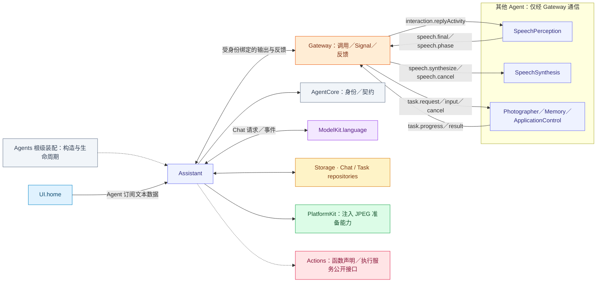
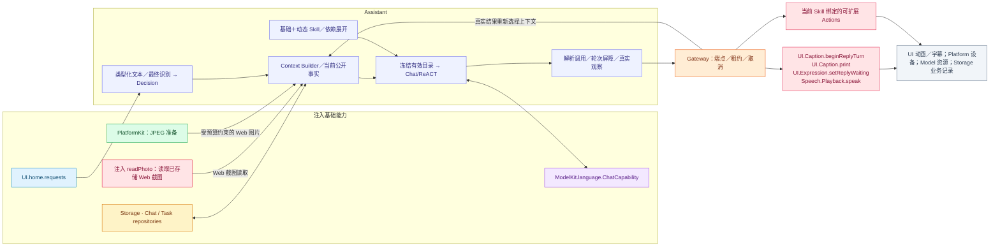
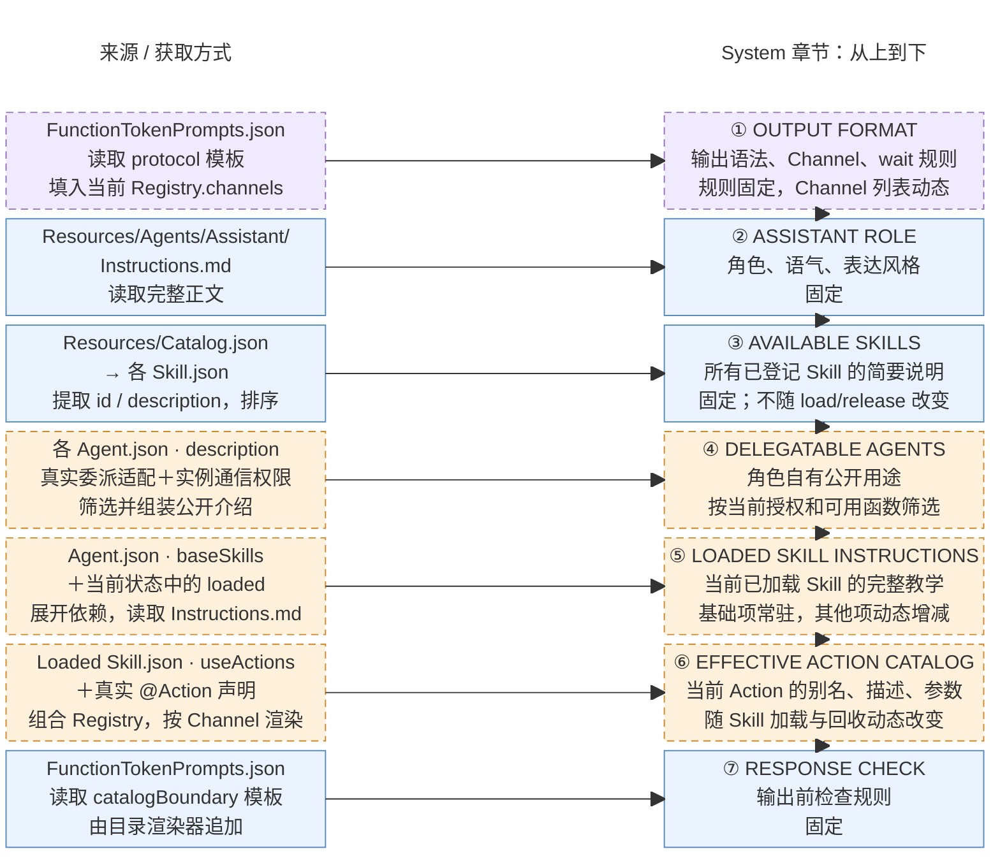

# Assistant — 对话、Task 与可扩展 Skill

## 角色容器

[AssistantContainer.swift](AssistantContainer.swift) 是 AgentContainer 的稳定子能力。持有 AssistantExecutionSession，通过会话管理角色私有 Context、注册与绑定输出任务，并提供首页会话／活动投影。仅启停 Assistant，不控制平级角色。

生命周期由[模块根](../README.md#agent-container)统一编排；子容器能力不授予执行权。

## 职责与注入能力

Assistant 是 `AgentChatWorker<AssistantContextState>` 的角色绑定，负责用户对话、一个前台目标、动态 Skill 与结果驱动 ReACT。它主动订阅 UI.home 文本；最终语音文本才经 Agent Signal 到达。UI 不持有 Assistant 引用，也不分派给指定 Agent。

| 注入能力 | 所有者与用途 |
| --- | --- |
| UIHomeContainer | 直接订阅 home.requests；聆听控制由 SpeechPerception 单独订阅 |
| ChatCapability／chatProvider | ModelKit.language：按请求选择并使用模型 |
| AgentStateContext | 读取 Skill.useStates 指定容器事实；Task从私有上下文生成 |
| AssistantHistoryStore／AssistantTaskRepository／AgentMessageRepository | Storage 数据库领域接口；会话、消息与任务提交 |
| 照片读取、prepareJPEG 回调 | 装配时注入 Actions.Camera 的只读 readPhoto 闭包与 PlatformKit JPEG 准备能力；角色制定预算，不持有相机控制器 |
| AgentContextRepository／配置与目录 | Agents 私有 Context、Skill 状态与 AgentCore 不可变执行声明 |

## 文件与职责

| 文件 | 职责 |
| --- | --- |
| [AssistantAgent.swift](AssistantAgent.swift) | 通用 Chat Worker 与 AssistantContextState 的类型绑定，保留单一推理实现 |
| [AssistantExecutionSession.swift](AssistantExecutionSession.swift) | Assistant 注册、受保护输出泵与会话中断／关闭加入 |
| [AssistantProcessing.swift](AssistantProcessing.swift) | Assistant 私有状态、提示词、照片策略与控制协议解释 |
| [AssistantSessionControl.swift](AssistantSessionControl.swift) | Assistant 私有的中断／关闭会话控制协议 |

## 外部关系（一层）

角色间消息经 Gateway 递送；基础能力通过构造注入，输入订阅由角色持有。角色、Skill 与 Task 授权归 Agents；Actions 来源的协作接口由 App 以中立窄端口绑定，Agents 不导入 Actions、CallRuntime 或 ExecutionRuntime。

## 内部结构与执行链

Skill 通过注册声明持续扩展可见函数，图中不固定穷举 Action。有效目录来自基础项与当前加载项，内部 Tool 不因注册而自动暴露给模型；Skill 加载本身不授予运行期执行权。Assistant 自己不消费 PCM 或视频帧，也不直接开关设备。

首页文本回执表示决策接纳，不表示模型回复或 Action 完成。实际模型、执行及回复终态由 Worker 与受身份绑定的输出泵拥有；取消与停止加入这些工作。

## Context 与 Builder

The private AgentContextRepository owns history, skillState and runtime task correlation/report views. Each actual model request freezes Skill/catalog/teaching selection and the matching active Task goal/status from that committed value. The loaded Skill ID list and minimal Task form AGENT CONTEXT; internal task registries, grants and Skill-retention bookkeeping stay private.

AgentChatWorker then samples the selected owner facts through AgentStateContext and combines them as CURRENT STATE in the same fresh system data message. It does not read a Storage.State mirror or route these reads through Gateway. The data message follows history and precedes the latest user input, or follows the complete native result group. Old system data is replaced on continuation. Ordinary background conversation and current Task evidence remain within the bounded history window; terminal Tasks can project summaries without altering source evidence. See [request assembly](../Support/Chat/README.md#request-state-assembly), [source mapping](../Support/Context/README.md#container-context-read-path) and the [overall context figure](../../README.md#model-context-composition).

## System 提示词结构与来源

实际拼接入口为 [AssistantContextState.systemPrompt](AssistantProcessing.swift)。下图左侧是来源与获取方式，右侧按 system 正文中的章节顺序从上到下排列。蓝色实线表示固定内容，橙色虚线表示动态章节，紫色虚线表示固定规则中包含动态字段；固定指同一 App 资源版本内固定。

资源由 [AgentConfigurations](../Support/AgentConfigurations.swift) 按打包 Bundle 中的 [Catalog.json](../../Resources/Catalog.json) 显式映射读取并缓存，不扫描目录或热更新。协议与短检查来自 [FunctionTokenPrompts.json](../Support/Core/Generation/FunctionTokenPrompts.json)，角色来自 [Instructions.md](../../Resources/Agents/Assistant/Instructions.md)，可委派角色职责来自各自 Agent.json.description，经 AgentTaskDelegation 与实例通信权限筛选；总量最多 8192 UTF-8 字节，超限明确失败。Skill 概览读取共享 Skill.json 的 id/description，按 ID 排序，总预算 4 KiB，必要时截短描述并保留 ID。带 owner 的 Writer 专属 Skill 由 Writer 的工作区域激活。

基础列表来自 [Agent.json](../../Resources/Agents/Assistant/Agent.json) 的 baseSkills；[AgentSkillLoader](../Support/AgentSkillLoader.swift) 展开当前激活项的依赖并合并函数绑定，⑤拼接对应 Instructions.md，⑥通过 [CapabilityContextBuilder](../Support/Core/Capability/CapabilityContextBuilder.swift) 渲染当前 Action 目录。别名/Channel 来自 Skill 绑定，描述、参数与约束来自真实 @Action 声明；⑦由同一目录渲染器追加。实际请求的独立 system 数据消息同时包含 AGENT CONTEXT 和 CURRENT STATE；放置规则见上文 Context 与 Builder。

[共享 Chat Worker](../Support/Chat/README.md) 在每次新输入及 ReACT 请求中按当前 Skill 快照重新组装 system/工具定义；已发出的请求与历史证据不重写。system 正文最多 64 KiB，超限明确失败。当前会话的 Task 目标/阶段及已加载 Skill ID 进入 AGENT CONTEXT；选定的相机/机械臂/UI 事实进入 CURRENT STATE，Skill 归属/剩余次数保持私有；历史与真实 ReACT 执行观察保留在各自消息中；Assistant 当前基础与可加载 Skills 均只声明 XML Action，request.tools 为空；Writer 的原生工具定义由其独立工作流提供。

## Task 与 Skill 生命周期

基础 Skill 为 basic-skill、expression-interaction。机械臂 robot-interaction 为可发现的按需 Skill，加载后才注入动作、教学及 actions.robot/actions.robot.motion 观察；可按近期/Task 生命周期释放。无 Task 的加载/合法使用将近期项计数重置为 5，每次完整闲置用户 Decision 扣 1；Task 等待期间暂停无关近期项计数。Task 只接管指定、加载或实际使用的项，等待用户时保留，终态屏障后回收。生命周期合图及容量/LRU、依赖与原子回滚见 [Context](../Support/Context/README.md#task-and-skill-lifecycle)。

已注册 Camera 函数不要求 Task。单次拍照、保存当前预览或相机控制可直接使用 Skill；必须先确认当前目录存在函数，缺失才加载 photography。预览引用来自实际捕获结果或 actions.camera.preview 目录。

教学只允许以当前活跃且匹配的 Task/目标决定 finishTask/cancelTask。无 Task 操作完成直接回复；不确定是否放弃旧目标时先询问并保留 Task，明确切换时关闭旧目标或释放无关近期 Skill。finishTask 通常结束决策，显式 continueDecision=true 才继续同一输入剩余新目标，cancelTask 结束该决策。Skill 释放不代表保存、忽略或关闭相机。

## 对其他 Agent 的委托

Assistant 拥有用户意图、委托请求和面向用户的沟通；执行 Agent 拥有接纳后的业务工作、进度、清理与终态。跨模块时序见[总体委托流程](../../README.md#assistant-agent-delegation)。委托通过已有 Task Action 和认证角色通信，不调用另一个 Agent 的私有方法，不复制它的提示词、模型上下文或执行循环。

| 阶段 | Assistant 与运行时契约 |
| --- | --- |
| 发起 | `task.delegate(agent_id, description)` 走 Control Channel 的 XML Action；Actions 校验后调用注入的 Task 控制端口。运行时检查目标通信权限、业务契约与能力，在 agent_messages 持久化请求 UUID，再发送绑定 requester/executor/session 的 `task.request`。 |
| 接纳 | 执行者验证来源、scope 与自身容量，并绑定其拥有的业务任务；回执只确认接纳。后台委托不切换 Assistant 前台 Task 或有效 Skill 目录；`task.end` 只结束当前前台目标。 |
| 观察 | `task.progress`/`task.result` 由共享 Chat 更新关联控制状态；Writer 在灵动岛展示普通进度。接纳、追问及持久终态还会更新 Assistant 的委派控制状态。公开状态仍由当前 Skill 的 `useStates` 选择。 |
| 补充与取消 | 使用 `agent_id` 指定通信目标；运行时解析唯一活跃通信链，回答追问时还校验本次输入捕获的问题身份。模型不提供 delegate/event/interaction UUID。取消接纳只表示已递送，必须等待执行者清理及终态证据。 |
| 失败 | 配置、权限、接纳、持久化和递送失败显式返回；回执成功不等于业务完成，回报事实不授予重试、重新委托或改变前台 Task 的权限。 |

通信输出由 [Support 独立消费者](../Support/README.md#lifetime-bounds-and-failures) 持续递送，不受等待该 Task Action 的模型轮次屏障阻塞。角色根拥有消费者及其取消/加入；通信队列与输出队列各自有界，溢出明确失败。消息值与固定任务准入见 [Communication](../Support/Communication/README.md)，执行参数见 [Task Actions](../../Actions/System/Task/README.md)。

当前公开创作执行者是 Writer；`task.delegate` 路径只向已声明且授权的目标开放，并不表示所有 Agent 都支持后台业务。当前 `task.send` 的补充输入适配也仅支持 Writer。Writer 的单行目标/原始输入、忙碌与取消、长期作品任务、灵动岛回馈、追问身份和独立持久终态通知见 [Writer 委托与主动事件](../Writer/README.md#委托与主动事件)。向 Writer 的委派、补充、取消送达成功时只完成调用，拒绝仍是异常观察。Writer 运行不随 Assistant 聆听停止、语音打断或对话关闭而取消；这属于该执行角色的生命周期契约，不能推定为所有角色的统一行为。

## ReACT、历史与失败

共享 [Chat](../Support/Chat/README.md) 根据真实业务值/失败和轮次屏障继续；Agent/Provider/解析异常不自动重试。Action 模型观察使用轮内序号、别名、状态、结构化值；拒绝明确未执行，失败保留效果不确定性和部分结果。原生 Tool 配对及完整执行日志保持完整。

Task/dialog/message 身份先经注入仓库提交；delta、Skill 计数、在途 Decision 和队列只保存在内存。完整消息和真实终态按边界提交；Task 原始来源由 SQL 查询，重启不重放 Action。存储实现及职责见 [Storage](../../Storage/README.md)。

## 输出与清理

输出容量 256；共享 worker 的接纳、driver/native 队列、结果与上下文容量见 [Chat](../Support/Chat/README.md#bounds-and-overflow)。UI.Caption 的内部 beginReplyTurn/print 和 Speech.Playback.speak 分别服务 Display/Speech Channel，不因内部注册而向模型开放。聆听权由 SpeechPerception 拥有，实际播放/采集由模块拥有的语音服务协调。

取消必须加入模型与已接纳工作清理；状态/历史提交失败显式报告，不能执行依赖未提交状态的后续步骤。根 scope 与 worker 独立于页面生命周期。

AssistantContextState.sessionControl 解释 AssistantSessionControl，并映射为通用 Chat 的 interrupt／close 意图。共享 Worker 不识别 assistant.control 字符串或 Assistant 私有类型，仍验证本地 runtime 来源后执行中断／关闭屏障。默认 Chat Context 不解释其他角色控制协议。

## Image context ownership

Camera previews come from Photography's actions.camera.preview State. Camera prepares bytes and owns latest/explicit selection; shared Chat rebuilds attachments on the original current user input on every request, including new user turns and Action continuations. The system State manifest supplies source/ID/size and attachment-order mapping. Assistant does not interpret takePhoto receipts or own a second photo cache. Ephemeral bytes are excluded from durable model-request logs.

AssistantWebImagePolicy and its observation callback remain for Web.Page browse/snapshot/navigate only, enforcing1568px/1MP/1MiB JPEG preparation and unsupported-model reporting. They never load Camera previews or album images.

## Container 上下文

Assistant 消费根注入的只读容器来源，Task／Skill 来自自身私有决策快照；根生命周期结束关闭来源接纳，不保留历史公共Task镜像。

## Basic native observations

BasicSkill includes eight passive platform.* sources in addition to ui.navigation. These enter CURRENT STATE through projection of the producer-owned complete Business dictionary. Native time, power, thermal, path, permissions, audio, locale and accessibility are observations; they never override frozen capability authorization or current business execution checks. Task/Skill projection remains private AGENT CONTEXT. See [Context](../Support/Context/README.md#current-facts-before-explicit-queries).

## Passive container state

stateSnapshot projects local installation/closure, Agent lifecycle/queue counters and initialized committed task/Skill fields without message content. residentContext() reads the repository’s last committed memory only; context fields are unknown before initialization. Agent start owns initialization/restoration and its failures. The root catalog binds independent readers without sampling roles or maintaining another mutable role-state registry.

## State selection ownership

Skill.useStates is the sole exact-path observation selection. AssistantStateBindings installs one App-backed resolver, not a path or field allowlist. It projects the producer's complete Business dictionary, retaining objects/arrays, while excluding Runtime, health/issues, metadata and children. Missing/unreadable/malformed nodes return unknown/null plus a bounded path/code diagnostic; cancellation, closed context and capacity failures still propagate. Selecting a parent does not traverse children. New Skill sources need only a producer and App read route, with no Assistant registration change.

## Photography state selection

Photography loads capture/video Actions and settings/recording fields from actions.camera: mode, delaySeconds, flash, supportedFlash, zoom, maximumZoom, durationSeconds, countdown, recordingPhase and recordingID. Native platform.vision.camera independently supplies actual running/recording/lens/zoom. State selection does not activate the camera or confer permission. Configuration and preview-only opening complete without business values. Capture and disposition use real preview/video identities, and window cleanup precedes matching Task completion.

ui.island投影包含活动身份、标题、系统选择及提交状态；前台目标展开与localStatus可读，系统实际几何未知，不携带频谱或设备权威状态。Island.setPresentation设置前台compact/expanded，expanded要求已提供的detail；系统可见性/时长仍由iOS决定；实际摄影/录像仍调用Camera声明。

## Web image observations

The scoped web observation hook recognizes successful Web.Page browse/snapshot/navigate receipts. It resolves their mediaID through the same scope-bound image read and image preparation port. The user image message labels the payload as untrusted data. Unsupported image models receive an explicit unavailable observation and can use the bounded page text in the Action result. Generated code and the Writer transcript never enter the Assistant parser or history.

WebBrowsing 从 ui.web.sessions 读取逐窗口的页面类型和有界远程 URL，从 ui.windows 读取窗口身份与焦点。统一resolver按Skill声明读取这两个来源；本地文件路径与WebKit运行指标不进入Assistant上下文。

默认BasicSkill观察全局ui.windows，包含Writer窗口。Assistant按可用Skill说明加载页面观察或窗口控制能力，不能将未加载目录解释为看不到所有窗口；窗口摘要与实际截图/正文证据区分。Writer 自有灵动岛直接展示进度、追问和结果。

## 自有任务岛

AssistantExecutionSession管理两条独立活动：消费本角色Skill状态的任务岛，以及共享Chat请求等待回调驱动的推理等待岛。共享层只报告开始/首个输出/异常结束；文案和UI.Island内部调用由Assistant拥有。各活动独立身份、版本与结束，停止先加入展示清理再退休角色权限。Gateway executeInternal结果由调用方处理，不进入模型输入；presentationFailure保留展示错误。其他角色自己的语音、摄影或连接展示不由Assistant代发。

## 输入开始与自有回复字幕

SpeechPerception的speech.phase(speaking)由Assistant作为控制输入处理，不启动LLM或占正式回复FIFO。按会话、可信发送者incarnation和识别turn单调去重，最多32个会话标记，关闭会话释放；满载明确拒绝。接纳新起点后经Gateway提交内部Display Action UI.Caption.clearReply，冻结当时的回复请求身份，随后结束该控制输入的输出记账；不借用beginReplyTurn、不把调用计入正在进行的模型round，也不清转写槽。原有语音打断路径不变。正常结束保留回复字幕，旧请求续轮被呈现围栏退休，实际新回复可以建立自己的身份。该动作不加入模型可见目录或Skill。

前台Task灵动岛通过GatewayOutputConsumer.executeInternal调用已声明的UI.Island内部工具，
其结果只由AssistantExecutionSession的呈现worker消费。独立呈现会话不生成Assistant输入或
回复占用；任务/模型会话与呈现会话保持独立。内部字幕/等待态的执行回执不触发模型ReACT。

## 前台与 Writer 入口选择

task.start 保留 Assistant 自己执行的前台目标；task.delegate 将目标交给平级 Agent。写作、绘图、文件修改、作品搜索/打开/删除直接委派 Writer，不先创建前台包装任务或加载 Skill。两个独立目标可并存，后台委派不改变已有前台 scope。Writer 专属 Skill、实际作品身份、文件操作与完成均由 Writer 负责。

## 提示词所有权

Assistant/Instructions.md 只维护自身用户对话、协调、输出和事实汇报责任，Prompts.json 只维护证据模板。AssistantContextState 组合 Core 协议、Skill 教学和目录、有效 Action 目录，以及各 Agent 自己的公开 description；DELEGATABLE AGENTS 根据实际实例权限和已实现适配过滤，不包含其他角色私有提示词。start/delegate 平级教学归 BasicSkill，Writer 业务用途和委派条件归 Writer/Agent.json。
