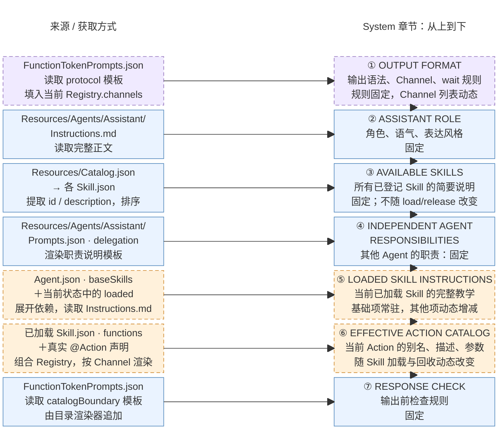

# Assistant

## 职责与边界

唯一普通用户对话执行者，拥有动态 Skill、一个前台目标 Task、Chat/ReACT、会话历史选择及照片模型输入策略。通过注入的 ModelKit/Storage 接口计算和记录，通过 Gateway 发出已解析调用；App 提供 native 能力，Actions 实现效果。角色间没有共享可写上下文。

## 文件与直接接口

| 文件 | 职责 |
| --- | --- |
| AssistantAgent.swift | 共享 Chat worker 的角色类型绑定 |
| AssistantProcessing.swift | State、预处理、Context Builder、system 拼接与照片输入策略 |

用户文本及最终 ASR 经 Gateway FIFO 进入；起音绑定当时 Task，迟到识别不得改投新目标。camera.state 只更新经来源/序号验证的被动事实。输出包括 Action、native Tool、通信及轮次屏障，执行反馈回原输入/轮次。模型函数来自 [Agent.json](../../Resources/Agents/Assistant/Agent.json) 的 baseSkills 和动态 Skill，真实函数参数见 [Actions](../../Actions/README.md)。

## Context 与 Builder

根拥有的仓库保存 history、skillState、cameraState 与后台任务报告。Builder 读取不可变快照；运行事实作为 user-role 数据注入，不能覆盖用户意图或拆开 native 配对。普通对话背景和完整当前 Task 过程保留在容量窗口内；终态 Task 在原始来源位置投影摘要，不修改原始证据。

## System 提示词结构与来源

实际拼接入口为 [AssistantContextState.systemPrompt](AssistantProcessing.swift)。下图左侧是来源与获取方式，右侧按 system 正文中的章节顺序从上到下排列。蓝色实线表示固定内容，橙色虚线表示动态章节，紫色虚线表示固定规则中包含动态字段；固定指同一 App 资源版本内固定。

资源由 [AgentConfigurations](../Support/AgentConfigurations.swift) 按打包 Bundle 中的 [Catalog.json](../../Resources/Catalog.json) 显式映射读取并缓存，不扫描目录或热更新。协议与短检查来自 [FunctionTokenPrompts.json](../Support/Core/Generation/FunctionTokenPrompts.json)，角色来自 [Instructions.md](../../Resources/Agents/Assistant/Instructions.md)，独立 Agent 职责来自 [Prompts.json](../../Resources/Agents/Assistant/Prompts.json) 的 delegation。Skill 概览读取各 Skill.json 的 id/description，按 ID 排序，总预算 4 KiB，必要时截短描述并保留 ID。

基础列表来自 [Agent.json](../../Resources/Agents/Assistant/Agent.json) 的 baseSkills；[AgentSkillLoader](../Support/AgentSkillLoader.swift) 展开当前激活项的依赖并合并函数绑定，⑤拼接对应 Instructions.md，⑥通过 [CapabilityContextBuilder](../Support/Core/Capability/CapabilityContextBuilder.swift) 渲染当前 Action 目录。别名/Channel 来自 Skill 绑定，描述、参数与约束来自真实 @Action 声明；⑦由同一目录渲染器追加。

[共享 Chat Worker](../Support/Chat/README.md) 在每次新输入及 ReACT 请求中按当前 Skill 快照重新组装 system/工具定义；已发出的请求与历史证据不重写。system 正文最多 64 KiB，超限明确失败。Task 目标/状态、Skill 归属/剩余次数、相机事实、历史与 ReACT 观察通过其他 messages 注入；原生 Tool 定义放在 request.tools，仅模型支持 Tool Calls 时提供，均不属于上图的 system 正文。

## Task 与 Skill 生命周期

基础 Skill 为 basic-skill、expression-interaction、robot-interaction。无 Task 的加载/合法使用将近期项计数重置为 5，每次完整闲置用户 Decision 扣 1；Task 等待期间暂停无关近期项计数。Task 只接管指定、加载或实际使用的项，等待用户时保留，终态屏障后回收。生命周期合图及容量/LRU、依赖与原子回滚见 [Context](../Support/Context/README.md#task-and-skill-lifecycle)。

已注册 Camera 函数不要求 Task。单次拍照、保存/忽略当前预览或相机控制可直接使用 Skill；必须先确认当前目录存在函数，缺失才加载 photography。媒体引用来自实际捕获结果或当前 displayedMediaID，忽略别名为 ignorePhoto。

教学只允许以当前活跃且匹配的 Task/目标决定 finishTask/cancelTask。无 Task 操作完成直接回复；不确定是否放弃旧目标时先询问并保留 Task，明确切换时关闭旧目标或释放无关近期 Skill。finishTask 通常结束决策，显式 continueDecision=true 才继续同一输入剩余新目标，cancelTask 结束该决策。Skill 释放不代表保存、忽略或关闭相机。

## ReACT、历史与失败

共享 [Chat](../Support/Chat/README.md) 根据真实业务值/失败和轮次屏障继续；Agent/Provider/解析异常不自动重试。Action 模型观察使用轮内序号、别名、状态、结构化值；拒绝明确未执行，失败保留效果不确定性和部分结果。原生 Tool 配对及完整执行日志保持完整。

Task/dialog/message 身份先经注入仓库提交；delta、Skill 计数、在途 Decision 和队列只保存在内存。完整消息和真实终态按边界提交；Task 原始来源由 SQL 查询，重启不重放 Action。存储实现及职责见 [Storage](../../Storage/README.md)。

## 输出与清理

输出容量 256；共享 worker 的接纳、driver/native 队列、结果与上下文容量见 [Chat](../Support/Chat/README.md#bounds-and-overflow)。Speech.Caption 的内部 beginReplyTurn/print 和 Speech.Playback.speak 分别服务 Display/Speech Channel，不因内部注册而向模型开放。聆听权由 SpeechPerception 拥有，实际播放/采集由模块拥有的语音服务协调。

取消必须加入模型与已接纳工作清理；状态/历史提交失败显式报告，不能执行依赖未提交状态的后续步骤。根 scope 与 worker 独立于页面生命周期。

## Model photo preparation policy

AssistantPhotoInputPolicy in AssistantProcessing.swift owns analysis budgets: maximum dimension 1568, maximum pixels 1,048,576, maximum JPEG bytes 1 MiB and initial quality 0.82. photoObservations checks successful takePhoto evidence and model image support, reads the original, validates photo identity, invokes an injected prepareJPEG(Data, policy) capability and constructs the JPEG ChatImage itself. photoObservationHandler builds the worker callback inside Agents from those injected capabilities. Raw read and preparation are separate required capabilities; there is no implicit/no-op production preparation fallback. App only binds capabilities, while PlatformKit retains Image I/O internals. Agent code imports no native codec/framework.

Check cancellation before reading, before preparation and before retaining results. Native preparation failure/cancellation propagates through the current decision; empty/over-budget results reject without uploading the original. The existing worker invokes observations after the round barrier and retains prepared images in ReACT requests, so later business-result continuations do not recompress. Original storage, preview and album import remain independent.

These scene/composition defaults are based on [OpenAI vision sizing](https://developers.openai.com/api/docs/guides/images-vision), [Claude client resizing guidance](https://platform.claude.com/docs/en/build-with-claude/vision) and [Alibaba vision](https://www.alibabacloud.com/help/en/model-studio/vision); 1 MiB is a local transport budget, not a vendor-wide recommendation or an OCR quality guarantee. Native mechanics are described in [PlatformKit/Vision](../../PlatformKit/Vision/README.md#native-image-compression).

## 待实现

- 真实模型对无 Task 完成、目标转移询问、主动释放及多轮摄影教学的遵循验收。
- 场景挂起期间保留前台目标及最终 checkpoint 的完整落盘；公共限制见 [Chat](../Support/Chat/README.md#待实现)。
- 相机/Photos、图像质量、原生历史交互、语音竞争及持续真机验收。

## Storage 依赖

✅ 存储访问使用独立的 State、Cache、Database 和 Files 接口；App 注册根实例，消费者通过构造器获得所需能力。存储容器不接管本目录的业务验证、执行和完成语义。
