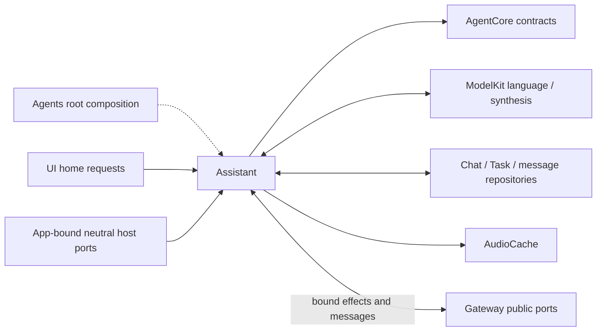
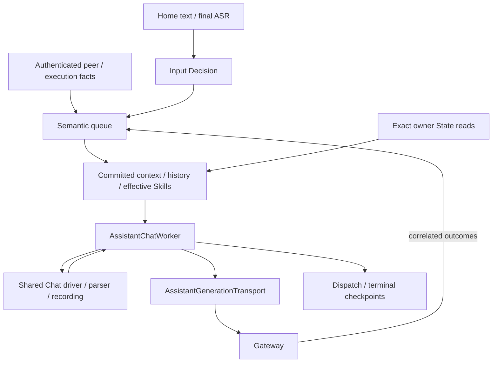

# Assistant — Conversation, foreground Tasks and dynamic Skills

## Ownership and interfaces

AssistantAgent binds AssistantChatWorker to AssistantContextState. The worker owns Assistant's conversation schema, Decision/ReACT orchestration, Task controls, input classification, Writer feedback and reply lifecycle. Its generic state seam supports isolated fixtures; it is not a common runtime for other production roles. Shared [Chat](../Support/Chat/README.md) supplies model driving, recording, neutral projection and templates; [Core](../Support/Core/README.md) supplies parsing, permissions and round coordination.

AssistantContainer is the stable child capability of AgentContainer. It retains AssistantExecutionSession, private context, registration and bound output workers, and exposes conversation/activity projections. The module root owns startup and joined shutdown; the child neither controls peer roles nor grants execution authority. Static category comes from the role's Agent.json.

| Injected capability | Owner and use |
| --- | --- |
| UIHomeContainer | Direct home text requests; SpeechPerception independently owns listening input. |
| ChatCapability / chatProvider | ModelKit language requests and model selection. |
| AgentStateContext | Exact Skill-selected owner facts and multimodal snapshots. |
| AssistantHistoryStore / AssistantTaskRepository / AgentMessageRepository | Separate durable conversation, foreground Task and peer-message boundaries. |
| AgentContextRepository | Private committed history, Skill state and runtime Task correlation. |
| AssistantSpeechProducing | Role-owned audio-handle production, cancellation and playback facts. |
| Bound output consumer | Authenticated calls, messages, feedback and cancellation scopes. |

Native observations and UI requests have role-owned consumers. Final SpeechPerception transcripts arrive through authenticated communication. Assistant does not consume raw PCM/video, directly switch devices or import Actions/CallRuntime/ExecutionRuntime implementations. App binds narrow collaboration interfaces. Home text acknowledgment establishes admission, not reply or effect completion.

## Files

| File | Responsibility |
| --- | --- |
| [AssistantAgent.swift](AssistantAgent.swift) | Concrete public worker/state binding. |
| [AssistantChatWorker.swift](AssistantChatWorker.swift) | Actor-owned decision loop, admission, Task/Skill controls, generation, round joins and peer feedback. |
| [AssistantChatContext.swift](AssistantChatContext.swift) | AssistantChatState, workflow control intent, transactional AssistantHistoryContext and recovery/compression. |
| [AssistantHistoryProjection.swift](AssistantHistoryProjection.swift) | Decision exchange selection, durable history reconstruction and private request selection. |
| [AssistantContainer.swift](AssistantContainer.swift) | Stable role capability, UI-facing state/control and resident-state projection. |
| [AssistantExecutionSession.swift](AssistantExecutionSession.swift) | Registration, output ownership, task/waiting/Decision presentation and joined session cleanup. |
| [AssistantGenerationTransport.swift](AssistantGenerationTransport.swift) | Ordered output reader, bounded native execution slots and per-round seals. |
| [AssistantProcessing.swift](AssistantProcessing.swift) | Concrete state, prompt/capability assembly, preprocessing and history binding. |
| [AssistantSessionControl.swift](AssistantSessionControl.swift) | Host interrupt/close message and typed decoding. |
| [AssistantInputDecision.swift](AssistantInputDecision.swift) | Input classification, fallbacks, adopted disposition and Decision log projection. |
| [AssistantInputBatch.swift](AssistantInputBatch.swift) | Trusted source timeline, batch text, historical marker parsing and input prompt access. |
| [AssistantStateBindings.swift](AssistantStateBindings.swift) | Business-only exact-path State adaptation. |
| [AssistantSpeechOutput.swift](AssistantSpeechOutput.swift) | AssistantSpeechProducing contract, audio-handle production and synthesis/playback presentation. |
| [SpeechPlaybackFailure.swift](SpeechPlaybackFailure.swift) | Playback-boundary failure copy with preserved underlying synthesis/cache cause. |

## Request state assembly

Each actual request freezes the effective Skill IDs, catalog, teaching and matching foreground Task goal/status from one committed private snapshot. AssistantHistoryProjection selects recent history and the current batch; selected owner facts are read afterward, outside the private transaction. These reads and private selection are not one atomic transaction.

AGENT CONTEXT exposes only the matching active Task and effective loaded Skill IDs. Task registries, delegated views, grants, retention counters and decision-use sets remain private. CURRENT STATE contains only Skill-selected Business facts; old system facts are replaced on every continuation. No Storage.State mirror or Gateway query is used for collection.

Ordinary ordering is instruction/catalog system, selected history, fresh Agent/business system data, then current user input. Native continuation keeps complete assistant-call/tool-result groups contiguous and places fresh data afterward. Historical requests are reconstructed from actual input/response/call evidence without reinserting old system facts. Terminal Task summaries remain historical evidence. Shared projection preserves system messages, current intent, the complete required suffix and current images while removing only expendable history.

Each request records selected State paths in AssistantDecisionMetadata.states alongside Task/Skill/catalog metadata. Fact bodies and image bytes belong to full request logs, not business metadata. History never reads current State to reconstruct an old selection. Model token fitting remains ModelKit-owned.

## Prompt ownership and localization

AssistantContextState assembles the following order: shared OutputProtocol, Assistant InputProtocol, role Instructions and reply-language guidance, available shared Skills, permission-filtered public Agent descriptions, loaded Skill teaching and the effective Action catalog. AgentConfigurations locates assets through Catalog.json; AgentPrompts loads/renders immutable locale-selected templates. Canonical historical timeline markers remain English and retain recognized historical formats; missing templates/render failures propagate.

Public Agent introductions are limited to 8,192 bytes and filtered by actual delegation adapters and current instance communication permissions. Shared Skill overview has a 4 KiB budget and retains IDs when descriptions are shortened. Owner-restricted Writer Skills are loaded by Writer's own workflow. Base/dependency teaching and Action metadata derive from the same effective Skill snapshot. Actual request assembly receives the instance's narrowed communication policy; the convenience default does not bypass it.

System instructions are limited to 64 KiB. Current Assistant Skills expose XML Actions and no native request tools; the native-call machinery remains available for controlled fixtures. Writer owns its independent native tool workflow. Already dispatched requests and recorded evidence are not rewritten when Skills or language change.

Assistant/Prompts.json owns execution evidence, Task-history prefixes, Writer coordination and default reply language. InputProtocol.json owns input guidance and canonical timeline markers. InputDecision.json and its zh-Hans sibling own classification action definitions and prompt templates. Shared RequestContext templates render fresh State and image manifests. InputDecisionOutcome's UI log projection stays in Assistant; generic runtime logs retain their existing AppLanguage injection.

## Task and Skill lifecycle

Base Skills are basic-skill and expression-interaction. Optional capabilities such as robot-interaction are discovered/loaded on demand. Loading a Skill adds declarations/teaching/selected State, not runtime execution authority. Internal tools are not automatically exposed by registration. Camera operations do not inherently require a foreground Task.

Task/Skill control uses the Control channel. task.start rejects an existing foreground goal; loadSkills/releaseSkills commit state before rebuilding the catalog. task.end commits the actual outcome and ends the decision unless continueDecision=true explicitly permits a new objective. Full-duplex completion validates the originating request/Task binding, commits SQLite terminal state/summary/sources, then publishes private context and releases Task-held Skills. The ending Message remains part of the source set. Trusted host completion uses the same commit path; synchronous mode joins the ending call and execution barrier first.

Task creation validates a candidate, commits business identity, then binds runtime context; failed binding explicitly closes that identity. Only admitted valid model calls count as Skill use; execution failure counts, rejected parsing/parameters do not. Recent Skills reset to five decisions on load/use without a Task. Full user decisions settle retention once; system observations do not decrement it. Waiting Tasks retain their held Skills and pause unrelated recent counters. [Context](../Support/Context/README.md#task-and-skill-lifecycle) owns dependency, LRU, capacity and rollback algorithms.

Interrupt/failure retains unfinished Task/Skills and returns the goal to waitingUser. Close releases matching session-scoped recent Skills but does not fabricate Task completion. Explicit change of goal reports the old outcome before proceeding. Unclear continuation is resolved with the user. Camera/media and draft effects are confirmed by their own receipts.

## Delegation and peer facts

Assistant owns user intent, delegation requests and user communication; the recipient owns admitted work, progress, cleanup and terminal results. task.send(agent_id,text) persists the authenticated original message and source dialog, then delivers agent.task.request. New goals, supplements, answers and stop requests use the same body contract. Writer decides whether to start/update/stop work and which workspace to use. Assistant never calls a peer's private method or copies its prompt/execution loop.

Writer replies through agent.task.response. Assistant authenticates and deduplicates admission, selected milestones, questions, rejection and terminal facts, preserving source dialog/task/question identity. Durable rejection/terminal handling verifies the immutable stored notification before consumption. Old delegation completion settles only its original view; delivery retry never repeats creative work. Fixed tasks separately use task.request/input/cancel and share agent.task.response for progress/results. Memory parent-commit confirmation retains its existing dependency barrier.

Full-duplex peer facts update control state before entering the semantic queue; synchronous mode uses deterministic notification presentation. Task/interaction binding remains available for follow-up validation. Peer receipt proves delivery admission only and cannot authorize retry or a new goal. Writer's task lifetime is independent of Assistant listening, interruption and dialog closure. Independent communication consumption is owned by the role root and bounded separately from round output; see [Support](../Support/README.md#lifetime-capacity-and-failures).

## Results, history and continuation

AssistantHistoryProjection selects the latest ten complete history blocks. Completed resolved native calls retain paired provider messages. Failed/interrupted/unresolved requests become textual evidence. Terminal Tasks compress at their first source position while original records remain queryable. Ordinary conversation and active Task evidence remain eligible within the window.

Input admission and read-token/begin history operations use the short admission gate. Model generation and effects run outside it. Preparing/queueing a request retains awaitingModel/awaitingDispatch state in memory; onDispatch creates the actual Message and writes complete batch/coordination metadata. Non-HTTP producers follow the same dispatch/evidence contract. Deltas, retention counters and queues remain in memory; complete messages and real terminal outcomes checkpoint at their boundaries. Failed persistence blocks dependent steps. Restart marks interrupted work and never replays effects.

In synchronous mode, the worker joins all admitted calls, reliable results and the round receipt before continuation. Full-duplex mode independently enqueues ordinary Action observations and complete native result groups while settling the original journal. Only explicit model-origin calls may contribute reasoning observations; origin is recorded per invocation, never inferred from path or internal-tool catalog membership.

| Actual evidence | Decision behavior |
| --- | --- |
| Explicit business value, including an empty string | Eligible for continuation after reliable joins. |
| Successful completed/report/activity acknowledgment | Completion evidence only; preserve details without requesting reasoning. |
| Native result without completion | Preserve its value semantics; Action result without completion normalizes to completed. |
| Failed/partial call, timeout or admission/permission rejection with reliable feedback | Preserve effects/failures and allow reasoning while the input owner is live. |
| Pure cancellation | Settle cancellation without incident or continuation; independent mixed-report failures remain real failures. |
| Unknown alias/invalid arguments | Correlated not-executed rejection; no effect is submitted. Malformed syntax is a generation failure. |
| Provider/stream/parser/observation construction failure | Join admitted work, preserve causes and terminate the decision without automatic retry. |
| Uncertain round closure/delivery | Preserve primary and cleanup evidence; uncertainty cannot authorize retry. |

Successful send/publish is an admission acknowledgment. Model stop/toolCalls/lengthLimit only ends generation; it does not itself request another round. Passive State, active Tasks and waiting for a user do not create polling. Unmatched Tool feedback is rejected rather than treated as a fresh input.

Runtime-generated caption, speech and waiting calls can join completion and retain diagnostics, but their values/failures never become model observations or independently trigger reasoning. A real model business observation remains deliverable even if internal presentation fails in the same round. Without business observations, the worker handles internal failure through its runtime-failure path.

## Bounds and overflow

| Owner | Bound and failure policy |
| --- | --- |
| Input/output | 32 queued inputs plus reserved continuation/settlement admission; 256 output envelopes. Overflow rejects. Failed output yield marks the worker failed, clears inbox, cancels inference and closes output. |
| Full-duplex semantic state | 32 pending inputs, 16 background candidates, 16 KiB per item, 512 KiB pending text, 32 sources and 64 active inputs. Expanded batch accounting prevents hidden overflow. |
| Pending rounds | 32 retained catalogs/request/call/result/resource snapshots. No admission from cancelled rounds. |
| Round calls / observations | 120 calls including rejected/runtime reply-start work; 65,536 UTF-8 bytes of observation text. Reset each round, overflow fails without replay. |
| Private Task views | 256 identities, at most 32 live; only terminal views are retireable. |
| Pending observation attachments | 32 MiB total, with request limits of five images, 64 messages and 64 KiB counted text/call fields. |
| Native output transport | Four execution slots, 128 retained Tool work records and 32 round-seal workers. Overflow rejects; seal failure wakes the pump and joins cancellation. |
| Decision usage | Counters span continuations, with no production cumulative request/native-call/time ceiling. New user input has an independent budget. |

Shared driver queue and provider lifecycle limits are documented in [Chat](../Support/Chat/README.md#driver-lifecycle-and-capacity). Parser/resource limits belong to [Generation](../Support/Core/Generation/README.md); request validation belongs to [ModelKit](../../ModelKit/Language/LLM/README.md#request-validation-bounds). Queues have owner cancellation/termination, not implicit elapsed-time expiry.

## Full-duplex input and Decision

Root composition enables fullDuplex. Only authenticated SpeechPerception final transcripts and local user text enter AssistantInputDecision. Authenticated peer messages and correlated execution facts receive trusted agent/action attribution and bypass user classification; payload text cannot claim a trusted source.

A classification snapshots language and committed configuration. Its prompt presents the three action definitions, the latest earlier dispatched exchange in the same dialog, buffered user input, and a three-way question quoting the latest input. History uses up to 80 characters per side, including a reply still streaming. A merged historical batch uses its latest actual user input. The buffer contains up to three earlier admitted, undispatched inputs from the same session in arrival order, up to 80 characters each. Peer/Action data and media do not enter this prompt. Playback, execution and the captured question remain available to Assistant's adoption checks.

Local D3 reads A/B/C against choices 1/2/3 (interrupt/discard/enqueue). Its State contains the first three sections and its Question contains the last section. Cloud receives the four sections as one user message with a required classification tool. Missing/loading/failed/over-512-token local inference falls back to the cloud model selected by the same configuration. Cloud requires one valid classify_input response; missing/failed cloud configuration conservatively enqueues. One classification consumer owns at most one local and one cloud invocation. Warm local budget is 250 ms; total budget from queue admission is two seconds. Late results cannot alter adopted decisions; root shutdown joins cleanup. Preparation failure resets on resource updates. Individual inference failure does not permanently disable later classification.

Logs retain raw/adopted dispositions, collected local/cloud requests and fallback reasons. Measured classification duration starts before playback/history preparation and ends at the final decision; classification queue waiting, decision execution, interruption cleanup and log publication are excluded.

Enqueue retains pending input. Discard completes the candidate and emits transient feedback. Noise-only unbound speech can be discarded deterministically; useful speech, typed input or bound answers override model discard to enqueue. Independent filler without question context may retain discard. Interrupt first retains new input; if the original reply was absent or changed generation, it only enqueues. Same-generation interrupt joins old execution cleanup before the next request.

A single main model request runs at a time. After stream seal, pending rounds retain original identity/capabilities until actual Gateway terminal feedback. Settlement freezes same-session input already being admitted/classified, waits for that set, then atomically takes ready semantic input; later arrivals do not extend the waiting set. Each complete native call/result block appears once. Ordinary Action business values/failures are deduplicated before enqueue; successful Void/internal completion/pure cancellation only settle the original call.

Preparation failure retains the in-memory batch and blocks that session, reports the actual failure and retries only with a new user input. It does not hot-loop or create a historical request before dispatch. Pause/close/stop clears unissued batches; already dispatched failures settle their original Message. Pause cancels classification/current/pending requests and revokes round admission; resume accepts new input rather than replaying old batches. Interrupted missing results are recorded as cancelled with unknown effect. Every batch member settles on completion, failure or cancellation.

## Input timeline and channels

AssistantInputBatch renders single and multi-source inputs as one timeline: original body followed by trusted source and local-device time. It sorts complete event time then admission sequence. User uptime maps to local Date; peers use receipt time and Actions use completion time. User text resembling trusted source lines/headings is indented. Interruption adds only related prior user intent. Legacy JSON requests can be reprojected while original dispatched evidence remains available.

AssistantGenerationTransport has one ordered reader for Actions and wait boundaries. Reply captions use Display, speech playback uses Speech and task.end uses Control. Each Channel remains FIFO in the session domain; different Channels can run under resource/wait constraints. Native calls retain independent pairing and bounded slots. Stream completion is separate from execution and result-delivery completion. See [Gateway scheduling](../../Gateway/Output/Scheduling/README.md).

Default text segmentation uses first-segment Han/other thresholds of 20/60 and subsequent 60/120, preserving safe word/sentence boundaries. XML/wait boundaries flush without resetting first-segment state; there is no timer flush. A completed text segment produces its caption/synthesis/playback intent.

## State and image ownership

AssistantStateBindings installs one App-backed exact-path resolver. Skill.useStates alone selects sources; parent paths do not imply child reads. It preserves the producer's complete Business dictionaries/arrays while excluding Runtime, health/issues, metadata and child indices. Missing/unreadable/malformed sources become unknown/null with bounded path/code diagnostics; cancellation, closed context and capacity failures propagate. There is no polling, tree discovery, loadState or duplicate path allowlist.

BasicSkill includes passive native time, power, thermal, network, permissions, audio, locale and accessibility facts plus navigation/windows. Facts never override authorization or execution checks. Resident state inspection reads initialized committed memory only, without persistence restoration or a second mutable registry; unknown is reported before initialization. start owns restoration and its failures.

Camera owns preview bytes, latest/explicit selection and validity. Photography selects actions.camera settings/recording facts and actions.camera.preview; native platform.vision.camera independently reports actual capture facts. Reads neither start the camera nor grant capture permission. Capture/disposition use actual preview/video identity and joined window cleanup.

Web owns one current scope-bound screenshot. WebBrowsing selects ui.web.sessions, ui.windows and actions.web.screenshot. Local paths and WebKit runtime metrics stay out of Assistant context. Feedback text/screenshotID does not trigger image lookup or a separate image message. Unsupported models use bounded page text and an unsupported-delivery manifest. Generated code and Writer transcripts do not enter Assistant parsing.

Every real request, including continuations, projects selected images into its current user message via shared Chat. The system manifest supplies source/identity/position. Ephemeral images are excluded from retained conversation attachments; independent full request logs keep submitted bytes. Private resourceBindings and image scopes travel separately from model facts/parameters and are replaced each round. Assistant owns no second media cache, image compression policy or historical screenshot selector. A selected image and its current intent/result group remain protected during budget trimming.

Island State exposes activity/title/selection/submission and local presentation facts, not spectrum or physical-device authority. Expanded detail requires existing detail content; iOS owns actual system visibility and geometry. Window summaries do not substitute for screenshot/content evidence.

## Presentation, speech and cleanup

AssistantExecutionSession owns separate Task, inference-waiting and Decision feedback activities. Waiting facts originate from the worker; content and internal UI.Island calls are role-owned. Confirmed discard or joined same-generation interruption shows approximately three seconds of replaceable local detail. New feedback replaces the timer/content; suspension/stop cancels and ends it. Stop joins final presentation cleanup before role retirement. Presentation failure remains observable and internal receipts do not enter inference.

AssistantSpeechProducing is bound once while idle. prepare reserves an audio handle, not audible completion; an absent producer fails explicitly. AssistantSpeechOutput owns a stable role subcomponent, without Agent registration or Signal intake. Native startup installs ModelKit TTS and AudioCache; playback still uses Gateway and Actions.

prepare validates nonempty text up to 2,000 UTF-8 bytes, creates a unique audioID and reserves by Assistant/session/input before rechecking lifecycle. One FIFO producer runs independently of playback. Live plus pending reservations are capped at 32; AudioCache separately bounds 32 handles and 8 MiB per segment. Overflow rejects. Model identity, mono Float32, stable format, increasing sequence, nonempty audio and explicit finish are required. Language is auto at synthesis; ModelKit selects the provider language.

Every synthesis request joins provider cleanup before completing/failing cache. Original model/cache/cleanup failures wake readers. TaskLocal context prevents a cache cancellation callback from awaiting its own producer. Failed playback submission cancels the handle and retains cleanup failure. Input cancellation uses session/input identity; stop closes admission and joins pending reservations and production. Replacement waits for prior cleanup. The output consumer retires residual handles at the actual input terminal barrier without replaying effects.

Speech presentation has its own identity. Actual audioID playback callbacks prevent old completion from hiding a new activity; synthesis finish cannot hide ongoing playback. Playing takes precedence over producing. Spectrum is a direct player/UI data path. Synthesis admission, provider cleanup and native playback drain are distinct completion boundaries. SpeechPlaybackFailure adapts user-facing copy after actual cleanup while preserving the underlying error.

Worker, speech producer and output scopes outlive pages. Interrupt/pause joins current owned work while retaining unfinished Task/Skills; close ends matching execution/State scopes; root stop joins all workers. AssistantChatState decodes its host-control contract into AssistantChatControl and the worker validates local runtime origin before cleanup. Fixture state does not inherit another role's host-control schema. Listening remains SpeechPerception-owned, and other roles retain their own lifetimes.
