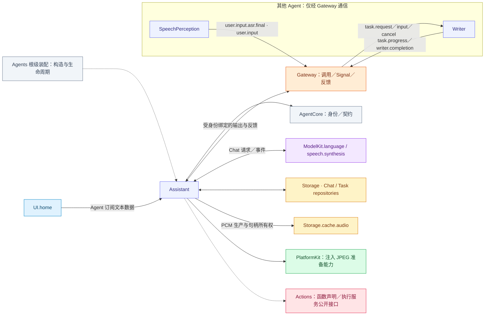
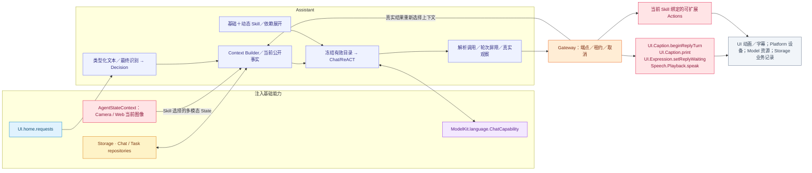
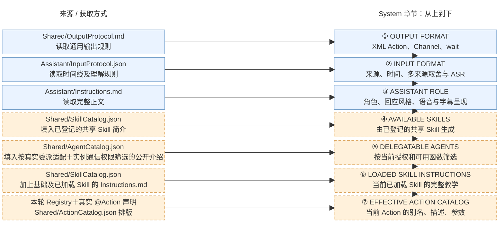

# Assistant — 对话、Task 与可扩展 Skill

本角色的静态类别由资源 Agent.json 声明并传入 Descriptor，归类与语义见 [Agents 分类](../README.md#agent-categories)。

## 角色容器

[AssistantContainer.swift](AssistantContainer.swift) 是 AgentContainer 的稳定子能力。持有 AssistantExecutionSession，通过会话管理角色私有 Context、注册与绑定输出任务，并提供首页会话／活动投影。仅启停 Assistant，不控制平级角色。

生命周期由[模块根](../README.md#agent-container)统一编排；子容器能力不授予执行权。

## 职责与注入能力

Assistant 是 `AgentChatWorker<AssistantContextState>` 的角色绑定，负责用户对话、一个前台目标、动态 Skill 与结果驱动 ReACT。它主动订阅 UI.home 文本；最终语音文本才经 Agent Signal 到达。UI 不持有 Assistant 引用，也不分派给指定 Agent。

| 注入能力 | 所有者与用途 |
| --- | --- |
| UIHomeContainer | 直接订阅 home.requests；聆听控制由 SpeechPerception 单独订阅 |
| ChatCapability／chatProvider | ModelKit.language：按请求选择并使用模型 |
| AgentStateContext | 读取 Skill.useStates 指定容器事实；Task从私有上下文生成 |
| AssistantHistoryStore／AssistantTaskRepository／AgentMessageRepository | Storage 数据库领域接口；会话、消息与任务提交 |
| 当前图像 State | Camera/Web 分别拥有图片与有效期；通过 AgentStateContext 按 Skill 选择，共享 Chat 组装，角色不读取媒体或压缩图片 |
| AgentContextRepository／配置与目录 | Agents 私有 Context、Skill 状态与 AgentCore 不可变执行声明 |

## 文件与职责

| 文件 | 职责 |
| --- | --- |
| [AssistantAgent.swift](AssistantAgent.swift) | 通用 Chat Worker 与 AssistantContextState 的类型绑定，保留单一推理实现 |
| [AssistantExecutionSession.swift](AssistantExecutionSession.swift) | Assistant 注册、受保护输出泵与会话中断／关闭加入 |
| [AssistantProcessing.swift](AssistantProcessing.swift) | Assistant 私有状态、提示词、照片策略与控制协议解释 |
| [AssistantSessionControl.swift](AssistantSessionControl.swift) | Assistant 私有的中断／关闭会话控制协议 |

## 外部关系（一层）

角色间消息经 Gateway 递送；基础能力通过构造注入，输入订阅由角色持有。角色、Skill 与 Task 授权归 Agents；Actions 来源的协作接口由 App 以中立窄端口绑定，Agents 不导入 Actions、CallRuntime 或 ExecutionRuntime。

Assistant 的跨角色任务命令定向送达 Writer，Writer 回报进度和完成结果。运行时送达工具、动作、轮次和通信回执，并使用 task.result 投递执行方终止反馈。语音入口订阅 SpeechPerception 在 user.input 主题发布的 user.input.asr.final。识别片段另有契约，按精确订阅分发。

## 内部结构与执行链

Skill 通过注册声明持续扩展可见函数，图中不固定穷举 Action。有效目录来自基础项与当前加载项，内部 Tool 不因注册而自动暴露给模型；Skill 加载本身不授予运行期执行权。Assistant 自己不消费 PCM 或视频帧，也不直接开关设备。

首页文本回执表示决策接纳，不表示模型回复或 Action 完成。实际模型、执行及回复终态由 Worker 与受身份绑定的输出泵拥有；取消与停止加入这些工作。

## Context 与 Builder

The private AgentContextRepository owns history, skillState and runtime task correlation/report views. Each actual model request freezes Skill/catalog/teaching selection and the matching active Task goal/status from that committed value. The loaded Skill ID list and minimal Task form AGENT CONTEXT; internal task registries, grants and Skill-retention bookkeeping stay private.

AgentChatWorker then samples the selected owner facts through AgentStateContext and combines them as CURRENT STATE in the same fresh system data message. It does not read a Storage.State mirror or route these reads through Gateway. The data message follows history and precedes the latest user input, or follows the complete native result group. Old system data is replaced on continuation. Ordinary background conversation and current Task evidence remain within the bounded history window; terminal Tasks can project summaries without altering source evidence. See [request assembly](../Support/Chat/README.md#request-state-assembly), [source mapping](../Support/Context/README.md#container-context-read-path) and the [overall context figure](../../README.md#model-context-composition).

## 共享提示词结构与来源

实际拼接入口为 [AssistantContextState.systemPrompt](AssistantProcessing.swift)。下图左侧是来源与获取方式，右侧按首条 system 消息的章节顺序排列。蓝色表示同一 App 资源版本内固定的正文，橙色表示从资源或本轮快照组装的章节。

Assistant 先拼接 [OutputProtocol.md](../../Resources/Agents/Shared/OutputProtocol.md)、[InputProtocol.json](../../Resources/Agents/Assistant/InputProtocol.json) 和自己的 [Instructions.md](../../Resources/Agents/Assistant/Instructions.md)，再组装四个目录与教学区。[AgentConfigurations](../Support/AgentConfigurations.swift) 根据 [Catalog.json](../../Resources/Catalog.json) 定位 Agent 与 Skill 资产，[AgentPrompts](../Support/Chat/AgentPrompts.swift) 加载并渲染提示词。可委派角色职责来自各自 Agent.json 的 description，经 AgentTaskDelegation 与实例通信权限筛选，总量最多 8192 UTF-8 字节。Skill 概览按 ID 拼接已登记的共享 Skill.json 的简介，总预算 4 KiB，必要时截短描述并保留 ID。带 owner 的 Writer 专属 Skill 由 Writer 的工作区域激活。

基础列表来自 [Agent.json](../../Resources/Agents/Assistant/Agent.json) 的 baseSkills。[AgentSkillLoader](../Support/AgentSkillLoader.swift) 展开当前激活项的依赖并合并函数绑定。⑥拼接对应 Instructions.md，⑦通过 [CapabilityContextBuilder](../Support/Core/Capability/CapabilityContextBuilder.swift) 和 [ActionCatalog.json](../../Resources/Agents/Shared/ActionCatalog.json) 渲染当前 Action 目录。别名和 Channel 来自 Skill 绑定，描述、参数和约束来自实际 Action 声明。独立 system 数据消息使用 [RequestContext.json](../../Resources/Agents/Shared/RequestContext.json) 渲染 AGENT CONTEXT、CURRENT STATE 及图片清单，用 [Assistant/Prompts.json](../../Resources/Agents/Assistant/Prompts.json) 呈现 Writer 的追问与近期事件。

[共享 Chat Worker](../Support/Chat/README.md) 在每次新输入及 ReACT 请求中按当前 Skill 快照重新组装 system/工具定义；已发出的请求与历史证据不重写。system 正文最多 64 KiB，超限明确失败。当前会话的 Task 目标/阶段及已加载 Skill ID 进入 AGENT CONTEXT；选定的相机/机械臂/UI 事实进入 CURRENT STATE，Skill 归属/剩余次数保持私有；历史与真实 ReACT 执行观察保留在各自消息中；Assistant 当前基础与可加载 Skills 均只声明 XML Action，request.tools 为空；Writer 的原生工具定义由其独立工作流提供。

## Task 与 Skill 生命周期

基础 Skill 为 basic-skill、expression-interaction。机械臂 robot-interaction 为可发现的按需 Skill，加载后才注入动作、教学及 actions.robot/actions.robot.motion 观察；可按近期/Task 生命周期释放。无 Task 的加载/合法使用将近期项计数重置为 5，每次完整闲置用户 Decision 扣 1；Task 等待期间暂停无关近期项计数。Task 只接管指定、加载或实际使用的项，等待用户时保留，终态屏障后回收。生命周期合图及容量/LRU、依赖与原子回滚见 [Context](../Support/Context/README.md#task-and-skill-lifecycle)。

已注册 Camera 函数不要求 Task。单次拍照、保存当前预览或相机控制可直接使用 Skill；必须先确认当前目录存在函数，缺失才加载 photography。预览引用来自实际捕获结果或 actions.camera.preview 目录。

教学只允许以当前活跃且匹配的 Task/目标决定 finishTask/cancelTask。无 Task 操作完成直接回复；不确定是否放弃旧目标时先询问并保留 Task，明确切换时关闭旧目标或释放无关近期 Skill。finishTask 通常结束决策，显式 continueDecision=true 才继续同一输入剩余新目标，cancelTask 结束该决策。Skill 释放不代表保存、忽略或关闭相机。

## 对其他 Agent 的委托

Assistant 拥有用户意图、委托请求和面向用户的沟通；执行 Agent 拥有接纳后的业务工作、进度、清理与终态。跨模块时序见[总体委托流程](../../README.md#assistant-agent-delegation)。委托通过已有 Task Action 和认证角色通信，不调用另一个 Agent 的私有方法，不复制它的提示词、模型上下文或执行循环。

| 阶段 | Assistant 与运行时契约 |
| --- | --- |
| 发起 | `task.delegate(agent_id, description)` 走 Control Channel 的 XML Action；Actions 校验后调用注入的 Task 控制端口。运行时检查目标通信权限、业务契约与能力，在 agent_messages 持久化请求 UUID，再发送绑定 requester/executor/session 的 `task.request`。 |
| 接纳 | 执行者验证来源、scope 与自身容量，并绑定其拥有的业务任务；回执只确认接纳。后台委托不切换 Assistant 前台 Task 或有效 Skill 目录；`task.end` 只结束当前前台目标。 |
| 观察 | `task.progress`/`task.result` 由共享 Chat 更新关联控制状态；Writer 在灵动岛展示普通进度。接纳、追问及持久终态还会更新 Assistant 的委派控制状态。公开状态仍由当前 Skill 的 `useStates` 选择。 |
| 补充与取消 | 使用 `agent_id` 指定通信目标；运行时解析唯一活跃通信链，回答追问时还校验本次输入捕获的问题身份。模型不提供 delegate/event/interaction UUID。取消接纳只表示已递送，必须等待执行者清理及终态证据。 |
| 失败 | 配置、权限、接纳、持久化和递送失败显式返回；回执成功不等于业务完成，回报事实不授予重试、重新委托或改变前台 Task 的权限。 |

通信输出由 [Support 独立消费者](../Support/README.md#lifetime-bounds-and-failures) 持续递送，不受等待该 Task Action 的模型轮次屏障阻塞。角色根拥有消费者及其取消/加入；通信队列与输出队列各自有界，溢出明确失败。消息值与固定任务准入见 [Communication](../Support/Communication/README.md)，执行参数见 [Task Actions](../../Actions/System/Task/README.md)。

当前公开创作执行者是 Writer；`task.delegate` 路径只向已声明且授权的目标开放，并不表示所有 Agent 都支持后台业务。当前 `task.send` 的补充输入适配也仅支持 Writer。Writer 的单行目标/原始输入、忙碌与取消、长期作品任务、灵动岛回馈、追问身份和独立持久终态通知见 [Writer 委托与主动事件](../Writer/README.md#委托与主动事件)。向 Writer 的委派、补充、取消送达成功时只完成调用，拒绝仍是异常观察。Writer 的接纳、精选里程碑、追问和终态由 Assistant 认证并去重，沿用既有合成与播放链播报，无额外模型请求。播报与正式输入共用执行 worker，已排队用户输入优先。通知队列最多八项，溢出优先淘汰较早的普通里程碑；终态移除未播放的旧里程碑和过期追问。每个委托保留最近六条事实，真实模型请求在原对话中最多读取最近两个委托的摘要。Writer 运行不随 Assistant 聆听停止、语音打断或对话关闭而取消；这属于该执行角色的生命周期契约，不能推定为所有角色的统一行为。

## ReACT、历史与失败

共享 [Chat](../Support/Chat/README.md) 根据真实业务值/失败和轮次屏障继续；Agent/Provider/解析异常不自动重试。Action 模型观察使用轮内序号、别名、状态、结构化值；拒绝明确未执行，失败保留效果不确定性和部分结果。原生 Tool 配对及完整执行日志保持完整。

Task/dialog/message 身份先经注入仓库提交；delta、Skill 计数、在途 Decision 和队列只保存在内存。完整消息和真实终态按边界提交；Task 原始来源由 SQL 查询，重启不重放 Action。存储实现及职责见 [Storage](../../Storage/README.md)。

## 输出与清理

输出容量为 256。共享 Worker 的接纳、driver/native 队列、结果与上下文容量见 [Chat](../Support/Chat/README.md#bounds-and-overflow)。聆听权由 SpeechPerception 持有，实际播放和采集由语音服务协调。

取消必须加入模型与已接纳工作清理；状态/历史提交失败显式报告，不能执行依赖未提交状态的后续步骤。根 scope 与 worker 独立于页面生命周期。

AssistantContextState.sessionControl 解释 AssistantSessionControl，并映射为通用 Chat 的 interrupt／close 意图。共享 Worker 不识别 assistant.control 字符串或 Assistant 私有类型，仍验证本地 runtime 来源后执行中断／关闭屏障。默认 Chat Context 不解释其他角色控制协议。

## 多 Channel 输出与跨轮结算

Assistant 按每轮冻结的 Action 目录解析模型流，保留调用所属 Channel 和显式 `wait` 边界。回复字幕的 `UI.Caption.beginReplyTurn` 和 `UI.Caption.print` 走 Display，音频播放 `Speech.Playback.speak` 走 Speech，前台任务结束 `task.end` 走 Control。字幕和播放所用的内部调用由角色生成，模型可用能力由该轮目录决定。原生 Tool 调用保留独立的调用与结果配对。见 [语音生产与播放](#语音生产与播放) 和 [前台任务控制](#前台与-writer-入口选择)。

会话的 [AssistantGenerationTransport](AssistantGenerationTransport.swift) 通过单一输出读取器按顺序接纳 Action 和 `wait` 边界。原生 Tool 使用四个独立执行槽，最多保留 128 条工具工作记录。各轮封口独立等待本轮原生 Tool，封口任务最多 32 个。容量耗尽时明确拒绝，封口失败通过独立通知唤醒输出泵并加入取消清理。

Assistant 以原会话、输入、轮次和调用身份提交输出。Gateway 适配层为 Assistant 附加会话级顺序域，同一 Channel 保持 FIFO。各 Channel 在资源许可和 `wait` 约束下并行。模型生成结束后保留原轮目录和身份，并缓冲新用户输入与执行结果。所有 Channel 和本轮原生 Tool 结算后才提交下一批模型请求。调度算法见 [Gateway Channel 调度](../../Gateway/Output/Scheduling/README.md)，批次与容量见 [Chat 全双工调度](../Support/Chat/README.md#assistant-全双工调度)。

普通 Action 的业务值或真实异常到达后可逐条进入下一批输入，原轮继续结算执行记录。成功 Void 和纯取消只结算原调用。原生 Tool 结果在组内配对齐备后进入下一批。确认打断时，Assistant 保留已接纳的新输入，取消当前生成和本会话此前未结束的输出，加入实际清理后再开放新执行。独立后台 Agent 持续运行。跨模块流向见 [总体技术设计](../../README.md#assistant-full-duplex-interaction)。

## Image context ownership

Camera previews come from Photography's actions.camera.preview State. Camera prepares bytes and owns latest/explicit selection; shared Chat rebuilds attachments on the original current user input on every request, including new user turns and Action continuations. The system State manifest supplies source/ID/size and attachment-order mapping. Assistant does not interpret takePhoto receipts or own a second photo cache. Retained conversation attachments exclude these bytes; independent full model-request logs preserve actual submitted images.

Web screenshots use the same State projection through WebBrowsing’s actions.web.screenshot. Actions.Web prepares and retains only the current image; Assistant has no Web feedback image hook, media lookup or compression policy. Unsupported delivery is reported by the common system image manifest.

## Container 上下文

Assistant 消费根注入的只读容器来源，Task／Skill 来自自身私有决策快照；根生命周期结束关闭来源接纳，不保留历史公共Task镜像。

## Basic native observations

BasicSkill includes eight passive platform.* sources in addition to ui.navigation. These enter CURRENT STATE through projection of the producer-owned complete Business dictionary. Native time, power, thermal, path, permissions, audio, locale and accessibility are observations; they never override frozen capability authorization or current business execution checks. Task/Skill projection remains private AGENT CONTEXT. See [Context](../Support/Context/README.md#current-facts-before-explicit-queries).

## Passive container state

stateSnapshot projects local installation/closure, Agent lifecycle/queue counters and initialized committed task/Skill fields without message content. residentContext() reads the repository’s last committed memory only; context fields are unknown before initialization. Agent start owns initialization/restoration and its failures. The root catalog binds independent readers without sampling roles or maintaining another mutable role-state registry.

## State selection ownership

Skill.useStates is the sole exact-path observation selection. AssistantStateBindings installs one App-backed resolver, not a path or field allowlist. It projects the producer's complete Business dictionary, retaining objects/arrays, while excluding Runtime, health/issues, metadata and children. Missing/unreadable/malformed nodes return unknown/null plus a bounded path/code diagnostic; cancellation, closed context and capacity failures still propagate. Selecting a parent does not traverse children. New Skill sources need only a producer and App read route, with no Assistant registration change.

## Photography state selection

Photography loads capture/video Actions and settings/recording fields from actions.camera: mode, delaySeconds, flash, supportedFlash, zoom, maximumZoom, durationSeconds, countdown, recordingPhase and recordingID. Native platform.vision.camera independently supplies actual running/recording/lens/zoom. State selection does not activate the camera or confer permission. Configuration and preview-only opening complete without business values. Capture and disposition use real preview/video identities, and window cleanup precedes matching Task completion.

ui.island投影包含活动身份、标题、系统选择及提交状态；前台目标展开与localStatus可读，系统实际几何未知，不携带频谱或设备权威状态。Island.setPresentation设置前台compact/expanded，expanded要求已提供的detail；系统可见性/时长仍由iOS决定；实际摄影/录像仍调用Camera声明。

## Web screenshot State

Web.Page browse/snapshot/navigate update one scope-bound current screenshot in Actions.Web. Action feedback contains text and screenshotID; every real model request reads the selected State again and attaches only the currently valid image. There is no screenshot history selection or extra feedback image message. Images remain untrusted data; models without image support can use bounded page text. Generated code and Writer transcripts never enter Assistant parsing.

WebBrowsing 从 ui.web.sessions 读取逐窗口的页面类型和有界远程 URL，从 ui.windows 读取窗口身份与焦点。统一resolver按Skill声明读取这两个事实来源和 actions.web.screenshot；本地文件路径与WebKit运行指标不进入Assistant上下文。

默认BasicSkill观察全局ui.windows，包含Writer窗口。Assistant按可用Skill说明加载页面观察或窗口控制能力，不能将未加载目录解释为看不到所有窗口；窗口摘要与实际截图/正文证据区分。Writer 自有灵动岛直接展示进度、追问和结果。

## 自有任务岛

AssistantExecutionSession管理两条独立活动：消费本角色Skill状态的任务岛，以及共享Chat请求等待回调驱动的推理等待岛。共享层只报告开始/首个输出/异常结束；文案和UI.Island内部调用由Assistant拥有。各活动独立身份、版本与结束，停止先加入展示清理再退休角色权限。Gateway executeInternal结果由调用方处理，不进入模型输入；presentationFailure保留展示错误。其他角色自己的语音、摄影或连接展示不由Assistant代发。

## 输入开始与自有回复字幕

完整转写与键入文本进入同一用户输入流程，按接纳时的会话和任务确定归属。识别字幕由 SpeechPerception 呈现，回复字幕使用 beginReplyTurn 校验实际回复身份。

前台Task灵动岛通过GatewayOutputConsumer.executeInternal调用已声明的UI.Island内部工具，
其结果由 AssistantExecutionSession 的呈现 worker 消费。任务、模型与呈现会话各有独立身份。字幕和等待态回执由内部呈现路径处理。

## 前台与 Writer 入口选择

task.start 保留 Assistant 自己执行的前台目标；task.delegate 将目标交给平级 Agent。写作、绘图、文件修改、作品搜索/打开/删除直接委派 Writer，不先创建前台包装任务或加载 Skill。两个独立目标可并存，后台委派不改变已有前台 scope。Writer 专属 Skill、实际作品身份、文件操作与完成均由 Writer 负责。

全双工 `task.end` 在 Control channel 提交前台终态与摘要，折叠从启动到结束时已发起的任务 Message，包含发出结束调用的 Message。Action 成功时清除前台目标并释放任务 Skill；各 channel 和模型流继续按各自边界记录原始证据。见 [Chat Worker](../Support/Chat/README.md)。

## 提示词所有权

Assistant/Instructions.md 只维护自身用户对话、协调、输出和事实汇报责任，Prompts.json 只维护证据模板。AssistantContextState 组合 共享协议、Skill 教学和目录、有效 Action 目录，以及各 Agent 自己的公开 description；DELEGATABLE AGENTS 根据实际实例权限和已实现适配过滤，不包含其他角色私有提示词。start/delegate 平级教学归 BasicSkill，Writer 业务用途和委派条件归 Writer/Agent.json。

## 语音生产与播放

[AssistantSpeechOutput.swift](AssistantSpeechOutput.swift) 是 AssistantExecutionSession 拥有的稳定子能力，不注册 Agent 或消费 Signal。共享 Chat 通过 [AgentSpeechOutput](../Support/Chat/AgentSpeechOutput.swift) 请求文本转音频句柄，具体生产与展示属于 Assistant。AgentRuntime 将同一实例注入 Worker 和执行会话；原生语音启动安装 ModelKit TTS 与该交互的 AudioCache，实际播放仍走 Gateway → Actions。子能力的安装、队列、完成计数和展示失败投影在 agents.assistant。

prepare 校验非空、至多 2000 UTF-8 字节的文本，生成唯一 audioID，按 assistant/session/input 预留缓存并再次校验生命周期。预留成功即返回，不等待完整 PCM。locale 为 auto；ModelKit 自行选择适用语言。一个串行 producer 并行于播放及其他 Action；生产器的活句柄及尚未注册的接纳合计最多 32 个，AudioCache 独立限制最多 32 个活句柄、每段 8 MiB，满载明确拒绝。缓存释放/失败回调退休生产器中的句柄关联。生产保持 FIFO，播放顺序由 Speech Channel/wait 决定。模型身份、单声道 Float32、稳定格式、递增序号、非空音频与显式 finished 必须全部有效。

每个推理 session 在成功、失败和取消时都加入 provider cleanup，之后才完成或失败音频缓存。失败保留原始模型/缓存错误并唤醒读者；生产者通过 TaskLocal 避免缓存取消回调等待自身。提交播放失败取消对应句柄并保留清理错误；中断按 session/input 二元身份清理，根停止关闭接纳，加入所有在途预留和生产。原生交互关闭先卸载绑定并清理 AudioCache，再释放 scope；替代绑定必须等待清理完成。Assistant 的执行消费者在真实终态屏障后退休本输入残余句柄，不重放业务 Action。

生产/播放展示使用 Assistant 自己的内部 UI.Island 权限，与任务岛、推理等待岛分别持有活动身份。App 绑定的原生播放事实携带 audioID；生产结束不能撤下仍播放的活动，旧 audioID 的结束不能撤下新播放。播放优先显示“正在说话”，其余生产显示“正在合成语音”；频谱仍由播放器直达 UI。停止先加入最终展示清理再退休 Assistant 注册。合成接纳、provider 清理、真实播放 drain 是不同完成边界。

[SpeechPlaybackFailure.swift](SpeechPlaybackFailure.swift) 在 App 注入的播放错误边界、实际清理后适配合成/缓存失败文案，保留 underlying 原始错误。

常驻 BasicSkill 独占通用窗口与 Task/Skill 生命周期教学，Assistant 身份指令不复制业务流程。摄影教学只维护自身媒体处置、窗口关闭和真实回执语义，不包含跨业务场景。普通 Action 失败作为观察继续决策，内部语音/字幕失败不能遮蔽同轮业务观察。

## 多源全双工输入与 Decision

根装配启用 fullDuplex。AssistantInputDecision 仅分类已认证的 SpeechPerception final 与本地用户 input，使用当前文本、来源/时间、占用及至多384字符现场片段。每次分类读取一份已提交的 Decision 配置，包含本地模式与独立选择的云端模型工厂。云端路径记录为 cloud:decision，强制一次 classify_input，校验唯一合法动作；本地选择 D3 时，缺失、加载、失败或超过512 token 使用同份配置的云端备用。云端未配置或失败时保守 enqueue。单个分类消费者，本地/云端各一个在途；热本地250ms、总2秒，迟到结果不修改已提交决定，后台清理有界并由根加入。

`enqueue` 累积待处理输入。主模型可接纳时冻结会话全部 Q，成员保留原文、来源、时间和交互身份。`discard` 结束候选并触发短暂的灵动岛提示。有效交互答案受保护。手工输入和 ASR 共用三分类规则，已验证的 Agent 消息直接入队。`interrupt` 先保留新输入，再进入[跨轮清理](#多-channel-输出与跨轮结算)。

主模型同时只运行一个请求。先前轮次的 Action 和原生 Tool 结果按 [跨轮结算](#多-channel-输出与跨轮结算) 进入后续输入批次。

实际发起模型请求时才创建 message，coordination 与完整批次输入保存来源、分类路径和批次成员；准备/排队不创建历史行。联合回复仅由一个主输入持有，失败/取消结算全部成员。重启不重放 Action。首页通过 Actions 的中立事实回调显示排队/分类数量，用户与助手字幕分别保留；partial/onset 不清助手回复。Agent Brains 的 Decision 子页保存本地模式和云端绑定，D3 由总页的共享模型下载区管理。

[AssistantInputBatch.swift](AssistantInputBatch.swift) 将单条或多条输入渲染为同一条时间线。正文后接 `User (ASR) ｜ HH:mm:ss` 等可信来源和设备本地时间。手输为 User，Writer 使用角色名，其他同伴使用 Agent 名。Action Result 的正文含函数名和结果；原生工具保留独立调用/结果配对。排序使用完整事件时间，同一事件时间按接纳顺序。用户可信 uptime 映射到本机日期，同伴用接收时间，Action 用完成时间。形似来源行或辅助标题的正文行缩进。打断仅补充相关旧用户意图。旧 JSON 请求在模型历史回放时重新投影，已发送请求的原始证据可回查。

Assistant 自有的 InputProtocol 在 system 消息中紧邻共享 XML 输出协议装配。它引导模型按最新用户修正确定目标，用同伴消息、执行结果、状态和图像核对事实，结合上下文处理明显转写错误，并澄清会改变动作的疑义。回复优先给出答案、等待中的结果或阻塞。角色 Instructions 允许在无需说话时仅用当前目录允许的表情。表情函数成功返回 Void，内部完成通知用于推进 FIFO，异常成为错误输入。

请求配置/上下文准备失败时，批次保留内存并阻塞该会话，显式报告错误；接纳新用户输入时一起重试，不自动循环。暂停、关闭或停止清理未发批次。已发请求失败不走此准备重试路径，仍结算原 message。所有持久化继续由 onDispatch 边界控制。

AssistantExecutionSession 为 Decision 维护独立、可替换的灵动岛活动。确认 discard 或实际完成同代 interrupt 后，发布约三秒的本地展开详情，正文仅包含结果。新反馈替换旧内容及计时，后台暂停或退出取消计时并结束活动。通用灵动岛负责详情仲裁及渲染。

## 请求文字的资源归属

Prompts.json 维护主对话的执行证据、任务历史摘要前缀和 Writer 协作事实。InputProtocol.json 同时维护主模型的输入规则与代码使用的来源标签、时间线排版和旧格式识别。InputDecision.json 维护独立分类请求的规则、输入模板及工具说明。TaskFeedback.json 维护任务控制与委派回执。图片清单由 Shared/RequestContext.json 提供。

来源行识别从当前资源标签和排版生成，同时识别历史格式；形似来源行与辅助标题的用户正文仍缩进。模板缺失或渲染失败显式传播，不用硬编码正文补位。
