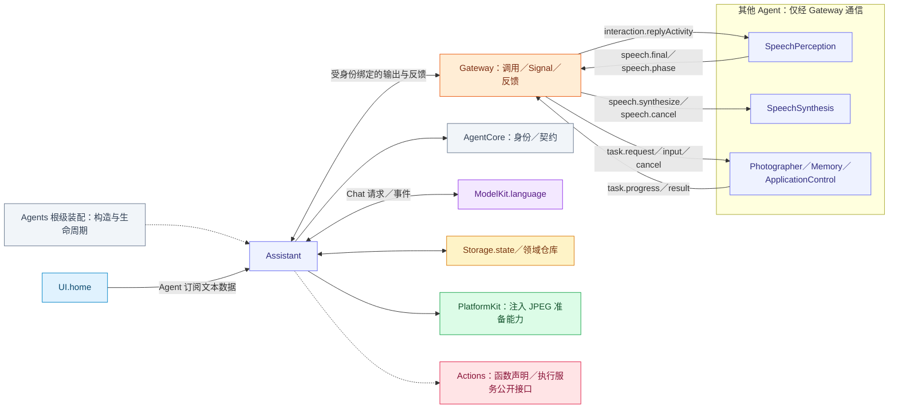
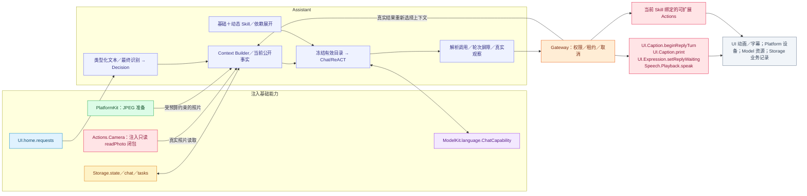
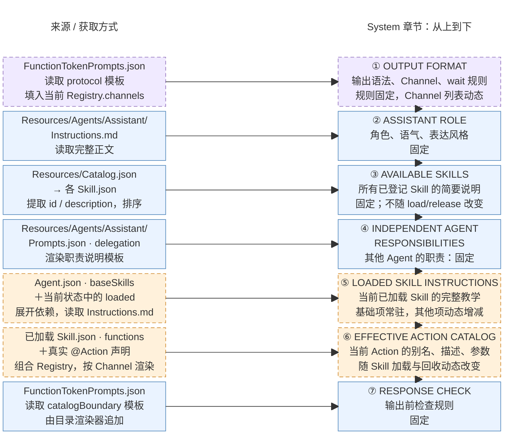

# Assistant — 对话、Task 与可扩展 Skill

## 角色容器

✅ [AssistantContainer.swift](AssistantContainer.swift) 是 AgentContainer 的稳定子能力。持有 AssistantExecutionSession，通过会话管理角色私有 Context、注册与绑定输出任务，并提供首页会话／活动投影。仅启停 Assistant，不控制平级角色。

生命周期由[模块根](../README.md#agent-container)统一编排；子容器能力不授予执行权。

## 职责与注入能力

Assistant 是 `AgentChatWorker<AssistantContextState>` 的角色绑定，负责用户对话、一个前台目标、动态 Skill 与结果驱动 ReACT。它主动订阅 UI.home 文本；最终语音文本才经 Agent Signal 到达。UI 不持有 Assistant 引用，也不分派给指定 Agent。

| 注入能力 | 所有者与用途 |
| --- | --- |
| UIHomeContainer | 直接订阅 home.requests；聆听控制由 SpeechPerception 单独订阅 |
| ChatCapability／chatProvider | ModelKit.language：按请求选择并使用模型 |
| AgentStateContext | 读取 Skill.useStates 指定容器事实；Task从私有上下文生成 |
| ConversationHistoryStore／TaskRepository | Storage 数据库领域接口；会话、消息与任务提交 |
| 照片读取、prepareJPEG 回调 | 装配时注入 Actions.Camera 的只读 readPhoto 闭包与 PlatformKit JPEG 准备能力；角色制定预算，不持有相机控制器 |
| AgentContextRepository／配置与目录 | Agents 私有 Context、Skill 状态与 AgentCore 不可变执行声明 |

## 文件与职责

| 文件 | 职责 |
| --- | --- |
| [AssistantAgent.swift](AssistantAgent.swift) | 通用 Chat Worker 与 AssistantContextState 的类型绑定，保留单一推理实现 |
| [AssistantExecutionSession.swift](AssistantExecutionSession.swift) | Assistant 注册、受保护输出泵与会话中断／关闭加入 |
| [AssistantProcessing.swift](AssistantProcessing.swift) | Assistant 私有状态、提示词、照片策略与控制协议解释 |
| [AssistantSessionControl.swift](AssistantSessionControl.swift) | Assistant 私有的中断／关闭会话控制协议 |

## 外部关系（一层）

角色间消息经 Gateway 递送；基础能力通过构造注入，输入订阅由角色持有。

## 内部结构与执行链

Skill 通过注册声明持续扩展可见函数，图中不固定穷举 Action。有效目录来自基础项与当前加载项，内部 Tool 不因注册而自动暴露给模型；Skill 加载本身不授予运行期执行权。Assistant 自己不消费 PCM 或视频帧，也不直接开关设备。

首页文本回执表示决策接纳，不表示模型回复或 Action 完成。实际模型、执行及回复终态由 Worker 与受身份绑定的输出泵拥有；取消与停止加入这些工作。

## Context 与 Builder

根拥有的私有仓库保存 history、skillState 与后台任务报告。Builder 每轮读取公开 State 的不可变快照，作为唯一 CURRENT STATE 系统数据块注入；不添加状态类 user 消息，不拆开 native 配对。普通对话背景和完整当前 Task 过程保留在容量窗口内；终态 Task 在原始来源位置投影摘要，不修改原始证据。

## System 提示词结构与来源

实际拼接入口为 [AssistantContextState.systemPrompt](AssistantProcessing.swift)。下图左侧是来源与获取方式，右侧按 system 正文中的章节顺序从上到下排列。蓝色实线表示固定内容，橙色虚线表示动态章节，紫色虚线表示固定规则中包含动态字段；固定指同一 App 资源版本内固定。

资源由 [AgentConfigurations](../Support/AgentConfigurations.swift) 按打包 Bundle 中的 [Catalog.json](../../Resources/Catalog.json) 显式映射读取并缓存，不扫描目录或热更新。协议与短检查来自 [FunctionTokenPrompts.json](../Support/Core/Generation/FunctionTokenPrompts.json)，角色来自 [Instructions.md](../../Resources/Agents/Assistant/Instructions.md)，独立 Agent 职责来自 [Prompts.json](../../Resources/Agents/Assistant/Prompts.json) 的 delegation。Skill 概览读取各 Skill.json 的 id/description，按 ID 排序，总预算 4 KiB，必要时截短描述并保留 ID。

基础列表来自 [Agent.json](../../Resources/Agents/Assistant/Agent.json) 的 baseSkills；[AgentSkillLoader](../Support/AgentSkillLoader.swift) 展开当前激活项的依赖并合并函数绑定，⑤拼接对应 Instructions.md，⑥通过 [CapabilityContextBuilder](../Support/Core/Capability/CapabilityContextBuilder.swift) 渲染当前 Action 目录。别名/Channel 来自 Skill 绑定，描述、参数与约束来自真实 @Action 声明；⑦由同一目录渲染器追加。实际请求把唯一 CURRENT STATE 作为独立 system 数据消息放在完整历史之后、最新 user 输入/观察之前；末尾为 native Tool 结果时，State 位于完整调用/结果组之后。

[共享 Chat Worker](../Support/Chat/README.md) 在每次新输入及 ReACT 请求中按当前 Skill 快照重新组装 system/工具定义；已发出的请求与历史证据不重写。system 正文最多 64 KiB，超限明确失败。Task/相机/机械臂公开事实进入 CURRENT STATE 系统数据块，Skill 归属/剩余次数保持私有；历史与真实 ReACT 执行观察保留在各自消息中；原生 Tool 定义放在 request.tools，仅模型支持 Tool Calls 时提供，均不属于上图的 system 正文。

## Task 与 Skill 生命周期

基础 Skill 为 basic-skill、expression-interaction、robot-interaction。无 Task 的加载/合法使用将近期项计数重置为 5，每次完整闲置用户 Decision 扣 1；Task 等待期间暂停无关近期项计数。Task 只接管指定、加载或实际使用的项，等待用户时保留，终态屏障后回收。生命周期合图及容量/LRU、依赖与原子回滚见 [Context](../Support/Context/README.md#task-and-skill-lifecycle)。

已注册 Camera 函数不要求 Task。单次拍照、保存/忽略当前预览或相机控制可直接使用 Skill；必须先确认当前目录存在函数，缺失才加载 photography。媒体引用来自实际捕获结果或当前 displayedMediaID，忽略别名为 ignorePhoto。

教学只允许以当前活跃且匹配的 Task/目标决定 finishTask/cancelTask。无 Task 操作完成直接回复；不确定是否放弃旧目标时先询问并保留 Task，明确切换时关闭旧目标或释放无关近期 Skill。finishTask 通常结束决策，显式 continueDecision=true 才继续同一输入剩余新目标，cancelTask 结束该决策。Skill 释放不代表保存、忽略或关闭相机。

## ReACT、历史与失败

共享 [Chat](../Support/Chat/README.md) 根据真实业务值/失败和轮次屏障继续；Agent/Provider/解析异常不自动重试。Action 模型观察使用轮内序号、别名、状态、结构化值；拒绝明确未执行，失败保留效果不确定性和部分结果。原生 Tool 配对及完整执行日志保持完整。

Task/dialog/message 身份先经注入仓库提交；delta、Skill 计数、在途 Decision 和队列只保存在内存。完整消息和真实终态按边界提交；Task 原始来源由 SQL 查询，重启不重放 Action。存储实现及职责见 [Storage](../../Storage/README.md)。

## 输出与清理

输出容量 256；共享 worker 的接纳、driver/native 队列、结果与上下文容量见 [Chat](../Support/Chat/README.md#bounds-and-overflow)。UI.Caption 的内部 beginReplyTurn/print 和 Speech.Playback.speak 分别服务 Display/Speech Channel，不因内部注册而向模型开放。聆听权由 SpeechPerception 拥有，实际播放/采集由模块拥有的语音服务协调。

取消必须加入模型与已接纳工作清理；状态/历史提交失败显式报告，不能执行依赖未提交状态的后续步骤。根 scope 与 worker 独立于页面生命周期。

AssistantContextState.sessionControl 解释 AssistantSessionControl，并映射为通用 Chat 的 interrupt／close 意图。共享 Worker 不识别 assistant.control 字符串或 Assistant 私有类型，仍验证本地 runtime 来源后执行中断／关闭屏障。默认 Chat Context 不解释其他角色控制协议。

## Model photo preparation policy

AssistantPhotoInputPolicy in AssistantProcessing.swift owns analysis budgets: maximum dimension 1568, maximum pixels 1,048,576, maximum JPEG bytes 1 MiB and initial quality 0.82. photoObservations checks successful takePhoto evidence and model image support, reads the original, validates photo identity, invokes an injected prepareJPEG(Data, policy) capability and constructs the JPEG ChatImage itself. photoObservationHandler builds the worker callback inside Agents from those injected capabilities. Raw read and preparation are separate required capabilities; there is no implicit/no-op production preparation fallback. App only binds capabilities, while PlatformKit retains Image I/O internals. Agent code imports no native codec/framework.

Check cancellation before reading, before preparation and before retaining results. Native preparation failure/cancellation propagates through the current decision; empty/over-budget results reject without uploading the original. The worker invokes observations after the round barrier and retains prepared images in ReACT requests, so later business-result continuations do not recompress. Original storage, preview and album import remain independent.

These are Assistant-owned analysis and transport budgets. Native image conversion is described in [PlatformKit/Vision](../../PlatformKit/Vision/README.md#native-image-compression).

## 待实现

❌ 场景挂起期间前台目标及最终 checkpoint 的完整落盘；公共限制见 [Chat](../Support/Chat/README.md#未实现范围)。

## Container 上下文

✅ Assistant 消费根注入的只读容器来源，Task／Skill 来自自身私有决策快照；根生命周期结束关闭来源接纳，不保留历史公共Task镜像。
