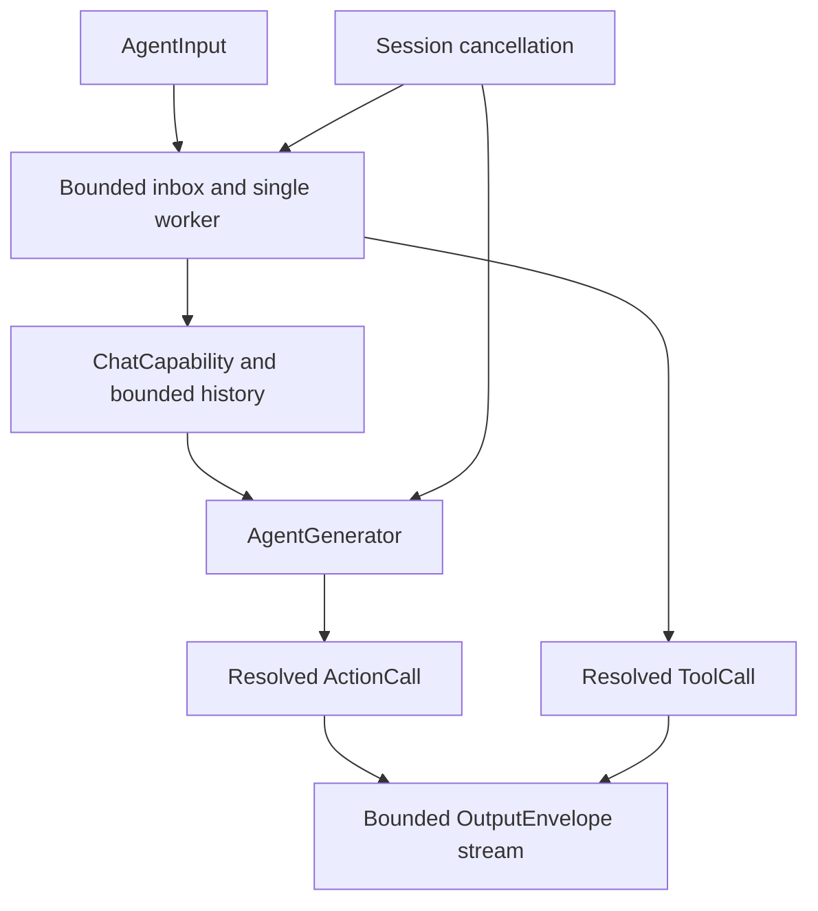
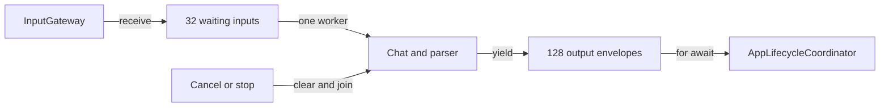

# Assistant — Stateful Conversation Agent

Purpose: send user input to ChatCapability, maintain bounded history and interpret generated output inside the Agent. Its local registry controls available capabilities; Gateway receives resolved calls.

- ✅ AssistantAgent actor: 32 waiting inputs, 128 output envelopes and one generation worker; overflow fails explicitly.
- ✅ Assistant.agent.json registers say → Speech.speak, print → UI.print and express → UI.express, with Speech/Display defaults and explicit main scope support.
- ✅ Each turn owns AgentGenerator state. Natural text maps through textActions (say + print); self-closing XML Actions resolve independently. Explicit channels override defaults.
- ✅ CapabilityContextBuilder includes only hidden=false Action aliases, docs, parameters and examples in system context. Native tools are excluded regardless of hidden; say/print remain registered for text mapping.
- ✅ express accepts smile, happy, laugh, thinking, surprised, sad and love. It controls UI presentation only.
- ✅ /status resolves runtimeInfo → System.runtimeInfo. Tool results and event descriptions are escaped before text interpretation.
- ✅ Limits: 4 KiB user text, 2000-byte generated text, 256 output tokens, 30 s generation deadline and at most 120 ActionCalls. History is saved only after successful generation and bounded to eight messages / 1600 characters.
- ✅ Cancellation bypasses full/paused inbox admission, joins the worker and discards incomplete parsing state.
- ❌ Native model tool deltas, persistent state, restart and long-running background execution. ToolCallParser exists, but ChatCapability produces text/completion events.

Speech and captions use different default channels and can run concurrently; main can serialize speech, expressions and captions in generation order. Runtime notifications are not model-authored.

## Configuration and initialization

Follow the [Agent standard](../README.md). AgentConfigurations loads Bundle.module JSON, validates agentID=assistant and nonempty textActions, then constructs an immutable descriptor. Tests/composition may inject configuration validated by the same loader. Missing/invalid configuration throws; App reports the error and does not register the Agent. Missing command aliases fail explicitly without try! or fallback registration. Hot reload is unsupported: JSON changes require packaging and a new instance.

ChatCapability is a required dependency; tests inject FixedTextChat from IntegrationTests. Configuration/request validation does not guarantee real-model protocol compliance. Update this README with changes and retain ✅/❌ status distinctions.

## Queue and asynchronous processing contract

`AssistantAgent` owns its FIFO inbox and generation worker inside an actor. InputGateway produces `AgentInput`; `drain()` consumes it. The default inbox holds 32 waiting inputs, excluding the active input. Admission rejects excess work with `queueFull`; it does not suspend until space appears. Text input is limited to 4096 UTF-8 bytes. A single generation worker preserves input processing order; actor reentrancy does not permit a second worker.

1. `receive` checks lifecycle and payload, appends an input, and starts draining when running.
2. Pausing stops admission-to-execution transitions, but does not cancel an already running generation. Resume drains queued inputs.
3. Generation consumes Chat events, parses them and emits resolved output envelopes. The output stream buffers 128 envelopes with `bufferingOldest`; the consumer is AppLifecycleCoordinator. Failed yields mark the Agent failed, clear the inbox, cancel generation and close the stream. This plain AsyncStream does not transmit a thrown error; the coordinator checks final Agent status.
4. `assistant.cancel` bypasses the inbox, even when full or paused, removes the selected session's waiting inputs and awaits cancellation of its active worker. Stop clears all waiting inputs/history and joins the worker before closing outputs.

Successful outputs already consumed are not rolled back. There is no automatic retry, durable inbox or priority scheduling. FIFO uses Array append/removeFirst; removal shifts remaining entries, with cost bounded by the configured capacity.

✅ The algorithm above describes the current implementation.

Maintenance: update this contract when changing producers, consumers, limits, ordering, cancellation or completion semantics.
