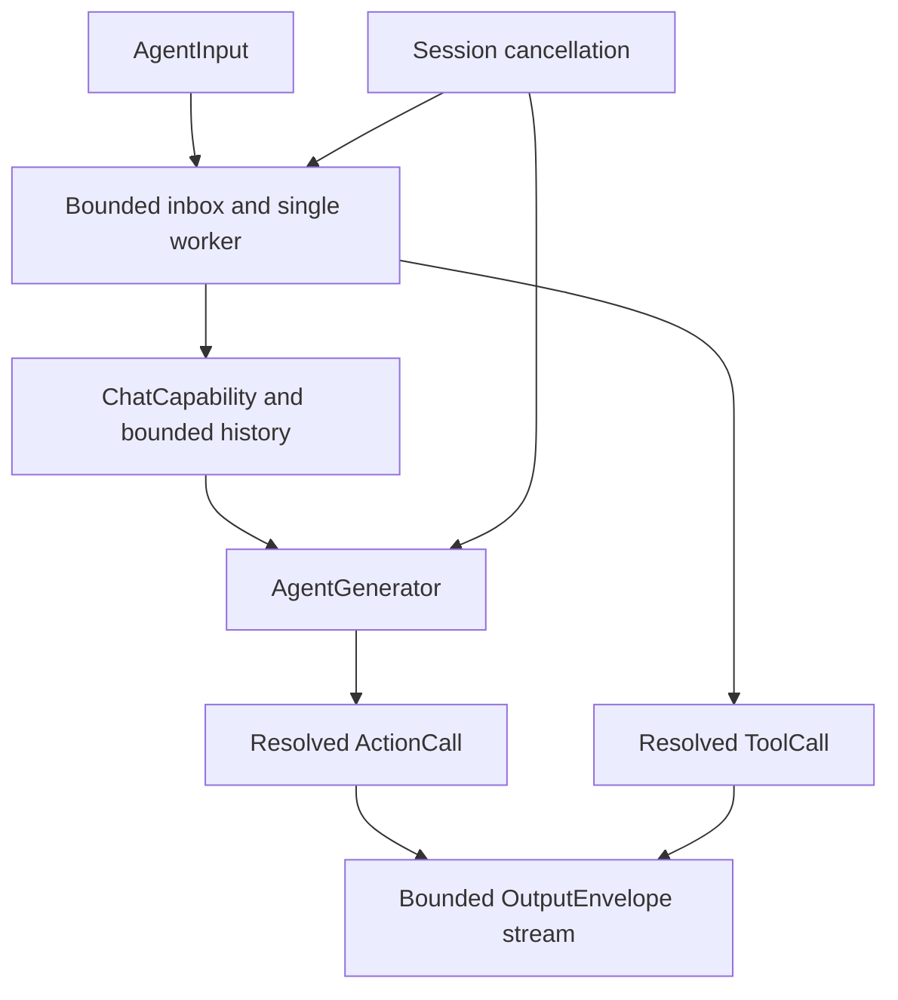
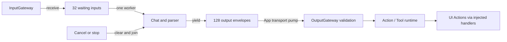
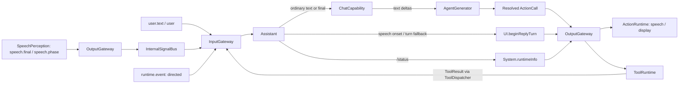

# Assistant — Stateful Conversation Agent

Purpose: send user input to ChatCapability, maintain bounded history and interpret generated output inside the Agent. Its local registry controls available capabilities; Gateway receives resolved calls.

- ✅ AssistantAgent actor: 32 waiting inputs, 128 output envelopes and one generation worker; overflow fails explicitly.
- ✅ Assistant.agent.json registers say → Speech.speak, print → UI.print and express → UI.express, with Speech/Display defaults and explicit main scope support.
- ✅ Each turn owns AgentGenerator state. Natural text maps through textActions (say + print); self-closing XML Actions resolve independently. Explicit channels override defaults.
- ✅ CapabilityContextBuilder includes only hidden=false Action aliases, docs, parameters and examples in system context. Native tools are excluded regardless of hidden; say/print remain registered for text mapping.
- ✅ express accepts clear, smile, happy, laugh, thinking, surprised, sad, love, angry, scared and playful. It controls UI presentation only.
- ✅ /status resolves runtimeInfo → System.runtimeInfo. Tool results and event descriptions are escaped before text interpretation.
- ✅ Limits: 4 KiB user text, 2000-byte generated text, 256 output tokens, 30 s generation deadline and at most 120 ActionCalls. History is saved only after successful generation and bounded to eight messages / 1600 characters.
- ✅ Cancellation bypasses full/paused inbox admission, joins the worker and discards incomplete parsing state.
- ❌ Native model tool deltas, persistent state, restart and long-running background execution. ToolCallParser exists, but ChatCapability produces text/completion events.

Speech and captions use different default channels and can run concurrently; main can serialize speech, expressions and captions in generation order. Runtime notifications are not model-authored.

## Configuration and initialization

Follow the [Agent standard](../README.md). AgentConfigurations loads Bundle.module JSON, validates agentID=assistant and nonempty textActions, then constructs an immutable descriptor. Tests/composition may inject configuration validated by the same loader. Missing/invalid configuration throws; App reports the error and does not register the Agent. Missing command aliases fail explicitly without try! or fallback registration. Hot reload is unsupported: JSON changes require packaging and a new instance.

ChatCapability is a required dependency; tests inject FixedTextChat from IntegrationTests. Configuration/request validation does not guarantee real-model protocol compliance. Update this README with changes and retain ✅/❌ status distinctions.

## Queue and asynchronous processing contract

`AssistantAgent` owns its FIFO inbox and generation worker inside an actor. InputGateway produces `AgentInput`; `drain()` consumes it. The default inbox holds 32 waiting inputs, excluding the active input. Admission rejects excess work with `queueFull`; it does not suspend until space appears. Text input is limited to 4096 UTF-8 bytes. A single generation worker preserves input processing order; actor reentrancy does not permit a second worker.

1. `receive` checks lifecycle and payload, appends an input, and starts draining when running.
2. Pausing stops admission-to-execution transitions, but does not cancel an already running generation. Resume drains queued inputs.
3. Generation consumes Chat events, parses them and emits resolved output envelopes. The output stream buffers 128 envelopes with `bufferingOldest`; the consumer is AppLifecycleCoordinator. Failed yields mark the Agent failed, clear the inbox, cancel generation and close the stream. This plain AsyncStream does not transmit a thrown error; the coordinator checks final Agent status.
4. `assistant.cancel` bypasses the inbox, even when full or paused, removes the selected session's waiting inputs and awaits cancellation of its active worker. Stop clears all waiting inputs/history and joins the worker before closing outputs.

Successful outputs already consumed are not rolled back. There is no automatic retry, durable inbox or priority scheduling. FIFO uses Array append/removeFirst; removal shifts remaining entries, with cost bounded by the configured capacity.

✅ The algorithm above describes the current implementation.

Maintenance: update this contract when changing producers, consumers, limits, ordering, cancellation or completion semantics.

✅ New image payloads remain unsupported by Assistant and are rejected by its descriptor; VisionPerception owns camera input.

✅ JSON v4 subscribes to speech.final and user.text; final transcript uses the same conversation path as text. Inputs expire before dequeue, never during a started reply. Partial transcripts cannot enter Assistant.

✅ JSON v4 also subscribes to speech.phase. Speech onset emits UI.beginReplyTurn once per turn on Display, followed by agent.finished to release Action tracking; it does not invoke Chat or resume capture. Other phases cause no Assistant behavior. App must not infer these UI operations from the Signal. Ordinary transcription still follows the existing chat path.

✅ Runtime turn context is inherited from the triggering input. Repeated VAD onset notifications within one utterance do not repeat beginReplyTurn. Final processing also ensures that begin Action exists if onset was missed. Every output has a monotonically increasing source sequence; text/expression survive normal reply completion until the next turn.

## 输入、订阅与输出契约

以 [Assistant.agent.json](Assistant.agent.json) 和 [AssistantAgent.swift](AssistantAgent.swift) 为准，以下是当前实现。公共信封见 [Agents 输入输出约定](../README.md#输入输出文档约定)。所有输入均经过 InputGateway；声明支持某种输入不等于订阅了该主题。

| 接收方式 | contract / version / kind | source / topic | 数据与处理 |
| --- | --- | --- | --- |
| 静态订阅 | `user.text / 1 / text` | `user / user.text` | `.text(String)`，最多 4096 UTF-8 字节；普通文本进入 Chat，精确等于 `/status` 时调用 runtimeInfo。当前 App 没有文本输入框，这是已支持的协议入口。 |
| 静态订阅 | `speech.final / 1 / observation` | `speechPerception / speech.final` | `.observation(.transcript(text, final: true))`，非空、最多 4096 UTF-8 字节；与文本走同一处理路径。 |
| 静态订阅 | `speech.phase / 1 / observation` | `speechPerception / speech.phase` | `.observation(.speechPhase(phase))`；仅 `speaking` 触发本轮 beginReplyTurn，其他阶段不产生业务输出，也不调用 Chat。 |
| 运行时定向输入，无静态订阅 | `runtime.event / 1 / event` | 默认 source 为 `runtime`，直接指定目标 `assistant` | `.event("assistant.cancel")` 绕过普通队列，清理指定 session 的等待输入/历史并取消其活动生成；其他事件按转义文本输出 `事件：…`，不调用 Chat。 |
| Tool 定向回流，无静态订阅 | `tool.result / 1 / toolResult` | ToolDispatcher 经 InputGateway 回送原 Agent/session，默认 source 为 `runtime` | `.toolResult(ToolResult(callID: UUID, value: String, isError: Bool))`；当前按 value 输出转义文本，不依据 isError 分支或继续调用 Chat。 |

事件入口 Gateway 限制 16 KiB；即时输出（事件前缀加正文或 ToolResult.value）另外限制 2000 UTF-8 字节，超限输出 assistant.error。不接收 raw audio、image、speech.partial 或 vision.pose。

| 输出类别 | 本地 alias → 路径 / Channel | 数据、触发与接收者 |
| --- | --- | --- |
| Action | `say → Speech.speak / Speech` | `parameters["text"]: String`，非空、最多 2000 UTF-8 字节；自然语言分句映射，交给语音 handler。 |
| Action | `print → UI.print / Display` | 同样的 text 参数，追加回复字幕；与 say 来自同一段自然文本。 |
| Action | `express → UI.express / Display` | `parameters["emotion"]` 为 `clear / smile / happy / laugh / thinking / surprised / sad / love / angry / scared / playful`，设置或清除表情。 |
| Action | `beginReplyTurn → UI.beginReplyTurn / Display` | 无参数；有 ConversationTurn 时在首次 speaking 或最终文本处理前确保本轮只发一次，原子清除上一轮回复和表情。 |
| 有返回值 Tool | `runtimeInfo → System.runtimeInfo`，无 Channel | `arguments: [:]`；由 `/status` 确定性触发，结果经过 tool.result 回流。目前不是模型原生 Tool streaming。 |
| control | `assistant.finished` | 正常生成或即时文本输出结束；由 App 经输出处理等待相关 Actions 完成，再协调恢复聆听。不能把“生成结束”等同于“语音已播放完”。 |
| control | `agent.finished` | speaking 阶段的展示 Action 完成屏障，释放该输入的 Action 跟踪。 |
| control | `assistant.error: …` | 生成、解析、即时输出等失败；输出流溢出会直接进入 failed 并关闭流，不能保证再塞入错误消息。 |

Action Channel 是默认值，生成中的显式 Channel 可覆盖；JSON 另允许 `main`。参数始终为 `[String: String]`。所有调用封装为 `OutputEnvelope`，由 App 消费后送 OutputGateway；Assistant/SpeechPerception 为输出赋递增序号，并保留触发输入的 `inputID / sessionID / turn`。

✅ `communication.publications` 和 `communication.sends` 均为空：Assistant 当前不发布共享感知，也没有 Agent 间定向发送权限。❌ 图像理解、partial 驱动回答及模型原生 Tool 增量仍未实现。

✅ express emits semantic eye emotions; Assistant.agent.json remains the production capability declaration. No emoji conversion is performed. clear smoothly returns to neutral. Three added values are angry/scared/playful; JSON schema remains v4, with an additive parameter-domain extension.
