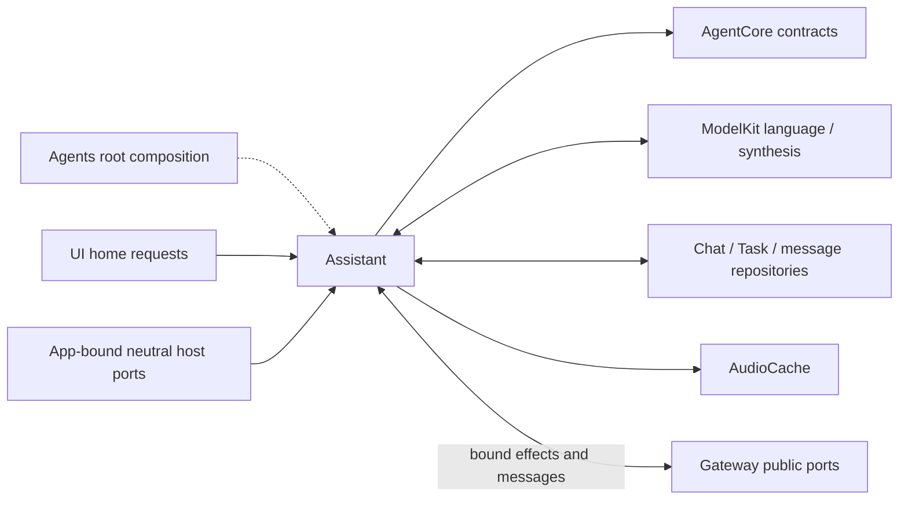
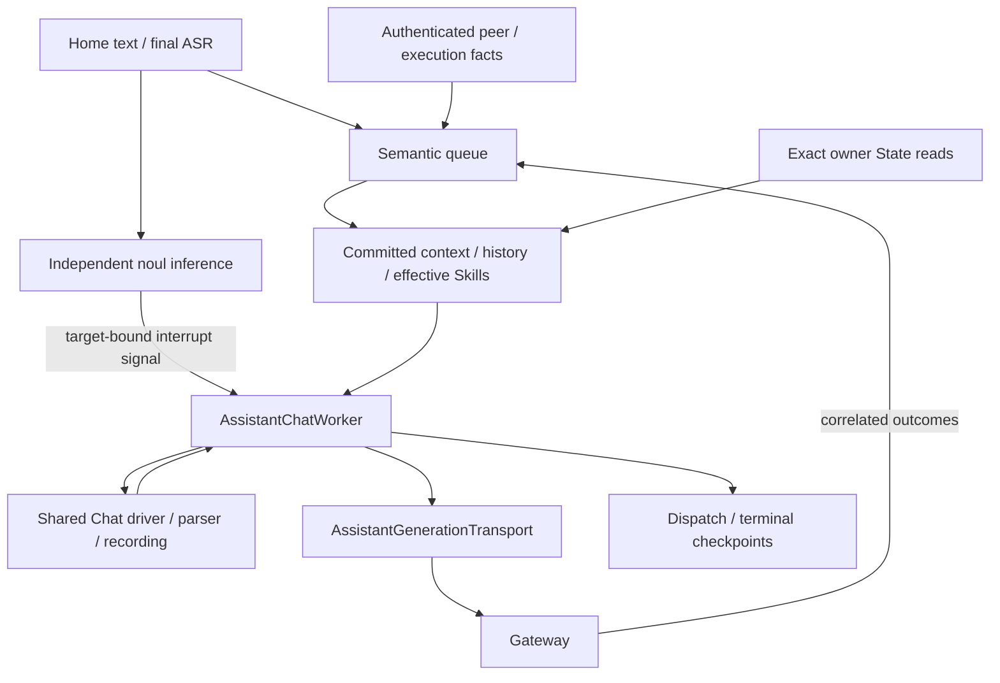
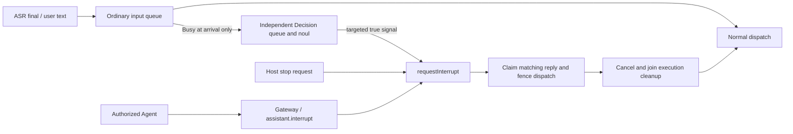

# Assistant — Conversation, own State and dynamic Skills

## Ownership and interfaces

AssistantAgent binds AssistantChatWorker to AssistantContextState. The worker owns Assistant's conversation schema, Decision/ReACT orchestration, Task controls, Decision submission, peer-task feedback and reply lifecycle. Its generic state seam supports isolated fixtures; it is not a common runtime for other production roles. Shared [Chat](../Support/Chat/README.md) supplies model driving, recording, neutral projection and templates; [Core](../Support/Core/README.md) supplies parsing, permissions and round coordination.

AssistantContainer is the stable child capability of AgentContainer. It retains AssistantExecutionSession, private context, registration and bound output workers, and exposes conversation/activity projections. The module root owns startup and joined shutdown; the child neither controls peer roles nor grants execution authority. Static category comes from the role's Agent.json.

| Injected capability | Owner and use |
| --- | --- |
| UIHomeContainer | Direct home text requests; SpeechPerception independently owns listening input. |
| ChatCapability / chatProvider | ModelKit language requests and model selection. |
| AgentStateContext | Exact Skill-selected owner facts and multimodal snapshots. |
| AssistantHistoryStore / AssistantTaskRepository / AgentMessageRepository | Separate durable conversation, foreground Task and peer-message boundaries. |
| AgentContextRepository | Private committed history, Skill state and runtime Task correlation. |
| AssistantSpeechProducing | Role-owned audio-handle production, cancellation and playback facts. |
| Bound output consumer | Authenticated calls, messages, feedback and cancellation scopes. |

Native observations and UI requests have role-owned consumers. Final SpeechPerception transcripts arrive through authenticated communication. Assistant does not consume raw PCM/video, directly switch devices or import Actions/CallRuntime/ExecutionRuntime implementations. App binds narrow collaboration interfaces. Home text acknowledgment establishes admission, not reply or effect completion.

## Files

The root keeps the Agent entry, container, execution session and processing assembly. Responsibilities live in [Controls](Controls/README.md), [Input](Input/README.md), [Output](Output/README.md), [Workflow](Workflow/README.md) and [State](State/README.md). `Resources/Agents/Assistant` mirrors this for controls (`Controls/`) and input prompts (`Input/`).

| File | Responsibility |
| --- | --- |
| [AssistantAgent.swift](AssistantAgent.swift) | Concrete public worker/state binding. |
| [AssistantChatWorker.swift](Workflow/AssistantChatWorker.swift) | Actor declaration: stored state and dependencies, registration and shared helpers. The other `AssistantChat*` files are extensions of this actor, split by responsibility. |
| [AssistantChatLifecycle.swift](Workflow/AssistantChatLifecycle.swift) | Start, recovery, pause/resume, stop and cleanup. |
| [AssistantChatInput.swift](Input/AssistantChatInput.swift) | Input admission, text handling, prepared batches, queue drain and reply-turn start. |
| [AssistantChatGeneration.swift](Workflow/AssistantChatGeneration.swift) | Generation per input: language selection, rounds, execution, completion and batch finish. |
| [AssistantChatFeedback.swift](Output/AssistantChatFeedback.swift) | Round Action results, pending feedback acceptance and publication, observation text. |
| [AssistantChatEmission.swift](Output/AssistantChatEmission.swift) | Output collection, Action and native Tool emission, playback, failures and runtime events. |
| [AssistantChatTaskCommunication.swift](Workflow/AssistantChatTaskCommunication.swift) | Directed task communication: receiving tasks and reports, delegation, `send` delivery and rejection. |
| [AssistantChatWriterEvents.swift](AssistantChatWriterEvents.swift) | Writer events, completion facts and the Writer notice queue and playback. |
| [AssistantChatStatus.swift](State/AssistantChatStatus.swift) | Signal preparation, status, resident context, effective capabilities, local history decisions and decision metadata. |
| [AssistantControls.swift](Controls/AssistantControls.swift) | Control library: aliases, declarations, `destination` (`send` is `peer`; the rest are `self`), `AgentControlOperation` and fixed registrations. |
| [AssistantControlExecution.swift](Controls/AssistantControlExecution.swift) | Control execution (`executeControl`, `control` gating, state/Skill/send entries, the `task` trigger) and the late-bound `AssistantControlLink`. |
| [AssistantChatContext.swift](Workflow/AssistantChatContext.swift) | AssistantChatState, workflow control intent, transactional AssistantHistoryContext and recovery/compression. |
| [AssistantHistoryProjection.swift](Workflow/AssistantHistoryProjection.swift) | Durable history reconstruction and private request selection. |
| [AssistantContainer.swift](AssistantContainer.swift) | Stable role capability, UI-facing state/control and resident-state projection. |
| [AssistantExecutionSession.swift](AssistantExecutionSession.swift) | Registration, output ownership, task/waiting/Decision presentation and joined session cleanup. |
| [AssistantGenerationTransport.swift](Workflow/AssistantGenerationTransport.swift) | Ordered output reader, bounded native execution slots and per-round seals. |
| [AssistantProcessing.swift](AssistantProcessing.swift) | Concrete state, prompt/capability assembly, preprocessing and history binding. |
| [AssistantSessionControl.swift](Workflow/AssistantSessionControl.swift) | Runtime cleanup/close message and typed decoding. |
| [AssistantInterrupt.swift](Input/AssistantInterrupt.swift) | Public interruption target, signal and result contracts. |
| [AssistantInputDecision.swift](Input/AssistantInputDecision.swift) | Frozen current-turn context, localized interruption question, ModelKit noul invocation, independent bounded classification queue, targeted signal submission and log values. |
| [AssistantInputBatch.swift](Input/AssistantInputBatch.swift) | Trusted source timeline, batch text, source-line markers and input prompt access. |
| [AssistantStateBindings.swift](State/AssistantStateBindings.swift) | Business-only exact-path State adaptation. |
| [AssistantSpeechOutput.swift](Output/AssistantSpeechOutput.swift) | AssistantSpeechProducing contract, audio-handle production and synthesis/playback presentation. |
| [SpeechPlaybackFailure.swift](Output/SpeechPlaybackFailure.swift) | Playback-boundary failure copy with preserved underlying synthesis/cache cause. |

## Request state assembly

Each actual request freezes the effective Skill IDs, catalog and teaching from one committed private snapshot, then renders the Agent's own variables from the same value. AssistantHistoryProjection selects recent history and the current batch; selected owner facts are read afterward, outside the private transaction. These reads and private selection are not one atomic transaction.

The state system message (`# STATE`) holds `## CURRENT STATE`, images, peer facts and, last, `## AGENT STATE` with the Agent's own variables, earliest written first as `name (written <natural-language time>): "value"`, rendered by one function ([AgentStatePrompt](../Support/Context/README.md#agent-state-variables)); the stable declarations (meaning and allowed values, never access) are a section of the system prompt. Task registries, delegated views, grants, retention counters and decision-use sets remain private. CURRENT STATE contains only Skill-selected Business facts; old system facts are replaced on every continuation. No Storage.State mirror or Gateway query is used for collection.

Ordinary ordering is instruction/catalog system, selected history, fresh Agent/business system data, then current user input. Native continuation keeps complete assistant-call/tool-result groups contiguous and places fresh data afterward. Historical requests are reconstructed from actual input/response/call evidence without reinserting old system facts. Terminal Task summaries remain historical evidence. Shared projection preserves system messages, current intent, the complete required suffix and current images while removing only expendable history.

Each request records selected State paths in AssistantDecisionMetadata.states alongside Task/Skill/catalog metadata. Fact bodies and image bytes belong to full request logs, not business metadata. History never reads current State to reconstruct an old selection. Model token fitting remains ModelKit-owned.

## Prompt ownership and localization

AssistantContextState assembles the following order: role Instructions (with the reply-language paragraph), Assistant InputProtocol, shared OutputProtocol, `# AGENT CONTROLS` (declarations then the Controls guide), `# STATE VARIABLES`, available shared Skills, permission-filtered public Agent descriptions, the effective Action catalog, then loaded Skill teaching (Actions are introduced before how to use them). AgentConfigurations locates assets through Catalog.json; AgentPrompts loads/renders immutable locale-selected templates. Canonical historical timeline markers remain English and retain recognized historical formats; missing templates/render failures propagate.

InputProtocol (`## User (ASR)`) explains that ASR input may contain recognition errors, noise or unintended background speech, and require a contextual check for meaningful intent before replying. Unintelligible or unrelated accidental input without clear user intent receives only a catalog-permitted expression or no response; recoverable errors, meaningful incomplete input and clear new topics remain actionable. Natural-language output is spoken and captioned, so the role requests plain conversational text without decorative formatting; expressions use declared Actions. BasicInteraction owns expression execution, while queue admission and Decision interruption remain independent.

Public Agent introductions are limited to 8,192 bytes and filtered by actual delegation adapters and current instance communication permissions. Shared Skill overview has a 4 KiB budget and retains IDs when descriptions are shortened. Owner-restricted Writer Skills are loaded by Writer's own workflow. Base/dependency teaching and Action metadata derive from the same effective Skill snapshot. Actual request assembly receives the instance's narrowed communication policy; the convenience default does not bypass it.

System instructions are limited to 64 KiB. Current Assistant Skills expose XML Actions and no native request tools; the native-call machinery remains available for controlled fixtures. Writer owns its independent native tool workflow. Already dispatched requests and recorded evidence are not rewritten when Skills or language change.

Assistant/Prompts.json owns execution evidence, Task-history prefixes, peer-task coordination (`taskQuestion`, `taskEventsHeading`, `taskEvent`, `taskNotice`) and default reply language. InputProtocol.json owns input guidance and canonical timeline markers. InputDecision.json and its zh-Hans sibling own localized boolean interruption questions. Shared RequestContext templates render fresh State and image manifests. InputDecisionOutcome's UI log projection stays in Assistant; generic runtime logs retain their existing AppLanguage injection.

## State, goal and Skill lifecycle

Base Skills are basic-interaction. Optional capabilities such as robot-interaction are discovered/loaded on demand. Loading a Skill adds declarations/teaching/selected State, not runtime execution authority. Internal tools are not automatically exposed by registration. Camera operations do not inherently require a foreground goal.

The control library lives in `Agents/Resources/Agents/Assistant/Controls/Controls.json` and its usage guide in `Controls.md` / `Controls.<language>.md` (AssistantControls.guidance; a missing translation falls back to English). The guide covers when and why to call each control, the variable and goal policy, delegation, response exclusivity, failure retry and examples; parameters stay in the declarations. No Skill declares or teaches a control, and the boundary checker rejects `Agent.*` control bindings and control tags in Skill instructions.

State, Skill and send are Assistant-owned controls (see [Agent controls](../Support/Core/Capability/README.md#agent-controls) and [Assistant controls](Controls/README.md)); `send` has destination `peer` and the others `self`. The prompt shows the peer Agent catalog only when a `peer` control is registered. Controls are resolved and executed inside the Assistant in emission order without waiting for Actions on other Channels, never through Gateway or the Actions Shell. `skill.load` / `skill.unload` commit state before rebuilding the catalog. The foreground goal is the preset `task` variable: setting it opens a goal record, clearing it with a note commits the actual outcome and compresses the history it covered. Full-duplex completion validates the originating request/goal binding, commits SQLite terminal state/summary/sources, then publishes private context. The ending Message remains part of the source set. Trusted host completion (`clearForegroundTask`) uses the same commit path; synchronous mode joins the ending call and execution barrier first.

Goal creation validates a candidate, commits business identity, then binds runtime context; failed binding explicitly closes that identity. Only admitted valid model calls count as Skill use; execution failure counts, rejected parsing/parameters do not. Recent Skills reset to five decisions on load/use. Full user decisions settle retention once; system observations do not decrement it. Skills never depend on the goal: an active goal neither holds Skills nor pauses their counters. [Context](../Support/Context/README.md#task-and-skill-lifecycle) owns dependency, LRU, capacity and rollback algorithms.

Interrupt/failure retains the unfinished goal and returns it to waitingUser. Close releases matching session-scoped recent Skills but does not fabricate goal completion. Explicit change of goal reports the old outcome (the `note` of the replacing `state.set`) before proceeding. Unclear continuation is resolved with the user. Camera/media and draft effects are confirmed by their own receipts. The host's `quiet` variable silences unsolicited peer-report playback.

## Delegation and peer facts

Assistant owns user intent, delegation requests and user communication; the recipient owns admitted work, progress, cleanup and terminal results. send(agent_id,text) keeps the source dialog as originDialog in Assistant's in-memory task tracking; the communication boundary persists the authenticated original message, then delivers agent.task.v1. New goals, supplements, answers and stop requests use the same body contract. Writer decides whether to start/update/stop work and which workspace to use. Assistant never calls a peer's private method or copies its prompt/execution loop.

Peer executors (currently Writer, listed by `AgentTaskMessaging.isPeer`) reply through agent.task.events.v1 and Assistant handles every peer through one generic path with no executor-specific branches or text. Writer replies through agent.task.events.v1, publishing each progress, terminal or rejection report once; there is no redelivery, retry or fallback, and a missed report stays missed. Assistant authenticates and deduplicates admission, selected milestones, questions, rejection and terminal facts, preserving source dialog/task/question identity. Each received Writer report is written to agent_messages as a consumed trace record; that record is never read to decide processing, and a record failure only sets messageRecordFailure without blocking handling. Old delegation completion settles only its original view. Fixed tasks separately use agent.task.v1 operations and share agent.task.events.v1 for progress/results. Memory parent-commit confirmation retains its existing dependency barrier.

Assistant statically subscribes to Writer's agent.task / agent.task.events.v1 channel during startup endpoint assembly. It remains subscribed across idle time, task completion and pause; role stop retires the endpoint and all its static subscriptions. Before a task request, AssistantChatWorker records producer, task reference, session and originDialog in its bounded in-memory trackedTasks collection (maximum 256); Writer tasks create no per-task broker handle. Tracking is not restored after restart. Reports for unknown tasks are recorded but not processed, mismatched sessions are ignored, and a terminal report or a rejection of the root request removes only task tracking. Other task producers without a matching static declaration use consumer-owned dynamic handles. Subscribing does not replay missed Signals. Old task sessions remain distinct from the current consumer incarnation. Public runtime exposes trackedTasks, rather than describing tracked work as a subscription count.

Full-duplex peer facts update control state before entering the semantic queue. In synchronous mode, a report for the origin dialog that is still current is added to the conversation as a completed turn identified by the event id, and the notice is still played when the report presents a reply. Task/interaction binding remains available for follow-up validation. Peer receipt proves delivery admission only and cannot authorize retry or a new goal. Writer's task lifetime is independent of Assistant listening, interruption and dialog closure. Independent communication consumption is owned by the role root and bounded separately from round output; see [Support](../Support/README.md#lifetime-capacity-and-failures).

## Results, history and continuation

AssistantHistoryProjection selects the latest ten complete history blocks. Completed resolved native calls retain paired provider messages. Failed/interrupted/unresolved requests become textual evidence. Terminal Tasks compress at their first source position while original records remain queryable. Ordinary conversation and active Task evidence remain eligible within the window.

Input admission and read-token/begin history operations use the short admission gate. Model generation and effects run outside it. Preparing/queueing a request retains awaitingModel/awaitingDispatch state in memory; onDispatch creates the actual Message and writes complete batch/coordination metadata. Non-HTTP producers follow the same dispatch/evidence contract. Deltas, retention counters and queues remain in memory; complete messages and real terminal outcomes checkpoint at their boundaries. Failed persistence blocks dependent steps. Restart marks interrupted work and never replays effects.

In synchronous mode, the worker joins all admitted calls, reliable results and the round receipt before continuation. Full-duplex mode independently enqueues ordinary Action observations and complete native result groups while settling the original journal. Only explicit model-origin calls may contribute reasoning observations; origin is recorded per invocation, never inferred from path or internal-tool catalog membership.

| Actual evidence | Decision behavior |
| --- | --- |
| Explicit business value, including an empty string | Eligible for continuation after reliable joins. |
| Successful completed/report/activity acknowledgment | Completion evidence only; preserve details without requesting reasoning. |
| Native result without completion | Preserve its value semantics; Action result without completion normalizes to completed. |
| Failed/partial call, timeout or admission/permission rejection with reliable feedback | Preserve effects/failures and allow reasoning while the input owner is live. |
| Pure cancellation | Settle cancellation without incident or continuation; independent mixed-report failures remain real failures. |
| Unknown alias/invalid arguments | Correlated not-executed rejection; no effect is submitted. Malformed syntax is a generation failure. |
| Provider/stream/parser/observation construction failure | Join admitted work, preserve causes and terminate the decision without automatic retry. |
| Uncertain round closure/delivery | Preserve primary and cleanup evidence; uncertainty cannot authorize retry. |

Successful send/publish is an admission acknowledgment. Model stop/toolCalls/lengthLimit only ends generation; it does not itself request another round. Passive State, active Tasks and waiting for a user do not create polling. Unmatched Tool feedback is rejected rather than treated as a fresh input.

Runtime-generated caption, speech and waiting calls can join completion and retain diagnostics, but their values/failures never become model observations or independently trigger reasoning. A real model business observation remains deliverable even if internal presentation fails in the same round. Without business observations, the worker handles internal failure through its runtime-failure path.

## Bounds and overflow

| Owner | Bound and failure policy |
| --- | --- |
| Input/output | 32 queued inputs plus reserved continuation/settlement admission; 256 output envelopes. Overflow rejects. Failed output yield marks the worker failed, clears inbox, cancels inference and closes output. |
| Full-duplex semantic state | 32 pending inputs, 16 background candidates, 16 KiB per item, 512 KiB pending text, 32 sources and 64 active inputs. Expanded batch accounting prevents hidden overflow. |
| Pending rounds | 32 retained catalogs/request/call/result/resource snapshots. No admission from cancelled rounds. |
| Round calls / observations | 120 calls including rejected/runtime reply-start work; 65,536 UTF-8 bytes of observation text. Reset each round, overflow fails without replay. |
| Private Task views | 256 identities, at most 32 live; only terminal views are retireable. |
| Pending observation attachments | 32 MiB total, with request limits of five images, 64 messages and 64 KiB counted text/call fields. |
| Native output transport | Four execution slots, 128 retained Tool work records and 32 round-seal workers. Overflow rejects; seal failure wakes the pump and joins cancellation. |
| Decision usage | Counters span continuations, with no production cumulative request/native-call/time ceiling. New user input has an independent budget. |

Shared driver queue and provider lifecycle limits are documented in [Chat](../Support/Chat/README.md#driver-lifecycle-and-capacity). Parser/resource limits belong to [Generation](../Support/Core/Generation/README.md); request validation belongs to [ModelKit](../../ModelKit/Language/LLM/README.md#request-validation-bounds). Queues have owner cancellation/termination, not implicit elapsed-time expiry.

## Full-duplex input and Decision

Authenticated SpeechPerception final transcripts and local user text enter the ordinary queue before any eligible Decision runs. Only arrivals during same-session reply work (including tool settlement) or playback submit Decision; idle arrivals dispatch without a Decision request or fabricated result. Peer reports and correlated Action facts bypass Decision. Queue capacity, attribution, batching and round settlement remain admission/dispatch concerns; classification never gates them.

AssistantInputDecision owns the localized interruption question and calls only ModelKit `noul`. A frozen snapshot contains `current_turn` (the current user request and natural-language text admitted to playback, if a reply exists) and `incoming_user_input`. It contains no completed earlier turns, queued messages, busy flag or playback state. Input text is JSON data and is not translated. Only an explicit immediate stop, pause, correction or replacement is true; additions, quotations, answers, negated/deferred stops and new questions are false. ModelKit owns all provider encoding and readout; no keyword rule overrides the boolean.

At receipt the worker captures the reply identity and same-session reply work/playback state before asynchronous admission. After successful queue admission, only inputs captured as busy submit a frozen snapshot to AssistantDecisionQueue in AssistantInputDecision.swift. This role-owned actor owns latest-wins Decision scheduling and bounded serial settlement (32 unsettled jobs including the running item), independently of ordinary queue dispatch. New candidates cancel the current classification; replaced jobs record `superseded` without a boolean, failure or interrupt, while their ordinary inputs remain queued. Only the latest waiting candidate runs after actual inference cleanup; [Input](Input/README.md#decision-scheduling-and-cleanup) owns deadlines and attempt identity fencing. A true result submits an AssistantInterrupt with the captured reply target to the common requestInterrupt entry. It does not cancel execution directly. The worker checks identity and current activity and installs the execution cancellation barrier before crossing actors. Cancellation joins existing model/action/playback cleanup before ordinary queue dispatch resumes. Idle arrivals create no Decision snapshot or job; becoming busy during admission/dispatch does not retroactively classify that input. Ended or replaced targets and duplicate signals have no effect on successors. Pause/stop cancels Decision; close removes that session's jobs, cancels its current classification and invalidates its target.

Selected models are exclusive: D3 Edge, Vela, or existing local/cloud Chat through ModelKit's ChatDecision adapter. Switching dedicated models joins work before unloading. Native timeout is one second, local Chat 500 ms and total age budget two seconds, including waiting for a previous inference to exit. Errors, missing resources, overflow and timeouts remain explicit failures; they never fabricate false, remove queued messages or switch models. A full Decision settlement backlog records a failure while the input remains in the ordinary queue. Native context capacity overflow fails without silently truncating the latest input.

Logs distinguish the raw boolean from signal status (`not_requested`, `no_target`, `target_expired`, `interrupted`, `interrupt_failed`, `decision_failed`), selected model, submitted semantic request and failure details. The measured duration covers classification, excluding earlier queue waiting and signal application/cleanup. Historical UI dispositions remain readable but are not produced by the new classifier. Only a completed interruption emits transient Island feedback. There is no discard/continue-listening path, held speech buffer or fragment concatenation.

The same-session reply activity query includes active execution, unsettled rounds and reported playback; SpeechPerception selects the shorter endpoint only while that activity is present. A full-duplex interruption blocks dispatch immediately, then after cancellation cleanup observes 40 processed VAD windows captured after cleanup, unless speech has already been confirmed. A boundary onset candidate remains pending until it confirms or clears. Once speech is confirmed, the observation interval ends and all tracked utterances must enter the ordinary queue as final text or end empty/failed; the last settlement releases dispatch without another interval. SpeechPerception reports opaque utterance IDs and capture-generation-fenced window facts; final text travels through authenticated Gateway delivery. Failed or unobserved delivery releases its ID with an explicit error. Up to 32 utterances may be tracked; overflow fails explicitly. Capture loss or a ten-second stalled-observation watchdog reports failure and retires the probe. Prior round settlement continues while same-session dispatch and peer notice playback wait. Session closure, pause, stop and cleanup failure retire the wait. Late cleanup and stale capture/utterance callbacks cannot release a successor. This runtime state is not sent to the model.

## Input timeline and channels

AssistantInputBatch renders single and multi-source inputs as one timeline: original body followed by trusted source and local-device time. It sorts complete event time then admission sequence. Adjacent ASR entries share one section with newline-separated text and one source line carrying the last fragment’s time. Typed inputs, peer messages and Action results retain their own sections and delimit speech groups. User uptime maps to local Date; peers use receipt time and Actions use completion time. User text resembling trusted source lines/headings is indented. Interruption adds only related prior user intent. Recorded requests are replayed as stored; older input formats are not reprojected.

AssistantGenerationTransport has one ordered reader for Actions and wait boundaries. Reply captions use Display, speech playback uses Speech and a goal-ending state.clear uses Control. Each Channel remains FIFO in the session domain; different Channels can run under resource/wait constraints. Native calls retain independent pairing and bounded slots. Stream completion is separate from execution and result-delivery completion. See [Actions Shell scheduling](../../Actions/Support/Shell/README.md#scheduling).

Default text segmentation uses first-segment Han/other thresholds of 20/60 and subsequent 60/120, preserving safe word/sentence boundaries. XML/wait boundaries flush without resetting first-segment state; there is no timer flush. A completed text segment produces its caption/synthesis/playback intent.

Full-duplex Action and native Tool result inputs retain their originating conversation turn and task scope while owning distinct input IDs and runtime attribution. Their next model request establishes a fresh Decision identity through beginReplyTurn, so observation-driven replies replace the previous caption and append through the same fenced Display path as direct replies. Inputs without a presentation turn remain without one; stale Decisions and cancelled turns remain rejected by Actions.

## State and image ownership

AssistantStateBindings installs one App-backed exact-path resolver. Skill.useStates alone selects sources; parent paths do not imply child reads. It preserves the producer's complete Business dictionaries/arrays while excluding Runtime, health/issues, metadata and child indices. Missing/unreadable/malformed sources become unknown/null with bounded path/code diagnostics; cancellation, closed context and capacity failures propagate. There is no polling, tree discovery, loadState or duplicate path allowlist.

BasicInteraction includes passive native time, power, thermal, network, permissions, audio, locale and accessibility facts plus navigation/windows. Facts never override authorization or execution checks. Resident state inspection reads initialized committed memory only, without persistence restoration or a second mutable registry; unknown is reported before initialization. start owns restoration and its failures.

Camera owns preview bytes, latest/explicit selection and validity. Photography selects actions.camera settings/recording facts and actions.camera.preview; native platform.vision.camera independently reports actual capture facts. Reads neither start the camera nor grant capture permission. Capture/disposition use actual preview/video identity and joined window cleanup.

Web owns one current scope-bound screenshot. WebBrowsing selects ui.web.sessions, ui.windows and actions.web.screenshot. Local paths and WebKit runtime metrics stay out of Assistant context. Feedback text/screenshotID does not trigger image lookup or a separate image message. Unsupported models use bounded page text and an unsupported-delivery manifest. Generated code and Writer transcripts do not enter Assistant parsing.

Every real request, including continuations, projects selected images into its current user message via shared Chat. The system manifest supplies source/identity/position. Ephemeral images are excluded from retained conversation attachments; independent full request logs keep submitted bytes. Private resourceBindings and image scopes travel separately from model facts/parameters and are replaced each round. Assistant owns no second media cache, image compression policy or historical screenshot selector. A selected image and its current intent/result group remain protected during budget trimming.

Island State exposes activity/title/selection/submission and local presentation facts, not spectrum or physical-device authority. Expanded detail requires existing detail content; iOS owns actual system visibility and geometry. Window summaries do not substitute for screenshot/content evidence.

## Presentation, speech and cleanup

AssistantExecutionSession owns separate Task, inference-waiting and Decision feedback activities. Waiting facts originate from the worker; content and internal UI.Island calls are role-owned. A joined same-generation interruption shows approximately three seconds of replaceable local detail. New feedback replaces the timer/content; suspension/stop cancels and ends it. Stop joins final presentation cleanup before role retirement. Presentation failure remains observable and internal receipts do not enter inference.

AssistantSpeechProducing is bound once while idle. prepare reserves an audio handle, not audible completion; an absent producer fails explicitly. AssistantSpeechOutput owns a stable role subcomponent, without Agent registration or Signal intake. Native startup installs ModelKit TTS and AudioCache; playback still uses Gateway and Actions.

prepare validates nonempty text up to 2,000 UTF-8 bytes, creates a unique audioID and reserves by Assistant/session/input before rechecking lifecycle. One FIFO producer runs independently of playback. Live plus pending reservations are capped at 32; AudioCache separately bounds 32 handles and 8 MiB per segment. Overflow rejects. Model identity, mono Float32, stable format, increasing sequence, nonempty audio and explicit finish are required. Language is auto at synthesis; ModelKit selects the provider language.

Every synthesis request joins provider cleanup before completing/failing cache. Original model/cache/cleanup failures wake readers. TaskLocal context prevents a cache cancellation callback from awaiting its own producer. Failed playback submission cancels the handle and retains cleanup failure. Input cancellation uses session/input identity; stop closes admission and joins pending reservations and production. Replacement waits for prior cleanup. The output consumer retires residual handles at the actual input terminal barrier without replaying effects.

Speech presentation has its own identity. Actual audioID playback callbacks prevent old completion from hiding a new activity; synthesis finish cannot hide ongoing playback. Playing takes precedence over producing. Spectrum is a direct player/UI data path. Synthesis admission, provider cleanup and native playback drain are distinct completion boundaries. SpeechPlaybackFailure adapts user-facing copy after actual cleanup while preserving the underlying error.

Worker, speech producer and output scopes outlive pages. Interrupt/pause joins current owned work while retaining unfinished Task/Skills; close ends matching execution/State scopes; root stop joins all workers. AssistantChatState decodes its host-control contract into AssistantChatControl and the worker validates local runtime origin before cleanup. Fixture state does not inherit another role's host-control schema. Listening remains SpeechPerception-owned, and other roles retain their own lifetimes.

AssistantSpeechOutput records paired native playback start/end times separately from synthesis and reply work. Its bounded SpeechPlaybackHistory retains at most 32 intervals and exposes a same-session SpeechPlaybackSnapshot to SpeechPerception through root injection. Late ends cannot close another audio ID; playback state retains its 200 ms tail for onset-threshold selection. Audio-scope shutdown clears the history. The native timestamp describes first scheduled playback, not a measured acoustic arrival.

## Unified interruption control

`AssistantInterrupt.swift` owns the typed `assistant.interrupt` v1 communication contract. Targets are `.current` (lock the same-session reply when received) or `.reply(UUID)` (match an already captured reply). `AssistantChatWorker.requestInterrupt` is the shared entry for Decision, trusted host controls and authorized Agent messages. Idle user input never invokes Decision; an external idle request returns `no_target`. A public `currentReplyID(sessionID:)` exposes the opaque target to trusted callers without granting communication authority.

The entry validates the current target, claims it and sets the dispatch barrier on the worker actor before invoking the execution-session cleanup callback. Cleanup joins model, Action and playback cancellation and settlement; same-session full-duplex speech additionally observes the wait described above. Results are interrupted/no_target/target_expired/duplicate; failures throw. A reply cut off while still generating is settled as `interrupted` in history (not `cancelled`), as are its batch members; when generation had already finished and only playback was active, the entry rewrites the reply to `interrupted`, and a history failure is thrown after cleanup. The interrupting input records the Decision boolean as `coordination.interrupt`. Recent source/session/signal identities use a 128-entry FIFO receipt set, including ignored and failed requests; there is no automatic replay or durable exactly-once promise. Closing a session or stopping the Agent remains a separate lifecycle control.

AgentContracts registers the schema and Agent.json declares an observation input. Gateway enforces sender `sends` and receiver `inputs`; no role gains sending permission merely by this declaration. External device/world events enter through their owning role or a trusted host adapter. The receiver handles interruption before ordinary admission, validates contract/version and provenance, and records a control result; it neither queues the signal as user text nor runs Decision on it. Transport receipts retain admission semantics. Host `interruptConversation` also uses the common entry; its private execution callback is cleanup-only. Internal `assistant.control` remains restricted to the runtime for cleanup and session closure.

Decision模型切换支持D3 Edge、Vela 3 Fast/3.1 Fast及Laya Multilingual；上下文和noul请求不随模型变化。根模块删除上述任一制品前，停止并加入该ID的Decision调用；模型名称仅用于日志呈现。
