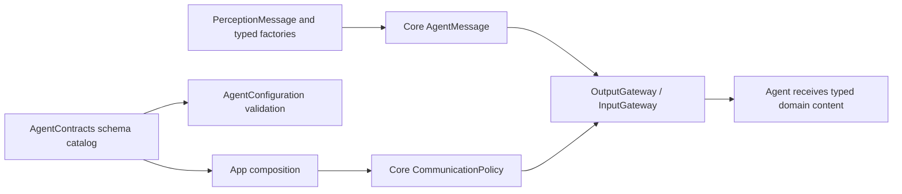
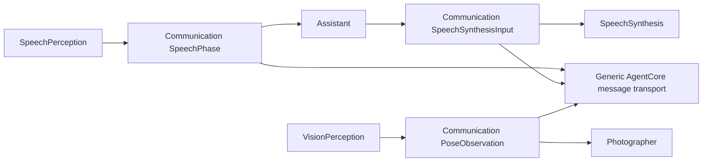

# Agent communication domains

Purpose: group the application's typed messages, schemas and built-in identities outside AgentCore. Design goals: one coherent catalog, immutable values, explicit validation and no transport workers.

✅ AgentContracts.swift contains concrete AgentID names, PerceptionMessage Codable cases, typed AgentMessage factories/access and the registered speech/vision schema catalog. Core transports generic messages; Gateway receives the catalog through App composition. Existing JSON v5 names, domain payload JSON, byte limits and freshness are preserved.
✅ Synthesis/cancellation are new work with a fresh 10-second deadline; observations inherit the parent deadline and use their registered lifetime (pose 1s, partial transcript 2s, other messages 10s). Content type and declared contract must match; unknown/duplicate schemas reject assembly/admission.
❌ No inbox, model operation, execution handler, request/reply service or retry loop belongs here. Per-Agent processing remains in each actor.

## Domain value ownership

✅ SpeechValues.swift owns SpeechPhase, SpeechSynthesisInput and SpeechValidationError; PoseObservation.swift owns the COCO-17 observation/Joint and VisionValidationError. These values are shared by business Agents inside one target, with the same Codable shape and validation limits. They have Foundation-only imports and are not re-exported from Types or Core.

✅ Image transport geometry errors remain ImageInputError.invalidFrame in Types; Agent/cadence input ordering rejects CommunicationError.outOfOrder and session mismatch rejects CommunicationError.scopeClosed. ❌ No compatibility aliases, new queues or serialization migration is introduced.
