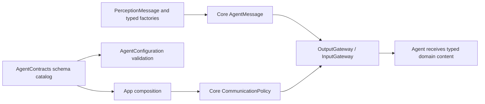
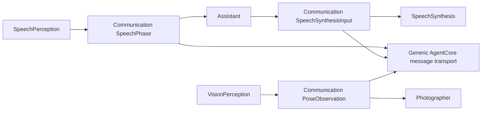

# Agent communication domains

Purpose: group the application's typed messages, schemas and built-in identities outside AgentCore. Design goals: one coherent catalog, immutable values, explicit validation and no transport workers.

✅ AgentContracts.swift contains concrete AgentID names, PerceptionMessage Codable cases, typed AgentMessage factories/access and the registered speech/vision schema catalog. Core transports generic messages; Gateway receives the catalog through App composition. Existing JSON v6 names, domain payload JSON, byte limits and freshness are preserved.
✅ Synthesis/cancellation are new work with a fresh 10-second deadline; observations inherit the parent deadline and use their registered lifetime (pose 1s, partial transcript 2s, other messages 10s). Content type and declared contract must match; unknown/duplicate schemas reject assembly/admission.
❌ No inbox, model operation, execution handler, request/reply service or retry loop belongs here. Per-Agent processing remains in each actor.

## Domain value ownership

✅ SpeechValues.swift owns SpeechPhase, SpeechSynthesisInput and SpeechValidationError; PoseObservation.swift owns the COCO-17 observation/Joint and VisionValidationError. These values are shared by business Agents inside one target, with the same Codable shape and validation limits. The domain value files import Foundation only. AgentContracts.swift imports AgentCore for generic envelopes and schema registration; business values are not declared or re-exported by Core.

✅ Image transport geometry errors remain ImageInputError.invalidFrame in AgentCore/Input; Agent/cadence input ordering rejects CommunicationError.outOfOrder and session mismatch rejects CommunicationError.scopeClosed. ❌ No compatibility aliases, new queues or serialization migration is introduced.

## Current compilation boundary

✅ This directory compiles into the single Agents target with the five business Agents. PerceptionMessage is currently one Codable union for transcript, speech phase, sound source, pose, synthesis and cancellation; AgentContracts registers the whole catalog. AgentCore is a separate Foundation-only target and contains no concrete schema names or application Agent identities.

❌ Communication domains and individual business Agents are not separate compilation targets. This document does not claim per-Agent import isolation; independent target/domain splitting is not implemented.

✅ SoundSourceObservation is the immutable sound.source/1 domain value. active requires a finite unit direction with consistent radian azimuth/elevation; inactive/uncertain/unavailable prohibit a direction. RMS, correlation quality, capture timestamp/window duration and fixed ambisonic coordinate convention are validated. The catalog registers a 500 ms observation lifetime; factories and JSON permissions remain Agent-owned. No PCM is broadcast. ❌ Photographer has no sound.source subscription yet.

✅ Built-in identities include memory; its JSON declares typed history.intent/1 and correlated tool.result feedback. ❌ Cross-Agent memory requests remain pending.

✅ history.intent/1 carries Codable MemoryHistoryIntent through the existing generic AgentMessage transport, bounded to512 encoded bytes. The schema rejects foreign content and JSON declarations use observation kind. Refresh/delete/cancel producers preserve their existing user/host identity and admission lifetime; this adds no Agent publication/send permission.

✅ Implemented: AssistantControl.cancelSession uses assistant.control/1 with a 512-byte schema bound and fresh 10-second admission. A factory binds source runtime and external origin; this does not grant runtime feedback authority.

✅ Implemented: MemoryHistoryIntent adds startNew/summarize(UUID), preserving history.intent/1,512-byte bound, source user and external origin. Cancel remains host-bound.

✅ Implemented: ModelResourceIntent Codable domain values, ID/source validation and2048-byte schema limit; factories bind external user source, fresh causal root and10-second admission. No UI/model types enter Core.

✅ Implemented: a host-only typed retire(request UUID) control releases resource Agent bookkeeping after dispatch/feedback failure. It is external runtime-source input, never a native download cancel or a model permission; completion/error remains request-local.

✅ ADR0167: model.resource.intent/1 adds configureSpeech with two typed booleans; the2048-byte external intent and owner-fenced result contract remain unchanged. No UI draft or persistence type enters the schema.

✅ ADR0168: model.resource.intent/1 adds restoreSource and saveSource with bounded endpoint/boolean fields. Preferences return as canonical JSON under tool.result; no UI draft, store or concrete function dependency enters Agent contracts.

✅ ADR0169: model.resource.intent/1 adds refreshResources. Canonical inventory travels as an owner-fenced returning result; the external intent stays2048 bytes and carries no UI or native model types.

✅ ADR0170: model.resource.intent/1 adds refreshPresentation with nonzero UInt64 generation; existing2048-byte external contract and provenance checks remain.

✅ ADR0171: ModelResourceObservation changed/failed content, positive presentation generation, failure<=2048 bytes, encoded contract<=16384 bytes; factory binds external model.resources source and producer sequence. No foundational type or calling protocol dependency.

## Resource host-failure Signal — ADR0174

✅ ResourceHostFailure.swift owns model.resource.hostFailure/1: original requestID, admission/dispatch phase, operation/preference/refresh scope and nonblank message≤2048 UTF-8 bytes. Refresh generation must be positive. The factory creates a fresh root with the original request as parent and one hop, sourced externally from app.resources. AgentContracts registers a 16 KiB escaped-JSON limit and startsNewWork. ApplicationControl validates envelope/source/session linkage. This directory contains immutable values and validation only, without workers, UI values or native snapshots.

## Provider discovery

✅ Implemented: ProviderDiscoveryIntent.swift defines provider.discovery/1 with requestID UUID only and a bounded512-byte user/external envelope. AgentContracts registers new-work admission. No endpoint, credential, UI draft or SDK value belongs in this message.

## Provider configuration transactions

✅ Implemented: ProviderSettingsIntent.swift defines restore/save kind plus requestID, user/external provenance and512-byte new-work contract provider.settings/1. It contains no URL/key/model/draft. Private results are held by Actions and referenced by the acknowledged requestID.

## Completion batch — provider presentation and capability policy

✅ Implemented: provider discovery model-family eligibility belongs to Actions ProviderModelList; ModelKit validates/decodes raw IDs only. Preserve filtering/dedup/order and bounds at the app boundary. SettingsState becomes a passive editable snapshot, with no tasks or injected execution; SettingsInteractionWorkflow in the existing Settings directory owns bounded form admission, revision and page-independent saves. UI forwards edits/discovery/cancellation/save through SettingsControlling.

✅ Implemented: presentation-enabled provider intents select a second registered UI.ResourcePresentation.showProviderResult call after the business call, on success or failure. Headless requests retain one call. Private result lookup and revision/session fences prevent credentials in protocol payloads and stale form updates. One attempt only, no recursive presentation/replay; producer and presentation failure chains remain distinct. App injects the native UI endpoint; business functions remain independent of UI and call protocols.

## Typed device, navigation and environment entry points

✅ Implemented: app.interaction/1 maps explicit device commands and navigation destinations to fixed registered functions through ApplicationControl and the shared root transport. This Agent now coordinates native resource interactions as well as model resources; it performs no native I/O. UI controls emit typed intent through a root-owned BluetoothInteractionWorkflow; native BluetoothWorkflow remains the injected connection/recovery/manual worker host. Existing arrival tolerance, timeouts, pacing and takeover algorithms stay unchanged.

✅ Implemented: System.Device.control validates bounded string arguments and invokes neutral DeviceControlCapability; successful submission reports acceptance, not physical arrival. Read-only status and selected connection commands are explicitly model-granted. UI.Navigation.open commits native route state; manual taps and model requests share that function. A bounded latest motor-intent worker sends only changed values, with reset/stop priority and explicit failure display. No queued motion replay.

✅ Implemented: app.environment/1 stores latest sequenced scene/device/capability facts in the root Agent, with finite categories and bounded data. App still performs synchronous background/native safety fencing before reporting facts; physical safety cannot wait on Agent admission or iOS background execution. Native back navigation remains platform-owned and reports a fact, rather than replaying navigation effects. Photo-library creation and physical acceptance are feature/acceptance boundaries, not implied by navigation support.

## Camera command entry

✅ Implemented: CameraInteractionWorkflow emits typed open/close/flip/retry intents through Photographer and existing Camera functions. Root presentation accepts Photographer in the dedicated camera root session or validated active voice delegation; Assistant calls delegate through the bound Gateway context. Native capture, permission, lifecycle fences and joined cleanup remain CameraCoordinator responsibilities. Retry uses a canonical callable and the native explicit settings/permission request. UI receives controls and passive camera state, not the native coordinator. One command slot rejects overlap, no replay.

✅ ADR0180: Memory / memory identity and MemoryHistoryIntent are used consistently in configuration, host transport, presentation source guards and regression fixtures; preserve history.intent/1 and runtime behavior. Enforce the two reorganized roles’ directory/actor/configuration naming and isolated business components.

✅ ADR0181: photography.camera/1 uses PhotographerCameraIntent operation/requestID with a512-byte bound and a fresh10-second routing deadline. It is a directed work command; trusted runtime cancellation is root-only. app.interaction removes camera and remains device/navigation only.

✅ Interaction refinement: PhotographerCameraIntent gains a finite Facing enum; flip requires facing, all other operations forbid it. The existing 512-byte bound remains.
