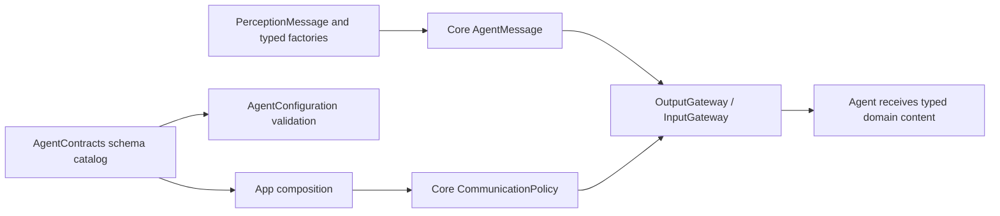
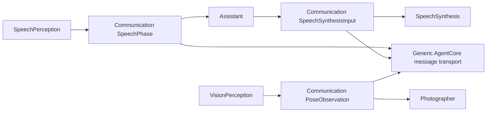

# Agent communication domains

Purpose: group the application's typed messages, schemas and built-in identities outside AgentCore. Design goals: one coherent catalog, immutable values, explicit validation and no transport workers.

✅ AgentContracts.swift contains concrete AgentID names, PerceptionMessage Codable cases, typed AgentMessage factories/access and the registered speech/vision schema catalog. Core transports generic messages; Gateway receives the catalog through App composition. Existing JSON v5 names, domain payload JSON, byte limits and freshness are preserved.
✅ Synthesis/cancellation are new work with a fresh 10-second deadline; observations inherit the parent deadline and use their registered lifetime (pose 1s, partial transcript 2s, other messages 10s). Content type and declared contract must match; unknown/duplicate schemas reject assembly/admission.
❌ No inbox, model operation, execution handler, request/reply service or retry loop belongs here. Per-Agent processing remains in each actor.

## Domain value ownership

✅ SpeechValues.swift owns SpeechPhase, SpeechSynthesisInput and SpeechValidationError; PoseObservation.swift owns the COCO-17 observation/Joint and VisionValidationError. These values are shared by business Agents inside one target, with the same Codable shape and validation limits. The domain value files import Foundation only. AgentContracts.swift imports AgentCore for generic envelopes and schema registration; business values are not declared or re-exported by Core.

✅ Image transport geometry errors remain ImageInputError.invalidFrame in AgentCore/Input; Agent/cadence input ordering rejects CommunicationError.outOfOrder and session mismatch rejects CommunicationError.scopeClosed. ❌ No compatibility aliases, new queues or serialization migration is introduced.

## Current compilation boundary

✅ This directory compiles into the single Agents target with the five business Agents. PerceptionMessage is currently one Codable union for transcript, speech phase, sound source, pose, synthesis and cancellation; AgentContracts registers the whole catalog. AgentCore is a separate Foundation-only target and contains no concrete schema names or application Agent identities.

❌ Communication domains and individual business Agents are not separate compilation targets. This document does not claim per-Agent import isolation; independent target/domain splitting is not implemented.

✅ SoundSourceObservation is the immutable sound.source/1 domain value. active requires a finite unit direction with consistent radian azimuth/elevation; inactive/uncertain/unavailable prohibit a direction. RMS, correlation quality, capture timestamp/window duration and fixed ambisonic coordinate convention are validated. The catalog registers a 500 ms observation lifetime; factories and JSON permissions remain Agent-owned. No PCM is broadcast. ❌ Photographer has no sound.source subscription yet.
