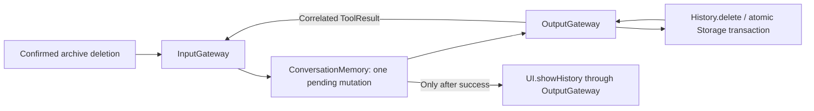

# ConversationMemory Agent

Purpose: interpret explicit history intent without voice or model inference. Design goals: bounded deterministic coordination, correlated runtime results and Gateway-only effects. This implements the [history mutation contract](../../Agent-Driven-App.md#deterministic-history-mutation-contract).

| Direction | Implemented contract |
| --- | --- |
| Input | JSON v5 runtime.event/1: unexpired input, fixed root session. User-source refresh/delete(archive UUID), runtime-source cancel(request UUID); unknown payloads reject. tool.result/1: runtime source, matching session and pending callID; foreign/duplicate results reject. |
| Output | Refresh emits internal UI.showHistory. Delete emits internal History.delete(id); successful correlated feedback emits UI.showHistory using the original request identity. Failure emits non-business history.delete.failed; cancellation emits history.cancelled. All executed calls/control acknowledgments cross OutputGateway. |
| Publish | None. |
| Send | None. Tool feedback uses InputGateway; no direct Agent messages or effect services. |

✅ JSON has no model-callable mutation; Swift owns fixed permissions with required id validation. The Agent performs no I/O or inference. One pending mutation rejects overlap. There is no inbox; output buffer8 rejects overflow and transitions to failed. Stop clears pending state and closes the stream. Production transport admits one request without backlog, joins cleanup and drains cancelled presentation before retry. Control acknowledgments carry no business command.

✅ A committed delete survives later cancellation or presentation failure. Failed/missing/current archive deletion never emits successful presentation. Existing UI confirmation is required by this stage's input binding; no conversational deletion permission is introduced.

❌ Archive/title generation, navigation, semantic retrieval, model-callable memory intent and model-driven continuation remain pending. Display-title defaults stay UI policy; failed output overflow requires explicit lifecycle recovery, not automatic retry.
