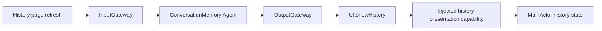

# ConversationMemory Agent

Purpose: interpret structured conversation-history intent independently of voice or model inference. Design goals: explicit user/session validation, Gateway-only effects and bounded admission.

✅ `ConversationMemoryIntent.refresh` encodes `history.refresh`. The actor accepts only unexpired user events in its root-owned session and emits the internal completion Tool `UI.showHistory`. JSON v5 declares event input and an empty model catalog; Swift owns the fixed Tool permission. App injects the handler and validates startup coverage.

✅ Receive performs no inference or storage I/O. There is no inbox; the output stream holds at most eight envelopes, rejects overflow explicitly and transitions to failed. Production transport admits one refresh with no backlog, correlates its output and joins cancellation cleanup before allowing retry. Page cancellation never stops the shared Agent or terminates its output stream.

❌ Archive/delete/title generation remain legacy feature operations. Conversation navigation, semantic retrieval, model-callable memory intent, model continuation and durable retries are pending. Display-title defaults remain UI policy.
