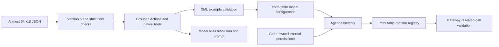

# Capability declarations and runtime permissions

Purpose: validate Agent configuration and resolve model-local names without depending on concrete Agents, models or device implementations. Design goal: keep model exposure distinct from trusted runtime output permissions.

- ✅ AgentConfiguration accepts bounded JSON v5: version, id, Channel-grouped actions, standard nested function tools and unchanged communication.
- ✅ Group keys supply Channel defaults; empty groups declare Channels. Old channels/textActions/hidden/defaultChannel fields fail validation.
- ✅ Action examples are parsed and resolved against the model-only catalog. Group traversal is sorted for deterministic prompt assembly; aliases are globally unique within an Agent.
- ✅ InternalAction and InternalTool define code-owned paths and argument names without aliases/docs. Registry permits checks include internal grants, but resolveAction/resolveTool never search them.
- ✅ CapabilityContextBuilder produces English Channel/module/wait instructions and callable Action details. The owning Agent supplies its speech Channel policy. Internal metadata and Tools never enter this text.
- ✅ NativeToolDefinition preserves the OpenAI Chat Completions envelope. Current argument transport supports string properties, optional enums and required-name checks. Unsupported schemas fail explicitly.
- ❌ Full JSON Schema, provider-native Tool streaming, configuration hot reload and physical-device authorization remain outside this module.

## Validation and assembly

The configuration permits at most 128 capabilities; assembly applies the same bound including internal grants. At most 16 Channels include model groups and internal defaults; parameter sets have at most 32 entries. Paths are keys, not reflected method names. Required and optional arguments must be disjoint; calls reject unknown/missing names and oversized values. Action handlers remain responsible for value semantics. Native Tool enums are checked during resolution and Gateway permission validation.

No Channel is implicitly main or blocking. DefaultChannel remains an internal runtime property derived from the JSON group, not a redundant JSON field. Text mapping is not part of AgentConfiguration: AgentGenerator receives an optional code-owned callback, and Assistant provides synthesis/playback/caption behavior. See [Agent standard](../../README.md) for complete schema rules and [Generation](../Generation/README.md) for streaming limits.

✅ Source location: `MobileHarness/Agents/Core/Capability`; compiled by `AgentCore`. Directory relocation preserves existing behavior and public contracts. ❌ No new runtime capabilities are implied.
