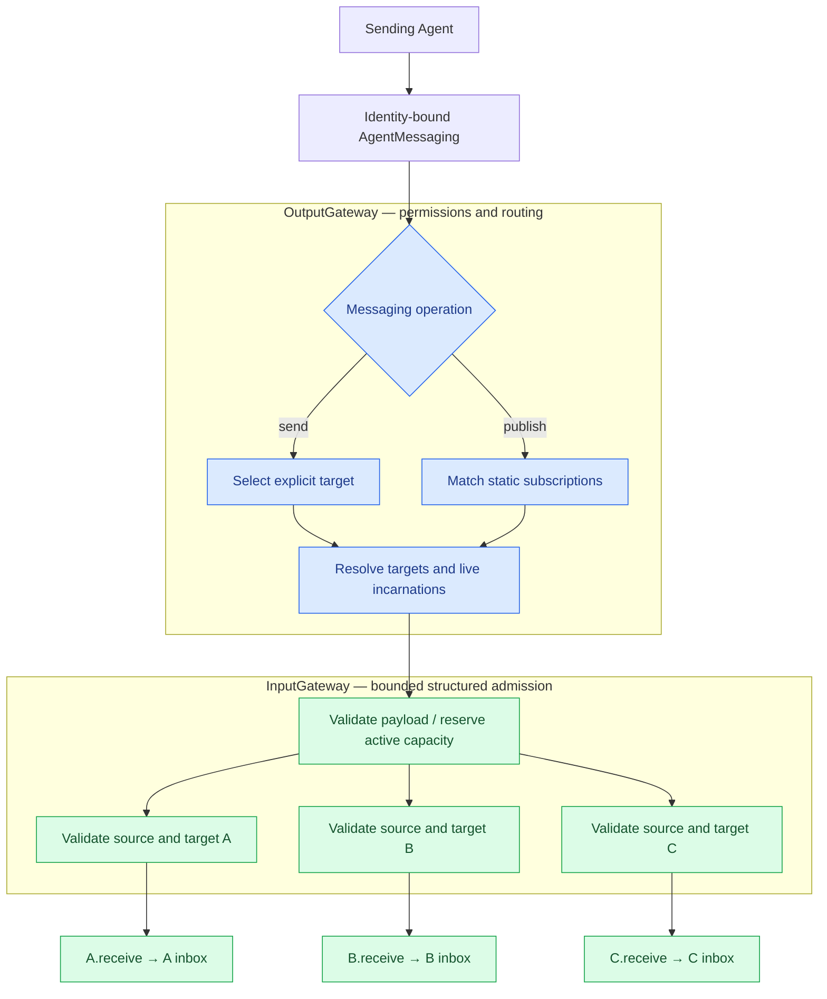
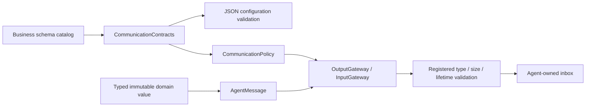

# Communication — contracts and routing policy

Purpose: define typed Agent communication without owning transport tasks, message queues or session lifecycle. Gateways validate and route; Agents own inbox buffering and processing. AgentCore remains independent of Gateway and concrete Agents.

- ✅ AgentMessaging binds publish/send to the sender's live incarnation through an OutputGateway closure.
- ✅ CommunicationPolicy validates JSON v6 inputs, exact contract/source/topic subscriptions, publications and direct-send permissions.
- ✅ DeliveryReport describes per-target admission; AgentMessaging.swift groups the generic AgentMessage, sender port and admission reports.
- ❌ Dynamic subscriptions, request/reply, remote transport, persistence and automatic retry.

InternalSignalBus and its queue/active-call registry, timers, session API, duplicate cache and snapshots have been removed. This directory replaces the former `AgentCore/Bus` directory (historical path); see [ADR 0048](../../../../docs/adr/0048-direct-signal-admission.md).

## Target selection and per-Agent delivery

A/B/C illustrate selected targets, not unconditional broadcast. A direct send selects one; publication matches exact static subscriptions. Supporting an input does not imply subscribing to it. Topic currently equals contract. App validates all declarations at composition time. Unknown sources/targets and incompatible declarations fail; no wildcard or default-Agent fallback exists.

OutputGateway checks permission, sender identity/session, payload and causal parent, builds trusted source/sequence/turn metadata and freezes live target identities. It directly calls module-internal InputGateway.sendInternal. App callers cannot use that internal entry; public external publish/send reject a supplied internal incarnation.

InputGateway uses one common admission path for external and internal calls. It validates input support, source/target identity and session, checks cancellation and expiry before receive, then calls each receiver in a structured task group. Concurrent callers have no transport FIFO guarantee. There is no independent Bus, waiting queue, persistent worker, per-call deadline task or retained task registry.

## Admission bounds and completion

| Boundary | Limit / overflow |
| --- | --- |
| Static policy | 64 Agents, 64 topics, 16 subscriptions per Agent / configured topic recipients |
| OutputGateway | 16 active emissions per source; reject excess |
| InputGateway | 128 active operations shared by external/internal callers; reject excess |
| Fan-out | At most 16 distinct targets per operation, 256 reserved branches total |
| Observation memory | 8 MiB reserved bytes, conservatively charged per target until all branches return |
| Observation size | 16 KiB normally, 256 KiB pose |
| Causal context | At most 8 hops; forwarded observations cannot extend their parent deadline; newly generated synthesis/cancel commands receive a fresh admission deadline (ADR 0055) |
| Message validity | Discrete default 10 s, pose 1 s, partial 2 s, maximum 60 s |

Limits describe active calls, not queue capacity. A whole-operation capacity failure throws before target tasks are created. A receiver failure is reported independently; other targets can succeed. The caller waits for all target admissions. Task creation is bounded; no retry or waiting for free capacity occurs.

Deadlines are validity checks before delivery and at Agent admission/processing, not timeouts racing receive. A receiver that suspends indefinitely can keep the caller waiting: ordinary receive must promptly validate and admit or reject, never await inference or inbox space. A Swift actor entry still requires await from outside, even when the implementation only does synchronous enqueueing.

Caller cancellation propagates through structured target tasks. Agent/runtime stop APIs own admitted work and cleanup; cancelling a sender does not retract an already accepted input. App stops producers, invalidates Agent identities and joins their tasks before replacing a session. There is no separate communication open/close/shutdown lifecycle. Explicit Agent cancellation controls may join cleanup and are distinct from ordinary input admission.

DeliveryReport means inbox admission, not inference or physical completion. No duplicate suppression or exactly-once execution is promised. Receivers requiring stale-state protection use session/source/sequence context; replaceable state may coalesce only in documented Agent buffers. Action ChannelScheduler queues remain separate execution coordination.

## Observations and extension

OutputGateway may await a registered App observer for a published contract. It does not create an Agent subscription and cannot mutate business presentation. Zero recipients fails unless such an observer exists; VisionPerception handles no pose subscribers independently of its skeleton Tool output.

Remote or cross-process Agents would require an explicit transport adapter, not automatically a Bus. Add serialization, authentication and network-failure handling only for a concrete integration. A broker is a separate future choice for offline delivery, persistence or replay.

See [external input delivery](../../../Gateway/Input/README.md#external-input-admission-and-delivery), [OutputGateway](../../../Gateway/Output/README.md) and the [communication framework](../../../README.md#communication-framework). Tests cover direct overlap, capacity recovery, receiver rejection, expired/foreign-session inputs and stale source ports; Agent tests cover their own buffering policies.

✅ Generic AgentMessage holds immutable typed content and a checked encoded size. The application catalog registers expected content type, validation, maximum bytes, lifetime and whether publication starts new work. Unknown schemas reject admission; no domain case list or alias lives in Core.

✅ Generated work starts its registered lifetime now; forwarded observations inherit the earlier parent deadline. Both retain source incarnation, session, root/parent IDs, hops and AgentTurn. This policy is declarative and does not require Gateway to recognize application contract strings.

✅ Source location: `MobileHarness/Agents/Core/Communication`; compiled by `AgentCore`. Directory relocation preserves existing behavior and public contracts. ❌ No new runtime capabilities are implied.

## Action runtime stage 2

✅ The contract catalog includes runtime-only action.result/actionResult and activity.event/activityEvent inputs. JSON v6 shape is unchanged. Agent publication remains restricted to permitted observations; dedicated InputGateway methods bind these runtime messages to a specific owner incarnation/session. ❌ No generic activity subscription service.

✅ AgentMessaging publishResult/sendResult return ordinary routing failures in DeliveryReport.failure; explicit task cancellation propagates; a cancelled delivery alone is a failed receipt. Each port retains128 correlated delivery receipts, evicts oldest with an explicit counter, and performs no retry. Legacy throwing methods remain low-level validation APIs.

✅ DeliveryHistory retains a bounded outcome history; overflow evicts the oldest receipt and increments evictedCount. No accepted action is discarded.

✅ CommunicationPolicy receives an immutable capacity-128 CommunicationContracts registry and a capacity-16 external-source allowlist from composition. Configuration parsing validates against the same registry. Duplicate/unknown schemas, missing observation validators and invalid size/lifetime bounds fail explicitly.
❌ Generic request/reply, dynamic registration, remote serialization and durable delivery remain outstanding.

✅ ADR0149: origin is explicit metadata, separate from domain schema. OutputGateway constructs Agent-origin messages with a bound incarnation; public external admission rejects claimed Agent/Runtime origin and execution feedback payloads. Runtime execution feedback uses owner-scoped delivery. ❌ Legacy host runtime.event commands remain externally admitted until typed control migration.
