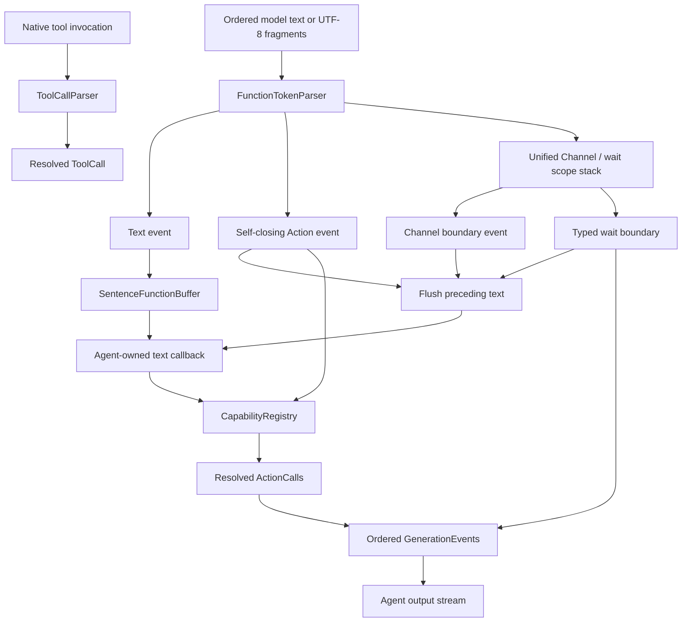
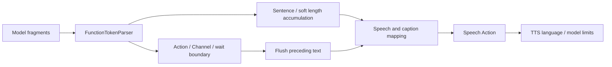
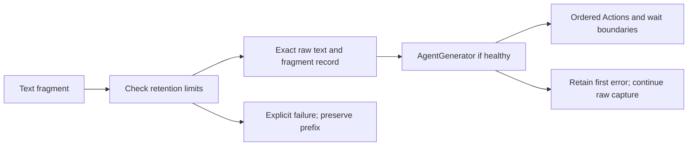
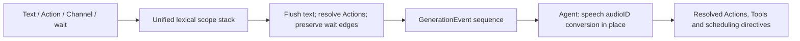
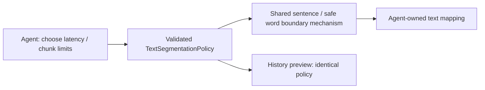

# Generation — Function Token and Tool Call Protocols

Purpose: share incremental Agent-output parsing across Agents without depending on model SDKs, UI or executable Actions. Raw model text, XML and unresolved aliases stay inside the Agent boundary. This README is the canonical definition of the Function Token protocol and its parser terminology.

## Terminology

| Term | Definition |
| --- | --- |
| Function Token protocol | A mixed stream of natural text characters and restricted XML syntax. Text is a first-class part of the protocol, not content outside it. A document root is not required. |
| FunctionToken | An internal parsed event: `.text`, `.action`, `.boundary` or `.scheduling`. It is not a model tokenizer token, a network fragment or necessarily one character. |
| FunctionTokenParser | Incrementally decodes UTF-8 and parses text, self-closing Action tags, paired Channel scopes and paired wait groups. It neither binds capabilities nor executes Actions. |
| Action | A registered executable behavior, such as `Speech.Playback.speak` or `UI.Expression.express`. Its implementation owns parameter/value validation and behavior. |
| ActionCall | One resolved Action invocation: ActionPath, string parameters and effective channel. It is distinct from raw FunctionToken events and model-native ToolCall invocations. |
| ToolCall | A separate native tool invocation resolved by ToolCallParser. It does not pass through XML parsing or Channel action queues. |

A model tokenizer may split one XML tag across many model tokens. Conversely, one received text fragment may contain several protocol events. Parsing handles arbitrary UTF-8 byte boundaries; `.text` event boundaries can depend on fragment delivery. SentenceFunctionBuffer subsequently forms text chunks for Action mapping. Do not assume one character, one model token, one parsed event and one Action call correspond one-to-one.

## Syntax and meaning

The protocol has four forms:

1. **Natural text**, such as `Hello.`: parsed as text and later expanded through the Agent's code-owned text callback. Assistant maps each accepted chunk to speech preparation and captions.
2. **Self-closing XML Action tags**, such as `<express emotion="happy"/>`: parsed as an alias plus string attributes. AgentGenerator resolves the alias to a registered ActionPath.
3. **Paired XML Channel tags**, such as `<channel.Speech>...</channel.Speech>`: control the channel scope for enclosed text and Actions. They emit boundary events but are not executable Actions.
4. **Paired wait tags**, `<wait>...</wait>`: emit typed beginWait/endWait events and retain each enclosed Action's effective Channel. They form structured execution groups with entry/exit synchronization.

```xml
Hello.
<channel.Speech>
  <express emotion="happy"/>
  Good news!
  <channel.Display><express emotion="thinking"/></channel.Display>
  Back in Speech.
</channel.Speech>
Back to each Action's default channel.
```

All Action tags must be self-closing; `<say>Hello</say>` is invalid. Channel tags accept neither attributes nor self-closing syntax. Closing an inner channel restores its parent; closing the outermost channel restores a nil scope, which capability resolution replaces with each Action's default channel. No Channel name has special blocking meaning. Use wait for cross-channel synchronization.

An Action is emitted as soon as its complete tag arrives, without waiting for channel closure. Action, Channel and wait boundaries first flush preceding text, preventing sentences from crossing scopes. Only natural text invokes the Agent-owned mapping. Explicit XML resolves model-callable Actions only; internal permissions have no XML aliases.

Literal `<` and `&` in text must be escaped as `&lt;` and `&amp;`. Attribute values must be quoted; single and double quotes, five predefined XML entities and valid numeric XML character references are supported. Escaped markup stays text and is not parsed a second time. Tool results and demonstration text use `escapeText` before entering this protocol. Comments, DOCTYPE, CDATA, processing instructions and non-self-closing Actions are rejected. This is a restricted XML syntax, not a general XML document parser.

## Algorithm and data flow

Each generation owns one parser, one bounded unified Channel/wait scope stack and one sentence buffer. The Agent supplies fragments in order and synchronously consumes returned GenerationEvents; there is no async mailbox in this module.

1. Incrementally decode UTF-8 and retain only incomplete byte/entity/tag state and pending text.
2. Parse completed tags; update ChannelParser scopes and emit text, Action, scope-boundary or scheduling events in order.
3. AgentGenerator accumulates text in SentenceFunctionBuffer. At sentence or protocol boundaries, flush text and invoke the Agent-owned text callback.
4. Resolve explicit Action aliases and parameters through CapabilityRegistry. Return ordered GenerationEvents (resolved Actions, immediate Tools and scheduling directives) to the Agent for its bounded output stream.
5. On normal termination, call `finish` to flush valid remaining text and reject incomplete syntax. On cancellation, discard state instead of flushing partial output.



For `<express emotion="happy"/> Hello.`, AgentGenerator produces an expression call to `UI.Expression.express`, then text-bearing calls to `Speech.Playback.speak` and `UI.Caption.print`. Assistant subsequently directs the speech text to SpeechSynthesisAgent and replaces the text-bearing call with `Speech.Playback.speak(audioID)` before output. Speech uses its default or explicit channel; the caption Tool has no channel. This illustrates why text is a Function Token even when it contains no XML.

## Bounds, completion and failure

| State or operation | Current bound |
| --- | --- |
| Input per generation | 65,536 UTF-8 bytes |
| One XML tag | 4096 UTF-8 bytes |
| Tags per generation | 1024 |
| Combined Channel / wait nesting | 8 |
| Wait groups | 32 per generation |
| Attributes per tag | 32 |
| Sentence text buffer | 2000 UTF-8 bytes |
| Resolved calls per generation | 120; Assistant separately buffers 256 output envelopes including wait boundaries and runtime notifications |
| Complete native tool argument JSON | 4096 UTF-8 bytes; string values only |

Structural errors and limits terminate that parser/generator instance; it cannot be reused. Finish rejects incomplete UTF-8, entities, tags and unclosed Channel/wait scopes. Unknown entities, mismatched closing tags, duplicate attributes, invalid UTF-8 fail explicitly. Unknown Action aliases and invalid invocation parameters instead produce rejected-call events.

Failure cannot roll back Actions already emitted and executed. If one append throws a structural/limit error, its local result is not returned; the Agent reports failure and Gateway cancels remaining work for that input. Invalid streams may have different already-executed prefixes under different fragmentation. There is no automatic retry or persistent replay.

## Implementation status

- ✅ FunctionTokenParser.swift: incremental mixed text/XML protocol parser.
- ✅ FunctionToken.swift: parsed tokens, GenerationEvent, SchedulingDirective and generation errors.
- ✅ ChannelParser.swift: unified Channel/wait nesting, matching closure and Channel restoration.
- ✅ AgentGenerator.swift: alias binding, effective channels and code-owned text mappings.
- ✅ SentenceFunctionBuffer.swift: validated TextSegmentationPolicy and progressive multilingual sentence segmentation, including punctuation, quotes, decimals and abbreviations.
- ✅ ToolCallParser.swift: complete native tool arguments and registered capability resolution.
- ❌ Incremental native tool-argument assembly and full JSON Schema. ChatEvent currently exposes text/completion only; the existing /status tool route remains separate.

Update this README when changing syntax, names, bounds, ordering or completion/cancellation behavior.

✅ AgentGenerator accepts an optional TextMapping callback. Without it, non-whitespace natural text fails explicitly. Each chunk expands into 1–8 ActionCalls, counts toward the 120-Action bound, and retains its effective Channel and execution group. Assistant supplies its fixed mapping in code; no text aliases are registered.

## Streaming speech/text segmentation

✅ Natural text is submitted at sentence endings (`。！？.!?`, semicolons, paragraph breaks and supported multilingual sentence marks), XML Action/Channel/wait boundaries, or normal generation completion. Commas, enumeration commas and colons no longer trigger short clauses. Adjacent punctuation, closing quotes and whitespace stay with the preceding text; one following content character disambiguates a streaming boundary. Decimal/abbreviation protection remains.

✅ Assistant supplies TextSegmentationPolicy with a soft length boundary of 60 Characters when the current prefix contains Hanzi, otherwise 120 Characters. Core defaults to sentence-boundary segmentation without a soft length limit. It waits for a safe word boundary, never splitting a contiguous non-CJK word, number, apostrophe or hyphenated word. These are text Characters, not model tokens. Pending text retains its 2000 UTF-8-byte hard bound; an oversized unbreakable word fails explicitly. No timer or new queue is introduced. Cancellation still discards pending text.

✅ The shared mechanism emits the same chunks to Agent-owned speech/caption mapping. Explicit XML Action parameters retain their own function validation and are not resegmented here. Kokoro's internal language switches and model input constraints remain independent backend adaptation. ❌ First-chunk special handling and timeout flushing are not implemented.



## Non-executing generation trace

✅ `GenerationTrace` is an independently tested, Sendable value owned by an explicit diagnostic consumer. It records exact text and fragment boundaries before calling the existing AgentGenerator. The first parser failure is retained with fragment/finish location, parsing stops, and raw collection continues. Successfully returned Actions, rejected calls and wait directives remain in interpretation order; events within an append that throws are not partially recovered. No dispatch or model dependency is introduced.

Raw retention has a 256 KiB UTF-8 bound and 8192-fragment bound (including empty fragments); overflow throws limitExceeded and seals input without evicting existing text. The parser retains its existing bounds, including 120 calls. Finish flushes only on normal completion; consumers must not finish after model failure/cancellation. No extra worker, queue or persistence is involved. ❌ It is not an execution trace, tokenizer trace or automatic repair facility.



## Structured wait protocol

✅ `<wait>` and `</wait>` are exact, attribute-free paired tags; `<wait/>` is invalid and wait is reserved as a capability alias. The unified ChannelParser lexical stack rejects crossing scopes such as `<wait><channel.Speech></wait></channel.Speech>`. A Channel may surround a wait or be nested within it. Wait does not change the effective channel. begin/end flush preceding sentence text before emitting SchedulingDirective, preserving the lexical position of every action.

✅ AgentGenerator append/finish now return `[GenerationEvent]` with `.action(ActionCall)`, `.tool(ToolCall)` and `.scheduling(SchedulingDirective)`. Consumers must forward the entire event sequence, not filter out directives. Natural text produces the code-owned mapped Action/Tool calls in callback order; speech is scheduled and caption append executes immediately. No special text-step type is needed. The parser limits 32 waits and combined depth 8; scheduled execution additionally validates balanced groups and bounds. Each Agent owns its parser; Gateway only receives resolved values and typed boundaries.

A wait waits for its parent's preceding work, executes internally by ordinary Channel rules, and releases its parent's continuation only once closed and all children complete. Nested waits apply the same rule locally. An open group may execute already received work. Completed XML is not physical completion; cancellation discards unfinished parsing state and Gateway cancels accepted work. Self-closing Actions never acquire paired start/stop semantics.

GenerationTrace retains the full ordered event sequence for an indented wait/action/rejection preview, alongside its action-only convenience view. Parser failure still stops interpretation but continues exact raw capture; this preview never claims execution timing.



✅ Source location: `MobileHarness/Agents/Core/Generation`; compiled by `AgentCore`. Directory relocation preserves existing behavior and public contracts. ❌ No new runtime capabilities are implied.

## Action and Tool presentation boundary

✅ TextMapping now returns ordered GenerationEvents containing ActionCalls or ToolCalls. Each chunk yields at most8 events and a generation at most120 calls. Assistant supplies a speech Action and append-caption Tool. Tool events retain unique call IDs but have no channel/wait membership. XML still resolves only model-declared Action aliases; native Tool parsing remains separate. ❌ The change does not invent XML Tool aliases or model-native transport.

✅ Unknown Action aliases and invocation parameter validation emit ordered CallRejection events and continue generation; rejected calls count toward the120-call bound. Native Tool parsing still throws typed resolution errors for the consumer to convert. ❌ Malformed XML, forbidden Channels, cancellation and resource limits remain terminal.

✅ TextSegmentationPolicy validates explicit soft limits in1…2000 Characters. AgentGenerator and GenerationTrace receive the same immutable policy; no device/Agent defaults are baked into the buffer. ❌ Timer-based flushing remains absent.


