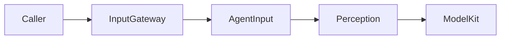

# AgentCore/Input

Owns generic immutable audio/image input contracts accepted by InputGateway and AgentInput. Foundation is the only import. Callers adapt capability SDK values into these contracts; perception Agents adapt them to model inputs.

✅ AudioInput validates PCM transport without fixing a model sample rate. ImageInput validates geometry, capture metadata and opaque Sendable attachments. Errors describe malformed transport only.

❌ Model preprocessing, receiver session/order policy and UI presentation do not belong here.

✅ AudioInput supports interleaved mono and first-order ACN/SN3D channel layouts, native sample rate and monotonic capturedAt. Byte alignment includes every channel; sampleCount counts scalar values, frameCount counts time samples. The existing per-input limit remains 64000 bytes and mono initializers remain compatible. ❌ No sound-source observation or localization policy lives in Core.
