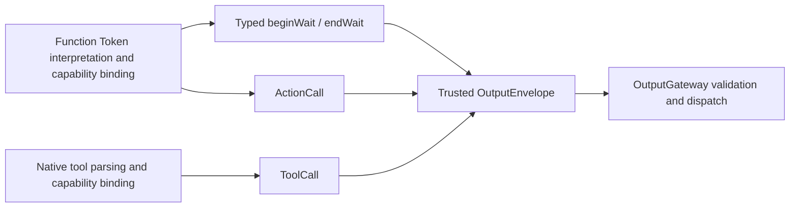

# Output — Resolved Calls and Runtime Notifications

Purpose: define executable values at the Agent boundary. ActionCall and ToolCall are resolved invocation types; raw text and unresolved FunctionToken events remain inside the Agent. The Function Token protocol produces ordered ActionCalls and scheduling directives, while the native tool protocol produces ToolCalls.

- ✅ `ActionCall`: ActionPath, effective channel and string parameters. Handlers receive an explicit module/function path, not a model alias.
- ✅ `ToolCall`: call UUID, toolPath and parameters; ToolResult preserves callID.
- ✅ `OutputEnvelope`: trusted source, inputID and sessionID association. The model cannot supply source identity.
- ✅ `AgentOutput.actionCall` and `.toolCall` carry these respective values; `OutputKind.actionCall` and `.toolCall` classify them.
- ✅ `.control` carries runtime completion/error notifications and supports cancellation/playback barriers. It is not a model generation protocol.
- ❌ Typed lifecycle notifications replacing control strings, ActionResult/Signal feedback, public ActionCall invocation IDs, priorities and deadlines.

ActionCall is a value type correlated with input through OutputEnvelope. ChannelScheduler allocates an internal UUID per admitted job; cross-process idempotent replay is not provided. ToolResult is shared by input/output contracts without introducing a dependency on Tools/Runtime.

See [Generation](../Generation/README.md) for protocol definitions. Keep names, fields, implemented ✅ and outstanding ❌ behavior synchronized with code.

✅ PoseOverlay is a Foundation-only compact action payload: sequence/time/rotation plus at most six COCO-17 skeletons, integer normalized coordinates and confidence. UI.showPose validates decoded values before presentation. Runtime agent.finished/agent.error controls now provide generic completion/cancellation alongside the legacy assistant names.

✅ UI.showPose now uses ToolCall with the same bounded PoseOverlay data. Its App-registered Void handler produces no ToolResult; data-returning tool calls retain existing callID feedback. ToolCall itself does not authorize suppression of feedback.

✅ OutputEnvelope retains ConversationTurn and a source-monotonic output sequence. These are assigned by runtime/Agent implementation, never parsed from model parameters.

✅ `AgentOutput.scheduling(SchedulingDirective)` and OutputKind.scheduling carry beginWait/endWait as typed runtime coordination. They inherit trusted source/session/input from the envelope, have no model-supplied group ID, and cannot invoke a device handler. Completion/error controls remain separate. Agent descriptors must explicitly permit scheduling output. ❌ General typed replacement of legacy control strings is still outstanding.

✅ Source location: `MobileHarness/Agents/Core/Output`; compiled by `AgentCore`. Directory relocation preserves existing behavior and public contracts. ❌ No new runtime capabilities are implied.

## Action runtime stage 2

✅ ActionResult.swift defines execution owners, feedback, typed completion, terminal results and separate ActivityEvent values; ResourceLease.swift defines lease values and bound ResourceControl closures. These shared Sendable contracts import no Gateway/device/UI service. ❌ Durable execution identity and generic activity ownership are not provided.

## Execution observation values

✅ `ActionExecutionRecord` / `ActionExecutionSnapshot` are independent, payload-free domain values for observing queued, running, cancelling and terminal execution. They contain execution/Agent/session/input identities, channel, path, completion semantics, timestamps and bounded failure codes. `ActionExecutionFailureProviding` lets adapters expose safe reasons without importing Gateway. These are distinct from Agent-directed ActionResult delivery. ❌ No device telemetry, raw arguments/Error objects, persistent history or automatic model turn is included.

✅ Execution observations include `invalidArguments` as a bounded adapter-provided failure reason, distinct from disconnected/unconfirmed motion. No raw argument payload is published.

## Action and Tool presentation boundary

✅ ActionExecutionRecord carries a bounded512-character failureDescription captured from the thrown error. Failure codes remain optional machine metadata; frontend text is not selected from a per-Action error catalog. ❌ Error objects and call parameters are not retained.

## Self-described execution observation

✅ ActionExecutionRecord carries an immutable displayName copied from its validated ActionDefinition at admission. This is a shared String value with no Actions, App or UI dependency. Producers provide the name; consumers never resolve domain paths into display titles. The existing bounded, versioned snapshots still carry raw Channel identity and generic execution/completion facts.

❌ Execution observation remains separate from ActionResult delivery and permission declarations; metadata does not grant execution rights. See ADR 0086.

## Atomic composition — ADR0092

✅ ActionReport adds bounded structured leaf outcomes and partialFailure to ActionResult/ActionCompletion. ResourceExecutionContext carries trusted task-local ownership across composed children.

❌ Sustained real-device acceptance and durable result delivery remain outstanding.

✅ `ActionReport.executionFailure` retains an execution-level timeout alongside all child entries. Its status is failed/partialFailure even when deadline cleanup cancelled an in-flight child; explicit user cancellation remains cancelled.

✅ ActionCall/ToolCall describe Agent intent; Gateway translates them to independent execution requests. AgentActionCompletion/AgentActionReport are delivery values, not execution interfaces. Action execution error protocols and argument readers now belong to Actions/Tools.
