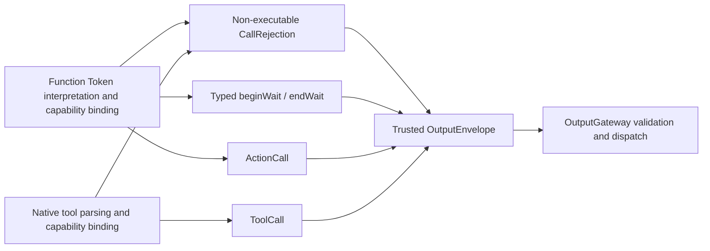
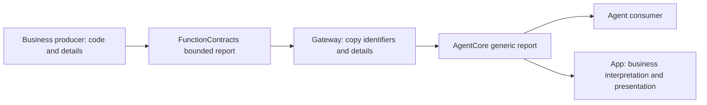

# Output — Resolved Calls and Runtime Notifications

Purpose: define executable values at the Agent boundary. ActionCall and ToolCall are resolved invocation types; raw text and unresolved FunctionToken events remain inside the Agent. The Function Token protocol produces ordered ActionCalls and scheduling directives, while the native tool protocol produces ToolCalls.

- ✅ `ActionCall`: ActionPath, effective channel and string parameters. Handlers receive an explicit module/function path, not a model alias.
- ✅ `ToolCall`: call UUID, toolPath and parameters; ToolResult preserves callID.
- ✅ `OutputEnvelope`: trusted source, inputID and sessionID association. The model cannot supply source identity.
- ✅ `AgentOutput.actionCall` and `.toolCall` carry these respective values; `OutputKind.actionCall` and `.toolCall` classify them.
- ✅ `.control` carries runtime completion/error notifications and supports cancellation/playback barriers. It is not a model generation protocol.
- ❌ Typed lifecycle notifications replacing control strings, durable ActionResult feedback, public ActionCall invocation IDs and priorities.

ActionCall is a value type correlated with input through OutputEnvelope. ChannelScheduler allocates an internal UUID per admitted job; cross-process idempotent replay is not provided. ToolResult is shared by input/output contracts without introducing a dependency on Gateway/Runtime.

See [Generation](../Generation/README.md) for protocol definitions. Keep names, fields, implemented ✅ and outstanding ❌ behavior synchronized with code.

✅ OutputEnvelope retains AgentTurn and a source-monotonic output sequence. These are assigned by runtime/Agent implementation, never parsed from model parameters.

✅ `AgentOutput.scheduling(SchedulingDirective)` and OutputKind.scheduling carry beginWait/endWait as typed runtime coordination. They inherit trusted source/session/input from the envelope, have no model-supplied group ID, and cannot invoke a device handler. Completion/error controls remain separate. Agent descriptors must explicitly permit scheduling output. ❌ General typed replacement of legacy control strings is still outstanding.

✅ Source location: `MobileHarness/Agents/Core/Output`; compiled by `AgentCore`. Directory relocation preserves existing behavior and public contracts. ❌ No new runtime capabilities are implied.

## Action runtime stage 2

✅ ActionResult.swift defines execution owners, feedback, typed completion, terminal results and separate ActivityEvent values; ResourceLease.swift defines lease values and bound ResourceControl closures. These shared Sendable contracts import no Gateway/device/UI service. ❌ Durable execution identity and generic activity ownership are not provided.

## Execution observation values

✅ `ActionExecutionRecord` / `ActionExecutionSnapshot` are independent, payload-free domain values for observing queued, running, cancelling and terminal execution. They contain execution/Agent/session/input identities, channel, path, completion semantics, timestamps and bounded failure codes. `ActionExecutionFailureProviding` lets adapters expose safe reasons without importing Gateway. These are distinct from Agent-directed ActionResult delivery. ❌ No device telemetry, raw arguments/Error objects, persistent history or automatic model turn is included.

✅ Execution observations include `invalidArguments` as a bounded adapter-provided failure reason, distinct from disconnected/unconfirmed motion. No raw argument payload is published.

## Action and Tool presentation boundary

✅ ActionExecutionRecord carries a bounded512-character failureDescription captured from the thrown error. Failure codes remain optional machine metadata; frontend text is not selected from a per-Action error catalog. ❌ Error objects and call parameters are not retained.

## Self-described execution observation

✅ ActionExecutionRecord carries an immutable displayName copied from its validated ActionBinding at admission. This is a shared String value with no Actions, App or UI dependency. Producers provide the name; consumers never resolve domain paths into display titles. The existing bounded, versioned snapshots still carry raw Channel identity and generic execution/completion facts.

❌ Execution observation remains separate from ActionResult delivery and permission declarations; metadata does not grant execution rights. See ADR 0086.

## Atomic composition — ADR0092

✅ ActionReport adds bounded structured leaf outcomes and partialFailure to ActionResult/ActionCompletion. ResourceExecutionContext carries trusted task-local ownership across composed children.

❌ Sustained real-device acceptance and durable result delivery remain outstanding.

✅ `ActionReport.executionFailure` retains an execution-level timeout alongside all child entries. Its status is failed/partialFailure even when deadline cleanup cancelled an in-flight child; explicit user cancellation remains cancelled.

✅ ActionCall/ToolCall describe Agent intent; Gateway translates them to independent execution requests. AgentActionCompletion/AgentActionReport are delivery values, not execution interfaces. Protocol-neutral execution errors and argument readers belong to FunctionContracts under Actions/Contracts; Gateway owns scheduling/native call adapters.

✅ rejectedCall carries a non-executable invocation rejection with Action/Tool output permission, bounded alias, typed reason and optional native Tool ID. Gateway records it alongside execution outcomes. ❌ It grants no execution or result-forging permission.

✅ Visual skeleton presentation and detection statistics belong to UI/Camera, not AgentCore. Output contains generic invocation/runtime contracts only; no pose-specific presentation policy or preview conversion remains.

## Generic resource and result boundary

✅ ResourceID contains no concrete device constants. App's CameraCoordinator owns camera.capture. AgentActionReport.Entry transports producer-defined details (at most16 keys,64 UTF-8 bytes per nonempty key,512 bytes per value) without interpreting device semantics. Construction rejects invalid programmer-supplied values by precondition; no fields are silently truncated or discarded. Report bounds remain256 entries and128 UTF-8 bytes per path.

✅ Report codes and execution failure identifiers are bounded RawRepresentable values (1–64 UTF-8 bytes), not device enums. Core defines only framework failure/cancellation/timeout constants. Gateway copies producer codes/details without a device switch. App owns interpretation and localization, including unknown-code fallback. ❌ Remote validation/serialization is not implemented.

✅ ADR0126: ResourceExecutionContext also carries the Gateway-bound ExecutionOwner independently of the held-resource set. This shared value imports no concrete runtime/device service; intent-triggered host workers inherit trusted Agent/session identity rather than reconstructing it from arguments.

✅ ADR0131: OutputFailureRecord/OutputFailureSnapshot are generic bounded source/title/message/time observation values, distinct from Agent-facing ToolResult and scheduled Action records. AgentActionReport carries producer failureDescription without SDK enums or device context. ❌ Durable failure history remains pending.

✅ ADR0132: ToolResult and OutputFailureRecord transport optional bounded opaque failure-code strings. Core interprets no domain errors and imports no Gateway execution/call SDKs or device classification.

❌ Sustained physical-device acceptance and durable error history remain pending.

✅ ADR0141: ResourceExecutionPermit is a generic Sendable validation capability bound to one actual execution. ResourceExecutionContext carries it beside owner/held IDs; App effects validate inherited authority rather than trusting IDs alone. Core contains no coordinator/device implementation or priority policy. ❌ Permits do not prove device availability or physical stop.

✅ ADR0149: OutputEnvelope retains immutable inputMetadata; returning Tool feedback preserves root, parent input, turn and hop context through Gateway. ✅ ADR0163 completes explicit causal context on ActionResult/ActivityEvent; no persisted/remote envelope format is added.

✅ ADR0157: canonical executable definitions and shared outcomes replace duplicate protocol metadata; consumers import Actions/FunctionContracts. Protocol request views remain adapters, and production permission/resource boundaries are preserved.

❌ Physical acceptance and additional business capability exposure are not established by this migration.

✅ ADR0157: AgentActionCompletion.value is bounded to64 KiB UTF-8. Both ActionResult and returning ToolResult transport this same independent completion type; ToolResult retains its native string value/error fields. ❌ AgentCore imports no execution implementation and receipt alone does not resume reasoning; a sealed round with registered observation does.

✅ ADR0163: SignalCausality captures inputID/rootID/hops/turn/output sequence without retaining payloads. ActionResult and ActivityEvent require explicit context; inputID/turn on ActionResult derive from it. Runtime feedback advances one hop, retains root/parent/turn and uses fresh bounded admission. No remote codec is implied.

## Action/Tool generation rounds — ADR0183

✅ Envelopes and terminal results retain optional round/call identity. Typed roundFinished and roundResult separate round sealing from final conversation completion; bounded ledger delivery failure is explicit.

❌ Live-model, native UI and physical-device acceptance remain pending; local native Tools and generic Agent request/reply are not implemented. See [ADR0183](../../../../docs/adr/0183-generation-round-observations.md).
