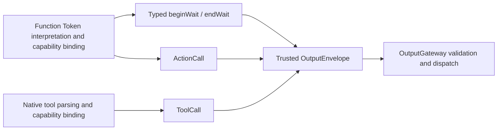

# Output — Resolved Calls and Runtime Notifications

Purpose: define executable values at the Agent boundary. ActionCall and ToolCall are resolved invocation types; raw text and unresolved FunctionToken events remain inside the Agent. The Function Token protocol produces ordered ActionCalls and scheduling directives, while the native tool protocol produces ToolCalls.

- ✅ `ActionCall`: ActionPath, effective channel and string parameters. Handlers receive an explicit module/function path, not a model alias.
- ✅ `ToolCall`: call UUID, toolPath and parameters; ToolResult preserves callID.
- ✅ `OutputEnvelope`: trusted source, inputID and sessionID association. The model cannot supply source identity.
- ✅ `AgentOutput.actionCall` and `.toolCall` carry these respective values; `OutputKind.actionCall` and `.toolCall` classify them.
- ✅ `.control` carries runtime completion/error notifications and supports cancellation/playback barriers. It is not a model generation protocol.
- ❌ Typed lifecycle notifications replacing control strings, ActionResult/Signal feedback, public ActionCall invocation IDs, priorities and deadlines.

ActionCall is a value type correlated with input through OutputEnvelope. ChannelScheduler allocates an internal UUID per admitted job; cross-process idempotent replay is not provided. ToolResult is shared by input/output contracts without introducing a dependency on Tools/Runtime.

See [Generation](../Generation/README.md) for protocol definitions. Keep names, fields, implemented ✅ and outstanding ❌ behavior synchronized with code.

✅ PoseOverlay is a Foundation-only compact action payload: sequence/time/rotation plus at most six COCO-17 skeletons, integer normalized coordinates and confidence. UI.showPose validates decoded values before presentation. Runtime agent.finished/agent.error controls now provide generic completion/cancellation alongside the legacy assistant names.

✅ UI.showPose now uses ToolCall with the same bounded PoseOverlay data. Its App-registered Void handler produces no ToolResult; data-returning tool calls retain existing callID feedback. ToolCall itself does not authorize suppression of feedback.

✅ OutputEnvelope retains ConversationTurn and a source-monotonic output sequence. These are assigned by runtime/Agent implementation, never parsed from model parameters.

✅ `AgentOutput.scheduling(SchedulingDirective)` and OutputKind.scheduling carry beginWait/endWait as typed runtime coordination. They inherit trusted source/session/input from the envelope, have no model-supplied group ID, and cannot invoke a device handler. Completion/error controls remain separate. Agent descriptors must explicitly permit scheduling output. ❌ General typed replacement of legacy control strings is still outstanding.

✅ Source location: `MobileHarness/Agents/Core/Output`; compiled by `AgentCore`. Directory relocation preserves existing behavior and public contracts. ❌ No new runtime capabilities are implied.
