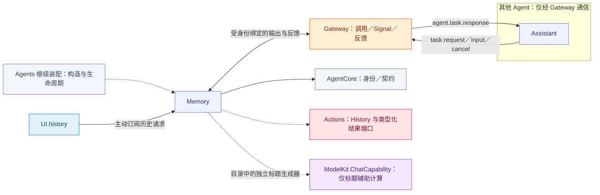
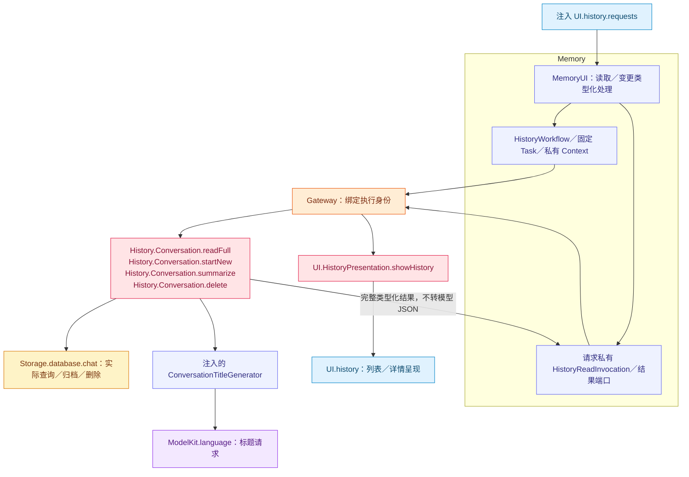

# Memory — 历史事务与标题生成

本角色的静态类别由资源 Agent.json 声明并传入 Descriptor，归类与语义见 [Agents 分类](../README.md#agent-categories)。

## 角色容器

[MemoryContainer.swift](MemoryContainer.swift) 是 AgentContainer 的稳定子能力。持有角色执行会话和历史工作流，启动绑定唯一角色／输出消费者，停止加入已接纳工作。历史请求继续以 UI 回执和 Gateway 真实完成为边界。

生命周期由[模块根](../README.md#agent-container)统一编排；子容器能力不授予执行权。

## 职责与注入能力

MemoryAgent 构造注入 `UIHistoryContainer`、会话身份、私有 `AgentContextRepository` 和新会话前的业务屏障；直接订阅历史请求。它不持有完整历史仓库或四大基础根，历史读取和变更均通过 Gateway → Actions。

`ConversationTitleGenerator` 是独立计算能力，显式接受 ModelKit `ChatCapability` 与已读取的会话值，由装配提供给 History 执行服务；不是 MemoryAgent 的普通对话 Worker。

## 文件与职责

| 文件 | 职责 |
| --- | --- |
| [ConversationTitleGenerator.swift](ConversationTitleGenerator.swift) | 有界标题采样与注入 Chat 的标题生成策略 |
| [MemoryAgent.swift](MemoryAgent.swift) | 历史请求与确定性固定 Task 的准入、调用及真实结果 |
| [MemoryExecutionSession.swift](MemoryExecutionSession.swift) | Memory 注册、输出泵、失败与停止加入 |
| [MemoryHistoryIntent.swift](MemoryHistoryIntent.swift) | 历史意图与本角色固定任务载荷解码，拒绝远程取消私有请求 |
| [MemoryHistoryWorkflow.swift](MemoryHistoryWorkflow.swift) | 历史查询／修改操作的顺序、请求槽与结果关联 |
| [MemoryProcessing.swift](MemoryProcessing.swift) | Memory 私有 Context、预处理和决策输入 |
| [MemoryUI.swift](MemoryUI.swift) | history 订阅、请求私有完整读取端口和取消加入 |

## 外部关系（一层）

角色间消息经 Gateway 递送；基础能力通过构造注入，输入订阅由角色持有。角色、Skill 与 Task 授权归 Agents；Actions 来源的协作接口由 App 以中立窄端口绑定，Agents 不导入 Actions、CallRuntime 或 ExecutionRuntime。

## 内部结构与执行链

## 查询、变更与完成

五类完整历史读取走私有 `History.Conversation.readFull`，调用携带单次类型化结果端口，校验真实 source/session/input，不使用全局结果暂存表。最多四个实际读取任务；普通 UI 请求仍受每源 64 个未终态项限制。页面取消及角色停止取消并加入已授权读取；端口不可重复执行或终态后复用。

`MemoryUI.swift` 在 MemoryAgent 隔离域内同步读取角色状态；历史执行前和异步结果返回后均检查角色仍在运行，Gateway 执行与结果端口读取保持异步。

新会话先通过 Assistant 的 task.end 提交活跃前台任务的摘要和终态，再归档。归档提交后独立生成标题，标题失败不撤回归档。固定操作和模型 history-query 暴露范围分别声明，Assistant 可直接调用相同 History Actions。回执等待真实读取、变更或呈现结果。

## 标题算法

从整个会话等距抽样至多 32 轮，user/assistant 每段最多 80 Characters。两条消息，输出 token 预算留空以使用模型默认值、temperature=0，30 秒截止后取消并加入。只接受 stop、单行非空且至多 80 Characters 的文本；拒绝 Tool、动作、截断及空结果，不执行输出，也不自动重试。供应商编码归 ModelKit。

## 状态、生命周期与失败

输出 256；接纳等待 32；证据／批次滚动窗口 4096。Context 保持在内存，持久化事实由 Actions 使用领域仓库提交。提交失败阻止依赖步骤，取消加入实际工作；pause/stop 关闭并加入 UI 消费，resume 加入旧消费者后重订阅。重启不重放已发出的操作。

通信声明见 [Agent.json](../../Resources/Agents/Memory/Agent.json)，效果契约见 [History Actions](../../Actions/History/README.md)。

本角色通过 [固定任务准入](../Support/Communication/README.md#固定任务准入) 接收 Assistant 委派。MemoryHistoryIntent.taskMessage 只解释 history.intent，拒绝将角色私有 cancel 意图作为 Task 业务载荷。

## Execution ownership and lifecycle

Memory uses neutral ActionRequestSlot<HistoryInput, HistoryReply> for private full-read requests. Agents validates role/Task authority; Actions validates typed business input and current session. The history interaction facade and actual title/query/mutation services belong to ActionsContainer.

## Passive container state

stateSnapshot projects local installation/closure, Agent lifecycle/queue counters and initialized committed task/Skill fields without message content. residentContext() reads the repository’s last committed memory only; context fields are unknown before initialization. Agent start owns initialization/restoration and its failures. The root catalog binds independent readers without sampling roles or maintaining another mutable role-state registry.

Memory接受用户的HistoryInput.clearLogs并转成内部History.Conversation.clearLogs调用。request_N只清空一条完整请求日志，nil清空Assistant/Writer共享日志全库。结果由Memory内部处理并刷新历史，不触发ReACT；业务对话和请求详情其他区块保持。

History clear registration and invocation share one InternalTool declaration with optional requestID. Single-row requests carry request_N; the global form omits the parameter. Parameter validation remains strict and the result is handled internally without model generation.

历史详情仅呈现持久化输入、响应与业务快照；Memory 不提供重新解析旧回复的执行预览接口。真实 Action 调度及执行结果仍由其既有 owner 持有。
