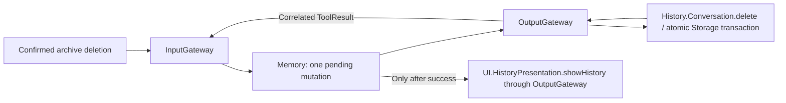
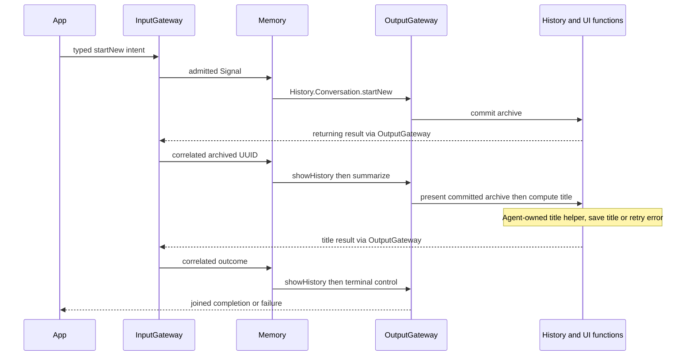
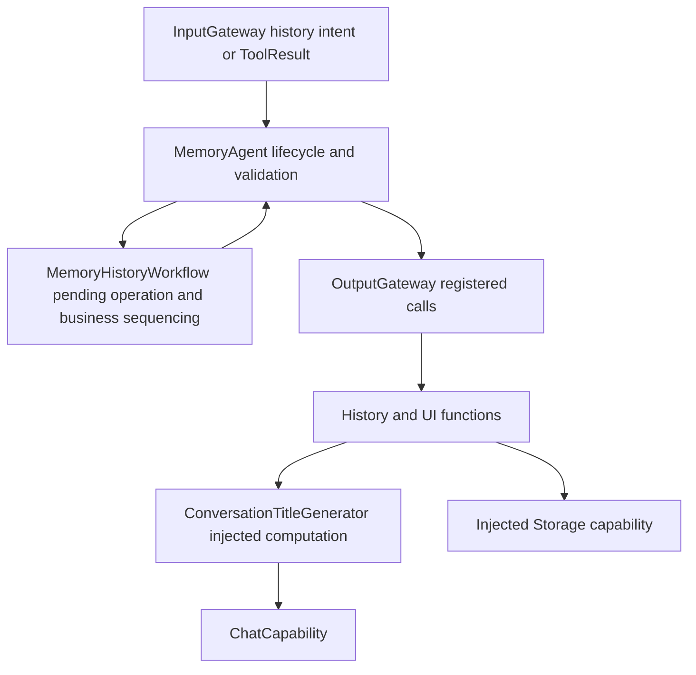

# Memory — Conversation and Memory Business Service

Memory is intended to organize conversation history and memory: determine what to retain, summarize, retrieve and forget, and select registered persistence operations. ✅ Today it owns history refresh/delete/archive/title sequencing and a bounded title-generation helper. ❌ Semantic retrieval, structured long-term memory, extraction/consolidation and forgetting policy are not implemented. Storage remains the persistence capability, while Assistant owns active-turn conversational reasoning and context assembly.

Design goals: bounded deterministic coordination, correlated runtime results and Gateway-only effects. This implements the [history mutation contract](../../README.md#deterministic-history-mutation-contract).

## Upstream and downstream

| Direction | Implemented contract                                                                                                                                                                                                                                                                                                                                                                                                                                      |
| --------- | --------------------------------------------------------------------------------------------------------------------------------------------------------------------------------------------------------------------------------------------------------------------------------------------------------------------------------------------------------------------------------------------------------------------------------------------------------- |
| Input     | JSON v6 history.intent/1 typed domain content: unexpired input, fixed root session. User-source refresh/delete/startNew/summarize(archive UUID), runtime-source cancel(request UUID); unknown payloads reject. tool.result/1: runtime source, matching session and pending callID; foreign/duplicate results reject.                                                                                                                                      |
| Output    | Refresh emits internal UI.HistoryPresentation.showHistory. Delete emits internal History.Conversation.delete(id); successful correlated feedback emits UI.HistoryPresentation.showHistory using the original request identity. Delete failure emits history.delete.failed; archive/title sequences finish with history.finished/history.failed, and cancellation emits history.cancelled. All executed calls/control acknowledgments cross OutputGateway. |
| Publish   | None.                                                                                                                                                                                                                                                                                                                                                                                                                                                     |
| Send      | None. Tool feedback uses InputGateway; no direct Agent messages or effect services.                                                                                                                                                                                                                                                                                                                                                                       |

## Lifecycle and failure handling

✅ JSON has no model-callable mutation; Swift owns fixed permissions with required id validation. The actor performs no I/O or inference; its co-located ConversationTitleGenerator helper performs bounded title-only inference through injected ChatCapability. Registered History functions own storage effects. MemoryHistoryWorkflow owns one pending mutation and rejects overlap. There is no inbox; output buffer8 rejects overflow and transitions to failed. Stop resets the workflow and closes the stream. Production transport admits one request without backlog, joins cleanup and drains cancelled presentation before retry. Control acknowledgments carry no business command.

✅ A committed delete survives later cancellation or presentation failure. Failed/missing/current archive deletion never emits successful presentation. Existing UI confirmation is required by this stage's input binding; no conversational deletion permission is introduced.

Navigation belongs to the application-control role, not conversation memory. ❌ Semantic retrieval and model-callable history mutation intent remain pending. Display-title defaults stay UI policy; failed output overflow requires explicit lifecycle recovery, not automatic retry.

✅ ADR0156: canonical execution addresses use domain/module/function; Agent v6 bindings resolve native names separately. Existing serialization/resource and output permissions are preserved.

✅ ADR0157: canonical executable definitions and shared outcomes replace duplicate protocol metadata; consumers import Actions/FunctionContracts. Protocol request views remain adapters, and production permission/resource boundaries are preserved.

❌ Physical acceptance and additional business capability exposure are not established by this migration.

✅ ADR0163: legacy history strings reject; refresh/delete/cancel use typed history.intent/1. The cancel request remains an external-origin trusted host command with runtime source and matching request UUID; it cannot masquerade as execution feedback. Generic host-control authority and model continuation remain pending.

✅ Implemented: startNew selects History.Conversation.startNew; a strictly validated archived UUID selects initial showHistory then History.Conversation.summarize. Empty archive selects presentation only. summarize(UUID) selects title directly. Correlated title completion selects final showHistory and history.finished/history.failed. Archive failure selects history.failed without title. One pending operation and buffer8 remain; host bounds new sequences to six outputs. Title computation is consolidated here with archive/history business; inference text is metadata and never parsed as calls.

## Archive and title flow

## Internal service structure

✅ MemoryAgent.swift and Memory.agent.json use the canonical Memory directory and memory identity. MemoryHistoryWorkflow.swift owns the existing history command/result state machine and fixed function grants. The actor retains session/lifecycle validation, serial admission, output sequence and overflow failure. ConversationTitleGenerator.swift retains bounded metadata inference with no effect dispatch.

The role encompasses conversation titles and short/long-term memory management. ✅ Existing historical records support refresh, deletion, archival and title generation. ❌ Structured memory creation/update/query/deletion, semantic recall and consolidation require future domain contracts, callable functions and storage schemas; the rename adds none of these interfaces. This role does not take over Assistant's current-turn context assembly.

The actor and workflow have no hidden queue or asynchronous worker. Each admitted input yields at most two effect decisions, retaining the original input identity for result continuation. Eight output slots retain accepted work; overflow resets pending state, fails this Agent and closes its stream. Invalid or foreign feedback cannot complete another operation.

✅ Xcode displays the actor, configuration, README and co-located business components under their owning role; Memory title computation appears under Memory rather than Assistant. SwiftPM remains the compilation/resource owner.

## Extension boundaries

- Add focused short-term/long-term memory components in this role; define typed intents/results in Communication instead of expanding history.intent with unrelated meanings.
- Memory owns extraction, retention and recall decisions. Registered Actions own storage effects; Storage owns neutral records and persistence primitives. Assistant consumes recalled information while retaining turn-specific prompt assembly.
- Declare each component's state bounds, owner, cancellation and completion before introducing workers. Preserve original request/call correlation and full failures; errors cannot fabricate successful persistence or trigger unbounded retries.
- The current actor runs synchronously with no hidden worker. Future asynchronous domains require explicit worker/overlap policy rather than sharing the single history pending slot accidentally.
