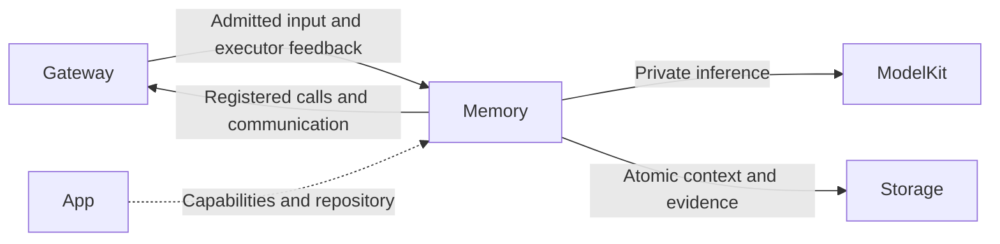
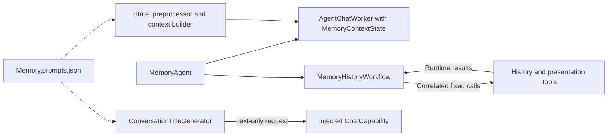

# Memory — History Decisions and Transactions

## Summary

Owns history reasoning, refresh, confirmed deletion and archive/title sequencing.

## Ownership and boundaries

Model exposure is bounded history list/read, not deletion authority. Trusted UI confirmation remains mandatory for fixed deletion. Assistant history is accessed only through the canonical history capability; Memory retains its own private decision context.

## External relationships and data flow

Runtime arrows show data or capability calls; dashed arrows show injection.

## Deterministic and model workflows

MemoryAgent.swift owns admission/Chat relay; MemoryProcessing.swift owns schema/preprocessing; MemoryHistoryWorkflow.swift owns fixed correlated calls; ConversationTitleGenerator.swift performs bounded title-only computation without mutation.

Typed history requests bypass model loading. Natural tasks wait for the authorized parentCommitted input after parent evidence has committed, then use the private Chat context. One deterministic history call is pending. Archive commits before title computation; title or presentation failure preserves the archive. Cancellation joins work and never rolls back committed deletion.

Only explicit task content/artifacts crosses delegation. Fixed state/commit admission uses a 32-waiter gate. Interactive reply occupancy is reported as interaction.replyActivity; this role has no listening permission.

❌ Rich semantic short/long-term memory beyond the implemented history operations is not implemented.

## Internal components

The following graph shows source composition and local data selection. Cross-role delivery and effect execution use Gateway.

## Context, bounds and failure

The role owns its schema/repository, preprocessing, immutable request builder and task outcomes. Evidence commits before dependent output; storage failure ends dependent processing. Legacy business contexts without Chat fields may import once; partial/null/unsupported fields fail. Restart interrupts unfinished work and does not replay native effects. Media is referenced by authorized IDs.

Shared model admission, request/call budgets, protocol consumers and overflow are defined in [Chat](../Support/Chat/README.md#bounds-and-overflow). Role communication retains 16 pending outputs with four runtime deliveries. Task views retain 256 identities with at most 32 live; terminal records may be retired, live tasks may not. Excess work rejects explicitly.

Pause cancels/joins model work; resume admits future work without replay. Stop joins worker/relay. App registration and output consumption outlive UI pages and microphone capture. Each reply's actual executor owns its results and speech; display focus does not change execution authority.

## Prompt resources

[Memory.prompts.json](Memory.prompts.json) owns the role system/style and task/history/execution message templates. Separate `title.system`, `title.excerpt` and `title.user` templates serve title-only inference. The generator evenly samples up to 32 turns, truncates each user/assistant excerpt to 80 Characters, requests at most 64 output tokens and uses a 30-second timeout. It accepts only a completed nonempty single-line title of at most 80 Characters, with no XML delimiters or native calls; stream text is limited to 1024 UTF-8 bytes. Sampling, cancellation and output validation remain code-owned.

## Function and communication registration

Model exposure comes from [Memory.agent.json](Memory.agent.json); code-owned internal permissions are separate. Empty Channel groups declare Channels without exposing a function.

### Model functions

| Protocol / Channel | Model name | Canonical function | Parameters and constraints | Behavior |
| --- | --- | --- | --- | --- |
| Tool / — | `History.list` | `History.Conversation.list` | `offset` required: string; Decimal integer from 0 through 64, encoded as a string.; `limit` required: string; Decimal integer from 1 through 5, encoded as a string. | List current and archived conversations, current first then newest archives. Returns paged JSON metadata with IDs and explicitly truncated title/input previews. Start at offset 0; use nextOffset for more. |
| Tool / — | `History.read` | `History.Conversation.read` | `id` required: string; Conversation UUID from History.list; `offset` required: string; Decimal integer from 0 through 256, encoded as a string.; `limit` required: string; Decimal integer from 1 through 2, encoded as a string. | Read a conversation by an ID returned by History.list. Turns are oldest first. Returns paged JSON with bounded user/response previews and truncation flags, not complete text; never replays behavior. Start at offset 0. |
| Action / Communication | `send` | `Agent.Communication.send` | target, kind, content; taskID/artifactID as applicable; authorized pairs: `assistant/progress`, `assistant/result` | Directed admission receipt; task outcome is separate. |

### Internal fixed functions

| Protocol | Canonical function | Channel | Parameters | Registration source |
| --- | --- | --- | --- | --- |
| InternalAction | `UI.Caption.beginReplyTurn` | Display | — | [AgentChatWorker.swift](../Support/Chat/AgentChatWorker.swift) |
| InternalAction | `Speech.Playback.speak` | Speech | `audioID` | [AgentChatWorker.swift](../Support/Chat/AgentChatWorker.swift) |
| InternalAction | `UI.Caption.print` | Display | `text` | [AgentChatWorker.swift](../Support/Chat/AgentChatWorker.swift) |
| InternalTool | `History.Conversation.startNew` | — | — | [MemoryHistoryWorkflow.swift](MemoryHistoryWorkflow.swift) |
| InternalTool | `History.Conversation.summarize` | — | `id` | [MemoryHistoryWorkflow.swift](MemoryHistoryWorkflow.swift) |
| InternalTool | `History.Conversation.delete` | — | `id` | [MemoryHistoryWorkflow.swift](MemoryHistoryWorkflow.swift) |
| InternalTool | `UI.HistoryPresentation.showHistory` | — | — | [MemoryHistoryWorkflow.swift](MemoryHistoryWorkflow.swift) |

### Declared input schemas

| Contract | Version | Kind |
| --- | --- | --- |
| `history.intent` | 1 | `observation` |
| `tool.result` | 1 | `toolResult` |
| `task.request` | 1 | `observation` |
| `task.input` | 1 | `observation` |
| `task.progress` | 1 | `observation` |
| `task.result` | 1 | `observation` |
| `task.cancel` | 1 | `observation` |
| `action.result` | 1 | `actionResult` |
| `generation.round.result` | 1 | `roundResult` |
| `communication.receipt` | 1 | `communicationReceipt` |
| `user.text` | 1 | `text` |

Directed input schemas and static subscriptions are distinct; admission also validates the runtime sender and scope.

### Input subscriptions and communication grants

Publication is one-way and has no recipient acknowledgment. Directed send returns admission; explicit task results report completion.

| Input contract | Source | Topic |
| --- | --- | --- |
| `history.intent` | `runtime` | `history.intent` |
| `history.intent` | `user` | `history.intent` |

| Output | Contract | Destination |
| --- | --- | --- |
| publish | `interaction.replyActivity` | Exact static subscribers |
| send | `task.progress` | `assistant` |
| send | `task.result` | `assistant` |
| send | `speech.synthesize` | `speechSynthesis` |
| send | `speech.cancel` | `speechSynthesis` |

## Related design

[Parent design](../README.md)
