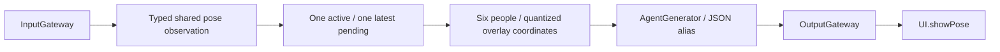

# Photographer

Purpose: apply photography/display policy to shared visual observations. Design goals: no model or camera ownership, bounded latest observations, explicit Action output and session fencing.

✅ JSON v4 subscribes to vision.pose from visionPerception. Photographer receives upright unmirrored pixel coordinates, selects up to six people, converts joints into the existing bounded PoseOverlay JSON and resolves UI.showPose through AgentGenerator and its configured Action alias. Empty observations clear the skeleton.

✅ Increasing frame sequence/timestamp and matching session are required. Expired observations cannot start processing. Pause suspends dequeue but allows one latest waiting value; stop clears pending work, cancels/joins its worker and closes outputs. Replacement and expiry counts are observable.

✅ The output stream remains capacity eight; overflow fails instead of replacing Actions. Completion controls preserve Action execution barriers. Perception observations are not themselves Actions.

✅ Shared inference, native image conversion and grayscale selection now belong to VisionPerception, with model execution in ModelKit. Historical YOLO/native performance records are preserved in ADRs and model documentation, not attributed to this migration.

❌ Composition/tracking policy, robot actions, channel takeover and physical-camera acceptance of this new pipeline remain outstanding.
