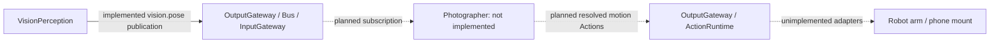

# Photographer — Camera Motion and Composition

Purpose: the future business Agent for robot-arm phone cinematography, framing, tracking and camera movement. Design goals: consume shared perception, choose composition/motion policy and issue authorized physical-control Actions through OutputGateway.

✅ Skeleton visualization belongs to VisionPerception through its UI.showPose Tool. Photographer is not created or required by the current camera perception session.
❌ Camera-motion policy, physical Action handlers, device safety integration and a runnable Photographer Agent/configuration remain unimplemented. The former display-only actor and JSON registration were removed rather than retained as an empty runtime placeholder.

When real camera-motion behavior is implemented, add its versioned JSON subscriptions to shared vision.pose observations and its actual motion capabilities. It must not own YOLO or UI skeleton rendering. Follow the parent Agents development standard.

## 输入、订阅与输出边界

当前目录只有设计说明，**没有 PhotographerAgent、agent.json、注册实例、订阅或实际输出**。下面的虚线图仅表示未来方向，不是已经接通的运行链路。

| 项目 | 当前状态 | 未来接入要求 |
| --- | --- | --- |
| 感知订阅 | ❌ 尚未声明 | 如使用现有姿态，应订阅 `contract=vision.pose, source=visionPerception, topic=vision.pose, version=1, kind=observation`，不能直接绕过 InputGateway。 |
| 用户任务 / 设备反馈等其他输入 | ❌ 无协议或实现 | 实际业务确定后声明 contract 与来源，再定义数据结构和处理策略；当前不能声称接收这些输入。 |
| 运镜、构图、跟随输出 | ❌ 无已注册 Action / Tool / Channel | 先定义实际机械能力、参数单位、限制和完成语义，再在版本化 JSON 声明，并由 App 注册实现；不得凭文档示例假设设备已执行。 |
| 共享观测 / Agent 定向消息 | ❌ 无 publications / sends 配置 | 有具体消费者后再定义，不隐式拥有发送权限。 |
| 骨架 UI | ✅ 已由 VisionPerception 实现 | `UI.showPose` 不属于 Photographer；移除或尚未实现 Photographer 不影响当前骨架显示。 |

可复用的现有数据是 `AgentInput.payload = .observation(.pose(PoseObservation))`：width/height、sequence/timestamp、rotation 和 people；每人 17 个 COCO 点，每点为像素 x/y 与 0...1 confidence，最多 300 人，正向未镜像坐标。详见 [VisionPerception 输入输出契约](../VisionPerception/README.md#输入订阅与输出契约) 和 [PerceptionInput.swift](../../AgentCore/Bus/PerceptionInput.swift)。这个结构没有 tracking ID、深度、机器人状态或运动命令。

未来消费者必须接受最新状态可能跳帧、空 people 表示无人、观测可能过期的事实；目前 App 的 100ms 新帧刷新不提供硬实时控制保证。具体任务、机械动作结构及设备保护应在真正实现时补齐，不能把感知数据直接当作物理控制指令。
