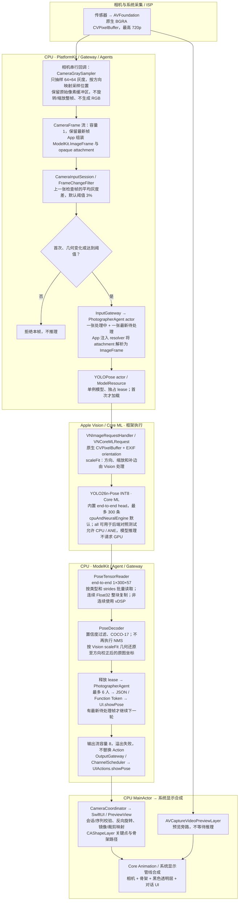

# Photographer Agent — 摄像师

Purpose: camera perception for future robot-arm phone cinematography, composition and tracking. Phase one performs pose inference and emits UI actions only. Design goals: freshest useful input, no duplicate inference, shared capability ownership, bounded output and strict lifecycle fencing.

## 单帧端到端执行位置（Vision 原生帧路径）

整条 flow 在 iPhone 上运行；Mac 负责构建、安装和可选 profiling。原生相机帧默认使用 Vision；独立 SDK 的 RGB 输入保留 vImage 自定义预处理路径。CPU+ANE 是允许的 Core ML 设备集合，不是确认每个算子都在 ANE 上执行。当前制品已替换为官方 YOLO26n-Pose INT8/end-to-end head。

| 节点 | 软件 / 源码 | 执行与数据边界 |
| --- | --- | --- |
| 原生取帧 | [CameraFrame](../../PlatformKit/Vision/CameraFrame.swift)、[CameraGraySampler](../../PlatformKit/Vision/CameraGraySampler.swift) | 相机专用串行队列，CPU 读取 4096 个采样点。BGRA 缓冲区只保留引用；生产者在引用存活时不得修改。 |
| 筛帧与封装 | [PhotographySession](../../App/PhotographySession.swift)、[FrameChangeFilter](../../Gateway/Input/FrameChangeFilter.swift) | App 把 ModelKit 图像封装为 AgentCore 的不透明附件；Gateway 只比较灰度样本，保持类型依赖边界。 |
| Agent | [PhotographerAgent](PhotographerAgent.swift) | CPU actor，接收最新帧；resolver 由 App 注入，AgentCore 不导入 CoreVideo/ModelKit/设备模块。 |
| Vision 与模型 | [CoreMLImageGraph](../../ModelKit/Backends/CoreML/CoreMLImageGraph.swift) | 同一模型 actor 串行执行 Vision 请求。Vision 的缩放/方向成本包含在 `VisionPreprocessAndPrediction` 中，不能标为零成本。Vision 内部预处理设备由框架决定，不能由模型的 computeUnits 推断。 |
| 后处理 | [PoseTensorReader](../../ModelKit/Backends/CoreML/PoseTensorReader.swift)、[PoseDecoder](../../ModelKit/Vision/YOLO/PoseDecoder.swift) | CPU 批量读取及解码；模型内 end-to-end head 输出最多 300 人；Swift 只过滤、排序和还原坐标，不做第二次 NMS。 |
| 输出与显示 | [ShowPose](../../Actions/UI/ShowPose.swift)、[CameraBackground](../../Experience/Camera/CameraBackground.swift) | Action 协议保持不变；MainActor 构造路径，系统显示管线渲染/合成，应用未编写 Metal kernel。`Vision` Channel 名称与 Apple Vision 框架是两件事。 |

✅ 原生路径不再进行 BGRA→整帧 RGB→BGRA 往返；Gateway 保持相邻检查帧阈值规则。灰度样本现在直接来自原始传感器尺寸，因此采样值可能与旧版“先缩放后采样”不同。

✅ RGB 调用仍走 `RGB Data → vImage / 114 灰补边 → Core ML(CPU+ANE) → CPU 解码`。Vision `.scaleFit` 的补边由框架决定，不声明与 114 补边逐像素一致；使用独立的连续 aspect-fit 坐标映射，不能复用手工整数补边偏移。

✅ 原始缓冲区由有界输入/输出持有：相机流 1、Agent 活跃 1 + 待处理 1；输出 envelope 及已接收 Action 在结束清理前也可能保留其输入。替换、取消、finish 会释放引用；没有永久帧缓存。此处避免应用层整帧复制，不代表 Core ML 内部零拷贝或零同步。

✅ `ReadTensor`、`DecodePose` 与 `VisionPreprocessAndPrediction` 可在 Instruments 查看。旧 RGB 对照路径另有 `PrepareImage` / `Prediction`。❌ 尚未得到该模型在本机 iPhone 上的各算子执行设备、持续 FPS 和视觉准确度复验；不能套用 YOLO26 的 3.9 ms 结果。没有引入 RetinaFace、MediaPipe 或多模型 Metal pipeline。

## Contracts and algorithm

`Photographer.agent.json` v3 is the only Action/Tool/Channel declaration. The actor receives an injected PoseCapability from the process-wide ModelManager; it never creates YOLO or calls UI/device APIs. One capture session owns one Agent incarnation. A new camera session creates a new Agent, but uses the same managed model provider/weights. Registration/configuration errors propagate.

```mermaid
flowchart LR
    Gateway[CameraInputSession / InputGateway] --> Inbox[One latest pending image]
    Inbox --> Worker[One inference worker]
    Worker --> Pose[Shared PoseCapability / exclusive model lease]
    Pose --> Format[COCO points to bounded overlay JSON]
    Format --> Parser[Shared AgentGenerator / FunctionTokenParser]
    Parser --> Registry[JSON alias / Channel resolution]
    Registry --> Output[8 output envelopes: fail on overflow]
    Output --> OG[OutputGateway]
    OG --> Action[UI.showPose on Vision Channel]
    Worker -->|Only if a newer image is waiting| Inbox
```

- Inbox: one active image plus one pending image; newer accepted images replace only the pending image. No task per frame and no polling/timer. Finishing a frame starts the newest pending frame, or becomes idle.
- Sequence must strictly increase; timestamps must not decrease; session ID must match this Agent's capture session. Duplicate/stale frames are rejected before inference. A pause preserves only the latest pending frame; active work may finish. Resume drains once. Stop is terminal: clear pending input, cancel/join inference and suppress late native results.
- Output: at most 8 envelopes, bufferingOldest. Overflow fails the Agent/stream explicitly; Actions are never replaced. Each successful inference emits `UI.showPose` plus runtime `agent.finished`; OutputGateway's finish barrier retires scheduler input state. Inference failures emit `agent.error:` and terminate this incarnation; App exposes retry. Runtime controls are not an alternate UI side-effect path.
- Overlay: at most six people (YOLO score order), each with COCO-17 points. JSON is at most 3000 bytes; each integer joint is `[x,y,confidence]` in 1/10000 upright-image units and confidence 0...1000. Out-of-image joints receive confidence zero and bounded coordinates. Empty detections explicitly clear the overlay through the same Action. No tracking identity is inferred.
- All presentation goes through JSON-declared `showPose` → `UI.showPose`, shared Function Token parsing, Gateway validation and Channel scheduling. The first version does not use an LLM or native Tool Calls.

✅ Latest-only inference, sequence/session checks, shared provider injection, JSON v3, bounded action output and cleanup.
✅ Tests cover threshold routing, latest replacement under delayed inference, one active call, duplicate rejection, pause/stop, late-result suppression, empty detections and real action execution/barriers.
❌ Robot hardware commands, composition decisions, temporal person tracking, autonomous cinematography, device accuracy/latency/thermal acceptance.

Validation (2026-09-26): final root scripts/check.sh passed, including 66 IntegrationTests and shared .pose provider identity. A separate full check with YOLO_POSE_MODEL_ROOT enabled passed real Core ML blank-image inference, unload/reload and shutdown checks. All four simulator schemes and the unsigned physical MobileHarness Debug build passed. Inspected the final device App: Photographer.agent.json matches source, pinned YOLO weight bytes match, and the AGPL license is present. An old generated Agent bundle was invalidated so the new configuration was recopied. The signed Debug build was subsequently installed and launched on iPhone 17 Pro. The user confirmed the feature works on the phone; quantitative alignment/accuracy, latency and thermal acceptance remain outstanding.

## 真机反馈与性能待办（2026-09-26）

✅ 用户在 iPhone 17 Pro 上确认功能效果正常，摄像头到姿态展示的完整流程可用。

❌ 用户反馈 YOLO 处理明显卡顿。目前尚无分阶段耗时数据，瓶颈未定位；不能据此认定 Core ML 推理本身慢，也不能认为性能已经验收通过。本次仅记录问题，未做性能优化。

后续定位需分别测量以下环节，并区分首次模型加载与稳定运行：

- 相机取帧、RGB 转换、缩放和旋转。
- Gateway 灰度采样、变化比对和输入路由。
- Agent 最新帧等待时间、模型资源等待和输入预处理。
- Core ML 推理、输出解码与 NMS。
- Action 序列化/解析、OutputGateway 调度及主线程骨架绘制。

记录每阶段耗时、端到端帧龄、实际推理频率、待处理帧替换数量，以及 CPU/GPU/内存和温度表现。比较前后摄像头、不同变化阈值和持续运行场景；先凭测量确认瓶颈，再优化，保留单例模型、单帧串行推理、只处理最新帧、不重复推理和 Action 输出协议约束。

进展（2026-09-26）：平台取帧与模型预处理已改用 Accelerate/vImage，模型输出已移除逐标量 NSNumber 索引，加入 PrepareImage / Prediction / ReadTensor / DecodePose 的 Instruments 标记。抽帧策略、单例与最新帧处理、Action 协议保持不变。Mac 微基准与真机性能验收分开记录；❌ 优化后的 iPhone 流畅度、准确度及热状态尚待复验。

主机微基准（2026-09-26，Mac arm64，Debug，独立运行、预热后 5 次中位数）：旧 RGB letterbox 为 101.42 ms，新完整 RGB→模型输入为 0.028 ms；旧 NSNumber 张量读取为 169.78 ms，新批量读取为 0.276 ms。输入为 360×640 固定颜色，张量为 Float32 [1,56,8400]；旧前处理计时不含后续 RGB→BGRA，因此不是完全相同的计时范围。这只验证特定 CPU 热点改善，不包含相机、模型执行、Gateway/Action 或 UI，也不代表 iPhone 端到端帧率。复现：`POSE_PERFORMANCE_CHECK=1 swift test --filter poseProcessingPerformance`。

部署记录（2026-09-26）：包含 vImage 与批量张量读取优化的 Release 版本已签名、安装并启动于 iPhone 17 Pro。安装成功不等同于优化后流畅度、准确度或执行设备归属验收。

## Vision 基线验证（2026-09-26）

✅ Mac 真实 YOLOv8n-Pose 验证了原生帧四种方向；Gateway → 不透明图像附件 → 注入 resolver → Agent → Action 协议测试通过。此结果不代表真人图像准确度或 iPhone 时延已验收。

主机 Debug 微基准（640×640 固定灰图，预热 3 次后 5 次中位数，包含输出张量提取，不含相机/Agent/NMS/UI）：

| Core ML 配置 | Vision | vImage / direct |
| --- | --- | --- |
| CPU + ANE | 4.59 ms | 2.95 ms |
| all | 3.35 ms | 2.37 ms |

此条件下 Vision 与 CPU+ANE 并未胜出。方形固定输入不体现真实相机方向/缩放、已消除的 RGB 往返或多模型 GPU 竞争；顺序测试和主机硬件也会影响结果。保留用户指定的 Vision+CPU/ANE 作为真机 baseline，不能以此表宣称已优化真机帧率。复现：设置 `YOLO_POSE_MODEL_ROOT` 和 `POSE_VISION_BENCH=1`，运行 `swift test --filter visionVersusVImageModelBaseline`。该版本尚未重新安装到手机。

最终检查（2026-09-26）：`scripts/check.sh` 通过（含 69 项 IntegrationTests、RGB 与原生 Vision 真实模型回归）；`scripts/build-ios.sh` 四个模拟器方案全部通过。以上为主机构建/测试记录，未替代本轮 iPhone 验收。

## 当前模型替换记录（2026-09-26）

✅ 当前默认且唯一 Pose 制品为官方 YOLO26n-Pose INT8，end2end=True、head=Pose26、输入 RGB image 640×640，实际输出名称 var_1566、Float32 [1,300,57]。输出名称从模型描述读取，形状严格校验。每行 xyxy/conf/class/17×xyz，其中 xyz 的第三值为置信度。保留最多 6 人的 UI Action 预算；模型结果不重复 NMS。

✅ 旧 YOLOv8 下载入口、注册 ID、模型文件和原始-head 解码已移除；前文 YOLOv8 微基准仅为历史，不代表当前模型。新档案记录 GitHub release asset 487599229 的 ZIP SHA-256 与每个文件的 SHA-256，运行时不下载。

❌ 新模型尚待手机真人姿态/持续时延验收；没有将旧模型或官方公开数据冒充新模型的本机测试结果。

YOLO26 最终验证：完整 check.sh 通过（含 3 项离线 ZIP 校验测试、69 项集成测试、Vision/RGB 真实模型回归）；四个 iOS 模拟器方案及真机 Release 无签名构建通过。Release App 内模型各文件 SHA-256 匹配下载 profile，旧 YOLOv8 包不存在，Photographer 配置完整。该新模型版本尚未安装到手机。
