# Photographer Agent — 摄像师

Purpose: camera perception for future robot-arm phone cinematography, composition and tracking. Phase one performs pose inference and emits UI actions only. Design goals: freshest useful input, no duplicate inference, shared capability ownership, bounded output and strict lifecycle fencing.

## Contracts and algorithm

`Photographer.agent.json` v3 is the only Action/Tool/Channel declaration. The actor receives an injected PoseCapability from the process-wide ModelManager; it never creates YOLO or calls UI/device APIs. One capture session owns one Agent incarnation. A new camera session creates a new Agent, but uses the same managed model provider/weights. Registration/configuration errors propagate.

```mermaid
flowchart LR
    Gateway[CameraInputSession / InputGateway] --> Inbox[One latest pending image]
    Inbox --> Worker[One inference worker]
    Worker --> Pose[Shared PoseCapability / exclusive model lease]
    Pose --> Format[COCO points to bounded overlay JSON]
    Format --> Parser[Shared AgentGenerator / FunctionTokenParser]
    Parser --> Registry[JSON alias / Channel resolution]
    Registry --> Output[8 output envelopes: fail on overflow]
    Output --> OG[OutputGateway]
    OG --> Action[UI.showPose on Vision Channel]
    Worker -->|Only if a newer image is waiting| Inbox
```

- Inbox: one active image plus one pending image; newer accepted images replace only the pending image. No task per frame and no polling/timer. Finishing a frame starts the newest pending frame, or becomes idle.
- Sequence must strictly increase; timestamps must not decrease; session ID must match this Agent's capture session. Duplicate/stale frames are rejected before inference. A pause preserves only the latest pending frame; active work may finish. Resume drains once. Stop is terminal: clear pending input, cancel/join inference and suppress late native results.
- Output: at most 8 envelopes, bufferingOldest. Overflow fails the Agent/stream explicitly; Actions are never replaced. Each successful inference emits `UI.showPose` plus runtime `agent.finished`; OutputGateway's finish barrier retires scheduler input state. Inference failures emit `agent.error:` and terminate this incarnation; App exposes retry. Runtime controls are not an alternate UI side-effect path.
- Overlay: at most six people (YOLO score order), each with COCO-17 points. JSON is at most 3000 bytes; each integer joint is `[x,y,confidence]` in 1/10000 upright-image units and confidence 0...1000. Out-of-image joints receive confidence zero and bounded coordinates. Empty detections explicitly clear the overlay through the same Action. No tracking identity is inferred.
- All presentation goes through JSON-declared `showPose` → `UI.showPose`, shared Function Token parsing, Gateway validation and Channel scheduling. The first version does not use an LLM or native Tool Calls.

✅ Latest-only inference, sequence/session checks, shared provider injection, JSON v3, bounded action output and cleanup.
✅ Tests cover threshold routing, latest replacement under delayed inference, one active call, duplicate rejection, pause/stop, late-result suppression, empty detections and real action execution/barriers.
❌ Robot hardware commands, composition decisions, temporal person tracking, autonomous cinematography, device accuracy/latency/thermal acceptance.

Validation (2026-09-26): final root scripts/check.sh passed, including 66 IntegrationTests and shared .pose provider identity. A separate full check with YOLO_POSE_MODEL_ROOT enabled passed real Core ML blank-image inference, unload/reload and shutdown checks. All four simulator schemes and the unsigned physical MobileHarness Debug build passed. Inspected the final device App: Photographer.agent.json matches source, pinned YOLO weight bytes match, and the AGPL license is present. An old generated Agent bundle was invalidated so the new configuration was recopied. The signed Debug build was subsequently installed and launched on iPhone 17 Pro. The user confirmed the feature works on the phone; quantitative alignment/accuracy, latency and thermal acceptance remain outstanding.

## 真机反馈与性能待办（2026-09-26）

✅ 用户在 iPhone 17 Pro 上确认功能效果正常，摄像头到姿态展示的完整流程可用。

❌ 用户反馈 YOLO 处理明显卡顿。目前尚无分阶段耗时数据，瓶颈未定位；不能据此认定 Core ML 推理本身慢，也不能认为性能已经验收通过。本次仅记录问题，未做性能优化。

后续定位需分别测量以下环节，并区分首次模型加载与稳定运行：

- 相机取帧、RGB 转换、缩放和旋转。
- Gateway 灰度采样、变化比对和输入路由。
- Agent 最新帧等待时间、模型资源等待和输入预处理。
- Core ML 推理、输出解码与 NMS。
- Action 序列化/解析、OutputGateway 调度及主线程骨架绘制。

记录每阶段耗时、端到端帧龄、实际推理频率、待处理帧替换数量，以及 CPU/GPU/内存和温度表现。比较前后摄像头、不同变化阈值和持续运行场景；先凭测量确认瓶颈，再优化，保留单例模型、单帧串行推理、只处理最新帧、不重复推理和 Action 输出协议约束。

## Phase 2 aim design

❌ Not implemented. [ADR 0037](../../../docs/adr/0037-photographer-aim.md) is the contract. This Agent remains the owner; there is no separate Tracking Agent and no second camera or detector.

After the pose result used for `showPose`, the same `AgentGenerator` may also emit hidden `<aim base="..." pitch="..."/>`, resolved to `Actions.Robot.aim` on channel `arm`. `base` and `pitch` are logical radians. The NexArm adapter maps them to `shoulder_pan` and `wrist_flex` over the arm's Wi-Fi hotspot and repeats a provisional raw-2048 home for the other four joints. `showPose` and `agent.finished` stay on every successful inference. `aim` is sent only after its own time and angle-delta throttle. An empty pose clears the skeleton and does not move the arm. Output overflow still fails this Agent. Command completion means the byte transport accepted the six-position frame, not that the joint has settled. Do not assume a fixed inference rate; on-device YOLO delay is already reported and not yet profiled.
