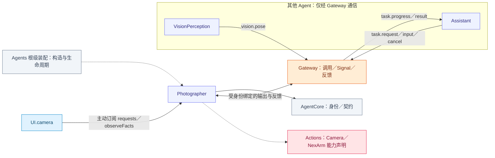
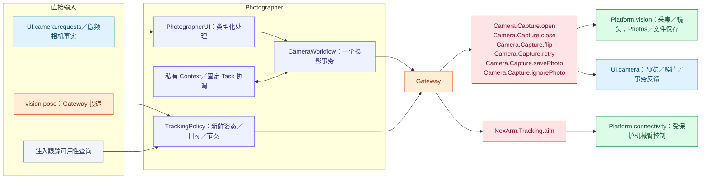

# Photographer — 摄影事务与机械跟踪

## 角色容器

✅ [PhotographerContainer.swift](PhotographerContainer.swift) 是 AgentContainer 的稳定子能力。持有角色执行会话、相机 UI 控制和跟踪输出生命周期。CameraCoordinator 由 Actions 实现，经根连接；跟踪 attach／detach 属于会话，停止加入角色和跟踪工作。

生命周期由[模块根](../README.md#agent-container)统一编排；子容器能力不授予执行权。

## 职责与注入能力

确定性角色，拥有相机 UI 请求、低频相机事实和跟踪策略，不运行普通 Chat，不消费视频帧。构造注入 `UICameraContainer`、可选 `UIAlbumContainer`、私有 `AgentContextRepository`、`controlAvailable` 只读能力及观察失败回调；不注入 ModelKit 或原生相机控制接口。StorageCore 的中立值依赖不等于持有 Storage 根。

## 文件与职责

| 文件 | 职责 |
| --- | --- |
| [PhotographerAgent.swift](PhotographerAgent.swift) | 相机意图、固定任务和姿态跟踪的角色生命周期 |
| [PhotographerCameraInputs.swift](PhotographerCameraInputs.swift) | 相机意图、低频状态观察及本角色固定任务解码 |
| [PhotographerCameraWorkflow.swift](PhotographerCameraWorkflow.swift) | 单槽相机命令、身份验证及结果关联 |
| [PhotographerExecutionSession.swift](PhotographerExecutionSession.swift) | 摄影注册、受保护输出消费及停止加入 |
| [PhotographerProcessing.swift](PhotographerProcessing.swift) | 摄影私有状态、阶段与输入预处理 |
| [PhotographerTrackingPolicy.swift](PhotographerTrackingPolicy.swift) | 新鲜姿态选择和跟踪策略，不操作硬件 |
| [PhotographerUI.swift](PhotographerUI.swift) | camera 请求与低频事实的角色直接订阅 |

## 外部关系（一层）

角色间消息经 Gateway 递送；基础能力通过构造注入，输入订阅由角色持有。

## 内部结构与执行链

## 请求、事实与跟踪

`PhotographerUI.swift` 在 start 建立请求与事实消费，按真实 Camera Tool 结果推进 open/close/flip/retry/save/ignore。回执在原生结果及角色终态完成后结束，媒体处理使用真实 mediaID；取消加入调用后 retire 状态。事实不通过 camera.state Signal 镜像；相机上下文在模型请求时读取所属容器快照。

Assistant 的 photography Skill 可以直接调用 Camera Actions，不必须委派 Photographer Task。跟踪另行消费 VisionPerception 的 `vision.pose`：前台、连接与准入满足且姿态新鲜才发内部 aim。输出间隔至少 0.2 秒；角色提供 base/pitch 目标，电机模式、速度整形、资源冲突和物理停机归 Actions/NexArm 与 PlatformKit。

## 状态、生命周期与失败

输出默认 256；短接纳等待容量 32；最近 4096 条证据／消费批次滚动保留并计数，不淘汰待执行事务。每个 UI 源普通未终态请求最多 64，控制独立单槽；相机事务自身只允许一个 pending。

pause/stop 关闭接纳、取消并加入订阅／事务／跟踪；resume 加入旧消费者后重新订阅。旧 token、会话、代际或调用反馈不能更新新请求。事实源非取消意外结束报告 `consumerEnded`；正常暂停和停止不生成故障。Context 提交失败显式传播，不重放不确定设备效果。

通信以 [Agent.json](../../Resources/Agents/Photographer/Agent.json) 为准，函数契约见 [Camera](../../Actions/Camera/README.md)、[NexArm](../../Actions/NexArm/README.md)。

本角色通过 [固定任务准入](../Support/Communication/README.md#固定任务准入) 接收 Assistant 委派。PhotographerCameraIntent.taskMessage 只解释 photography.camera；PhotographerCameraWorkflow 要求私有 cancel 来自本地 runtime 且匹配根会话与请求身份，远程业务载荷不能获得清理权。Task 取消通过 task.cancel 契约进入协调器。

## 基础相册实施契约

✅ 订阅UI.album并经身份绑定Gateway执行内部Album操作，根持有导入导出任务，停止取消并加入；相册不依赖相机开启。
