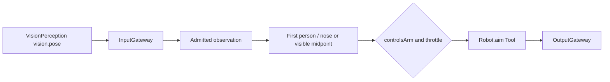

# Photographer

Purpose: decide arm aim from shared pose observations. Design goals: subscribe to VisionPerception, emit one internal Tool, and leave skeleton display and YOLO where they already are. See [ADR 0102](../../../docs/adr/0102-photographer-aim.md).

✅ JSON v5 subscribes to `vision.pose` from `visionPerception` and declares no model-callable Actions or Tools. Code grants internal `Robot.aim`. The output stream holds 8 envelopes and rejects only the excess call when full; an aim is not replaced or dropped.

✅ The first person in the published array is the target. That array keeps VisionPerception's copy order. The current pose decoder sorts by detection score before the score is removed, but this Agent does not re-rank. The nose is the aim point when its confidence is at least 0.3 and it lies inside the image. Otherwise the point is the midpoint of joints that pass the same test. No such joint means no aim. `base` and `pitch` are `(point / size - 0.5) * 0.8` radians. The first aim is immediate. Later aims require both 0.2 seconds and 0.02 radians since the previous emitted aim, using the observation timestamp. Empty people emits nothing and does not return to center. Pause admits the observation and does not aim.

✅ App composition supplies the Agent factory; VisionSession registers this Agent with `controlsArm` true and dispatches each `Robot.aim` through OutputGateway. Gateway admits the declared five-motor resources; NexArmBehaviorAdapter binds the verified foreground Bluetooth workflow. Missing/unready/background connection failure is visible as an independent tracking warning; vision continues. ❌ Wi-Fi stays closed, and physical tracking acceptance remains pending.

## 输入、订阅与输出契约

| 方向 | 数据标准与边界 |
| --- | --- |
| 输入 | 静态订阅 `vision.pose / 1 / observation`，source `visionPerception`，topic `vision.pose`。payload 为 `PoseObservation`。session 必须匹配；pose.validate() 校验尺寸、17 关节及有限值后，sequence 严格递增，timestamp 不倒退；过期输入拒绝。这不是图像，也不运行 `PoseCapability`。 |
| 输出 | `controlsArm == true` 且通过节流时发出 `ToolCall`，路径 `Robot.aim`，参数 `base` / `pitch` 为十进制弧度字符串。完成语义在 Tool：发送函数返回，不进 Channel，不写夹爪，不等关节到位。 |
| publish | 无。 |
| send | 无。 |

❌ 构图、跟踪身份、腕部行程补偿和真机运动验收未实现。发出的包只表示蓝牙链路收下了指令。

✅ App reports rejected tracking Tools independently. Offline/unready robot failures do not terminate vision or skeleton rendering. No failed device call is silently treated as successful.

✅ Photographer checks an injected read-only controlAvailable capability before emitting Robot.aim. Offline/control-unready poses are consumed without a command; lastAim is reset so reconnection uses a fresh pose. Device effects still cross OutputGateway and resource/connection guards protect a disconnect race.

✅ Output overflow rejects only the current unaccepted aim; Photographer remains running and queued accepted calls are retained.
