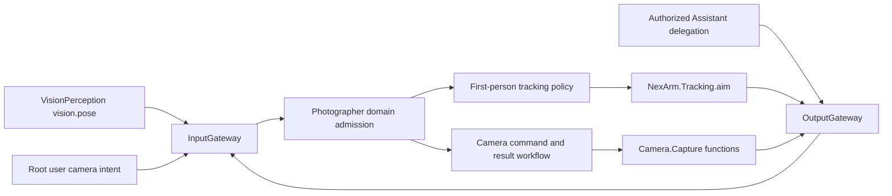
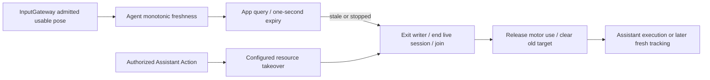
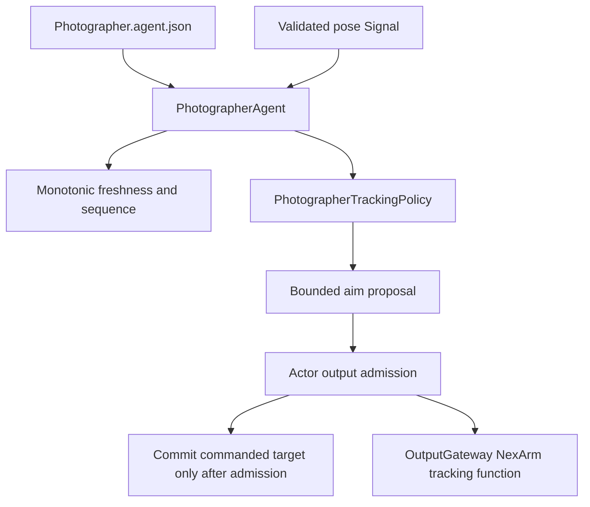
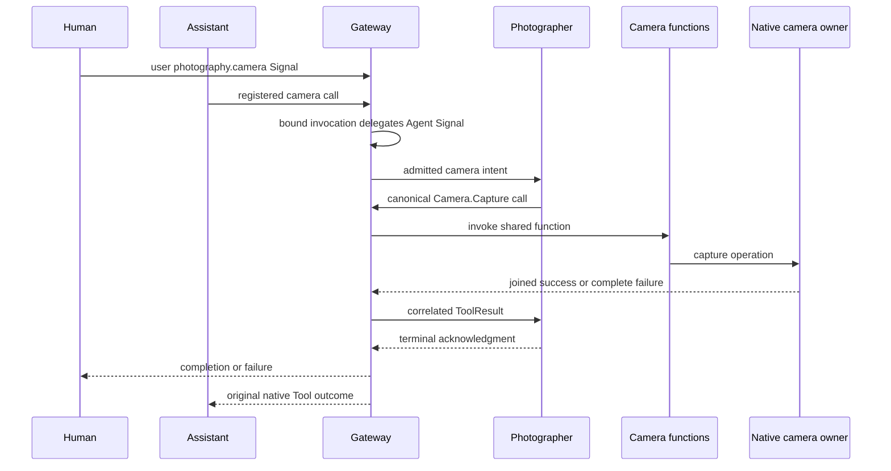

# Photographer

Photographer is the application's photographer Agent: its intended business scope combines video recording, still photography, camera movement and interaction with the user during a shoot. It owns photographic intent and shooting decisions, using perception Signals and registered Actions through the Gateways. ✅ The current implementation owns camera open/close/front-rear switch/retry decisions and selects arm aim targets from shared pose observations. ❌ Video recording, still capture, broader shooting/movement policy and shoot-time dialogue are not yet implemented; the name expresses the full role rather than only today's tracking function. See [ADR 0102](../../../docs/adr/0102-photographer-aim.md).

Current design goals: select registered camera operations, consume VisionPerception observations and emit bounded NexArm.Tracking.aim calls; pose inference and skeleton rendering retain their existing owners.

## Upstream and downstream

✅ JSON v6 subscribes to `vision.pose` from `visionPerception`, admits `photography.camera` and `tool.result`, and declares no model-callable Actions or Tools. Code grants internal `NexArm.Tracking.aim` and the four fixed Camera.Capture functions. The output stream holds 8 envelopes and rejects only the excess call when full; an aim is not replaced or dropped.

✅ The first person in the published array is the target. That array keeps VisionPerception's copy order. The current pose decoder sorts by detection score before the score is removed, but this Agent does not re-rank. The nose is the aim point when its confidence is at least 0.3 and it lies inside the image. Otherwise the point is the midpoint of joints that pass the same test. No such joint means no aim. `base` turns only the base and `pitch` tips only the wrist. Each command adds a limited step from the last command: a 4% dead zone, smoothing, and a capped rate so a person at the edge is followed without a full-frame snap. The first aim outside the dead zone is immediate. Later aims wait 0.2 seconds on the observation timestamp. A centered person, or an empty observation, emits nothing and does not return to center. Pause admits the observation and does not aim.

✅ App composition supplies one root-owned Photographer with controlsArm true. VisionSession attaches its vision UUID; PhotographerIntentRuntime dispatches camera and tracking independently through OutputGateway. Intent dispatch has no transient motor fence; App's worker holds motors1–4 through ResourceCoordinator (ADR0126). NexArmBehaviorAdapter binds the foreground Bluetooth workflow. Missing/unready/background failure is an independent tracking warning; vision continues. ❌ Wi-Fi and physical tracking acceptance remain pending.

## 输入、订阅与输出契约

| 方向 | 数据标准与边界 |
| --- | --- |
| 输入 | 静态订阅 `vision.pose / 1 / observation`，source `visionPerception`，topic `vision.pose`。payload 为 `PoseObservation`。session 必须匹配当前绑定的视觉会话；pose.validate() 校验尺寸、17 关节及有限值后，sequence 严格递增，timestamp 不倒退；过期输入拒绝。这不是图像，也不运行 `PoseCapability`。 |
| 输出 | `controlsArm == true` 且通过节流时发出 `ToolCall`，路径 `NexArm.Tracking.aim`，参数 `base` / `pitch` 为十进制弧度字符串。完成语义在 Tool：发送函数返回，不进 Channel，不写夹爪，不等关节到位。 |
| 相机输入/反馈 | photography.camera/1：root user 或已授权 Assistant；只接受固定 operation/requestID。tool.result/1：runtime 来源、pending callID 和原始 session 全部匹配。 |
| 相机输出 | 内部 Camera.Capture.open/close/flip/retry ToolCall；反馈后发出完成/失败 control，取消需 root host Signal 并确认。完整结果保留为只读 cameraResult。 |
| publish | 无。 |
| send | 无。 |

❌ 构图、跟踪身份、腕部行程补偿和真机运动验收未实现。发出的包只表示蓝牙链路收下了指令。

✅ App reports rejected tracking Tools independently. Offline/unready robot failures do not terminate vision or skeleton rendering. No failed device call is silently treated as successful.

✅ Photographer checks an injected read-only controlAvailable capability before emitting NexArm.Tracking.aim. Offline/control-unready poses are consumed without a command; lastAim is reset so reconnection uses a fresh pose. Device effects still cross OutputGateway and resource/connection guards protect a disconnect race.

✅ Output overflow rejects only the current unaccepted aim; Photographer remains running and queued accepted calls are retained.

✅ Tracking accumulation advances only after output admission; an overflow cannot advance an unsent target. Control-unavailable input resets filters and accumulation; fresh poses resume with bounded steps. Dead-zone hold and axis saturation emit no redundant command. Offline gating and independent failure scopes remain intact.

✅ PoseObservation is owned by Agents/Communication; association and robot-selection business policy remain here. Concrete AgentID constants are compiled in the business Agents target.

✅ Photographer extracts the business PerceptionMessage.pose from generic AgentMessage. Shared pose validation still precedes indexing; no robot behavior changes are made.

## Tracking freshness and takeover — ADR0139

✅ hasFreshPose is a read-only host query. Validated, nonexpired, ordered observations with a usable first-person aim point update ContinuousClock reception time, including centered targets that emit no Tool. Empty/no-visible-target observations do not renew freshness; future sensor timestamps cannot prolong it. Production expires after one second. Pause/stop deny freshness and clear accumulation. Fresh input after a one-second gap resets previous filters/targets before selecting a new step.

✅ Composition binds this query to the App tracking writer. Source silence exits/join-cleans the writer and releases motor use without a new Tool, whole-Agent cancellation or Bluetooth recovery. Camera shutdown independently removes the vision session and closes its resources. Assistant's authorized NexArm executions can preempt Photographer through host-configured ResourceCoordinator policy; Photographer cannot preempt Assistant. Later tracking requires fresh usable input and ordinary control availability.

❌ Physical takeover timing/stop acceptance remains pending.

✅ ADR0156: canonical execution addresses use domain/module/function; Agent v6 bindings resolve native names separately. Existing serialization/resource and output permissions are preserved.

✅ ADR0157: canonical executable definitions and shared outcomes replace duplicate protocol metadata; consumers import Actions/FunctionContracts. Protocol request views remain adapters, and production permission/resource boundaries are preserved.

❌ Physical acceptance and additional business capability exposure are not established by this migration.

## Internal service structure

✅ PhotographerAgent.swift retains input/session/lifecycle/freshness checks, injected control availability and bounded output. PhotographerTrackingPolicy.swift owns first-person aim selection, dead zone, smoothing, rate/axis limits and commanded-target state. Proposal and admission commit remain separate so output overflow cannot advance the commanded target. Pause/stop, stale pose and unavailable control reset the same tracking state as before. No still-capture or recording implementation is added; existing preview camera controls are now selected by the camera workflow.

Future capture, recording and shoot-time interaction policy belongs in focused components of this role. Perception remains upstream; device execution and resource scheduling stay outside the Agent.

✅ Xcode displays the actor, configuration, README and co-located business components under their owning role; Memory title computation appears under Memory rather than Assistant. SwiftPM remains the compilation/resource owner.

## Extension boundaries

- Add capture, recording, movement and shoot-time interaction as focused business components in this role, preserving one clear owner for each state machine. These components are currently unimplemented.
- Consume typed perception/user Signals through InputGateway; emit registered camera, device and presentation calls through OutputGateway. Shared functions do not move photographic decisions into the application-control role.
- Keep inference, target selection, runtime resource arbitration and native motion execution distinct. New asynchronous work requires explicit owner, bounds, cancellation and completion; native safety remains independent of page/Agent lifetime.
- Retain complete execution failures and correlate feedback to the owning shoot/request. A failed device call must not terminate unrelated perception or the shared runtime.

## Camera control service — ADR0181

✅ PhotographerCameraWorkflow selects existing Camera.Capture.open/close/flip/retry and tracks one correlated pending call/result. PhotographerCameraIntent contains a finite operation, explicit front/back facing for flip, and opaque request UUID; cancellation is a trusted root host command. External user commands require the root session; Agent commands require trusted Assistant provenance. Results require runtime provenance, exact call ID and original session. Last feedback retains the complete bounded ToolResult. Output overflow rejects only the current command and rolls back its pending slot.

The actor outlives capture. Bind/unbind exactly one vision UUID; reset ordering/freshness/tracking state between sessions and reject retired poses. Root camera work and attached pose work remain distinct scopes. Root registration is unscoped in AgentManager but actor admission is explicit. Stop clears both domains and closes outputs.

No new recording/still-capture implementation or physical tracking algorithm is introduced.

✅ Interaction refinement: PhotographerCameraWorkflow validates target-facing intent and pass facing into the flip Tool arguments under the existing one-request correlation/lifetime.
