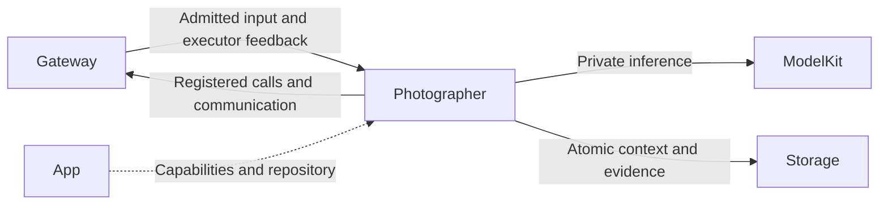
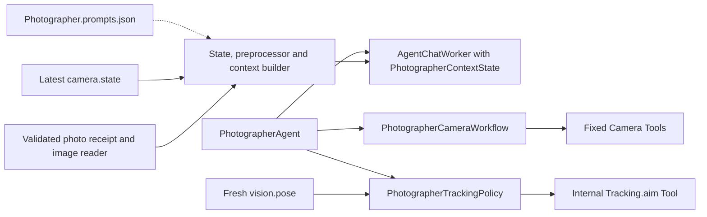

# Photographer — Photography Decisions and Tracking

## Summary

Owns independent photography reasoning, typed camera operations, photo disposition and deterministic pose tracking.

## Ownership and boundaries

Camera native capture/permissions/cleanup remain App/PlatformKit-owned. Tracking policy consumes admitted pose facts; the model exposes Camera Actions and task send, with no native Tools. Replies and photo context stay with this executor.

## External relationships and data flow

Runtime arrows show data or capability calls; dashed arrows show injection.

## Camera and model context

PhotographerAgent.swift owns admission/relay; PhotographerProcessing.swift owns durable schema/builder and grants; PhotographerCameraWorkflow.swift owns fixed camera sequencing; PhotographerTrackingPolicy.swift owns target selection and bounded motion intent.

Direct UI photography.camera input is a deterministic transaction without model startup. Conversational TaskRequest uses an independently injected Chat binding pinned across continuations. Camera results return to Photographer; Assistant receives explicit task reports.

camera.state accepts only phone.camera/root-session snapshots with monotonic sequence. The latest enabled/visible/busy/permission/lens/photo/error facts are selected into a fresh immutable model request, including ReACT continuations. Passive state alone cannot invoke a model or device. takePhoto observation resolves its authorized photo ID into a bounded multimodal request; save/ignore use actual receipts.

## Tracking and lifecycle

One camera command and one vision attachment are distinct from model work. Tracking consumes the newest fresh pose, validates connection/foreground availability and emits completion-only NexArm.Tracking.aim. A usable-pose gap of at least one second resets tracking state when the next pose is admitted; it does not create a timer-driven motor stop. Detach resets targets and joins owned work without removing resident Photographer. Deterministic policy does not invent person identity or physical completion.

Tracking selects the first published person, preferring an in-image nose with confidence ≥0.3, otherwise the mean of usable joints. Image-center error passes a soft 0.04 dead zone and smoothing (0.55 gain; a direction reversal starts at half the new error). Commands are at least 200 ms apart, with integration step clamped to 50–400 ms. Base/pitch proportional gains are 1.15/0.85, rate limits 0.55/0.40, targets clamped to ±1/±0.7 and steps below 0.004 suppressed. The commanded target advances only after output admission; that admission does not prove motor arrival.

The actor's short state/commit gate has 32 FIFO waiters; model/native work never holds it. Context write failures prevent dependent commands. Camera facts remain eligible while model output is queued; stale producer/task/session results reject.

## Internal components

The following graph shows source composition and local data selection. Cross-role delivery and effect execution use Gateway.

## Context, bounds and failure

The role owns its schema/repository, preprocessing, immutable request builder and task outcomes. Evidence commits before dependent output; storage failure ends dependent processing. Legacy business contexts without Chat fields may import once; partial/null/unsupported fields fail. Restart interrupts unfinished work and does not replay native effects. Media is referenced by authorized IDs.

Shared model admission, request/call budgets, protocol consumers and overflow are defined in [Chat](../Support/Chat/README.md#bounds-and-overflow). Role communication retains 16 pending outputs with four runtime deliveries. Task views retain 256 identities with at most 32 live; terminal records may be retired, live tasks may not. Excess work rejects explicitly.

Pause cancels/joins model work; resume admits future work without replay. Stop joins worker/relay. App registration and output consumption outlive UI pages and microphone capture. Each reply's actual executor owns its results and speech; display focus does not change execution authority.

## Prompt resources

[Photographer.prompts.json](Photographer.prompts.json) owns camera-task role/style, current camera-state context, captured-image review and task-scoped save/ignore guidance, plus shared-worker message templates customized for this role. Code supplies validated IDs, JSON facts and image attachments; template text does not create authority.

## Function and communication registration

Model exposure comes from [Photographer.agent.json](Photographer.agent.json); code-owned internal permissions are separate. Empty Channel groups declare Channels without exposing a function.

### Model functions

| Protocol / Channel | Model name | Canonical function | Parameters and constraints | Behavior |
| --- | --- | --- | --- | --- |
| Action / Camera | `flipCamera` | `Camera.Capture.flip` | `facing` required: string; front or back; change only when requested. | Select the requested front or back lens of the enabled foreground camera. Already selecting that lens leaves it unchanged. Fails if disabled, busy or unavailable. Schedule on Camera; successful completion is execution feedback. Do not repeat a successful command to continue reasoning. |
| Action / Camera | `closeCamera` | `Camera.Capture.close` | — | Disable camera preview and vision processing, and wait for capture and vision cleanup. Schedule on Camera; successful completion is execution feedback. Do not repeat a successful command to continue reasoning. |
| Action / Camera | `openCamera` | `Camera.Capture.open` | — | Enable foreground camera preview and vision processing. Requires camera permission and an available camera; completion confirms capture, not pose-model readiness. Schedule on Camera; successful completion is execution feedback. Do not repeat a successful command to continue reasoning. |
| Action / Camera | `takePhoto` | `Camera.Capture.takePhoto` | — | On an explicit user request, take one photo using the current ready foreground camera. Capture, retain private App evidence and show the actual photo; this does not save to the system Photos library. Its execution observation supplies the photo to the next model round for visual understanding. Emit once, then wait for actual image feedback before describing it. Use savePhoto only on an explicit save request. Do not repeat capture merely to continue reasoning. Camera must be enabled and ready. |
| Action / Camera | `savePhoto` | `Camera.Capture.savePhoto` | `photoID` required: string; A photoID from actual capture feedback. | On an explicit user request, save the currently displayed captured photo to the system Photos library. Wait for the actual observation before confirming success; permission denial is a failure. Repeated saves of the same displayed photo do not create duplicates. This does not take another photo. |
| Action / Camera | `ignorePhoto` | `Camera.Capture.ignorePhoto` | `photoID` required: string; A photoID from actual capture feedback. | On a request to close, dismiss, ignore or discard the displayed photo, hide its thumbnail and preview without exporting to Photos. This does not close the camera, delete an existing album photo, or take another photo. Wait for the actual result before confirming. |
| Action / Camera | `retryCamera` | `Camera.Capture.retry` | — | Explicitly retry a failed foreground camera operation. Wait for execution feedback; do not automatically repeat failed work. |
| Action / Communication | `send` | `Agent.Communication.send` | target, kind, content; taskID/artifactID as applicable; authorized pairs: `assistant/progress`, `assistant/result` | Directed admission receipt; task outcome is separate. |

### Internal fixed functions

| Protocol | Canonical function | Channel | Parameters | Registration source |
| --- | --- | --- | --- | --- |
| InternalAction | `UI.Caption.beginReplyTurn` | Display | — | [AgentChatWorker.swift](../Support/Chat/AgentChatWorker.swift) |
| InternalAction | `Speech.Playback.speak` | Speech | `audioID` | [AgentChatWorker.swift](../Support/Chat/AgentChatWorker.swift) |
| InternalAction | `UI.Caption.print` | Display | `text` | [AgentChatWorker.swift](../Support/Chat/AgentChatWorker.swift) |
| InternalTool | `NexArm.Tracking.aim` | — | `base`, `pitch` | [PhotographerAgent.swift](PhotographerAgent.swift) |
| InternalTool | `Camera.Capture.open` | — | — | [PhotographerCameraWorkflow.swift](PhotographerCameraWorkflow.swift) |
| InternalTool | `Camera.Capture.close` | — | — | [PhotographerCameraWorkflow.swift](PhotographerCameraWorkflow.swift) |
| InternalTool | `Camera.Capture.flip` | — | `facing` | [PhotographerCameraWorkflow.swift](PhotographerCameraWorkflow.swift) |
| InternalTool | `Camera.Capture.retry` | — | — | [PhotographerCameraWorkflow.swift](PhotographerCameraWorkflow.swift) |
| InternalTool | `Camera.Capture.savePhoto` | — | `photoID?` | [PhotographerCameraWorkflow.swift](PhotographerCameraWorkflow.swift) |
| InternalTool | `Camera.Capture.ignorePhoto` | — | `photoID?` | [PhotographerCameraWorkflow.swift](PhotographerCameraWorkflow.swift) |

### Declared input schemas

| Contract | Version | Kind |
| --- | --- | --- |
| `camera.state` | 1 | `observation` |
| `vision.pose` | 1 | `observation` |
| `photography.camera` | 1 | `observation` |
| `tool.result` | 1 | `toolResult` |
| `task.request` | 1 | `observation` |
| `task.input` | 1 | `observation` |
| `task.progress` | 1 | `observation` |
| `task.result` | 1 | `observation` |
| `task.cancel` | 1 | `observation` |
| `action.result` | 1 | `actionResult` |
| `generation.round.result` | 1 | `roundResult` |
| `communication.receipt` | 1 | `communicationReceipt` |
| `user.text` | 1 | `text` |

Directed input schemas and static subscriptions are distinct; admission also validates the runtime sender and scope.

### Input subscriptions and communication grants

Publication is one-way and has no recipient acknowledgment. Directed send returns admission; explicit task results report completion.

| Input contract | Source | Topic |
| --- | --- | --- |
| `camera.state` | `phone.camera` | `camera.state` |
| `vision.pose` | `visionPerception` | `vision.pose` |
| `photography.camera` | `runtime` | `photography.camera` |
| `photography.camera` | `user` | `photography.camera` |

| Output | Contract | Destination |
| --- | --- | --- |
| publish | `interaction.replyActivity` | Exact static subscribers |
| send | `task.progress` | `assistant` |
| send | `task.result` | `assistant` |
| send | `speech.synthesize` | `speechSynthesis` |
| send | `speech.cancel` | `speechSynthesis` |

## Related design

[Parent design](../README.md)
