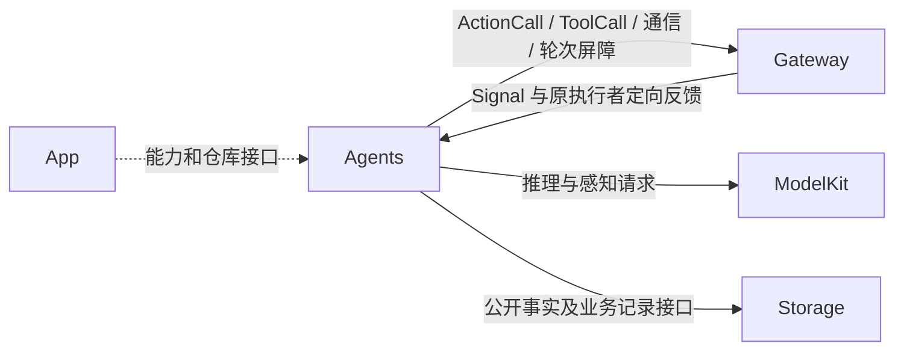

# Agents — 业务决策与运行上下文

## 职责与边界

Agents 解释 Signal、维护业务目标与上下文，并选择下一步动作。Assistant 是唯一普通对话执行者；Photographer、Memory、ApplicationControl、SpeechPerception、SpeechSynthesis、VisionPerception 按各自确定性流程处理输入。App 提供能力及生命周期，Gateway 校验和传输，Actions 实现被调用函数。角色之间不共享可写聊天历史。

## 直接上下游与数据流

语义解释和业务协调由角色拥有；Gateway 不推断用户目标，基础模块不持有 Agent 业务策略。执行接纳、任务完成和物理效果完成是不同事实。

## 内部结构与接口

| 目录 | 职责及接口 |
| --- | --- |
| [Assistant](Assistant/README.md) | 用户文本/最终 ASR、动态 Skill、单前台 Task、Chat/ReACT、照片模型输入 |
| [Photographer](Photographer/README.md) | 固定摄影事务、相机事实、姿态跟踪与设备调用 |
| [Memory](Memory/README.md) | 历史事务与独立标题生成 |
| [ApplicationControl](ApplicationControl/README.md) | 设置、资源、Provider、设备和环境事务 |
| [SpeechPerception](SpeechPerception/README.md) | 听取意图、VAD/ASR、声源与聆听策略 |
| [SpeechSynthesis](SpeechSynthesis/README.md) | 有界定向合成及 PCM 生产 |
| [VisionPerception](VisionPerception/README.md) | 最新帧姿态推理、检测节奏与注视/骨架投影 |
| [Support](Support/README.md) | 资源读取与不可变目录组合 |
| [Support/Core](Support/Core/README.md) | Foundation-only AgentCore：身份、Signal、接纳、解析与轮次契约 |
| [Support/Communication](Support/Communication/README.md) | 不可变业务消息与 schema |
| [Support/Chat](Support/Chat/README.md) | Chat 请求、配对、执行屏障、观察及历史投影 |
| [Support/Context](Support/Context/README.md) | 原子内存仓库、Task/Skill 状态与固定任务协调 |

角色资源位于 [Resources/Agents](../Resources/Agents/README.md)，流程和模型函数绑定位于 [Resources/Skills](../Resources/Skills/README.md)。Agent.json 声明身份、通信和 baseSkills；Skill.json 声明函数；参数和说明由真实 @Action 提供。

## Task、Skill 与不可变请求

一个前台 Task 管理持续目标。startTask 的 goal 必填，skills 为可选 JSON ID 数组；已有运行、等待或收尾 Task 时拒绝覆盖。finishTask 在执行/回复屏障后关闭，通常结束当前决策；continueDecision=true 只处理同一输入剩余的新目标。cancelTask 关闭并结束当前决策，已发生效果不会撤销。

Skill 所有权分 base、recent、task。基础项常驻；无 Task 加载/合法调用将近期项计数重置为 5，每个完整未使用用户 Decision 扣 1；内部 ReACT 不扣数。Task 只接管指定、加载或实际使用的项，等待用户时持有，终态回收持有项；无关近期项暂停计数。预算为展开后 3 个非基础 Skill、24 KiB 指令/增量目录，非保护项按 LRU 淘汰。生命周期合图、算法与原子失败契约见 [Context](Support/Context/README.md#task-and-skill-lifecycle)。

每个模型请求冻结 Task 身份、Skill revisions 和函数目录。加载/释放仅影响后续请求；固定调用使用执行者的固定目录。模型教学以当前 Task/目录事实为准，Skill 加载不创建 Task。

后台任务通过定向 send 与独立执行者的业务契约处理，不抢占前台；投递接纳、取消确认和最终结果分别记录。后台 Registry 最多 16 个非终态、256 条记录；父任务结束不自动取消子工作。当前生产未声明通用后台契约，不能凭配置创造执行能力。

## 多轮、失败与历史

ReACT 在本轮调用及回复屏障后由显式业务 value（包括空值）或真实调用失败驱动；成功报告、活动句柄及投递接纳是完成证据。单轮生成/反馈有界，完整决策不以累计轮数或计时器结束。Provider、流、解析、观察构造等 Agent 异常结束当前决策，不自动重试或重放副作用；调用拒绝保留未执行证据，可由模型重新选择合法步骤。

每个角色使用根拥有的 actor 私有内存仓库，有限公开事实另行发布到共享 State。SQLite 是 dialog/message/task/media/device 业务事实的持久化来源；完整模型消息与真实终态在各自边界提交，delta 与运行时队列留内存。Task 原始过程仅在终态投影成有界摘要，来源可查询。重启标记未完成业务记录 interrupted，不恢复热状态或重放效果。详细历史契约由 [Chat](Support/Chat/README.md) 与 [Storage](../Storage/README.md) 拥有。

## 生命周期与开发约束

每个异步生产者、队列、缓存与活动都必须有 owner、容量及溢出/取消/完成策略；页面退出不终止根服务拥有的业务工作。事务先提交状态，再执行依赖步骤；配置、执行与持久化失败显式传播。确定性事务角色保留最近 4096 条 Signal 证据，核心未指定滚动策略时上限 8192 且拒绝溢出；业务关联独立保存。

模型调用、私有固定调用、通信权和实际设备授权分别验证。Speech/vision 的 freshness 不等于任务超时；模块的物理停机及权限保护不等待模型；App 只调用公开接口。

## Role processing pipeline

```mermaid
flowchart LR
 Signal[Admitted Signal] --> Preprocess[Role SignalPreprocessor]
 Preprocess --> Batch[Validated SignalBatch and role-state update]
 Batch --> Commit[Atomic role context commit]
 Commit --> Snapshot[Immutable selected snapshot]
 Snapshot --> Builder[Role ContextBuilder and grant projection]
 Builder --> Decide[Fixed workflow or ChatCapability]
 Decide --> Evidence[Persist exact request and received evidence]
 Evidence --> Output[Resolved calls and communication]
 Output --> Feedback[Owner-directed feedback]
 Feedback --> Preprocess
```

角色预处理、批次选择和状态转换由角色拥有。Context 仓库先验证并提交热状态，再提供不可变快照；固定事务直接选择已注册调用，Assistant 的模型分支还记录精确请求与实际结果。业务持久化通过注入仓库完成，不将流式证据或整个热状态反复编码落盘。状态机与存储机制分别见 [Core Runtime](Support/Core/Runtime/README.md#processing-work-state) 和 [Context](Support/Context/README.md)。

## 核心与集成编译边界

Agents 核心仍只依赖独立契约、模型/原生能力和领域仓库；不导入 UI、Actions、Gateway 实现或 App。AgentBindings 使用互斥源清单编译外层请求与运行接入，可依赖 Gateway、ActionBindings、公开 UI/基础能力。

UI 提交的设置、资源、历史、相机及蓝牙请求由 AgentBindings 编码并关联实际角色结果；发布成功不等于业务完成。AgentServices 构造角色内部运行图并显式 start，启动错误传播至应用服务图。ApplicationFeatures 持有根级操作和观察，AgentApplicationUI 实现 UI 自己的端口；不读取具体 SQLite 后端。语音输入/角色策略、VisionSession 和隔离诊断属于本目标；原生播放和 UI 动画不在这些角色接入器内实现。

Root UI bootstrap 只调用注入的生命周期启动端口；根服务开始后页面才等待呈现准备。根观察独立于 SwiftUI 页面，退出/重试加入观察、业务消费和模块清理。App 只创建、连接和启停模块。

## 待实现

- 通用生产后台业务契约与对应独立执行者能力。
- 运行中 Task 跨场景挂起的目标保留与统一终态 checkpoint；详见 [Chat](Support/Chat/README.md#待实现)。
- 真实模型的流程遵循、原生交互、摄影/Photos、语音竞争及持续设备验收。

## Storage 依赖

✅ 存储访问使用独立的 State、Cache、Database 和 Files 接口；App 注册根实例，消费者通过构造器获得所需能力。存储容器不接管本目录的业务验证、执行和完成语义。

## 公开 State 边界

✅ 角色运行内存由 AgentContextRepository actor 私有持有。AgentBindings 安装设备公开事实并创建会话端口；Agents 只发布 task 的有限业务视图。Skill schema v2 的 useState 决定每轮公开读取集合；确定性 Photographer 的内部反馈继续独立保留。

[公开 State 契约](../Storage/State/README.md)

✅ 区分会话中断与会话关闭。后台暂停、语音停止只结束在途 Decision（不扣闲置次数），运行 Task 在屏障后回到 waitingUser，保留近期计数、Task 持有 Skill 和公开会话端口；显式关闭继续清理，前台恢复不自动重放。

✅ 每轮固定 system、Skill/目录后在历史尾部注入唯一 CURRENT STATE 系统数据；ReACT 不携带旧 State。Skill 基础选择/Task/说话规则只归 BasicSkill，摄影仅保留摄影流程。

✅ Core 通用输出教学区分 XML Actions 与接口提供的原生 Tools，原生 name 以当前接口声明为准，业务 Skill 不另写一套可调用名称。补强先执行后依据真实反馈确认效果的通用规则；保持现有解析、名称映射和调度执行不变。

## 分类异常诊断

✅ AgentChatWorker 将模型中立诊断归为 Agent 异常，生成稳定 agent.model.* 代码，并分类生成/运行错误。现有 agent.error 控制继续结束决策；附加结构化诊断，不靠解析错误描述分类。模型请求和对话错误证据保留详细原因，无自动重试。

✅ Implemented: bundled Skill business invocations are Action-only, including read queries; generic Tool execution and historical pairing remain supported. Request catalog alone determines applicable protocol teaching.
