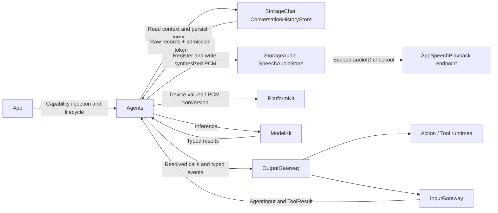
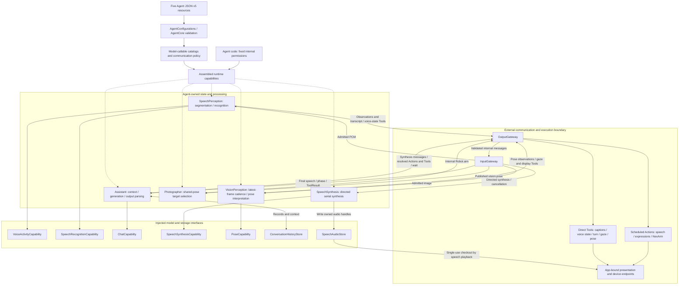
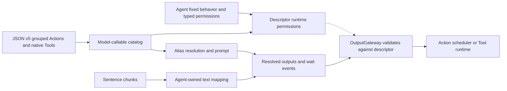

# Agents — Perception and Business Policy

Implements stateful actors that interpret input, request model capabilities and select outputs. The goal is independent roles with explicit permissions and bounded work. Agents depends on AgentCore, ModelKit, PlatformKit, StorageChat and the shared StorageAudio cache; App injects capabilities and binds executable handlers.

## Directory structure

```text
Agents/
├── Core/                     # Independent AgentCore compilation boundary
├── Communication/            # Shared domain messages, schema policy and built-in identities
├── AgentConfigurations.swift  # Load versioned JSON from package resources
├── Assistant/                 # Chat, reply history and resolved speech Actions and UI Tools
├── SpeechPerception/          # VAD, segmentation, ASR and speech observations
├── SpeechSynthesis/           # Directed serial synthesis into shared PCM handles
├── VisionPerception/          # Latest-frame image/pose/cost cadence, pose inference and skeleton ToolCalls
├── Photographer/              # Subscribed pose observations and optional arm aim
└── README.md                  # Shared Agent and configuration rules
```

Each implemented Agent has `<AgentName>.agent.json`, an actor implementation and a README. Helper files remain in that Agent's directory. Shared parsers belong in Agents/Core/Generation. Add JSON resources to root Package.swift; the loader uses Bundle.module, not App bundle lookup.

## Upstream and downstream

Arrows show runtime data flow; Agents never call concrete Actions or Tools. Compile-time dependencies are `AgentCore` (contracts, permissions and parsers), `ModelKit` (capability protocols), `PlatformKit` (device values and caller-selected conversion), `StorageChat` (conversation history) and `StorageAudio` (shared PCM handles). App injects the production services; neither storage service delivers Agent messages.



## Current compilation and ownership

✅ Root Package.swift compiles Core once as the independent AgentCore target with no project dependencies; the Agents target excludes Core. All five business Agent directories, Communication and AgentConfigurations currently compile together in one Agents target. Its dependencies are AgentCore, ModelKit, PlatformKit, StorageChat and StorageAudio. Each actor owns its processing state; the shared target does not enforce per-Agent import isolation.

✅ Model-callable registrations are loaded from each JSON v5 resource. Code owns fixed internal permissions and behavior, capability protocols are injected, and communication/execution requests cross Gateways. AgentCore supplies generic contracts/parsers/registries rather than business messages or native services.

❌ Per-Agent targets and separate speech/vision communication targets are not implemented. Assistant owns request context selection and SpeechSynthesis owns producer errors; Storage retains records and neutral media/cache contracts.

## Internal structure and data flow

Agents combine injected processing capabilities with explicit messages and executable calls. Solid arrows show capability use or runtime flow, not imports. Dashed arrows show validated configuration. Model/storage interfaces are used directly; communication and skill calls cross Gateway. The external subgraph is a boundary, not Agent-owned implementation.



The diagram groups current business paths; runtime control and ActionResult receipts use the same validated boundaries. Assistant requests synthesis by message, not by calling SpeechSynthesisAgent directly. Its audio-ID playback Action is scheduled separately from synthesis. App injects the same PCM store into synthesis and playback; the store is shared data, not a message transport. Model-callable registrations come from JSON; fixed text mapping and internal behavior remain code-owned.

SpeechPerception owns one utterance across ASR segments. Assistant consumes final speech and speech onset, maps generated text through its code-owned text policy and retains bounded durable conversation history. VisionPerception performs one shared pose request per admitted frame and independently publishes pose state and displays skeletons.

Each actor documents its own capacity, overflow, pause, stop and cleanup rules: [Assistant](Assistant/README.md), [SpeechPerception](SpeechPerception/README.md), [SpeechSynthesis](SpeechSynthesis/README.md) and [VisionPerception](VisionPerception/README.md). Audio and discrete work fail on overflow; vision can replace its latest pending frame, observation and display state. Generation completion does not mean playback completion. Stop must close admission and join owned work before a replacement session starts.

## 输入输出文档约定

每个 Agent README 都要按下面四个方向描述当前实现，且以同目录 JSON v5 声明和 Swift 行为为准。JSON 的 `communication.inputs` 表示可接纳的 `contract / version / kind`；`subscriptions` 另限定广播消息的 `source / topic`。声明输入不自动创建订阅。定向消息由 Gateway 校验发送方、目标方和双方权限，不需要目标方订阅。

| 方向 | 数据标准至少写明 | 边界 |
| --- | --- | --- |
| 输入 | 接收方式、contract/version/kind、source/topic 或目标、payload 类型与字段、单位/上限、会话/序号/期限、拒绝条件 | 所有外部输入和 ToolResult 经 InputGateway；注入依赖与生命周期方法须标为非业务输入。 |
| 输出 | `OutputEnvelope` 中 ActionCall、ToolCall、scheduling 或 control 的路径/参数/Channel、触发时机、完成语义和失败行为 | 输出流由 App 送 OutputGateway；调用接纳、Action 完成和最终播放是不同事件。 |
| publish | `communication.publications` 的 contract、typed `AgentMessage` payload、发送时机、消费者、可替换/丢失策略和接纳回执含义 | `AgentMessaging.publish(..., parent:)` 经 OutputGateway → InputGateway 广播；不是 Action/Tool 输出。 |
| send | `communication.sends` 的 contract/target、typed payload 字段、因果与所有权、接纳/取消/超时语义 | `AgentMessaging.send(..., parent:, to:)` 走同一双 Gateway 链路，但只定向一个 Agent。 |

公共 `AgentInput` 包含 `id: UUID`、`sessionID: UUID`、`turn: AgentTurn?` 和 `InputMetadata(contract, version, topic, source, incarnation, capturedAt, sequence, rootID, parentID, hops, deadline)`。publish/send 的端口绑定发送方身份，以 `parent` 继承会话、轮次和因果关系；接收方不能从业务 payload 自行推断授权身份。`DeliveryReport.delivered / rejected` 只表示目标 Agent 的接纳或拒绝，不代表推理、合成、Action 或播放完成。`OutputEnvelope` 含 `source / inputID / sessionID / turn / sequence / output`；它与共享观测消息是两条不同的输出通路。某方向没有声明或实现时，明确写“无”，不要把缓存副作用或本地方法误记为 publish/send。

### 业务输出与系统功能调用边界

Agent 的业务输出仅限于已在 JSON 声明通信权限的消息信号（publish/send），以及已注册的 ActionCall / ToolCall。消息必须通过绑定的 AgentMessaging 端口进入 OutputGateway → InputGateway；ActionCall / ToolCall 必须经 OutputGateway 分发执行。

所有完整的业务功能调用，包括 UI 渲染变动、音量调节、媒体播放和设备控制，都必须取得明确权限，再由 Agent 输出解析完成的调用，经 OutputGateway 执行。模型可调用能力在 JSON 中声明；Agent 固定内部行为通过代码定义的 InternalAction / InternalTool 声明权限，不创建模型 alias。不得通过注入服务、闭包回调、直接调用平台 API 或借用消息处理链路绕过这一边界；接收消息的 Agent 若要执行这些功能，也必须输出已注册的 ActionCall / ToolCall。App 的运行时观察器不能代替 Agent 执行业务展示或设备控制。

Storage、ModelKit 等基础能力不属于这里的完整业务功能：Agent 可以通过注入的能力接口进行模型推理、内部状态与共享缓存管理，无须把这些基础操作包装为 Action / Tool。此例外不允许基础能力接口夹带 UI 变更、音量调节等业务副作用。

`control` 是完成、失败等运行时协议通知，不是额外的业务输出或通用系统功能调用入口；它仍随输出流进入 OutputGateway，不能用于编码业务命令或触发未注册的业务功能。

## Capability configuration v5 — JSON

UTF-8 `<AgentName>.agent.json` is limited to 64 KiB and accepts version 5 only. Top-level fields are required and unknown fields fail. Version and identity are written first for readability; JSON key ordering has no semantic effect.

| Field | Contract |
| --- | --- |
| version | Integer, exactly 5 |
| id | Stable Agent identity, matching its implementation |
| actions | Object mapping Channel names to arrays of model-callable Actions; an empty array declares a Channel without callable Actions |
| tools | OpenAI Chat Completions function declarations |
| communication | Inputs, subscriptions, publications and sends |

```json
{
  "version": 5,
  "id": "example",
  "actions": {
    "Display": [{
      "alias": "express",
      "path": {"module": "UI", "function": "express"},
      "doc": "Perform one expression and restore the current base.",
      "parameters": [{
        "name": "emotion", "valueType": "string", "required": true,
        "description": "Requested expression.", "constraints": "smile"
      }],
      "examples": ["<express emotion=\"smile\"/>"]
    }],
    "Speech": []
  },
  "tools": [{
    "type": "function",
    "function": {
      "name": "runtimeInfo",
      "description": "Read the fixed runtime configuration.",
      "parameters": {"type": "object", "properties": {}, "required": [], "additionalProperties": false},
      "strict": true
    }
  }],
  "communication": {"inputs": [], "subscriptions": [], "publications": [], "sends": []}
}
```

Each Action has exactly `alias`, `path` (`module` and `function`), `doc`, `parameters` and `examples`. The enclosing key supplies its default Channel. A Channel scope may override that default; module identity remains unchanged and controls process-wide mutual exclusion. Aliases must be unique across all Channel groups and Tools in one Agent. `wait` and `channel.*` aliases are reserved. `main` is an ordinary opt-in Channel.

Parameters contain exactly `name`, `valueType`, `required`, `description`, `constraints`. Types are string/integer/number/boolean documentation; XML transport values remain strings and handlers own semantic conversion, limits and defaults. Required/optional name sets are derived, never repeated in JSON. Each Action has 1–8 nonblank XML examples; every example must explicitly demonstrate that Action and resolve only model-callable aliases. Natural text in examples is allowed but does not authorize an internal method.

Tools use `type: function` and nested `function` with `name`, `description`, `parameters`, optional `strict`. The callable name is also the handler registry key; App explicitly binds it. No internal path, alias, hidden flag or example list is added to the OpenAI declaration. The current ToolCall transport supports **string properties only**, optional string descriptions/enums, an object parameter schema with required names and `additionalProperties: false`. Strict mode requires all properties to be required. Unsupported schema features/types fail explicitly; full JSON Schema is unsupported; cloud SSE transport assembles complete Tool calls. The validated definition is retained separately; it is not appended to the XML system prompt.

Limits: at most 128 combined model/internal capability entries, 16 distinct Channels after internal permissions are assembled, 32 parameters per capability, 64-byte identifier names, and 2048-byte Action prose/examples. Configuration errors propagate without `try!`, silent fallback or inferred broad permissions.

## Fixed internal behavior

JSON has no `channels`, `textActions`, `textOutput`, `internal`, `hidden` or per-Action `defaultChannel` fields. Agent code owns fixed business behavior and creates typed `InternalAction` / `InternalTool` permissions without model aliases or documentation:

- Assistant: reply initialization, automatic speech synthesis/audioID playback and captions.
- SpeechPerception: transcript updates/closure and voice-state presentation.
- VisionPerception: gaze targets and skeleton display.
- Photographer: optional `Robot.aim` from a subscribed pose. The model catalog stays empty.
- SpeechSynthesis: directed synthesis/cancellation only; no device-output permission.

These declarations form the descriptor's immutable runtime capability snapshot together with the JSON model catalog. Internal calls are never resolved from model XML or native Tool names. All calls still pass OutputGateway permission validation, Action module exclusion/Channel/wait scheduling or the independent Tool runtime. App retains explicit implementation handlers. Internal permissions are mandatory code policy, not recovery for an invalid JSON resource.

Assistant supplies a bounded text-mapping callback to AgentGenerator. It preserves sentence boundaries and event position, sends synthesis requests, and replaces each speech text call with audioID playback before Gateway admission. Only audioID playback is authorized downstream. Speech retains its default Speech Channel unless a Channel scope overrides it. Captions are immediate Tools without a Channel or wait membership. The system prompt explains automatic audio and wait; it does not disclose internal methods or subtitle mechanics.



## Registration and implementation rules

- JSON is the sole production list of model-callable Actions/Tools and communication permissions. Internal behavior is declared once in Agent code. No reflection, fallback registry or direct platform/UI side effects.
- Communication policy uses trusted input/session/turn identity, bounded inboxes and producer-first cancellation.
- Every interpreted wait boundary is forwarded in order. Internal text expansion does not reset or move group boundaries. Internal device Actions follow the same runtime limits as model Actions.
- CapabilityContextBuilder includes only JSON Actions grouped by Channel. Assistant supplies its code-owned speech policy. Tools remain separate; cloud ChatCapability emits text, complete native Tool calls and completion.
- Storage and ModelKit remain foundational capabilities, not wrappers for unregistered UI/device effects. Control notifications cannot carry business commands.
- New Agents require a real implementation, JSON resource and explicit App capability/handler bindings; configuration errors propagate.

## Admission, scheduling and receipts

Gateways call receive directly; Agent inboxes own pending-message buffering. Ordinary receive validates/admits or rejects promptly without awaiting inference or inbox space. Concurrent calls have no transport FIFO guarantee. Session/source/sequence checks reject stale state; replacement policies are Agent-owned and discrete events are not silently discarded. Lifecycle/control cancellation may join cleanup.

An Agent interpreting wait markup declares OutputKind.scheduling and forwards the complete GenerationEvent sequence through OutputGateway. Speech preparation and substitutions preserve directive order. Assistant's bounded output buffer carries resolved Action/Tool calls and wait edges; native Tools and directed synthesis messages are outside wait membership. Task-local wait does not provide cross-task coordination.

Assistant, SpeechPerception and VisionPerception accept action.result receipts without triggering inference. Startup permission coverage uses the descriptor's model and internal grants; Action kind/completion metadata remains implementation-side.

## Implemented scope and limitations

✅ Assistant, SpeechPerception, SpeechSynthesis, VisionPerception and Photographer implement the declared JSON v5 and code-owned permissions. Core compiles independently as AgentCore; business Agents depend only on AgentCore, ModelKit, PlatformKit, StorageChat and StorageAudio.

Fixed captions, transcript closure, voice phase, gaze and reply-turn initialization use completion-only Tools. UI.express is a scheduled finite model-callable Action; UI.setExpression is a scheduled state Action. Assistant's durable journal is shared across voice sessions; archive-title generation is metadata-only and cannot dispatch behavior.

❌ Configuration hot reload, full executable value schemas, local native Tool deltas, general request/reply, result-driven replanning and activity subscriptions are not implemented.

See [Assistant.agent.json](Assistant/Assistant.agent.json) for the production configuration. Per-Agent limits and processing algorithms belong to their own READMEs.

✅ Photographer subscribes to vision.pose and emits internal Robot.aim with a bounded output stream. Camera lifecycle enables this Agent; physical tracking acceptance remains outstanding.

✅ Photographer validates decoded pose before target selection; malformed values fail without indexing joints. Its eight-call output bound rejects excess calls without stopping the actor and retains previously accepted calls for normal stream consumption.

✅ VisionPerception retains independent visualization when an optional subscriber rejects an observation. Photographer command failures remain scoped to its output consumer; Gateway authorization is not bypassed.

✅ Every production producer uses publishResult/sendResult: delivery failure affects only dependent work. App output consumers use OutputGateway.execute to retain execution failures rather than terminating another Agent. Startup configuration errors and explicit cancellation retain their existing validation/cleanup semantics.

✅ Output overflow rejects only the current unaccepted aim; Photographer remains running and queued accepted calls are retained.

✅ Business Agents own their domain values and output payloads. VisionPerception builds PoseOverlayPayload; AgentCore retains generic runtime contracts. This does not allow UI/service imports or bypass OutputGateway.

✅ Communication/AgentContracts.swift owns built-in application Agent names as AgentID extensions. Core defines only the raw identity type. Shared pose and speech message values belong to Communication/SpeechValues.swift and PoseObservation.swift; output syntax stays Core-owned while speech policy stays Assistant-owned.

✅ Shared application messages and registry metadata are grouped in Communication/AgentContracts.swift. Core exposes generic messages/schema registration only. Generic media inputs are grouped in AgentCore/Input; host input adapters supply device sources/deadlines. No per-domain file or compatibility alias remains under Core.

✅ Capability callers own SDK data adaptation: VisionPerception converts retained CameraFrame to ModelKit ImageFrame; SpeechPerception selects/resamples native-rate transport to ModelKit PCM; SpeechSynthesis converts model PCM into StorageAudio values. App injects capabilities and transports inputs, without injecting model input conversion closures. ❌ No model-specific tensor preprocessing is moved out of ModelKit adapters.

✅ ADR0121 removes the Types module: AgentCore/Input owns generic audio/image transport, UI/Camera owns PoseOverlay, and VisionPerception owns PoseOverlayPayload. App adapts the independent Tool payload into UI values. ❌ Capability SDKs must not import consumer or presentation modules.

✅ SpeechPerception additionally estimates the single dominant direction of any obvious sound in its listening interval and publishes sound.source. Its deterministic estimator is separate from ASR/VAD, and Communication owns the immutable observation. ❌ Source identity, multiple-source separation and Photographer audio-driven movement are unimplemented.

✅ ADR0131: generic Core observations transport producer execution descriptions without Bluetooth classification; business Agent result/session policies are unchanged. ❌ Physical device failure acceptance remains pending.

✅ ADR0139: Photographer exposes monotonic usable-pose freshness as a read-only host signal; source silence releases the App writer after one second. Assistant priority over Photographer is host resource policy, not Agent-to-Agent cancellation or a model-callable permission.

✅ Assistant JSON declares read-only History.list/read. Aliases resolve inside Agents and execution/results cross both Gateways. ❌ Tool feedback does not yet resume model reasoning.
