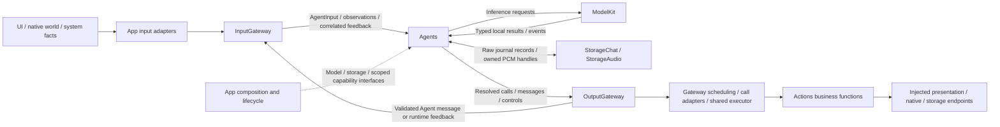
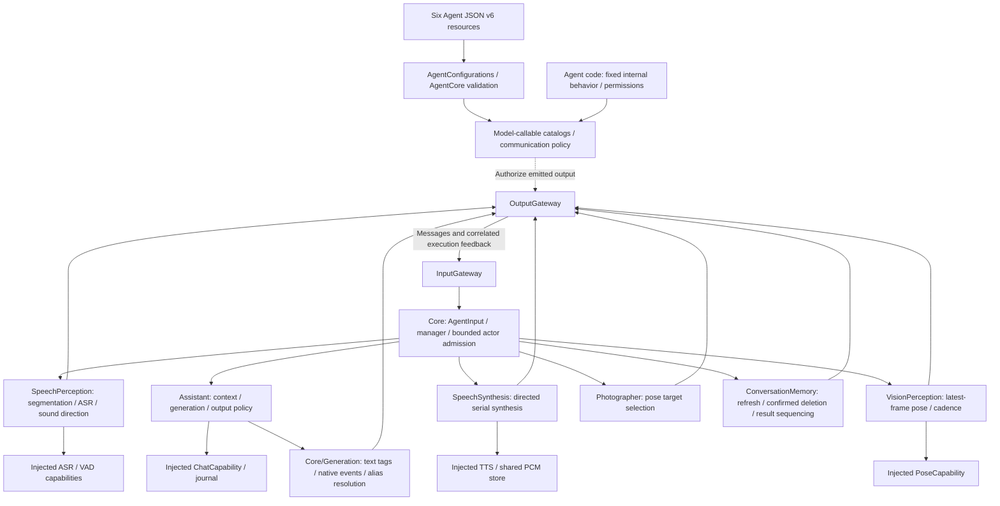
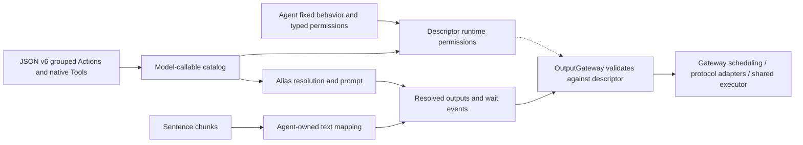

# Agents — Signal Processing and Business Decisions

Agents interpret admitted Signals, own task state and business decisions, use injected model/storage capabilities and emit permitted communication or execution requests. Explicit user intent can be handled deterministically; LLM selection is another entry into the same registered business capabilities.

Design goals: independent AgentCore, domain-owned processing policy, explicit grants, bounded inbox/output state and effects through OutputGateway rather than direct UI/device mutation.

## Upstream and downstream

Arrows show runtime information/capability flow; dashed arrows show injection. Capability results stay local unless the Agent explicitly communicates them as Signals.



SignalOrigin distinguishes external, Agent and runtime producers within the same AgentInput envelope; trusted adapters/ports bind it rather than deriving authority from payload content.

Agents does not import concrete Actions, Gateway, UI or execution SDKs. The target depends on AgentCore, ModelKit, PlatformKit, StorageChat and StorageAudio. Perception callers adapt SDK media values; this does not grant permission to perform unregistered device effects.

## Internal structure

The diagram shows Agent roles and their capability use. All role-to-role communication is routed through the Gateway nodes; arrows are runtime flow rather than compile dependencies.



Each implemented Agent has an actor, README and `<AgentName>.agent.json`. Add configuration resources to root Package.swift; AgentConfigurations loads Bundle.module rather than searching the App bundle.

Core compiles independently with no project dependencies and contains no concrete Agent, model or device adapter. Communication owns shared speech/pose schemas and built-in Agent identities. Each business Agent directory owns its actor, JSON and processing contract; all six currently share the Agents target.

Model-callable Actions appear in prompt/context by Channel; native declarations enter the provider request's tools parameter. Text action tags resolve to ActionCall and native events resolve to ToolCall inside Agents. Natural text follows Agent policy; it is not inherently an ActionCall. Both call protocols ultimately invoke the same protocol-neutral function implementation.

## Design principles and core mechanisms

**Agent-driven does not mean every step calls an LLM.** ConversationMemory performs deterministic intent/result sequencing; Assistant uses model generation. Both own task policy and emit permitted calls through OutputGateway. Basic model inference and internal storage access stay local capability calls; complete UI/device business effects cannot hide inside injected callbacks.

**State is owned by an actor and scoped to an incarnation/session.** Registration binds a live identity. Stop invalidates that identity before joining cleanup, and replacement requires a new instance. AgentManager owns registration/lifecycle, while each Agent owns its worker, inbox and generation state; there is no generic Agent-owned factory/restart supervisor.

| Kind of information | Handling principle |
| --- | --- |
| Explicit intent / discrete command | Validate and admit or reject; never silently replace accepted work |
| Declared latest-state observation | Agent-specific bounded replacement/coalescing; freshness checked before use |
| Local inference/cache result | Stays local unless explicitly published or sent |
| Execution feedback | Check owner/session and call/execution correlation before changing task state |

**Interpretation stays inside Agents.** Core/Generation provides shared parsing; each Agent supplies its text policy and resolves its aliases. JSON v6 is the sole model-callable catalog and communication declaration, while fixed internal behavior/grants are code-owned. Host registration supplies implementations but cannot infer broader Agent permissions. Admission receipts mean acceptance, not completed reasoning or effects.

Result-driven sequencing is implemented for selected deterministic history flows. General LLM continuation after ToolResult remains pending; receipt consumption must not be described as automatic replanning.

## 输入输出文档约定

每个 Agent README 都要按下面四个方向描述当前实现，且以同目录 JSON v6 声明和 Swift 行为为准。JSON 的 `communication.inputs` 表示可接纳的 `contract / version / kind`；`subscriptions` 另限定广播消息的 `source / topic`。声明输入不自动创建订阅。定向消息由 Gateway 校验发送方、目标方和双方权限，不需要目标方订阅。

| 方向 | 数据标准至少写明 | 边界 |
| --- | --- | --- |
| 输入 | 接收方式、contract/version/kind、source/topic 或目标、payload 类型与字段、单位/上限、会话/序号/期限、拒绝条件 | 所有外部输入和 ToolResult 经 InputGateway；注入依赖与生命周期方法须标为非业务输入。 |
| 输出 | `OutputEnvelope` 中 ActionCall、ToolCall、scheduling 或 control 的路径/参数/Channel、触发时机、完成语义和失败行为 | 输出流由 App 送 OutputGateway；调用接纳、Action 完成和最终播放是不同事件。 |
| publish | `communication.publications` 的 contract、typed `AgentMessage` payload、发送时机、消费者、可替换/丢失策略和接纳回执含义 | `AgentMessaging.publish(..., parent:)` 经 OutputGateway → InputGateway 广播；不是 Action/Tool 输出。 |
| send | `communication.sends` 的 contract/target、typed payload 字段、因果与所有权、接纳/取消/超时语义 | `AgentMessaging.send(..., parent:, to:)` 走同一双 Gateway 链路，但只定向一个 Agent。 |

公共 `AgentInput` 包含 `id: UUID`、`sessionID: UUID`、`turn: AgentTurn?` 和 `InputMetadata(origin, contract, version, topic, source, incarnation, capturedAt, sequence, rootID, parentID, hops, deadline)`。publish/send 的端口绑定发送方身份，以 `parent` 继承会话、轮次和因果关系；接收方不能从业务 payload 自行推断授权身份。`DeliveryReport.delivered / rejected` 只表示目标 Agent 的接纳或拒绝，不代表推理、合成、Action 或播放完成。`OutputEnvelope` 含 `source / inputID / sessionID / turn / sequence / output`；它与共享观测消息是两条不同的输出通路。某方向没有声明或实现时，明确写“无”，不要把缓存副作用或本地方法误记为 publish/send。

### 业务输出与系统功能调用边界

Agent 的业务输出仅限于已在 JSON 声明通信权限的消息信号（publish/send），以及已注册的 ActionCall / ToolCall。消息必须通过绑定的 AgentMessaging 端口进入 OutputGateway → InputGateway；ActionCall / ToolCall 必须经 OutputGateway 分发执行。

所有完整的业务功能调用，包括 UI 渲染变动、音量调节、媒体播放和设备控制，都必须取得明确权限，再由 Agent 输出解析完成的调用，经 OutputGateway 执行。模型可调用能力在 JSON 中声明；Agent 固定内部行为通过代码定义的 InternalAction / InternalTool 声明权限，不创建模型 alias。不得通过注入服务、闭包回调、直接调用平台 API 或借用消息处理链路绕过这一边界；接收消息的 Agent 若要执行这些功能，也必须输出已注册的 ActionCall / ToolCall。App 的运行时观察器不能代替 Agent 执行业务展示或设备控制。

Storage、ModelKit 等基础能力不属于这里的完整业务功能：Agent 可以通过注入的能力接口进行模型推理、内部状态与共享缓存管理，无须把这些基础操作包装为 Action / Tool。此例外不允许基础能力接口夹带 UI 变更、音量调节等业务副作用。

`control` 是完成、失败等运行时协议通知，不是额外的业务输出或通用系统功能调用入口；它仍随输出流进入 OutputGateway，不能用于编码业务命令或触发未注册的业务功能。

## Capability configuration v6 — JSON

UTF-8 `<AgentName>.agent.json` is limited to 64 KiB and accepts version 6 only. Top-level fields are required and unknown fields fail. Version and identity are written first for readability; JSON key ordering has no semantic effect.

| Field | Contract |
| --- | --- |
| version | Integer, exactly 6 |
| id | Stable Agent identity, matching its implementation |
| actions | Object mapping Channel names to arrays of model-callable Actions; an empty array declares a Channel without callable Actions |
| tools | Explicit three-field path plus nested OpenAI Chat Completions function definition |
| communication | Inputs, subscriptions, publications and sends |

```json
{
  "version": 6,
  "id": "example",
  "actions": {
    "Display": [{
      "alias": "express",
      "path": {"domain": "UI", "module": "Expression", "function": "express"},
      "doc": "Perform one expression and restore the current base.",
      "parameters": [{
        "name": "emotion", "valueType": "string", "required": true,
        "description": "Requested expression.", "constraints": "smile"
      }],
      "examples": ["<express emotion=\"smile\"/>"]
    }],
    "Speech": []
  },
  "tools": [{
    "path": {"domain": "System", "module": "Runtime", "function": "runtimeInfo"},
    "definition": {
    "type": "function",
    "function": {
      "name": "runtimeInfo",
      "description": "Read the fixed runtime configuration.",
      "parameters": {"type": "object", "properties": {}, "required": [], "additionalProperties": false},
      "strict": true
    }
    }
  }],
  "communication": {"inputs": [], "subscriptions": [], "publications": [], "sends": []}
}
```

Each Action has exactly `alias`, `path` (`domain`, `module` and `function`), `doc`, `parameters` and `examples`. The enclosing key supplies its default Channel. A Channel scope may override that default; the resolved address remains unchanged; definition-owned serialization keys control process-wide exclusion. Aliases must be unique across all Channel groups and Tools in one Agent. `wait` and `channel.*` aliases are reserved. `main` is an ordinary opt-in Channel.

Parameters contain exactly `name`, `valueType`, `required`, `description`, `constraints`. Types are string/integer/number/boolean documentation; XML transport values remain strings and handlers own semantic conversion, limits and defaults. Required/optional name sets are derived, never repeated in JSON. Each Action has 1–8 nonblank XML examples; every example must explicitly demonstrate that Action and resolve only model-callable aliases. Natural text in examples is allowed but does not authorize an internal method.

Tools use `type: function` and nested `function` with `name`, `description`, `parameters`, optional `strict`. Each tools entry contains exactly path (domain/module/function) and definition (the native declaration). The callable name is the Agent-local alias; the canonical address is the handler registry key. Only definition is passed to the model provider; path is never added to the native declaration. The current ToolCall transport supports **string properties only**, optional string descriptions/enums, an object parameter schema with required names and `additionalProperties: false`. Strict mode requires all properties to be required. Unsupported schema features/types fail explicitly; full JSON Schema is unsupported; cloud SSE transport assembles complete Tool calls. The validated definition is retained separately; it is not appended to the XML system prompt.

Limits: at most 128 combined model/internal capability entries, 16 distinct Channels after internal permissions are assembled, 32 parameters per capability, 64-byte identifier names, and 2048-byte Action prose/examples. Configuration errors propagate without `try!`, silent fallback or inferred broad permissions.

## Fixed internal behavior

JSON has no `channels`, `textActions`, `textOutput`, `internal`, `hidden` or per-Action `defaultChannel` fields. Agent code owns fixed business behavior and creates typed `InternalAction` / `InternalTool` permissions without model aliases or documentation:

- ConversationMemory: deterministic history refresh and confirmed-delete sequencing with correlated results and history presentation.
- Assistant: reply initialization, automatic speech synthesis/audioID playback and captions.
- SpeechPerception: transcript updates/closure and voice-state presentation.
- VisionPerception: gaze targets and skeleton display.
- Photographer: optional `NexArm.Tracking.aim` from a subscribed pose. The model catalog stays empty.
- SpeechSynthesis: directed synthesis/cancellation only; no device-output permission.

These declarations form the descriptor's immutable runtime capability snapshot together with the JSON model catalog. Internal calls are never resolved from model XML or native Tool names. All calls still pass OutputGateway permission validation, Action module exclusion/Channel/wait scheduling or the Gateway call adapter and shared function executor. App retains explicit implementation handlers. Internal permissions are mandatory code policy, not recovery for an invalid JSON resource.

Assistant supplies a bounded text-mapping callback to AgentGenerator. It preserves sentence boundaries and event position, sends synthesis requests, and replaces each speech text call with audioID playback before Gateway admission. Only audioID playback is authorized downstream. Speech retains its default Speech Channel unless a Channel scope overrides it. Captions are immediate Tools without a Channel or wait membership. The system prompt explains automatic audio and wait; it does not disclose internal methods or subtitle mechanics.



## Registration and implementation rules

- JSON is the sole production list of model-callable Actions/Tools and communication permissions. Internal behavior is declared once in Agent code. No reflection, fallback registry or direct platform/UI side effects.
- Communication policy uses trusted input/session/turn identity, bounded inboxes and producer-first cancellation.
- Every interpreted wait boundary is forwarded in order. Internal text expansion does not reset or move group boundaries. Internal device Actions follow the same runtime limits as model Actions.
- CapabilityContextBuilder includes only JSON Actions grouped by Channel. Assistant supplies its code-owned speech policy. Tools remain separate; cloud ChatCapability emits text, complete native Tool calls and completion.
- Storage and ModelKit remain foundational capabilities, not wrappers for unregistered UI/device effects. Control notifications cannot carry business commands.
- New Agents require a real implementation, JSON resource and explicit App capability/handler bindings; configuration errors propagate.

## Admission, scheduling and receipts

Gateways call receive directly; Agent inboxes own pending-message buffering. Ordinary receive validates/admits or rejects promptly without awaiting inference or inbox space. Concurrent calls have no transport FIFO guarantee. Session/source/sequence checks reject stale state; replacement policies are Agent-owned and discrete events are not silently discarded. Lifecycle/control cancellation may join cleanup.

An Agent interpreting wait markup declares OutputKind.scheduling and forwards the complete GenerationEvent sequence through OutputGateway. Speech preparation and substitutions preserve directive order. Assistant's bounded output buffer carries resolved Action/Tool calls and wait edges; native Tools and directed synthesis messages are outside wait membership. Task-local wait does not provide cross-task coordination.

Assistant, SpeechPerception and VisionPerception accept action.result receipts without triggering inference. Startup permission coverage uses the descriptor's model and internal grants; Action kind/completion metadata remains implementation-side.

## Implementation status

✅ Six implemented roles: ConversationMemory, Assistant, SpeechPerception, SpeechSynthesis, VisionPerception and Photographer. Shared parsers stay in Core/Generation; domain values stay outside Core. JSON v6 and code-owned internal grants are independent from host implementation bindings.

✅ Shared Signal provenance, bound publish/send, owner-fenced returning feedback and deterministic history refresh/delete continuation. Vision uses explicit latest-state replacement; discrete outputs reject overflow. Synthesis and playback share PCM data without using Storage as message transport.

❌ Full typed intent/control migration, remaining settings/device business routes, complete Action/activity causality and bounded model continuation are outstanding. Assistant currently displays Tool feedback without starting another LLM reasoning turn. Per-Agent target isolation, configuration hot reload, generic request/reply and activity subscriptions are not implemented.

Detailed capacities/cleanup and real-device limitations: [Core](Core/README.md), [Communication](Communication/README.md), [ConversationMemory](ConversationMemory/README.md), [Assistant](Assistant/README.md), [SpeechPerception](SpeechPerception/README.md), [SpeechSynthesis](SpeechSynthesis/README.md), [VisionPerception](VisionPerception/README.md) and [Photographer](Photographer/README.md). Architecture: [Overall technical design](../README.md).

✅ ADR0163: ConversationMemory consumes typed history.intent/1 from the domain catalog; execution feedback carries explicit SignalCausality. Remaining legacy host events and business workflow migration are separate stages.
