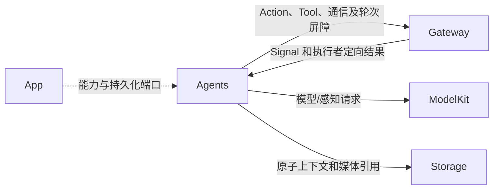
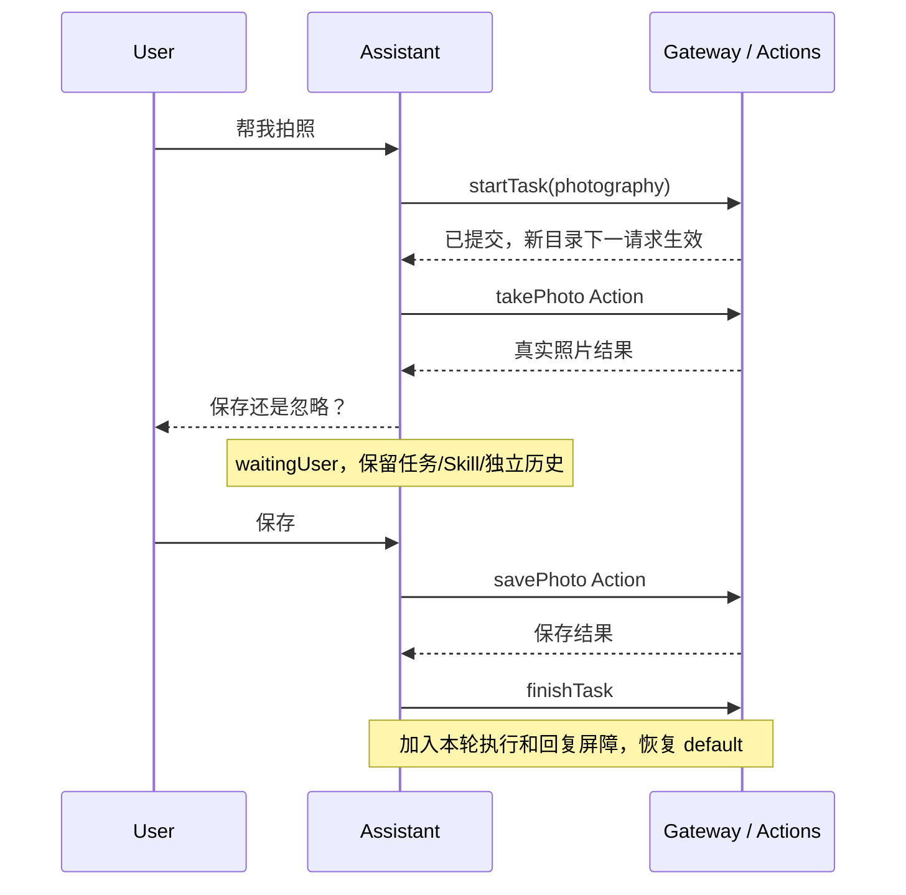
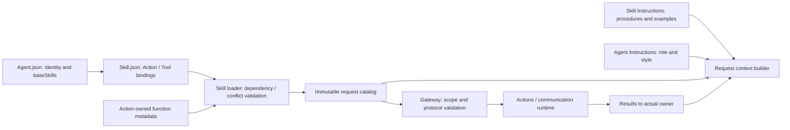

# Agents — Assistant、Skills 与业务执行

## 职责与边界

✅ Assistant 是唯一普通对话 Agent，动态组合 Skill 和一个前台目标任务。Photographer 管确定性摄影/追踪，Memory 管历史/标题事务，ApplicationControl 管配置/设备/环境；语音和视觉 Agent 保持独立流式生命周期。所有输入为 Signal，业务输出为 Action；ReACT 消费真实结果，不是向自己广播。

Agents 依赖 AgentCore、ModelKit、PlatformKit、Storage/Chat/Audio 和中立 FunctionContracts；不依赖具体 Actions、Gateway 或 UI。App 注入能力及端口；Gateway 校验身份、输入/通信权限和执行目录；Actions 实现函数。

## 上下游与数据流

Photographer 自己产生的追踪调用仍回 Photographer；Assistant 摄影 Action 的结果回 Assistant。send 仅用于独立确定性后台任务，投递接纳和任务完成不同；publish 单向，接收错误不反馈发送者。

## 内部结构

| 目录 | 职责 |
| --- | --- |
| [../Resources](../Resources/README.md) | v7 Agent 权限、v1 Skills 与显式 catalog；配置/指令无编译代码 |
| Support/Core | Foundation-only AgentCore，身份、Signal、权限、队列、轮次和 Context 契约 |
| Support | 纯资源加载与不可变 Skill/函数目录组装 |
| Support/Communication | 业务 Signal 和任务通信 Schema |
| Support/Chat | 组合式 Chat worker、快照目录、提示词、原生协议、ReACT 与证据 |
| Support/Context | Task/Skill 结构化状态、固定任务协调与原子持久化 |
| 七角色目录 | Actor/生命周期、Processing（状态、预处理、Builder）及本角色策略/固定流程 |

## 开发契约

每个角色明确输入/输出权限、队列/替换策略、Context Schema、Builder、调用/任务状态、容量、取消、失败与恢复。模型函数由已加载 Skill 决定，无额外权限上限。Skill 只能引用 Actions 参数契约；send 仅 Action，同路径不能同时注册 Action/Tool。函数可被多角色复用。

Skill 加载验证依赖、canonical 函数、别名、Channel 后整体提交；最多 16 Skill、8 层依赖。一个前台任务，不自动挂起。请求冻结任务身份/Skill/函数目录，切换只作用后续请求。每次用户决策链不设固定模型轮数或累计原生调用上限；按真实结果继续、完成或取消，重复同一失败且无进展则返回实际错误。单轮执行/传输仍有界，模型上下文淘汰最早完整调用组。模型等待用户不计入执行时间。

## 历史与可视化

唯一持久化事实源是角色 Context。Assistant 默认对话和任务选择独立历史；每请求记录任务目标、执行类型、Skill revision、taskID 和目录 JSON。固定执行者仅持久化事务和任务状态；重启标记中断且不重放。UI 展示 Assistant 聊天记录与任务记录，首页只有有界 Task/Skill 投影和 Action/Task/Agent 日志。

✅ 资源、动态授权、Assistant 任务与 ReACT、确定性角色和历史/UI 投影已接入。❌ 真机摄影、语音竞争、模式切换及历史展示仍需验收。详细实现见各目录 README。

## 泛化 Task 与独立 Skill

✅ 泛化 Task 与独立 Skill 已接入：任意目标、单前台任务，基础/交互链/任务 Skill 作用域；后台复用 send，不抢占前台。详见所属 Agents 与公共机制设计。
### 公共任务控制契约

startTask 的 goal 为必填；skills 为可选 JSON ID 数组，execution 缺省 foreground。后台还需要 target、businessContract、payload，校验目标声明后通过通信 Action/send 提交。一个前台任务；最多 16 个非终态后台任务，Registry 保留 256 条记录。投递确认、取消确认和最终结果严格区分。父任务结束不自动取消后台工作。后台消息不触发前台推理、抢占或播放。生产后台契约暂未声明，公共路径由合成执行者验证。

Skill 所有权分为 base、decision、task。默认决策链结束释放临时能力；startTask 转移同链加载的能力并原子添加指定 Skill；任务等待用户保持能力。任务结束经过执行/回复清理恢复基础能力。不提供任务栈。v1 状态迁至 v2 时中断未结束任务，旧 mode 只保留在历史 TaskRecord/请求证据中。

✅ Resource-path contract: pure Agent and Skill assets move to MobileHarness/Resources/{Agents,Skills} with Catalog.json. Agents retains loading and policy ownership. Package sources remain limited to Agents; explicit copies exclude unrelated app/model assets. Bundle catalog lookup establishes the runtime root without repeating Resources. Regression covers flat and Resources-containing Bundle lookup plus missing catalog failure; final packaging checks compare indexed asset bytes. Device acceptance is recorded separately.

✅ Source organization audit (2026-10-11): No new directories/modules. Move resource loading/catalog composition to Support root, task/Skill structured state and fixed-task lifecycle to Context. Canonical resource directories and filenames become UpperCamelCase while IDs keep existing contracts.

## Skill 函数目录：取消资源权限上限

✅ 已删除 Permissions.json 和 Agent.json 的 permissions 字段。Agent.json 不声明函数；基础和动态模型函数完全由已加载 Skill 组合，不再与 Agent 权限上限求交。保留 canonical 元数据、重复/冲突、容量、通信授权、真实执行身份和任务范围校验。Gateway 对有轮次快照的调用使用该快照，对无模型轮次的固定调用使用 Agent 固定目录。App 对所有 Skill 目录检查真实实现覆盖，不把全局 Skill 合并成权限白名单。后台 Skill 校验仍要求目标业务契约支持，但不再校验 Permissions。历史快照不重写。

✅ ADR0213: shared FunctionTokenPrompts guidance describes task-local Channel/wait ordering, independent same-name Channels across tasks and explicit resource conflict/takeover outcomes. Canonical addresses do not create queues; prompt text grants no execution authority.

## Agent → Skill → Function registration

✅ Implemented: Agent.json references baseSkills; Skill.json alone registers model Actions/Tools. BasicSkill owns task orchestration and environment reading; ExpressionInteraction owns expression Actions. Role instructions retain identity/responsibility/style. Business roles reuse existing Skills; internal trusted bindings remain separate. Historical snapshots are preserved.

## Agent request failure continuation

✅ 已实现：AgentChatWorker 在同一决策链内携带上一轮 HTTP/provider 或解析异常重试，加入已接纳执行的结果而不重放副作用。Core 预算和 Gateway 屏障继续生效，未恢复或不能确认结果时才进入终态失败。

## Lifecycle-owned conversation and audio (2026-10-12)

✅ 已移除对话生成、ReACT、收件箱排队、结果屏障、ASR 收尾、TTS 合成及回复占用租约的计时终止。Signal 默认无过期时间，框架不再按通信契约附加 TTL。保留显式实时感知数据的新鲜度和网络传输自身超时；它们不作为对话/语音缓存生命周期。Action 自身超时通过原始执行者的 ActionResult 返回。请求/调用数及队列/PCM 容量仍有界，不以计时自动删除已接纳输入。语音句柄无读等待或错误记录 TTL，按播放完成、输入/会话正常结束、异常或显式取消清理；取消加入生成和播放工作。

## Result-driven ReACT (ADR0214)

✅ ADR0214：模型决策按实际业务输出/失败继续，取消角色与宿主注入的反馈策略。Core 统一解释结果；Worker 保留原生配对、请求快照、Task 收尾、取消和已有错误重试。

✅ Implemented: explicit host session cancellation emits agent.cancelled for the original active/queued input and captured round identity after joining the cancelled model; this terminates its output transport and effects without fabricating failure or cancelling other sessions.

✅ Shared Chat removes fixed four-round/16-native decision limits and uses result-driven completion/cancellation. Per-round counters reset, continuation context retains a bounded recent window, complete native pairs and current user intent. Duplicate failed recovery terminates with its original error.

✅ 2026-10-13 已实现：ReACT 业务输出仅为显式 value（含空字符串），成功执行报告和活动句柄仅保留完成证据；失败报告仍由错误判定触发续轮，既有 Agent 异常恢复不变。详见 [总体设计](../README.md#react-continuation-and-agent-recovery)。

## 历史记录收敛（2026-10-13）

✅ 已实现：历史记录页面仅保留 Assistant 聊天记录与任务记录。Assistant context 是聊天持久化事实源，任务按持久化身份关联；页面板块重新设计另行开展。

❌ 历史记录页面板块重新设计及原生 UI/真机验收。

✅ Implemented (2026-10-13 Skill scope review): canonical Actions unify trusted business calls and model calls; Skill exposure is optional and must serve an actual procedure. ExpressionInteraction retains two expression functions; Feedback/Notice/Light model exposure is removed while implementations and business bindings remain. ApplicationControl keeps navigation/status/resource/Bluetooth operations, removing duplicate robot functions; RobotInteraction owns them. BasicSkill removes unused send while production background contracts are absent. Affected instructions/revisions and explicit communication-only test catalogs are aligned; all six Skills were audited for prerequisites, result handling and cross-Skill references.

## Streaming TTS latency

✅ Shared Chat owns first-segment speech policy (20 Han / 60 other Characters, subsequent 60/120); Generation keeps generic segmentation state. Directed synthesis, identities, FIFO and rejection bounds stay unchanged.
